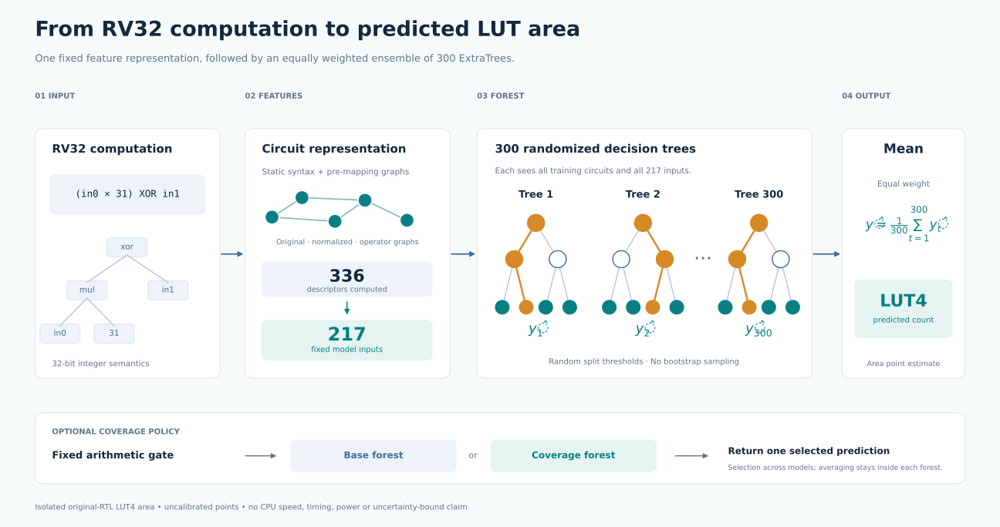
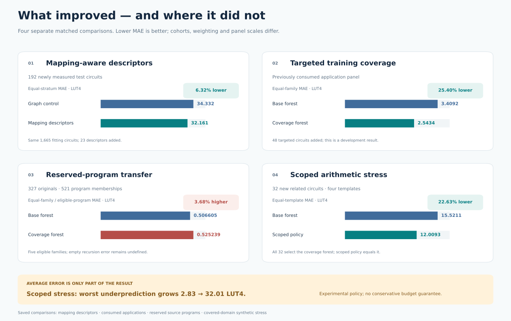

# ISAForge

**Learning the hardware cost of RISC-V custom instructions.**

We want to help a CPU designer choose useful instruction extensions within a hardware budget. ISAForge extracts small RV32 computations, verifies their RTL, and trains a model to predict their **iCE40 LUT4 count** before full technology mapping. The research question is whether better circuit representations and targeted training examples improve those estimates enough to support instruction selection.

[Model](docs/model.md) · [Benchmarks and metrics](docs/benchmarks.md) · [Results](results/README.md) · [Reproduce](docs/reproduce.md)

## Our ML model

The predictor is a **300-tree ExtraTrees regressor using 217 circuit features**. It combines original and normalized circuit graphs, a simple operator graph, and mapping-related descriptors. Each tree predicts area; the forest averages its predictions.



The **base model** uses 1,665 measured training circuits. A **coverage model** adds 48 arithmetic examples. An experimental **scoped policy** chooses the coverage model for fixed arithmetic structures and the base model elsewhere. The base model remains the default. [Model details and weights](docs/model.md).

## What we benchmark against

**Ground truth is measured hardware:** verified original RTL synthesized with Yosys for iCE40. We compare our predictions with that circuit's measured LUT4 count, then compare models on identical circuits and labels.

| Predictor | MAE ↓, LUT4 | Positive-target MAPE ↓ |
| --- | ---: | ---: |
| **ISAForge base model** | **32.16** | **43.63%** |
| Dual-graph control | 34.33 | 49.37% |
| Tuned simple-operator-graph model | 46.34 | 75.63% |
| MasterRTL recipe adaptation | 61.47 | 85.67% |

This matched test contains **192 synthetic circuits**, with the same 1,665 fitting circuits for these models. Our baseline adapts [MasterRTL's representation and method](https://arxiv.org/html/2311.08441v1) to FPGA LUT prediction; these are our measured results, not the paper's original ASIC results.

**MAPE = 100 × mean(|predicted LUTs − measured LUTs| / measured LUTs).** It uses the 186 positive-area circuits in this test. The six zero-area circuits remain in MAE and are reported separately. Predicting 12 LUTs for a 10-LUT circuit gives 20% error; predicting 3 for a 1-LUT circuit gives 200%. This is why we report both MAPE and absolute error. [Benchmark definitions](docs/benchmarks.md).

## How the model improved



These are separate experiments, not one learning curve. Targeted coverage helped arithmetic cases, but did not improve the primary application-transfer metric. The scoped policy reduced MAE **22.63%** on 32 new related circuits; its worst underprediction increased **2.83 → 32.01 LUT4**, so it remains experimental. [Complete compact results](results/README.md).

## Run it

```sh
git clone --branch latest https://github.com/jas0nriverah/agentic-riscv-codesign.git
cd agentic-riscv-codesign
python3.13 -m venv .venv
source .venv/bin/activate
pip install -e '.[dev,reports]' -r requirements-research.txt
make reproduce
make predict
```

These commands recompute the saved scores and run real pretrained-model inference from cached features. No FPGA tools or retraining are needed. `make test` checks the retained implementation; `make figures` regenerates the diagrams.

| Directory | Contents |
| --- | --- |
| `models/` | Base and coverage forests, metadata and hashes |
| `results/` | Three curated benchmarks, all observations and replayable scores |
| `isaforge/` | Feature extraction, prediction, verification and synthesis code |
| `scripts/` | Prediction, score replay and figure generation |
| `src/`, `hardware/`, `benchmarks/` | Workload extraction and processor-integration components |

This branch presents the current research snapshot. Full protocols, raw measurements, failed experiments and historical implementations remain in the [preserved research archive](https://github.com/jas0nriverah/agentic-riscv-codesign/tree/b64716a2b94b332fdbced677869620bb949c073d). Current ML results concern isolated area; improved CPU speed, power and learned instruction selection remain separate research questions.
