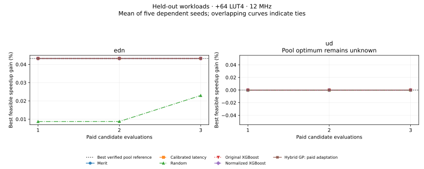

# ISAForge

**An AI-guided RISC-V program optimization system that selects custom instructions using learned performance predictions and bounded hardware measurements.**

**Working research prototype:** five executed Embench workloads, **27 verified candidate speedup labels**, 32 fully measured processor designs, and 96 routing results. A new prospective EDN/UD experiment compares ten selection policies over 900 budget/constraint/seed endpoints, with predictions committed before measurements. All 30 automatic candidate attempts are preserved, including two correctness failures and one infrastructure failure. The older six-candidate CRC32 study remains intact.

```sh
# Python 3.12; install the pinned replay environment first.
python -m pip install -r requirements-speedup.txt
make campaign-report PYTHON=python
# Open generated/reproduction/budget-campaign-report/results.md.
# candidates.csv and policy-endpoints.csv contain the measured comparison.
```

This command verifies preserved raw evidence, exactly refits the frozen predictions, and builds the report without new hardware jobs. [The campaign guide](docs/budget-campaign.md) explains the experiment. **ML has not beaten the strongest heuristics.** Normalizing measured cycle savings fixes the original regressor's UD selection miss at the predeclared +128-LUT4 limit, but only matches merit. At the primary +64-LUT4 limit, EDN improves by 1.000432× and every policy retains the UD baseline: its four verified candidates cost +65 to +72 LUT4. UD's final hardware outcome remains unknown after an infrastructure failure, so its reference is the best verified design, not an exhaustive oracle.



Two held-out source workloads, six attempted candidates each, five dependent seed repetitions. Overlapping curves indicate ties. [Campaign evidence](results/2026-10-20-budget-campaign/README.md) and the [expanded consumed dataset](results/2026-10-21-expanded-corpus/README.md) retain labels, failures, costs and provenance. [Final validation](results/2026-10-21-budget-final-validation/README.md): 2,780 tests and 179 subtests pass; one unchanged legacy process-cleanup test fails. The earlier [SLRE report and SQLite demo](docs/prospective-slre.md) still reproduce with `make demo`; that frozen database covers the earlier three workloads.

This README is the current project scope contract. It follows the [original project proposal](docs/original-project-proposal.txt) and the project owner's October 19, 2026 clarification. Contributors and coding agents must read it before choosing new work. [AGENTS.md](AGENTS.md) defines the engineering and evaluation guardrails.

## Research objective

Given a supported real RISC-V workload, ISAForge should automatically discover legal custom-instruction opportunities, predict their performance benefit and hardware cost, and select worthwhile instructions under area, timing, and evaluation budgets. The selected instructions must execute correctly in the modified program and integrated processor.

The research question is: **Can ML-guided and LLM-agent-guided instruction selection find better whole-program performance–area decisions with fewer expensive hardware evaluations than frequency, merit, random selection, and non-agent active learning?**

The contribution being tested is **measurement-efficient, uncertainty-aware RISC-V custom-instruction selection using learned predictions and an AI agent, validated against actual processor performance and hardware constraints**. The endpoint is the best verified feasible whole-program performance found for a given evaluation count **and actual evaluation time**, with regret against the measured pool oracle where available.

An agent or learned model losing to merit is a valid research result. Success requires a working, reproducible comparison; it does not require a favorable headline.

## Established research we build upon

Dataflow legality, bounded inputs/outputs, convex candidate identification, latency-based merit, synthesis-aware selection, and constrained Bayesian optimization have established precedents. We reuse those methods; we are not proposing a new enumerator or RTL-generation framework. The [primary-method review](docs/research-foundation.md) records Atasu (DAC 2003), Sun (TCAD 2004 and the separately reviewed ICCAD 2002 paper), CIDRE (ICCAD 2025), Hussein et al. (TACO 2026), LACE (2026), Gardner et al. (ICML 2014), and relevant performance/ranking/cost-aware methods, including exact references, assumptions, feasibility, and access gaps.

Four requested papers' methods were read. The exact Sun 2004 and Hussein 2026 full methods remain inaccessible and are explicitly pending. The [October 20 review](docs/selection-methods-review.md) adds primary methods from AutoTVM, SMAC, RGPE, Ithemal, covariate-shift conformal prediction, and integrated arbitration-cost research. The EDN/UD campaign adds calibrated latency, a hardware-cost heuristic, and constrained/cost-aware GP acquisition. These are adaptations, not complete reproductions of the cited systems; two new workloads do not establish broad superiority or calibrated uncertainty. No novelty claim is made.

## Intended system

```text
Supported workload and inputs
  → compatible compilation and execution profile
  → legal candidate extraction and executable lowering
  → measured whole-program cycles, correctness, area, and timing
  → XGBoost speedup prediction/ranking and uncertainty estimates
  → bounded selection: heuristics, active learning, or LLM agent
  → jointly implemented and measured instruction set
  → optimized software/hardware and a baseline-versus-optimized report
```

The LLM agent is an **instruction-selection agent**. Its bounded interface should let it list candidates, query predictions and uncertainty, request measurements, and choose a feasible set. It does not rewrite or optimize RTL. Deterministic RTL generation, verification, synthesis, and routing implement and measure the selected instructions.

## Current engineering scope

- Real integer Embench workloads with fixed, recorded inputs. The proposal's initial programs are CRC32, aha-mont64, edn, huffbench, matmult-int, nettle-aes, nettle-sha256, and wikisort; support is conditional on compilation, memory fit, and correctness.
- The working processor target is pinned **PicoRV32**, using **RV32I plus supported counter reads**, ILP32, and PCPI. CRC32 and aha-mont64 use GCC `-O2`; SLRE, EDN and UD use `-Os` in separately recorded contexts. Software helpers implement unsupported multiply operations and UD's original double arithmetic. Compiler, simulator, and synthesized processor must agree on the ISA.
- Automatically discovered patterns contain two to four connected integer operations, at most two register inputs and one output, and no memory or control-flow operations inside the instruction. Lowering removes original instructions and reassembles labels. New source-provenance checks reject symbolic relocations before future pool selection: replacing a linked address with a literal can invalidate it and remove the referenced object. This guard does not retroactively change frozen pools.
- The SoC has 8 KiB synchronous RAM. Stack reservations are explicitly recorded: original contexts 4 KiB; SLRE 3,840 bytes; EDN 1,408 bytes; UD 896 bytes. New contexts use continuous partition checks and deliberate overflow controls; all original evidence stays unchanged. Designs are measured at a common 12 MHz target and routed with seeds 1, 2, and 3 on iCE40 HX8K CT256. These checks cover recorded inputs, not arbitrary-input memory safety.
- The final system should select one to three compatible instructions under a hardware budget, with an unmodified baseline always available. Selected combinations require joint execution and synthesis; individual speedups and area increments are not additive.

PicoRV32/RV32I is the current feasible implementation of the proposal's objective. The proposal's RV32IM, Spike-extension, and VexRiscv integration choices are not additional integration requirements for this milestone. Arbitrary RISC-V binaries are outside the initial support contract.

## What works and what remains

| Capability | Current evidence or remaining work |
| --- | --- |
| Six-candidate CRC32 experiment | Complete and preserved. Real program cycles, correctness, integrated area, three routing seeds, and equal-budget policy replay. Best single candidate reduces cycles 4.84%. Merit beats learned acquisition at the reported three-measurement budget. |
| Automatic second-workload pipeline | Complete for six `aha-mont64` candidates: automatic profiling/extraction/lowering, correctness, execution, integrated synthesis/routing, and 120 policy replays. Best cycle reduction **8.60%**, +42 LUT4. Merit finds the pool optimum in one measurement in all five seeds. [Results and replay](docs/automatic-workloads.md). |
| Automatic CRC32 / historical training data | CRC32 was reprofiled, automatically lowered, and remeasured in a new RV32I context. Twelve automatic outcomes share compatible feature provenance across CRC32 and aha-mont64; six older CRC32 adapter outcomes remain historical evidence. This earlier comparison has two workload groups; the new SLRE context is listed below. [Development results](docs/selection-pilot-results.md). |
| Automatic third workload / prospective transfer | **SLRE complete:** six candidates from 16 eligible formulas, seven integrated designs, 21 routes, and 105 policy/budget/seed outcomes. Best 16,333,432 → 16,221,562 cycles (**1.006896×**, +77 LUT4). Upstream self-check and every hardware control pass. Combined automatic evidence now covers **18 candidates across three workloads**, with the compiler/partition shift explicitly recorded. [Results](docs/prospective-slre.md). |
| Five-workload corpus / second prospective campaign | **EDN and UD complete as one-attempt campaigns:** 12 attempted candidates, nine new verified labels, two correctness failures and one infrastructure-censored result. Total automatic evidence: 27 labels / 32 measured designs / 96 routes across five workloads. Ten policies, three area caps, three budgets, five seeds: 900 endpoints. [Results and commands](docs/budget-campaign.md). |
| Speedup regression and acquisition | Raw-speedup and normalized-cycle-savings bootstrap XGBoost, pairwise ranking, and zero-shot/paid-adaptation constrained GP policies are measured against heuristics. Normalization improves the original regressor's UD choice at +128 LUT4 but does not beat merit. The GP predicts integrated hardware cost, timing and measurement duration for selection; historical isolated-LUT studies remain separate. |
| Held-out-workload evaluation | SLRE predictions used 12 older outcomes. EDN/UD predictions were jointly committed before either target's measurements, using the same 18 historical outcomes and 15 fitting rows per target after family exclusions. Exact refits, source hashes and receipt chronology are checked. Compiler/partition shifts remain explicit; repeated seeds are not independent workload tests. |
| Ranking and uncertainty | Fixed XGBoost pairwise ranking is implemented and compared in 420 consumed-data policy/budget/seed outcomes. It does not improve selection over regression or merit. Ensemble interval coverage is poor on aha-mont64; held-out calibration remains missing. |
| Execution-aware features and baseline | A separate 222-case processor calibration exactly explains all 27 successful automatic cycle deltas. No latency residual model is justified yet. Normalized XGBoost lowers mean speedup MAE by 98.43% on EDN and 91.00% on UD versus the original regression; uncertainty coverage remains below its nominal level and worsens on UD. The earlier SLRE regression failures remain preserved. |
| Data and reproducibility | The new consumed JSON corpus contains 27 consistent measured rows, three separate failed attempts and five contexts, linked to authenticated raw archives. CSV comparison tables and a figure reproduce with `make campaign-report`. The frozen three-workload SQLite demo remains available with `make demo`. Analysis artifacts stay outside selector access. |
| Additional workload eligibility | All earlier failures remain preserved. Seven more qualification failures and three static linker diagnostics explain the EDN/UD partition choices, SHA256's memory limitation, and statemate's one-formula pool. A source-relocation guard addresses the newly demonstrated lowering failure before future pools are frozen. |
| LLM selection agent | Required later milestone; not implemented or evaluated yet. It must share candidate information and measurement budgets with non-agent methods. |
| Joint final instruction set | Fixed historical CRC32 pair experiments exist. Automatic selection, lowering, and measurement of compatible sets of one to three instructions remain to be connected. |

The small CRC32 study and historical LUT-prediction studies are not the finished project. [Current handoff](docs/HANDOFF.md) tracks the next blocker. [Historical checkpoints](README-research-history.md) retain earlier results without defining current priorities.

## Priority order and milestone acceptance

1. **Preserve the five-workload milestone.** Keep original CRC32, both prelabel checkpoints, all raw outcomes and failures, and every heuristic win or tie. EDN/UD are now consumed data. An infrastructure-censored attempt must never become an invented speedup label or a claim of hardware infeasibility.
2. **Make future extraction relocation-safe, then expand independent decisions.** Connect the tested source guard before the existing pool stratifier, bind its source in a fresh protocol, and add independent workload/input pools where feasible designs genuinely differ. Keep the calibrated latency comparator; its exact cycle predictions make more unconstrained speedup models a weak next experiment.
3. **Evaluate learned selection.** Train XGBoost regression and ranking on measured outcomes; hold out entire workloads and related candidate families. Evaluate uncertainty calibration and non-agent active learning. Add hardware-cost prediction only when real measurements support it and it helps selection.
4. **Connect the LLM selection agent.** Use a bounded, auditable tool interface and the same public features, training data, constraints, and target measurement budget as the baselines. Record model/provider settings, prompts, decisions, repeated seeds, and inference cost.
5. **Validate the final implementation.** Implement compatible selected sets together. Report baseline/optimized execution, correctness, integrated area, timing, evaluation count/cost, and regret against the fully measured manageable-pool oracle.

Each milestone must include its working command, tests, measured outcomes, limitations, preserved negative results, and next blocker. Complete these connections before starting more model versions or new infrastructure.

## Evaluation rules

- **Primary outcome:** best verified feasible whole-program runtime/speedup as a function of expensive evaluations, with performance–area tradeoffs reported separately.
- **Comparators:** frequency, instruction-saving merit, strong architecture/latency/timing-aware merit, seeded random, non-agent uncertainty/constrained acquisition, LLM selection agent, and exhaustive oracle on the same manageable pool. Pair lookahead joins set selection once joint lowering works. Report unimplemented methods as missing.
- **Fair information and costs:** hold pools, training data, area/timing limits, and budgets constant. Only queried target labels reach a selector. Charge failed attempts; distinguish cached/replayed observations from fresh evaluations. Report historical training-label counts/time, baseline/profiling setup, target measurements/time, and inference cost separately, with total and amortized costs rather than treating training as free.
- **Timing:** at a common feasible clock, speedup is baseline cycles divided by optimized cycles. If periods differ, use `baseline_cycles × baseline_period / (optimized_cycles × optimized_period)`. Report all routing seeds and timing feasibility.
- **Labels:** instruction savings, isolated datapath cost, simulated whole-program cycles, routed timing estimates, and physical-board measurements are different quantities. Do not relabel one as another.
- **Generalization:** hold out entire workloads/source families; detect duplicates and related candidates. Freeze protocols and predictions before examining held-out labels. Test sets used for revisions become development data.
- **Set selection:** account for overlapping occurrences, register dependencies, encoding compatibility, and shared hardware. Measure selected combinations together instead of summing individual speedups.

## Outside the current project

RTL-rewriting optimization agents, GNN development, multi-agent frameworks, unrelated model architectures, arbitrary RISC-V support, and power/energy claims without measurements are outside scope. Further isolated LUT-prediction studies are deferred unless they directly address a demonstrated final-selection failure. Historical code and results remain available for reproduction; their old roadmaps do not authorize new work.

## Run and reproduce

From a source checkout:

```sh
git submodule update --init --recursive
python3 -m venv .venv
. .venv/bin/activate
python -m pip install -e '.[dev,reports,proofs]'
# For exact October 19 processor-policy replay, use Python 3.12 and:
python -m pip install -r requirements-speedup.txt
make test
python scripts/reproduce_codesign.py replay
python scripts/reproduce_workload.py replay
```

Each processor replay verifies seven preserved designs and 120 policy/seed/budget outcomes without new native measurements. The [recorded replay dependencies](requirements-speedup.txt) are separate from historical model-version requirements. Automatic collection needs recorded RISC-V GCC, Verilator, Yosys, nextpnr, and a prepared pinned evaluator context:

```sh
python -m isaforge.workload_experiment prepare \
  --reference-root generated/codesign-crc32-2026-10-19-r1 \
  --root generated/automatic-aha-new --workload aha-mont64 --pool-size 6
python -m isaforge.workload_experiment discover --root generated/automatic-aha-new
python -m isaforge.workload_experiment collect --root generated/automatic-aha-new
python -m isaforge.workload_selection --root generated/automatic-aha-new
```

Use a fresh output directory for a fresh protocol. Resume completed measurements only after evidence hashes are verified. [Automatic-workload instructions](docs/automatic-workloads.md) cover setup and portable replay. [CRC32 commands](docs/codesign-loop.md) cover reference preparation. `make reproduce` remains a regression check for the historical six-model cost comparison; it is not the primary project experiment.

[Agent instructions](AGENTS.md) · [Contribution rules](CONTRIBUTING.md) · [Documentation](docs/README.md) · [Frozen evidence](results/README.md) · [Original proposal](docs/original-project-proposal.txt)
