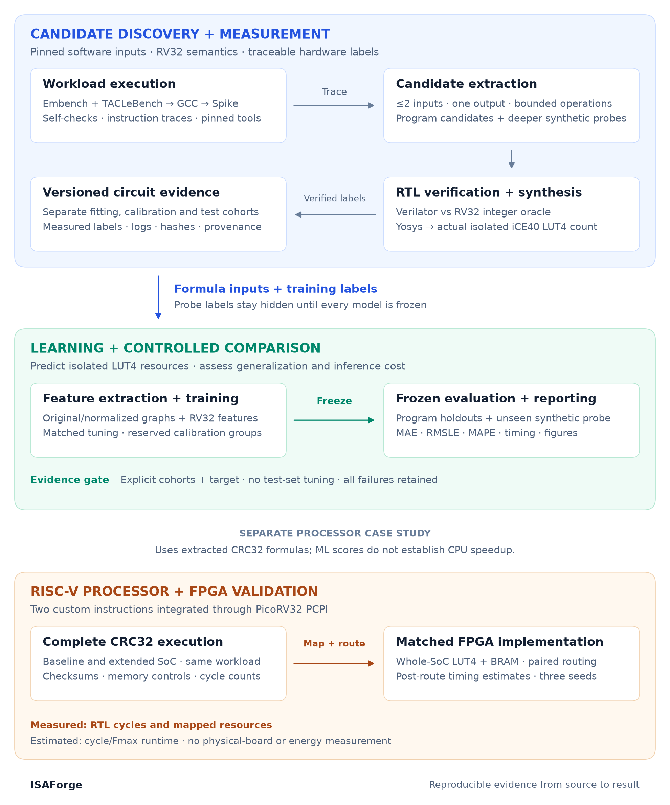
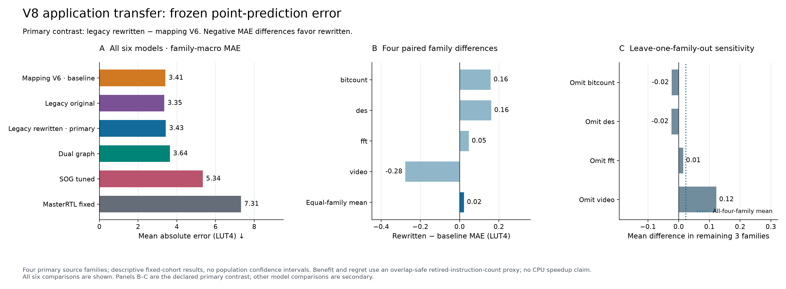
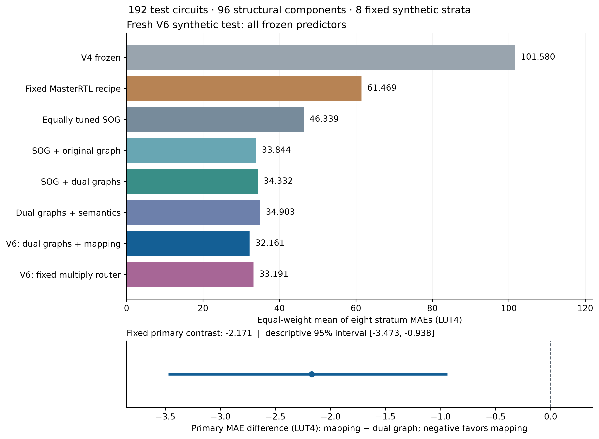
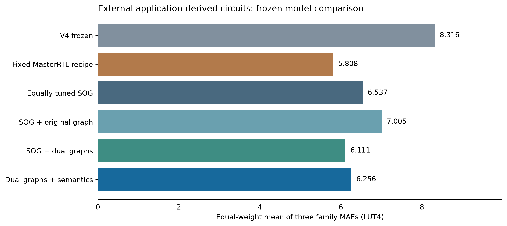
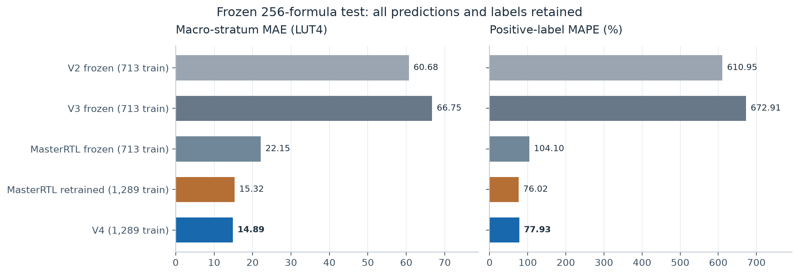
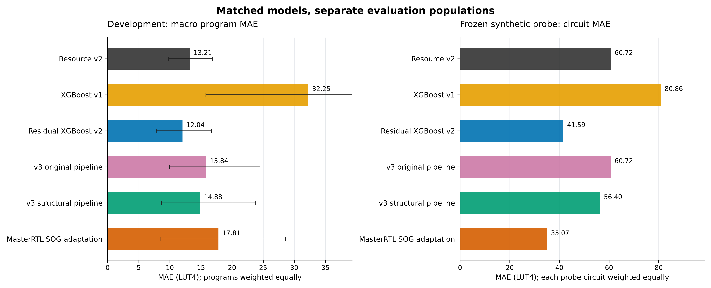

# ISAForge

**Measured RISC-V custom-instruction research: candidate discovery, learned hardware cost, and processor validation.**

ISAForge explores whether machine learning can help choose useful RISC-V instruction extensions with fewer expensive hardware measurements. It extracts small computations from real programs, verifies their RTL, learns their FPGA resource cost, and evaluates the resulting estimates under controlled data splits. A separate PicoRV32 experiment checks what two CRC32 extensions actually do to processor cycles and FPGA resources.

The current learned target is **isolated iCE40 LUT4 count**. Processor speedup is evaluated separately through RTL simulation and routing. This is a research prototype with reproducible measured evidence; an LLM-driven selector remains future work.

[Methodology](docs/methodology.md) · [V9 development](docs/v9-adaptation-results.md) · [V8 application results](docs/v8-application-results.md) · [V6 results](docs/v6-results.md) · [External transfer](docs/external-v5-results.md) · [All results](docs/results.md) · [Documentation](docs/README.md) · [Evidence index](results/README.md)

## System architecture



The diagram is an editable vector asset; regenerate it with `make diagram`. [Editable SVG](docs/assets/architecture.svg).

## Research methodology

1. **Collect real workloads.** Compile pinned Embench programs for RISC-V, verify their self-checks, and trace execution with Spike. Extract bounded computation graphs with at most two inputs and one output.
2. **Measure verified circuits.** Generate RV32 RTL, compare Verilator outputs against an integer oracle, and synthesize with Yosys. Preserve formulas, labels, tool versions, logs, and hashes.
3. **Train comparable predictors.** Deduplicate formulas and exclude held-out formulas from training. Compare formula-derived features with a MasterRTL-inspired pre-ABC graph pipeline on identical LUT4 labels.
4. **Freeze before testing.** Fix models and predictions before releasing fresh probe labels. Report all declared circuit groups, true-zero errors, large failures, inference costs, and paired uncertainty estimates.
5. **Validate processor effects separately.** Integrate two extracted CRC32 formulas through PicoRV32 PCPI; check full-workload execution, whole-SoC resources, and paired FPGA routing.

The [methodology](docs/methodology.md) defines the data splits, feature boundary, primary endpoint, and limits of each measurement. Protocols and negative findings are retained alongside successful runs.

## Results at a glance

### Latest development: measured-example correction

A fixed local residual correction uses three previously measured examples per family and improves MAE on the remaining circuits **3.3450 → 3.2800 LUT4 (1.94%)**. A global offset worsens error. This is development on consumed V8 data; the changing unqueried pools and tiny FFT denominator are explicit. The hardest constant-multiply misses remain unchanged because the queried examples provide no local forest support. [Results, publication figure and independent replay](docs/v9-adaptation-results.md).

A [tree-level coverage audit](docs/v9-training-coverage-direction.md) identifies missing constant-product compositions in the original training data. A fixed 48-circuit augmentation is being prepared to test that bottleneck with the existing learner and features.

### Complete application-pool transfer

Six frozen models predicted **146 original circuits across 152 application rows** before fresh synthesis. The primary panel covers four families and 150 rows; related-source isqrt is secondary. All circuits passed **313,608 RTL comparisons**, with zero synthesis failures.

| Frozen predictor | Primary family-macro MAE, LUT4 |
| :--- | ---: |
| Legacy original336, secondary control | **3.3509** |
| V6 mapping, primary incumbent | 3.4092 |
| Legacy rewritten336, primary challenger | 3.4319 |
| Frozen dual graph | 3.6382 |
| Frozen tuned SOG | 5.3395 |
| Frozen MasterRTL recipe adaptation | 7.3124 |

**The rewritten model did not improve the primary prediction metric:** its difference is +0.0227 LUT4 (+0.67%). Development gains did not transfer across all four families. At the 64-LUT cap with one measurement per program, both new models find an oracle-best instruction—but **merit alone does too**, so a learned-selection advantage is not established. These are instruction-count proxies, not new CPU speedups.



[Complete results, failure analysis and reproduction](docs/v8-application-results.md) retain all models, original zeros, novelty limits and policy outcomes. Run `make reproduce-v8` to authenticate raw evidence and regenerate scores and publication figures without training or synthesis. [Next research direction](docs/research-update-2026-10-15.md).

### New development study: proved semantic rewrites

A fixed **90-fit** ablation on the original 1,665 fitting circuits tests six feature views across three paired seeds. New bit and affine descriptors lower development macro MAE **4.9351 → 4.8601 LUT4 (1.52%)**, but worsen MAPE and error tails slightly. The best observed view applies the proved rewrite before the existing semantic descriptors: **4.7384 LUT4 (3.99% below baseline)**. These are development scores on consumed folds, with a newly detected cross-fold equivalence; they do not replace the independent V6 test below. Neither new correlated-bit pattern occurs in training. [All controls, correctness evidence and limitations](docs/v7-development-results.md).

### V6 mapping features on fresh structural families

V6 adds 23 generic-graph mapping descriptors to the previous dual-graph model, keeping the same **1,665 fitting circuits, 300-tree estimator settings and seed**. Models and predictions were frozen before measuring a separate 192-case calibration cohort and **192 test circuits in 96 structural families**. All 384 circuits passed verification and synthesis: **824,832 sampled/boundary RTL comparisons**, with no failed or replaced cases.

| Frozen predictor | Test MAE, LUT4 |
| :--- | ---: |
| **V6 mapping** | **32.161** |
| V6 fixed multiply router, secondary | 33.191 |
| SOG + original graph | 33.844 |
| SOG + dual graphs, primary control | 34.332 |
| Dual graphs + semantics | 34.903 |
| Equally tuned SOG | 46.339 |
| Fixed MasterRTL recipe | 61.469 |
| V4, unchanged | 101.580 |

The preregistered comparison improves equal-stratum MAE **6.32%**, with paired difference **−2.171 LUT4** and a descriptive 95% component interval **[−3.473, −0.938]**. Six of eight strata improve. Multiplication still has large failures: the two worst cases contribute 26.95% of total absolute error. Mapping's positive MAPE is **43.63%** over 186 targets; all six zero targets remain in MAE. Scores across different experiment cohorts are not directly comparable.



Fresh bounds cover **92.71% of candidates but 88.54% of complete families**, below the nominal 90% at the family unit. At a 64-LUT cap, mapping's point predictor falsely accepts six infeasible cases versus the control's three. Lower MAE has not established a better selection policy. [Complete results and failure analysis](docs/v6-results.md) retain all eight predictors, strata, caps and outliers. [Run inference or replay](docs/v6-reproduction.md) with `make reproduce-v6`.

### External application transfer

The six frozen models now predict **79 unique circuits from three TACLeBench programs**, retaining all **80 program/formula occurrences** and equal family weights. Predictions were committed before measurements; all circuits pass **169,692 RTL comparisons**, with no synthesis failures.

| Frozen predictor | External family-macro MAE, LUT4 |
| :--- | ---: |
| Fixed MasterRTL recipe | **5.808** |
| SOG + dual graphs | 6.111 |
| Full V5: dual graphs + semantics | 6.256 |
| Equally tuned SOG | 6.537 |
| SOG + original graph | 7.005 |
| V4, unchanged | 8.316 |

Full V5 improves its preregistered comparator by **4.31%**, but the fixed MasterRTL adaptation wins this primary metric. The much larger synthetic gain does not transfer at the same scale. Full V5's positive MAPE is **3.13%** over 61 positive targets; 19 zero targets remain in MAE. These are different distributions from published ASIC and FPGA studies.



All five Dijkstra formulas are familiar under our novelty rule. Strict novelty leaves 20 rows from only ADPCM and anagram, so a three-family novel score is unavailable. Full V5's upper bounds cover 95% of candidates but only one of three complete families. [Results, failure analysis and reproduction](docs/external-v5-results.md) include all predictors, overlap, bounds and the portable raw-evidence archive. Run `make reproduce-external-v5` to replay scores and vector figures.

<details>
<summary>Previous V5 matched synthetic feature comparison</summary>

### V5 matched synthetic feature comparison

V5 adds original and normalized graph channels, stronger range/output-demand features, structural group splits, and held-out calibration. All four V5 views use **1,665 fitting circuits**, identical folds and six estimator configurations; **392 separate circuits** calibrate upper bounds. Models and all predictions were committed before measuring **256 fresh circuits**, split equally between familiar families and unseen compositions.

| Frozen predictor | Known-family MAE, LUT4 | Unseen-composition MAE, LUT4 |
| :--- | ---: | ---: |
| V4, unchanged | 17.92 | 92.58 |
| Fixed MasterRTL recipe, matched fitting rows | 16.24 | 72.23 |
| Equally tuned original SOG | 13.56 | 52.91 |
| SOG + original graph | 4.12 | **18.77** |
| SOG + original/normalized graphs | **3.44** | 19.13 |
| Full V5: dual graphs + semantics | 3.58 | 21.69 |

The preregistered full-V5 comparison reduces unseen-composition MAE **59.01% against equally tuned SOG**. Its descriptive paired cluster interval for the difference is **[−72.75, −2.11] LUT4**. The aggregate gain comes entirely from multiplication; across the other seven strata, full V5 is slightly worse (10.87 versus 10.72 LUT4). The simpler original-graph view has the lowest observed primary MAE: added semantic features did not improve this test. The primary endpoint remains the full V5 comparison.

There are only **19 unseen structural clusters**, and five strata have one cluster each, so the conditional interval cannot establish broad population superiority. Nominal 90% upper bounds cover only **63.16% of whole unseen clusters**; they are not reliable safety guarantees under this shift. Full V5's positive MAPE is 22.86% on known families and 13.28% on unseen compositions. These are different curated distributions from the historical tests and published ASIC/FPGA studies.


All 256 original circuits passed RTL checks and synthesis; no failures or outliers were removed. See [V5 results](docs/v5-results.md), the [frozen protocol](docs/v5-protocol.md), [reproduction guide](docs/v5-reproduction.md), and [literature-informed next steps](docs/research-direction-v5.md). Run `make reproduce-v5` to regenerate scores and vector figures.

</details>

<details>
<summary>Historical model comparisons: V4 and the original six-model study</summary>

### Historical V4: separate 256-circuit holdout


V4 combines RV32 algebraic normalization, sparse multiplier features, and pre-ABC graph topology with a 300-tree ExtraTrees regressor selected using development-only grouped validation. It trains on **1,289 circuits**: the earlier 713 workload circuits, the now-development 192-circuit probe, and 384 newly verified/synthesized development circuits. Models and all predictions were committed before measuring the new **256-circuit test**.

| Predictor | Training circuits | MAE, LUT4 | RMSLE | Positive MAPE | Median percentage error |
| :--- | ---: | ---: | ---: | ---: | ---: |
| **V4** | 1,289 | **14.89** | 0.572 | 77.93% | **1.36%** |
| MasterRTL adaptation, same-data retrain | 1,289 | 15.32 | **0.460** | **76.02%** | 5.55% |
| MasterRTL adaptation, frozen earlier fit | 713 | 22.15 | 0.536 | 104.10% | 11.51% |
| Residual XGBoost v2, frozen | 713 | 60.68 | 0.901 | 610.95% | 24.82% |
| Structural v3, frozen | 713 | 66.75 | 0.902 | 672.91% | 21.62% |

V4 reduces MAE **75.46% versus the previous residual model** on this same test. The additional training data contributes to that improvement. Against the same-data MasterRTL retrain, the MAE difference is only −0.43 LUT4, with a descriptive paired 95% interval **[−5.52, 5.59]**: broad superiority is not established. V4 improves seven of eight stratum MAEs and makes 11 rather than 19 feasibility mistakes at a 64-LUT cap, but loses on multiplication, RMSLE, and zero-target error. One zero-LUT circuit is predicted at 556.21 LUTs; all failures remain in the scores. MAPE uses 235 positive targets; all 21 zero targets remain in MAE/RMSLE.



The [V4 results and reproduction guide](docs/v4-results.md) includes the fixed protocol, semantic checks, independent audit, inference commands, and remaining failures. These are synthetic isolated-circuit results, not a new CPU-speedup or instruction-selection result.

### Historical six-model comparison: 192 circuits

All six models below train on **713 unique formulas** and predict the same **192 unseen synthetic circuits**, balanced across eight predeclared groups. Every circuit is synthesized and passes sampled/boundary RTL checks: **412,416 comparisons** in total. Lower error is better.

| Frozen predictor | MAE, LUT4 | RMSLE | Positive-label MAPE |
| :--- | ---: | ---: | ---: |
| **MasterRTL SOG adaptation** | **35.07** | **0.494** | **36.50%** |
| Residual XGBoost v2 | 41.59 | 0.808 | 320.14% |
| Structural v3 | 56.40 | 0.839 | 478.13% |
| Resource regression v2 | 60.72 | 0.930 | 514.20% |
| Original-feature v3 | 60.72 | 0.930 | 514.20% |
| Initial XGBoost architecture, retrained | 80.86 | 1.239 | 165.81% |

MAPE uses all 181 positive targets; the 11 zero targets remain in MAE and RMSLE. The large percentage errors reflect real missed simplifications on tiny circuits and are retained. Original-feature v3 selected the resource-regression configuration, so those predictions coincide.



**The MasterRTL adaptation has the lowest observed probe MAE; our structural revision did not win.** Its paired MAE advantage over residual v2 is 6.52 LUT4, with a descriptive 95% interval of −4.89 to 18.04, which includes zero. Against structural v3, the advantage is 21.33 LUT4, interval 2.88 to 40.58. These intervals condition on the eight curated circuit groups.

MasterRTL processes all 192 formulas in **7.431 s with a fresh graph cache** and **0.205 s median with cached graphs**; structural v3 takes **0.047 s warm**. The graph method has an additional preprocessing cost. This is a matched adaptation of a published recipe to our FPGA target, not replication of its ASIC benchmark.

</details>

### Processor and earlier workload experiments

| Experiment | Recorded result | Interpretation |
| :--- | :--- | :--- |
| Embench collection | 19 programs pass self-checks; 1,098 program/formula rows, 713 unique formulas | Two programs have no eligible candidates; 17 supply model data |
| Earlier prospective workload test | Resource model MAE 23.15 vs initial model 87.59 LUT4 on 331 novel formulas | Separate experiment using models frozen on 301 training formulas |
| Budgeted instruction selection | V1 and residual v2 lose to merit on first transfer; resource v2 ties. All point models tie merit on the final primary endpoint | No established selection advantage |
| Full CRC32 SoC | 32,387,382 → 29,602,102 simulated cycles (**−8.60%**) | Two custom instructions, complete workload and correctness checks |
| Whole-SoC mapping | 1,633 → 1,704 LUT4 (**+4.35%**); 20 BRAMs in both | Includes on-chip memory and integration overhead |
| Matched routing | Six runs pass 12 MHz; paired cycle/Fmax ratios **1.022×–1.140×** | Timing-model estimates across three seeds; no physical-board measurement |

See [results and interpretation](docs/results.md) for sources, per-group behavior, uncertainty, and remaining research questions.

## Reproduce the comparison

Use **Python 3.13** for the exact research replay environment. The general package also supports Python 3.11, but some frozen numerical versions require a newer interpreter. Replay uses committed predictions and needs no RISC-V or FPGA tools. Install the [recorded numerical-library versions](docs/reproduce-matched-comparison.md#runtime-requirements-and-cache) for exact artifact compatibility.

```sh
git clone https://github.com/jas0nriverah/agentic-riscv-codesign.git
cd agentic-riscv-codesign
git checkout codex/isaforge-ml-foundation
python3.13 -m venv .venv
source .venv/bin/activate
python -m pip install -e '.[dev,reports]' -r requirements-research.txt
make reproduce
make reproduce-v4
make reproduce-v5
make reproduce-external-v5
make reproduce-v6
make reproduce-v8
```

These commands validate their respective frozen experiments and regenerate scores and vector PDF/SVG plus PNG figures under `generated/reproduction/`. External and V6 replay also restore and hash retained raw synthesis artifacts, and check the reviewed freezes against Git history. They do not retrain models or synthesize new circuits.

```sh
make test                         # Python suite; hardware checks run when tools exist
make help                         # Research and hardware entry points
python scripts/reproduce_matched.py --skip-figures  # Scores + audit only
```

On macOS, XGBoost may require `brew install libomp`. Hardware regeneration additionally requires the pinned GCC, Spike, Yosys, Verilator, and nextpnr tools described in the [toolchain](docs/toolchain.md) and [full research reproduction guide](docs/reproduce-research.md).

### Run actual frozen-model inference

This example predicts from formula inputs with the previous residual model; it does not need Yosys:

```sh
python -m isaforge.frozen_inference \
  --kind v2 \
  --model results/2026-10-13-v3/models/area-model-v2-full.joblib \
  --candidates results/2026-10-13-v3/probe/candidates.json \
  --output generated/inference/residual-v2.json
```

For the latest models, use the [V6 inference guide](docs/v6-reproduction.md) and optional [descriptor cache](docs/v6-cached-inference.md). The [V5 command](docs/v5-reproduction.md#feature-extraction-and-portable-cache-replay) and [V4 command](docs/v4-results.md#run-frozen-v4-inference) remain available. Graph models require retained feature caches or their compatible frozen Yosys tool; the older formula-only models remain available when that dependency is unsuitable. The [six-model inference guide](docs/reproduce-matched-comparison.md#run-all-six-frozen-predictors-then-score) covers earlier artifacts. Large graph caches remain outside Git. Raw target-measurement archives are included in the external and V6 snapshots and serve a different purpose from feature caches.

## Repository map

| Path | Purpose |
| :--- | :--- |
| [`isaforge/`](isaforge/) | Prediction, evaluation, synthesis, verification, and processor experiment modules |
| [`src/`](src/) | Benchmark collection, instruction tracing, candidate extraction, and bare-metal startup |
| [`hardware/`](hardware/) | PicoRV32 integration RTL, firmware, simulation harnesses, and hardware methodology |
| [`benchmarks/`](benchmarks/) | Pinned Embench submodule and platform hooks |
| [`results/`](results/README.md) | Immutable experiment snapshots: data, models, predictions, protocols, and provenance |
| [`docs/`](docs/README.md) | Methodology, results, reproduction guides, protocol records, diagrams, and figures |
| [`scripts/`](scripts/README.md) | Short entry points for result replay and architecture-diagram generation |
| [`tests/`](tests/) | Unit, evidence-contract, artifact-integrity, and installed-tool checks |
| `generated/` | Ignored local outputs: traces, builds, caches, replays, and new experiments |

Frozen model modules and experiment paths remain stable because saved artifacts validate their source hashes. New research revisions should use new modules and snapshots. See [contribution and evidence conventions](CONTRIBUTING.md).

## Scope and next steps

The next research targets are missed arithmetic/operand correlations, untouched application-family transfer, calibrated selection under a total measurement budget, and jointly measured multi-instruction sets. V6 improves its fixed synthetic primary comparison, but error tails and feasibility mistakes remain. The first external program-transfer study shows a small V5 gain over tuned SOG and a loss to the fixed MasterRTL recipe; V6 has no fresh application result. Novel application-family transfer and useful acquisition gains remain unestablished. [Recent literature](docs/research-update-2026-10-14.md) motivates separate source-only distillation and processor-aware selection experiments. LLM-guided selection and power/energy prediction remain unimplemented. Current evidence does not establish published-system superiority or a general CPU speedup model.

The [related-work comparison](docs/research-model-comparison.md) and [MasterRTL adaptation protocol](docs/masterrtl-matched-protocol.md) identify the primary research sources and the differences from their settings. The code and measurements are a research checkpoint, not a peer-reviewed result. Third-party components retain their upstream licenses; see [reuse and attribution](docs/reuse.md).
