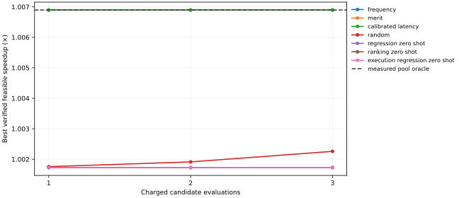

# ISAForge

**An AI-guided RISC-V program optimization system that selects custom instructions using learned performance predictions and bounded hardware measurements.**

**Working research prototype:** three executed Embench workloads, 18 automatically extracted candidates, 21 measured processor designs, and 63 routing results. A prospective SLRE experiment freezes predictions before measurement, then compares seven selection policies against actual processor outcomes. The repository includes a validated SQLite experiment ledger and an offline results demo.

```sh
# Python 3.12; install the pinned replay environment first.
python -m pip install -r requirements-speedup.txt
make demo PYTHON=python
# Open generated/reproduction/prospective-slre/index.html.
# Its experiments.sqlite contains queryable measurements and provenance.
```

This command verifies preserved raw evidence, exactly reproduces the frozen predictions, and builds the report without new hardware jobs. [Prospective results and commands](docs/prospective-slre.md) explain the full experiment. **The strongest heuristics currently outperform ML.** The execution-feature ablation reduces prediction MAE by 21.14% on SLRE but does not improve the selected design. Honest failure analysis and repeatable processor validation are part of this project.



One held-out workload, six candidates, five dependent seed repetitions. Overlapping curves indicate equal performance; the measured oracle covers only this pool. [Validation: 2,639 tests and all research replays pass](results/2026-10-20-slre-validation/README.md). [Runnable SQL analysis](docs/experiment-queries.sql) queries the measured designs and costs.

This README is the current project scope contract. It follows the [original project proposal](docs/original-project-proposal.txt) and the project owner's October 19, 2026 clarification. Contributors and coding agents must read it before choosing new work. [AGENTS.md](AGENTS.md) defines the engineering and evaluation guardrails.

## Research objective

Given a supported real RISC-V workload, ISAForge should automatically discover legal custom-instruction opportunities, predict their performance benefit and hardware cost, and select worthwhile instructions under area, timing, and evaluation budgets. The selected instructions must execute correctly in the modified program and integrated processor.

The research question is: **Can ML-guided and LLM-agent-guided instruction selection find better whole-program performance–area decisions with fewer expensive hardware evaluations than frequency, merit, random selection, and non-agent active learning?**

The contribution being tested is **measurement-efficient, uncertainty-aware RISC-V custom-instruction selection using learned predictions and an AI agent, validated against actual processor performance and hardware constraints**. The endpoint is the best verified feasible whole-program performance found for a given evaluation count **and actual evaluation time**, with regret against the measured pool oracle where available.

An agent or learned model losing to merit is a valid research result. Success requires a working, reproducible comparison; it does not require a favorable headline.

## Established research we build upon

Dataflow legality, bounded inputs/outputs, convex candidate identification, latency-based merit, synthesis-aware selection, and constrained Bayesian optimization have established precedents. We reuse those methods; we are not proposing a new enumerator or RTL-generation framework. The [primary-method review](docs/research-foundation.md) records Atasu (DAC 2003), Sun (TCAD 2004 and the separately reviewed ICCAD 2002 paper), CIDRE (ICCAD 2025), Hussein et al. (TACO 2026), LACE (2026), Gardner et al. (ICML 2014), and relevant performance/ranking/cost-aware methods, including exact references, assumptions, feasibility, and access gaps.

Four requested papers' methods were read. The exact Sun 2004 and Hussein 2026 full methods remain inaccessible and are explicitly pending. The [October 20 review](docs/selection-methods-review.md) adds primary methods from AutoTVM, SMAC, RGPE, Ithemal, covariate-shift conformal prediction, and integrated arbitration-cost research. It motivates one fixed ranking comparison and explicit uncertainty diagnostics. No novelty or published-method superiority is claimed. Strong latency/timing-aware heuristics and constrained acquisition must join the current simple baselines before drawing broader conclusions.

## Intended system

```text
Supported workload and inputs
  → compatible compilation and execution profile
  → legal candidate extraction and executable lowering
  → measured whole-program cycles, correctness, area, and timing
  → XGBoost speedup prediction/ranking and uncertainty estimates
  → bounded selection: heuristics, active learning, or LLM agent
  → jointly implemented and measured instruction set
  → optimized software/hardware and a baseline-versus-optimized report
```

The LLM agent is an **instruction-selection agent**. Its bounded interface should let it list candidates, query predictions and uncertainty, request measurements, and choose a feasible set. It does not rewrite or optimize RTL. Deterministic RTL generation, verification, synthesis, and routing implement and measure the selected instructions.

## Current engineering scope

- Real integer Embench workloads with fixed, recorded inputs. The proposal's initial programs are CRC32, aha-mont64, edn, huffbench, matmult-int, nettle-aes, nettle-sha256, and wikisort; support is conditional on compilation, memory fit, and correctness.
- The working processor target is pinned **PicoRV32**, using **RV32I plus supported counter reads**, ILP32, and PCPI. CRC32 and aha-mont64 use GCC `-O2`; SLRE explicitly uses `-Os` in a separate recorded context. Software helpers implement unsupported multiply operations. Compiler, simulator, and synthesized processor must agree on the ISA.
- Automatically discovered patterns contain two to four connected integer operations, at most two register inputs and one output, and no memory or control-flow operations inside the instruction. Lowering removes original instructions and reassembles labels and relocations.
- The SoC has 8 KiB synchronous RAM. The original contexts reserve 4 KiB for the stack. SLRE uses a separately declared 3,840-byte stack with continuous partition checks and deliberate overflow controls; all original evidence stays unchanged. Designs are measured at a common 12 MHz target and routed with seeds 1, 2, and 3 on iCE40 HX8K CT256.
- The final system should select one to three compatible instructions under a hardware budget, with an unmodified baseline always available. Selected combinations require joint execution and synthesis; individual speedups and area increments are not additive.

PicoRV32/RV32I is the current feasible implementation of the proposal's objective. The proposal's RV32IM, Spike-extension, and VexRiscv integration choices are not additional integration requirements for this milestone. Arbitrary RISC-V binaries are outside the initial support contract.

## What works and what remains

| Capability | Current evidence or remaining work |
| --- | --- |
| Six-candidate CRC32 experiment | Complete and preserved. Real program cycles, correctness, integrated area, three routing seeds, and equal-budget policy replay. Best single candidate reduces cycles 4.84%. Merit beats learned acquisition at the reported three-measurement budget. |
| Automatic second-workload pipeline | Complete for six `aha-mont64` candidates: automatic profiling/extraction/lowering, correctness, execution, integrated synthesis/routing, and 120 policy replays. Best cycle reduction **8.60%**, +42 LUT4. Merit finds the pool optimum in one measurement in all five seeds. [Results and replay](docs/automatic-workloads.md). |
| Automatic CRC32 / historical training data | CRC32 was reprofiled, automatically lowered, and remeasured in a new RV32I context. Twelve automatic outcomes share compatible feature provenance across CRC32 and aha-mont64; six older CRC32 adapter outcomes remain historical evidence. This earlier comparison has two workload groups; the new SLRE context is listed below. [Development results](docs/selection-pilot-results.md). |
| Automatic third workload / prospective transfer | **SLRE complete:** six candidates from 16 eligible formulas, seven integrated designs, 21 routes, and 105 policy/budget/seed outcomes. Best 16,333,432 → 16,221,562 cycles (**1.006896×**, +77 LUT4). Upstream self-check and every hardware control pass. Combined automatic evidence now covers **18 candidates across three workloads**, with the compiler/partition shift explicitly recorded. [Results](docs/prospective-slre.md). |
| Speedup regression and acquisition | Existing bootstrap XGBoost predicts measured application speedup from paid observations. Historical V6/V9 models predict isolated LUT4 cost and remain separate evidence. |
| Held-out-workload evaluation | Predictions trained on 12 historical CRC32/aha outcomes were committed before SLRE candidate measurements. Exact prediction replay, family exclusions, baseline receipt chronology, and target-label access are checked. One prospective workload is insufficient for broad generalization; repeated model seeds are not independent workload tests. |
| Ranking and uncertainty | Fixed XGBoost pairwise ranking is implemented and compared in 420 consumed-data policy/budget/seed outcomes. It does not improve selection over regression or merit. Ensemble interval coverage is poor on aha-mont64; held-out calibration remains missing. |
| Execution-aware features and baseline | A separate 222-case processor calibration supplies operation and PCPI costs. Its heuristic predicts all six new SLRE cycle deltas exactly. The fixed execution-feature regression ablation lowers MAE but still ranks the best candidate fifth; both regression ensembles have **0% interval coverage** on SLRE in every seed. [Prior diagnosis](docs/model-analysis.md) and [prospective test](docs/prospective-slre.md). |
| Data and reproducibility | Typed SQLite tables retain contexts, features, measurements, routes, failures, costs, and source hashes. Imports authenticate evidence, are transactional, and reject changed repeat imports. `make demo` rebuilds this analysis view and the offline report from preserved raw archives. The ledger is not exposed to selection policies. |
| Additional workload eligibility | Nine earlier failed build contexts remain preserved, plus the first failed SLRE partition attempt. The checked partition now executes SLRE for the recorded inputs; EDN and larger workloads still require validated runtime/memory support. |
| LLM selection agent | Required later milestone; not implemented or evaluated yet. It must share candidate information and measurement budgets with non-agent methods. |
| Joint final instruction set | Fixed historical CRC32 pair experiments exist. Automatic selection, lowering, and measurement of compatible sets of one to three instructions remain to be connected. |

The small CRC32 study and historical LUT-prediction studies are not the finished project. [Current handoff](docs/HANDOFF.md) tracks the next blocker. [Historical checkpoints](README-research-history.md) retain earlier results without defining current priorities.

## Priority order and milestone acceptance

1. **Preserve the completed three-workload milestone.** Keep the original CRC32 experiment, both historical automatic pools, SLRE's prelabel commit, all raw outcomes, and the negative learned-selection result. SLRE is now consumed data; do not tune on it and report another held-out win.
2. **Build the measured multi-workload corpus.** Add independent workload pools and inputs using the same evaluator. Record features, trace/firmware/tool identities, individual and combined measurements, costs, and all failures.
3. **Evaluate learned selection.** Train XGBoost regression and ranking on measured outcomes; hold out entire workloads and related candidate families. Evaluate uncertainty calibration and non-agent active learning. Add hardware-cost prediction only when real measurements support it and it helps selection.
4. **Connect the LLM selection agent.** Use a bounded, auditable tool interface and the same public features, training data, constraints, and target measurement budget as the baselines. Record model/provider settings, prompts, decisions, repeated seeds, and inference cost.
5. **Validate the final implementation.** Implement compatible selected sets together. Report baseline/optimized execution, correctness, integrated area, timing, evaluation count/cost, and regret against the fully measured manageable-pool oracle.

Each milestone must include its working command, tests, measured outcomes, limitations, preserved negative results, and next blocker. Complete these connections before starting more model versions or new infrastructure.

## Evaluation rules

- **Primary outcome:** best verified feasible whole-program runtime/speedup as a function of expensive evaluations, with performance–area tradeoffs reported separately.
- **Comparators:** frequency, instruction-saving merit, strong architecture/latency/timing-aware merit, seeded random, non-agent uncertainty/constrained acquisition, LLM selection agent, and exhaustive oracle on the same manageable pool. Pair lookahead joins set selection once joint lowering works. Report unimplemented methods as missing.
- **Fair information and costs:** hold pools, training data, area/timing limits, and budgets constant. Only queried target labels reach a selector. Charge failed attempts; distinguish cached/replayed observations from fresh evaluations. Report historical training-label counts/time, baseline/profiling setup, target measurements/time, and inference cost separately, with total and amortized costs rather than treating training as free.
- **Timing:** at a common feasible clock, speedup is baseline cycles divided by optimized cycles. If periods differ, use `baseline_cycles × baseline_period / (optimized_cycles × optimized_period)`. Report all routing seeds and timing feasibility.
- **Labels:** instruction savings, isolated datapath cost, simulated whole-program cycles, routed timing estimates, and physical-board measurements are different quantities. Do not relabel one as another.
- **Generalization:** hold out entire workloads/source families; detect duplicates and related candidates. Freeze protocols and predictions before examining held-out labels. Test sets used for revisions become development data.
- **Set selection:** account for overlapping occurrences, register dependencies, encoding compatibility, and shared hardware. Measure selected combinations together instead of summing individual speedups.

## Outside the current project

RTL-rewriting optimization agents, GNN development, multi-agent frameworks, unrelated model architectures, arbitrary RISC-V support, and power/energy claims without measurements are outside scope. Further isolated LUT-prediction studies are deferred unless they directly address a demonstrated final-selection failure. Historical code and results remain available for reproduction; their old roadmaps do not authorize new work.

## Run and reproduce

From a source checkout:

```sh
git submodule update --init --recursive
python3 -m venv .venv
. .venv/bin/activate
python -m pip install -e '.[dev,reports,proofs]'
# For exact October 19 processor-policy replay, use Python 3.12 and:
python -m pip install -r requirements-speedup.txt
make test
python scripts/reproduce_codesign.py replay
python scripts/reproduce_workload.py replay
```

Each processor replay verifies seven preserved designs and 120 policy/seed/budget outcomes without new native measurements. The [recorded replay dependencies](requirements-speedup.txt) are separate from historical model-version requirements. Automatic collection needs recorded RISC-V GCC, Verilator, Yosys, nextpnr, and a prepared pinned evaluator context:

```sh
python -m isaforge.workload_experiment prepare \
  --reference-root generated/codesign-crc32-2026-10-19-r1 \
  --root generated/automatic-aha-new --workload aha-mont64 --pool-size 6
python -m isaforge.workload_experiment discover --root generated/automatic-aha-new
python -m isaforge.workload_experiment collect --root generated/automatic-aha-new
python -m isaforge.workload_selection --root generated/automatic-aha-new
```

Use a fresh output directory for a fresh protocol. Resume completed measurements only after evidence hashes are verified. [Automatic-workload instructions](docs/automatic-workloads.md) cover setup and portable replay. [CRC32 commands](docs/codesign-loop.md) cover reference preparation. `make reproduce` remains a regression check for the historical six-model cost comparison; it is not the primary project experiment.

[Agent instructions](AGENTS.md) · [Contribution rules](CONTRIBUTING.md) · [Documentation](docs/README.md) · [Frozen evidence](results/README.md) · [Original proposal](docs/original-project-proposal.txt)
