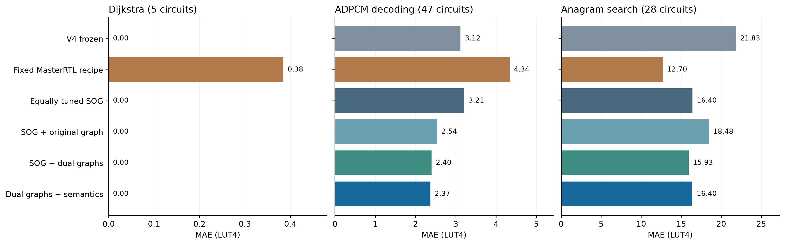

# V5 external application transfer

The fixed MasterRTL adaptation has the lowest observed primary error on this
external application-derived cohort. Full V5 improves the preregistered
comparison against equally tuned SOG by **0.282 LUT4 (4.31%)**, but does not beat
the fixed recipe. The synthetic 59.01% improvement does not transfer at the same
scale. These are three curated workload families, with substantial input overlap;
there is no population confidence interval or claim of published-system superiority.

## Frozen comparison

All six previously frozen artifacts predict the same 80 program/formula rows
from 79 unique circuits. The primary endpoint gives Dijkstra, ADPCM decoding
and anagram search equal weight, irrespective of their 5/47/28 row counts.
Predictions and source/input/model evidence were committed at
`0db749ab0a4b0ba769d9b0bbd42bbfdef00343e9` before parent review and target release.
No model was fitted, selected or recalibrated for these programs.

| Frozen predictor | Family-macro MAE, LUT4 | Pooled MAE, LUT4 | Positive MAPE |
| --- | ---: | ---: | ---: |
| V4 frozen | 8.316 | 9.473 | 4.85% |
| Fixed MasterRTL recipe | 5.808 | 7.018 | 7.51% |
| Equally tuned SOG | 6.537 | 7.627 | 4.70% |
| SOG + original graph | 7.005 | 7.959 | 3.21% |
| SOG + dual graphs | 6.111 | 6.986 | 3.18% |
| Full V5: dual graphs + semantics | 6.256 | 7.131 | 3.13% |

MAPE uses all **61 positive targets**. The **19 zero targets** remain in MAE,
RMSLE and feasibility counts. Full V5's low 3.13% MAPE cannot be compared directly
with a paper's ASIC area error or our synthetic composition distributions.
The primary metric remains equal-family MAE, even where another metric favors V5.


## What transfers and what fails

Full V5's family MAEs are **0.000 Dijkstra**, **2.369 ADPCM**, and **16.398
anagram**; tuned SOG gives 0.000, 3.211 and 16.401. Almost all of the small
primary gain comes from ADPCM. The fixed recipe gives 0.385, 4.336 and 12.704,
with its anagram advantage outweighing the other two families.

The simpler original-graph model, which had the lowest unseen-composition error
in the synthetic test, is worse here at 7.005 family-macro MAE. Dual graph is
best among the four matched V5 views at 6.111. This reversal is evidence against
choosing a universal architecture from a single curated holdout.

The largest full-V5 error is an anagram multiply-high/shift composition:
`srli(mulhu(in0,addi(in1,-1365)),2)` measures **2,776 LUT4**, predicted **2,901.59**.
Its largest underprediction is 75.52 LUT4. All cases remain in the results.
At the fixed 16/32/64/128/256 LUT caps, the three graph-enhanced point predictors
make zero feasibility mistakes in this cohort; this does not establish a
budgeted-selection advantage or validate their upper bounds.



## Novelty and measurement scope

Novelty was computed before labels against all **2,313 consumed formulas**.
There are 13 exact, 14 normalized, 26 full-feature, 55 original-skeleton and
56 normalized-skeleton overlaps with development; two rows also match consumed
test skeletons. Overlap categories intersect and must not be added.

| Predeclared scope | Dijkstra | ADPCM | Anagram | Three-family macro |
| --- | ---: | ---: | ---: | --- |
| All program rows | 5 | 47 | 28 | Available |
| Formula-novel | 0 | 40 | 14 | Unavailable: missing Dijkstra |
| Strict-novel | 0 | 14 | 6 | Unavailable: missing Dijkstra |

Formula novelty excludes exact, normalized and full-feature matches; strict
novelty also excludes either skeleton match. The scorer retains per-family and
pooled secondary metrics for these subsets without silently dropping Dijkstra
from a purported three-family macro. All five Dijkstra expressions are familiar
under the formula-novel rule.

Programs use the pinned [TACLeBench source](https://github.com/tacle/tacle-bench/tree/c6a0d73e47bbd2bc86e34637156fb26dd4d5cf08).
Dijkstra discovery traces one path, with full 20-path correctness controls outside
that window. ADPCM uses the exact pinned two-code input instance. Anagram witness
checks cover three phrases, not enumeration completeness. O0/O2 controls, source
licenses, trace counters, fusion checks and failed collection attempts remain
in the collection evidence. These bounds on scope are explicit in the
[collection protocol](external-v5-protocol.md).

## Uncertainty and independent audit

Full V5's frozen upper bounds cover **76/80 candidates (95%)**, but only **1/3
whole application families**. Its worst slack is **−61.94 LUT4**. Only two rows
are outside individual feature ranges, demonstrating that such range checks
cannot certify calibrated transfer. Application families are different units
from the structural calibration components; no 90% application guarantee applies.
No margin was changed after seeing these results.

All 79 original circuits pass 2,148 sampled/boundary RTL comparisons each:
**169,692 comparisons**, zero verification or synthesis failures. Independent
raw netlist recount totals **22,916 LUT4 and 1,831 carry cells** over the 79 unique
circuits. Repeated formulas are measured once and expanded to preserve program
weights. All targets use the original emitted RTL and frozen Yosys binary.

Independent audits reproduce every field of all six model prediction lists,
reject outcome-metadata dependence, rebuild all 79 feature vectors from copied
caches, and verify all 155 distinct committed freeze-bound files. A fresh Git
clone with no object alternates restores all 560 archived raw files and reproduces
every score field except the evaluation timestamp. Audit scripts and reports
are retained under the result snapshot's `audit/` directory.

## Reproduce

Use a Git clone with the reviewed commit in history (a source ZIP is insufficient).
No hardware tool or model fitting is needed for score replay:

```sh
python scripts/archive_external_v5.py restore
python scripts/evaluate_external_v5.py score --output generated/reproduction/external-v5/evaluation.json
python scripts/report_external_v5.py --evaluation generated/reproduction/external-v5/evaluation.json --output generated/reproduction/external-v5/report
# Equivalent after installation:
make reproduce-external-v5
```

The 3.2 MB archive retains original circuits, logs, netlists and verification
sources/results, excluding generated compiler object trees. Restore checks every
hash and refuses to overwrite changed evidence. The [evaluation protocol](external-v5-evaluation.md)
defines release gates and complete measurement requirements. Full trace/cache
regeneration requires the recorded RISC-V and hardware toolchains.

## Consequence for the next revision

The current study is now consumed evidence, not a tuning set with a reusable
independent-test label. Preserve all six artifacts. Develop changes on fitting
folds, add input-only mapping/reuse descriptors, and collect genuinely independent
source families and deeper nonmultiply structures for a new frozen experiment.
Calibrate the final predictor at the intended claim unit, then evaluate useful
selection benefit and total preprocessing/measurement cost. CPU cycles, routing,
energy and whole-processor area remain separate experiments.
