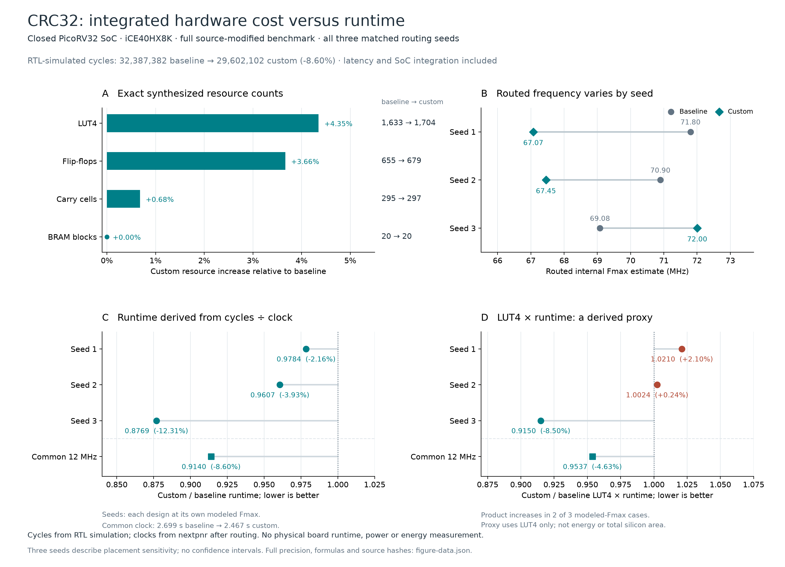

# Hardware tradeoff ledger

ISAForge separates prediction quality, isolated circuit resources and integrated processor behavior. A lower prediction error is useful only if it improves a hardware decision; a smaller circuit is useful only under the required timing, correctness and integration constraints.

| Decision or measurement | Current evidence | What it establishes |
| --- | --- | --- |
| Whole CRC32 workload cycles | 32,387,382 → 29,602,102 (8.60% lower) with two custom instructions | RTL-simulated workload behavior including the implemented PCPI integration |
| Whole-SoC resources | LUT4: 1,633 → 1,704 (+4.35%); FF: 655 → 679 (+3.66%); carry: 295 → 297 (+0.68%); BRAM: 20 → 20 | Resource costs of that integrated processor configuration; counts are kept separate |
| Routed processor timing | Six runs (three baseline/extended pairs) pass 12 MHz; cycle/Fmax ratios 1.022×–1.140× | Conditional timing-model runtime estimates, not physical-board speedups |
| V9 prediction quality | Consumed-application family-macro MAE 3.4092 → 2.5434 LUT4 | A development improvement in predicting original-RTL isolated area |
| V9 application budget decisions | At cap64, 0 false accepts and 3 false rejects for both models; one repaired rejection and one new rejection | Average error reduction does not automatically reduce decision errors |
| V9 historical regression budget decisions | Cap64 stays 6 false accepts / 5 false rejects; cap128 changes 1/4 → 1/6 | Some feasibility tradeoffs worsen despite lower MAE |
| Learned instruction selection | V8's best learned policies tie merit-only selection on the primary endpoint | No demonstrated learned-selection advantage |
| Constant-multiply implementation | V10d: 32 parsed-RTL proofs and 64 fresh arms; LUT4 lower/equal/higher: 31/1/0; carry: 13/7/12 | Mean bare LUT4 saving 88.5625; 12 carry increases; CPU effects not measured |

| Matched CSD harness timing | All 192 routes pass; all 32 three-seed formula means have lower period (mean −1.710802 ns); 95/96 seed pairs improve | Measured routing-model tradeoff; 72 path attributions unknown; no CPU or board claim |

Sources: [processor and routing results](results.md), [SoC routing assumptions](soc-routing.md), [V9 complete metrics](v9-coverage-results.md), [V8 selection study](v8-application-results.md), [complete CSD area results](v10-csd-hardware-results.md), and [matched timing](v10d-timing-results.md).

## The existing CPU result has a measurable tradeoff

[Vector PDF](figures/cpu-hardware-tradeoffs/crc32-hardware-tradeoffs.pdf) · [Editable SVG](figures/cpu-hardware-tradeoffs/crc32-hardware-tradeoffs.svg) · [Full-precision data and source hashes](figures/cpu-hardware-tradeoffs/figure-data.json)

Both configurations meet the common 12 MHz constraint. At that clock, the
custom configuration's runtime follows its cycle count: 8.60% lower, with
4.35% more LUT4s. If each configuration instead operates at its own routed
internal Fmax estimate, the clock reduction in two seeds offsets part of the
cycle saving. The three seeds are retained individually:

| Clock assumption | Baseline / custom MHz | Custom runtime change | LUT4 × runtime change |
| --- | ---: | ---: | ---: |
| Common constraint | 12 / 12 | −8.60% | −4.63% |
| Own routed Fmax, seed 1 | 71.803 / 67.074 | −2.16% | +2.10% |
| Own routed Fmax, seed 2 | 70.897 / 67.454 | −3.93% | +0.24% |
| Own routed Fmax, seed 3 | 69.080 / 72.005 | −12.31% | −8.50% |

These are derived from the committed [cycle/resource summary](../results/2026-10-13-prospective/soc/summary.json)
and [six routing runs](../results/2026-10-13-prospective/soc/routing-summary.json).
For each paired seed, runtime ratio is
`(custom_cycles / custom_Fmax) / (baseline_cycles / baseline_Fmax)`;
the resource-time proxy multiplies that ratio by `1704 / 1633`.
Positive changes mean a higher cost. LUT4 × runtime is a descriptive FPGA
resource-time proxy, not energy, power or physical chip area. The own-Fmax
rows are conditional timing-model estimates, not measured board runtimes;
three seeds do not establish a population confidence interval.

The extension is therefore a faster, larger design under these assumptions.
It does not dominate the baseline on every resource or combined objective.
An instruction selector must respect the area and timing budget and evaluate
the workload benefit, rather than treating prediction MAE or LUT reduction
alone as the optimization objective.

## Each implementation comparison must retain

- **Correctness:** exact source semantics, emitted-RTL equivalence and separately identified sampled or universal mapped verification.
- **Resources:** LUT4 and carry counts for every original/modified pair; FF and BRAM counts when a wrapper or processor is included. Carry cells are reported separately rather than silently treated as free LUT equivalents.
- **Timing and latency:** critical-path/Fmax evidence under matched device, constraints and routing seeds; instruction latency and interface overhead for processor integration. Shift/add rewrites can increase dependency depth, so area alone cannot establish a speed benefit.
- **Workload effect:** execution frequency, saved instructions and actual full-workload cycle changes. Extracted instruction-count merit is a proxy until the processor runs the implementation.
- **Measurement cost:** new target labels, synthesis and inference work, and any fitting or acquisition budget. Existing cached feature inference has a different cost from preprocessing a new formula.
- **Failures:** proof timeouts, unsuccessful measurements, infeasible budgets, tails and worst underpredictions. Missing measurements remain unavailable rather than zero.

The completed V10d area stage measures isolated original/CSD resources on all 32 fixed inputs after parsed-RTL equivalence. LUT4 falls in 31 pairs and ties once; carry increases in 12. The direct 511 multiplier illustrates the tradeoff: 299 → 62 LUT4 and 27 → 30 carry cells. [All bare paired resources](v10-csd-hardware-results.md).

The [completed matched timing study](v10d-timing-results.md) adds a common registered wrapper and 192 routes across three seeds. All 32 formula means improve in period; one of the 96 individual seed pairs is slightly slower. Wrapped LUT4 falls in 31 pairs and ties once, but `44*x+y` uses two more packed logic cells in every seed. All arms retain 132 FFs. Carry, mapped LUT4, packed logic cells and timing remain separate endpoints. Critical-path attribution is unresolved for 72 routes, which are retained in the full-harness results. This study measures no CPU, board, energy or power effect.

[Vector PDF](figures/v10d-timing/v10d-resource-timing-tradeoffs.pdf) · [Full-precision data](figures/v10d-timing/figure-data.json)

V6's earlier calibrated upper bounds do not automatically transfer to the newly fitted V9 model. V9 currently reports point-estimate feasibility errors; new uncertainty or safe-selection claims require a separate calibration design and held-out validation. Power and energy remain unmeasured. FPGA LUT4 counts are also not an ASIC area measurement.
