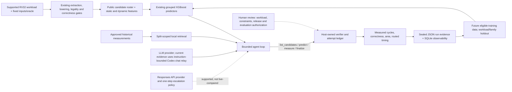

# ISAForge ML and selection-agent integration — October 28, 2026

This is the evidence-backed status of the current ML-guided selector and the
bounded LLM selection loop. It distinguishes a working research prototype from
the complete, prospective optimization system in the project proposal.

## Research question and current answer

ISAForge asks whether a model-guided, uncertainty-aware selector can find a
better **verified, feasible whole-program design** with fewer expensive
PicoRV32 evaluations than frequency, merit/calibrated latency, random search,
and non-agent active selection. We do not yet have evidence that ML or an LLM
beats the strongest heuristic across workloads. The live agent results below
are consumed-data replays of the six-candidate Embench CRC32 pool; no new
hardware jobs or labels were produced.

## Implemented path



The host owns candidate legality, test outcomes, correctness, area/timing
feasibility, charged attempts, and final accepted selection. The language model
receives a public snapshot and can propose the next bounded action; it cannot
declare an unmeasured candidate correct or feasible. The current agent supports
single-instruction selection only. It does not assume speedups or areas add
when combining instructions.

## What the model predicts

The current grouped adapter fits the **existing** XGBoost recipes from the
authenticated 122-label corpus. It is not a new model release and does not
train the LLM.

- `XGBRanker` with `rank:pairwise` produces a relative candidate-ordering
  score. The score is neither an absolute speedup nor a probability.
- The factorized feasibility selector combines an uncalibrated,
  probability-like feasibility score and ensemble disagreement with analytic
  cycle-reduction features. Its disagreement is not a calibrated uncertainty
  interval; its score is not a guaranteed probability.
- The host prediction tool also exposes the existing analytic latency estimate.
  In the measured corpus, every successful cycle-speedup label is explained by
  this calibrated-latency estimate. This is why another standalone speedup
  regressor is not currently justified.
- The fit excludes the full target workload and every expression family in its
  candidate roster. Target outcomes, including failures, remain evaluator-only
  until a candidate is measured or the replay is scored after the policy ends.

Current data before this turn: 122 verified speedup labels, 4 charged failed
attempts, and 14 workload groups. The measured labels are historical and the
active workload-eligibility census has not produced a new independent source
that passes the existing gates.

## Bounded agent, memory and AI engineering

| Component | Working now | Boundary / not yet demonstrated |
| --- | --- | --- |
| Agentic workflow and loop engineering | Persistent, bounded four-tool loop: `list_candidates`, `predict`, `measure`, `finalize`; explicit decision, provider, tool and hardware-attempt accounting; host fallback on model failure or exhaustion. | One live replay used a manual Codex chat relay. That relay was instruction-bounded, not sandboxed, and its exact deployment model ID is unavailable. |
| Function calling / structured output | Typed action protocol and host-side validation; invalid actions and finalization corrections are recorded. | The Codex bridge is not an isolated production tool runtime. No production service is deployed. |
| Model routing | Responses-provider wrapper supports one stronger-model escalation after invalid structured output or explicit host incumbent correction, within the shared provider-call budget. | No Responses API key was present and no routed API comparison ran. The Codex chat replay did not exercise dynamic provider routing. |
| Agent memory, embeddings and semantic/hybrid search | Per-run retrieval over eligible historical measurements: lexical TF-IDF, latent semantic TF-IDF/SVD vector representations, reciprocal-rank hybrid, and typed operator-overlap graph options. Each measurement is a provenance-bound record (the current chunk); hybrid supplies at most three, and raw history is hidden in retrieval mode. | No pretrained dense embeddings, arbitrary-document chunking, persistent vector database, or separate cross-encoder/LLM reranker. The hybrid rank fusion is the reranking step. No causal quality gain is established. |
| Context windows and tokens | Requests are byte-bounded; retrieved memory has a 40,000-byte ceiling. SQLite records serialized context size and history exposure. Only provider-reported token usage is recorded. | A byte count is not a token count. Codex relay token usage is null; do not estimate it from text length. |
| Knowledge graph | Typed operator-overlap graph can retrieve structurally related prior measurements. | It is a retrieval prototype, not a trained performance graph or proof of semantic relevance. |
| Explainability | Final LLM summary is bound to the exact public-context hash, tool trace, policy identity, and separate host-verified facts. | The summary is model-authored and explicitly unverified; it is an explanation artifact, not proof of why the model acted. |
| Evals and guardrails | Deterministic unit tests, sealed retrospective replay, hidden-outcome host boundary, full-pool oracle scoring only after completion, and failure-preserving ledgers. | No LLM-as-a-judge or Ragas evaluation is used. A judge would not replace tool correctness or measured processor outcomes. |
| LLMOps / observability | Source/protocol hashes, JSON event ledgers, and SQLite tables for episodes, decisions, model calls, tools, retrievals, context windows, rationales and verified evidence. | Local research observability only; no deployed monitoring, model release service, or automated production alerting. |
| Agent memory persistence | The retriever rebuilds from the approved split-scoped training rows for each episode; its source hashes and returned record IDs are logged. | It is not a durable conversational memory store. It cannot retrieve target labels or arbitrary files. |
| Human-in-the-loop | Human approval points for workload/constraint/release decisions; the relay operator copied requests and actions for the Codex pilot. | Human review is not yet an interactive runtime approval product. |
| Frameworks and deployment | Existing Python host controller is the orchestration layer. | LangChain, LangGraph, MCP, cloud deployment and general-document RAG are deferred; no demonstrated need or measured benefit. |

### Selection board and auditable measurement choices

The grouped selector now builds a host-side decision board once the model has
queried the complete public candidate roster. It places the frozen pairwise
rank beside the analytic latency estimate, merit/frequency, and the
factorized-feasibility signals, while explicitly marking those feasibility
signals as uncalibrated. Its advisory default is the highest-pairwise-ranked
candidate not yet attempted. This is guidance, not a hard filter: the agent may
override it, and only paid host-verified outcomes can mark area, timing, or
correctness as verified. The board does not add an estimator, update a model,
reveal unmeasured outcomes, or claim that rank means speedup.

Each charged `measure` tool action must now carry a bounded
`decision_summary` (1–320 characters) stating the public evidence behind that
measurement. It deliberately asks for a short action note rather than private
chain of thought. The selector binds the note to the exact pre-measure context
hash, candidate, pairwise position, advisory default, whether it deviated, and
the later paid verification result. The SQLite exporter stores those records
in `rationale_selection_decisions`. This makes a choice auditable without
pretending a model-authored note is causal truth. It improves observability and
context use; it has not yet been shown to improve design selection.

The retrieved-only memory change reduced the serialized initial request from
154,008 bytes with 101 raw historical rows to 17,353 bytes with three retrieved
rows and 5,103 bytes of retrieved payload (about 88.7% fewer serialized
bytes). This is context-size evidence only: it does not establish token savings,
lower latency, improved decisions, or a causal retrieval benefit.

## CRC32 selection replay and matched controls

Both runs used the same frozen +64 LUT4 and 12 MHz constraints, seed 0,
three-measurement maximum, target-family/workload-excluded model fit, six public
candidates, and complete measured-pool oracle. They replay previously measured
outcomes; `new_native_jobs=0`.

The best candidate was
`slli(andi(xor(in0,in1),255),2)`: baseline 32,387,382 cycles, candidate
30,820,662 cycles, speedup **1.050833x** (4.8374% cycle reduction), +31 LUT4,
minimum routed Fmax 71.489845 MHz, correctness passed, and archived native
evaluation duration 42.0438 seconds. It is feasible under both constraints.
The complete six-candidate cycle, area, route, and correctness table remains in
the [automatic CRC32 result archive](../results/2026-10-20-automatic-crc32/README.md).

| Selector | Charged measurements to best verified feasible result | Best speedup | Regret to complete six-candidate oracle |
| --- | ---: | ---: | ---: |
| GPT-6.1 Sol chat relay, no retrieval | 2 | 1.050833x | 0 |
| GPT-6.1 Sol chat relay, hybrid retrieved memory | 1 | 1.050833x | 0 |
| Factorized-feasibility XGBoost, retrospective matched control | 1 | 1.050833x | 0 |
| Pairwise XGBoost, retrospective matched control | 2 | 1.050833x | 0 |
| Merit / calibrated latency / latency-cost / random, matched controls | 2 | 1.050833x | 0 |
| Frequency, matched control | 3 | 1.050833x | 0 |

These rows come from the current October 26 feasibility-screen seed-0
trajectories used by the grouped-agent replay. They are not a replacement for
the earlier five-seed CRC32 study: that separate development report records
merit finding the oracle at budget one and documents its own model/policy
protocol. Keep the two results distinct; both show no learned advantage over
merit. See [the original selection-pilot report](selection-pilot-results.md).

These are one seed and one already-consumed workload. The no-retrieval chat
pilot had two invalid candidate-ID actions caused by manual request/response
transcription; those actions were rejected without hardware charge. It then
measured one infeasible candidate (+69 LUT4; timing passed) and the best
feasible candidate. The retrieval run measured only the best feasible
candidate. Pilot relay elapsed time includes human waiting and copying, not
model inference latency; provider calls, exact model identity, and token usage
are unavailable. The two runs differ in information framing and relay history,
so they do **not** isolate retrieval causally. Both tie the best current
non-agent policy at its best budget; hybrid ties factorized XGBoost and does
not beat it.

## Second workload replay: BEEBS AHA-compress

To test whether the controller could carry over beyond CRC32, the same
hybrid-memory agent and current grouped models were run on the authenticated
12-candidate BEEBS AHA-compress pool. Training used 109 labels from 13 other
workload groups and excluded all eight target expression families. The oracle
is complete; all candidate outcomes were already in the corpus. This is a
retrospective second workload check, not a fresh benchmark label.

| Agent measurement | Whole-program cycles | Speedup | Added LUT4 | Minimum routed Fmax | Correct | Feasible at +64 LUT4 / 12 MHz |
| --- | ---: | ---: | ---: | ---: | --- | --- |
| `xor(slli(xor(slli(in0,4),in0),8),xor(slli(in0,4),in0))` | 70,797 → 68,277 | 1.036908x | +72 | 66.299805 MHz | yes | no: area |
| `xor(slli(in0,2),in0)` | 70,797 → 69,897 | 1.012876x | +77 | 62.449257 MHz | yes | no: area |
| `and(in0,xori(in1,-1))` | 70,797 → 70,527 | 1.003828x | +96 | 66.648895 MHz | yes | no: area |
| Best feasible measured-pool oracle (not selected by agent) | 70,797 → 69,177 | 1.023418x | +61 | 64.184853 MHz | yes | yes |

The LLM finalized the baseline after three measurements, so its verified
best-so-far remained 1.0x and its cycle-reduction regret was 0.0228823 (2.2882
percentage points). It made five valid tool calls (one prediction, three
measurements, one finalization) and zero invalid actions. The first choice was
the pairwise ranker's top candidate; its later choices were rank positions 5
and 9. All three measured candidates were correct and timing-feasible, but all
exceeded the area cap. By budget three, merit, calibrated latency, and the
pairwise XGBoost control found the feasible oracle; factorized feasibility,
frequency, random, and latency-cost remained at baseline in this seed-0
trajectory. This exposes a concrete gap: after its first top-ranked choice,
the LLM did not follow the rank order to the feasible oracle, and the separate
factorized-feasibility control also missed it. The feasibility score remains
uncalibrated and should not be treated as a reliable hard filter.

| Policy | B1 best speedup | B2 | B3 |
| --- | ---: | ---: | ---: |
| GPT-6.1 Sol hybrid agent | 1.000000x | 1.000000x | 1.000000x |
| Merit | 1.000000x | 1.000000x | 1.023418x |
| Calibrated latency | 1.000000x | 1.000000x | 1.023418x |
| XGBoost pairwise rank | 1.000000x | 1.000000x | 1.023418x |
| Factorized-feasibility XGBoost | 1.000000x | 1.000000x | 1.000000x |
| Frequency / random / latency-cost | 1.000000x | 1.000000x | 1.000000x |

Archived native evaluation durations summed to 125.6829 seconds. The
194.4627-second chat-replay elapsed time includes manual relay/waiting and is
not model latency. SQLite records five model decision contexts of 24,386 to
32,089 serialized bytes, zero raw training rows exposed, and at most 5,202
retrieved-memory bytes under the 40,000-byte limit. API token use remains
unavailable. No additional native jobs or labels were created. The one-run
comparison does not establish a population-level loss, but it is an important
negative result and must be preserved alongside CRC32. Its SQLite export is
`results/2026-10-28-grouped-agent-observability-r1/aha-compress-hybrid.sqlite`.

Artifacts:

- `results/2026-10-28-grouped-agent-crc32-gpt61sol-seed0-pilot2/`
- `results/2026-10-28-grouped-agent-crc32-hybrid-seed0/`
- `results/2026-10-28-grouped-agent-aha-compress-gpt61sol-seed0-hybrid/`
- `results/2026-10-28-grouped-agent-observability-r1/`
- `results/2026-10-28-grouped-agent-crc32-gpt61sol-seed0/` preserves the initial
  no-TTY EOF/host-fallback start (zero paid attempts); it is not a model result.

## Dataset supplement and ablation

The sealed Ascon import authenticates three previously measured outcomes but
keeps them in a separate `training_only` release. The original corpus remains
122 labels; the other nine public candidate IDs remain unmeasured. These three
rows are same-domain crypto transfer and all three formula families already
exist in history, so they add no independent family/workload confirmation.

An outcome-hidden, whole-workload/family-held-out ablation adds those three
rows only to the eligible training fold for the two existing XGBoost recipes.
It adds no model family, label, or native run. Across 13 complete-oracle
contexts: pairwise ranking has one workload loss at B1 (macro regret
0.00841660 to 0.00900788), ties at B2, and one workload win at B3 (0.00070245
to 0.00014510). Factorized-feasibility regret is unchanged at B1/B2/B3
(0.00729212 / 0.00534721 / 0.00527538). **No model was promoted.**
The detailed sealed results are in
`results/2026-10-28-ascon-training-ablation-r2/`.

## Reproduction and current checks

List the authenticated grouped targets:

```sh
../work/audit-venv/bin/python scripts/run_grouped_agent_selector.py --list-targets
```

Run a new Codex-chat replay into a new output directory (the chat provider
requires manual relaying of each JSON request; it is not an API benchmark):

```sh
../work/audit-venv/bin/python scripts/run_grouped_agent_selector.py \
  --provider codex-chat --target-group embench-crc32 \
  --benchmark embench-crc32:63c7f40f7e906b046f5a1911d5ed91824bb1aa15673f8fa753a818ccc0d5f511 \
  --memory-mode hybrid --seed 0 --budget 3 --area-cap 64 \
  --output results/grouped-agent-crc32-reproduction
```

The historical results are immutable; do not reuse their output paths.
Current validation for the board, grouped predictions, selector, provider,
chat bridge, routing, rationale and grouped-agent case passes **110 focused
tests**. No new live model API call, model fine-tuning, native job, or speedup
label was made for the board implementation. The Ascon retrospective described
above performs local fits of the existing models; it adds no model version or
new label.

## Next research gate

Do not call this a finished optimization system or claim a research win. The
next valid improvement needs an untouched eligible workload and a frozen
prospective protocol before outcomes: same public features/history, model and
agent information, area/timing limits, measurement budget and total cost for
frequency, merit/calibrated latency, random, active learning, XGBoost and the
LLM selector. Repeat the agent comparison across independent workloads and
seeds; record structured-action validity, measurements, wall time, model
latency/tokens/cost when actually available, verified feasible best-so-far,
and oracle regret only for complete pools. Then test selected instruction
combinations together in the processor. Preserve negative results.
