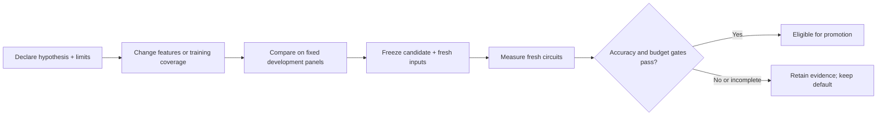

# Model pipeline

| Stage | Input → output | Implementation |
| --- | --- | --- |
| Candidate | Two-input RV32 expression → parsed operator tree | `isaforge/features.py` |
| Representation | Original and normalized RTL graphs → 336 cached descriptors | `isaforge/area_model_v6.py` |
| Selection | 336 descriptors → fixed 217-column view | Frozen model metadata |
| Prediction | 300 ExtraTrees outputs → mean LUT4 estimate | `scripts/predict.py` |
| Verification | Original RTL → checked semantics → measured iCE40 LUT4 | Yosys synthesis flow |
| Evaluation | Prediction + measurement → MAE, MAPE, budget mistakes | `scripts/reproduce.py` |

## Features

| Selected feature block | Count |
| --- | ---: |
| Simple operator graph | 14 |
| Original graph | 60 |
| Normalized graph | 60 |
| Absolute graph differences | 60 |
| Mapping descriptors | 23 |
| **Total** | **217** |

Each tree uses all training rows, randomized split thresholds and no bootstrap. Tree outputs are averaged; disagreement is not a calibrated confidence bound. Frozen zero-graph handling is retained.

## Available models

| Model | Training circuits | Role |
| --- | ---: | --- |
| `base` | 1,665 | Default area predictor |
| `coverage` | 1,713 | Experimental arithmetic coverage |
| `scoped` | Uses both above | Fixed structural routing; experimental |
| Later classifiers | See individual records | Budget-feasibility research; not promoted |

Weights and metadata live in `models/`. Loading checks artifact hashes, numerical package versions and runtime source hashes. Use the pinned environment; editing frozen runtime code requires a new compatible artifact.

## Improvement and selection

| Finding | Decision |
| --- | --- |
| Mapping descriptors improve matched MAE by 6.32% | Base representation retained |
| Arithmetic coverage improves mean error but worsens worst underprediction | Experimental only |
| Latest control/sharing coverage introduces four new false acceptances | Not promoted |
| Latest fresh cohort has only 16/55 area labels | No fresh accuracy conclusion |

[Measured results](../results/README.md) · [Inference commands](reproduce.md) · [Detailed historical model notes](https://github.com/jas0nriverah/agentic-riscv-codesign/blob/f8fa7b02ba56507f64893debece8d38db8aff642/docs/model.md)
