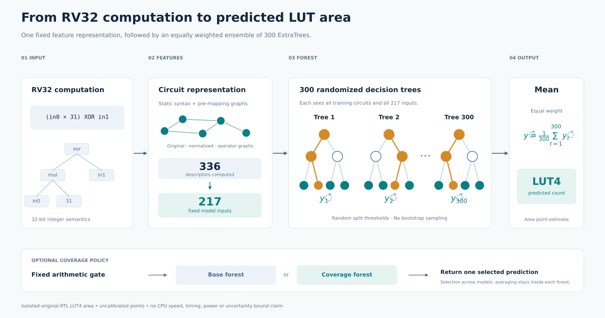

# Model

ISAForge predicts the number of iCE40 four-input lookup tables required by an original RV32 instruction candidate. A candidate is a bounded computation with up to two inputs and one output. Training targets come from verified RTL and actual Yosys synthesis.

## Representation and estimator

The extractor computes 336 descriptors; the forest uses a fixed 217-feature view:

| Feature block | Count |
| --- | ---: |
| Simple operator graph | 14 |
| Original generic graph | 60 |
| Normalized generic graph | 60 |
| Absolute differences between the two graph views | 60 |
| Mapping-related graph descriptors | 23 |
| **Model inputs** | **217** |

The model is an ExtraTrees regressor with 300 trees, one-sample minimum leaves, all features considered at splits, randomized split thresholds, and no bootstrap sampling. Every tree sees the training dataset. Its prediction is the equally weighted mean of tree outputs, clipped to nonnegative values, with the frozen original-generic-zero rule preserved. Tree disagreement is recorded but is not a calibrated uncertainty bound.

Both graph views describe the same original implementation. Labels always measure original RTL, never a cheaper rewritten implementation substituted after observing the result. Cached features avoid preprocessing; a new formula still requires compatible pre-mapping graph extraction.

## Available predictors

| Name | Training circuits | Role |
| --- | ---: | --- |
| `base` | 1,665 | Default; strongest primary result on the completed application-transfer panel |
| `coverage` | 1,713 | Same representation and estimator, with 48 targeted arithmetic examples |
| `scoped` | Uses the two saved forests | Experimental input-only selection of one forest |

The scoped policy selects coverage when the original formula contains a low multiplication with a syntactic positive constant from 1 through 2047, or a signed-shift difference `sub(srai(A,k),srai(B,31))`, with input-containing A/B and k from 0 through 31. Otherwise it selects base. It does not inspect labels, predicted error or benchmark identity. The CLI computes only the required model subsets and returns the selected original points.

On the 32-case arithmetic test every case selects coverage, so the scoped policy equals coverage by construction. On the consumed 327-case application panel every case selects base. These checks do not establish routing generalization to a new mixed application distribution.

The weights and adjacent metadata in [models/](../models/) are byte-identical to their archived artifacts. Their original internal module names remain unchanged to preserve serialization and source validation. [Inference and reproduction](reproduce.md).

## Testing the feature budget

217 is a fixed representation choice, not a model capacity limit. A [matched development experiment](../results/feature-comparison/README.md) compares that view with all 336 descriptors and with 128 selected inside each training fold. The 336 view contains the same values as the extractor storage, reordered as the 217 inputs followed by 119 semantic descriptors. Feature ordering is frozen because it can affect randomized trees.

The selected view has the lowest development MAE, but its hardware-budget mistakes and worst underprediction prevent promotion. Each fold selects its own 128 columns; this experiment does not produce a single new deployable model.

The [stability follow-up](../results/selection-stability/README.md) repeats the MAE gain across three seeds, but the [fresh 40-circuit test](../results/selection-validation/README.md) worsens both accuracy and budget decisions. The experimental selected forest is retained for reproducibility; it is not exposed as the default prediction model.

## Targeted coverage candidate

The earlier [experimental predictor](../results/budget-preserving-coverage/README.md) uses the unchanged 217-feature representation and a forest trained on 1,729 circuits (1,665 original plus 64 new variable-shift/mixed-arithmetic cases). A fixed original-AST rule selects it for covered structures. A final constrained upward correction preserves all baseline decisions at 32/64/128 LUT4 and cannot increase underprediction. The correction is not calibrated, does not fix baseline budget errors, and does not guarantee lower average error on every distribution. It passes the separate 32-case fresh synthetic validation, with the documented subgroup regressions retained.

## Signed-arithmetic repair

The [new experimental revision](../results/guarded-revision/README.md) adds 32 signed-arithmetic training cases for a 1,761-row forest, retaining 217 features and 300 trees. Only active formulas containing a signed shift, subtraction and XOR use this repair forest; other cases retain the incumbent. The predeclared static-shift abstention and unchanged budget guard prevent the named development regressions. Selection occurred before the new 40-case test labels. The revision improves aggregate error over the incumbent in that test, with unchanged decisions at 32/64/128 LUT4 and the documented remaining tradeoffs.

## Signed-shift refinement

The [current experimental refinement](../results/signed-refinement/README.md) adds 32 measured cases for a 1,793-row forest. It changes only two predeclared signed-shift structural classes; other formulas retain the previous composite predictor. The primary passed development selection before fresh labels and improves a separate 40-case test versus the immediate incumbent. All seven retained panels meet incremental MAE/MAPE and maximum-underprediction criteria. The model remains a four-forest composite with explicit AST routing and the same cap guard; it does not repair existing budget classification errors. Fresh subgroup and older-policy tradeoffs remain documented.

## Budget-release experiment

The [latest experiment](../results/budget-release/README.md) tests whether allowing estimates to cross the old budget limits repairs false acceptances. One new forest uses 1,825 training circuits. The predeclared compound-only policy takes the maximum of the previous composite estimate and the new forest on compound signed shifts, preserving the previous policy elsewhere. This can correct false acceptances but can introduce false rejections; it is not a calibrated safety bound.

Development selection rejected the broader compound/Boolean route. The narrow fallback improved fresh accuracy and reduced false acceptances, but newly rejected one circuit that actually used 125 LUTs at a 128-LUT budget. It therefore fails promotion and remains an explicit diagnostic predictor. The unclipping-only comparator uses the broader route, so its aggregate difference from the selected fallback does not isolate the effect of added training.

## Median boundary repair

The [zero-fit boundary experiment](../results/boundary-repair/README.md) reuses the 1,825-row forest. On compound signed shifts, when budget release crosses a fixed cap but the signed incumbent and the forest median remain at or below it, the repair clamps the estimate to that cap. For 300 trees, the median averages the two middle predictions; it is not equivalent to a strict majority vote or a calibrated uncertainty bound. It fixes the known false rejection and leaves the other 782 consumed cases unchanged. A fresh 40-case test preserves the accuracy and false-acceptance gains, but never activates the repair, so it fails the preregistered transfer-activity gate.

## Direct test of the correction

The [conditional boundary challenge](../results/boundary-challenge/README.md) freezes a 200-input pool, extracts all features, then selects novel disagreements using the unchanged policy before any labels. Ten active cases and eight fixed controls meet the predeclared coverage requirements. The repair corrects eight release false rejections but creates two false acceptances, worsening both MAE and MAPE versus release. Median agreement alone is therefore insufficient. No passing subset is substituted for the complete result, and neither this negative result nor the prior inactive trial is promoted.

## Structural refinement

The [structural boundary refinement](../results/boundary-refinement/README.md) applies median adjudication only when the original formula has an XOR root, a direct addition operand and a direct compound signed-shift operand of that same addition. Both operand orders are tested; elsewhere the previous budget-release prediction is exact. This development-informed rule uses no labels, IDs or constant-specific lookup at inference.

It preserves the nine known rejection repairs and prevents both earlier new false acceptances. All16 fresh active cases pass, but the fixed general32 panel retains four false rejections introduced by release. Those four cases are inside the structural gate and have forest medians above128, so the correction does not activate. This suggests studying training coverage or representation for Boolean sharing and narrow signed arithmetic; that hypothesis is not yet validated. The candidate remains experimental and unpromoted.
