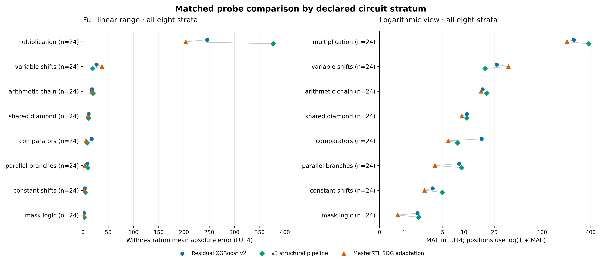
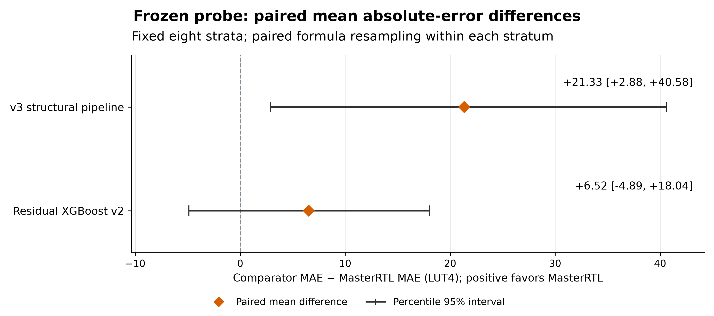

# Results

The evidence supports resource-prediction and processor-integration results. V6 mapping features improve a frozen synthetic comparison by 6.32%, but error tails, feasibility mistakes and incomplete family coverage remain. Earlier V5 gains transfer weakly to three application families. Historical V4’s small advantage over a same-data MasterRTL retrain was inconclusive. Learned acquisition has not beaten simple merit on the prospective primary endpoint. The ML target is isolated LUT4 cost; the CRC32 cycle result comes from a separate matched processor experiment. [Methodology](methodology.md) defines those quantities and their boundaries.

## Latest: V6 mapping features and fresh family calibration

The [V6 study](v6-results.md) adds 23 mapping descriptors while preserving the dual-graph control's 1,665 fitting rows and estimator settings/seed. On 192 new test circuits in 96 structural components, MAE falls from **34.332 to 32.161 LUT4** (6.32%), primary difference **−2.171**, descriptive stratified component interval **[−3.473, −0.938]**. All eight predictors and strata remain; the secondary multiply router reaches 33.191. Separate calibration and test cohorts total 384 original circuits and 824,832 passing RTL comparisons. Positive MAPE is 43.63% on 186 test targets; six zeros remain in MAE. This is a new cohort, not a direct comparison with older headline scores.

Six strata improve, but two large multiplication overpredictions account for 26.95% of mapping's absolute error. Nominal 90% bounds cover 178/192 candidates and only **85/96 complete components (88.54%)**. Mapping makes more point false acceptances than dual graph at 16/32/64-LUT caps. These results support the representation change in this grammar, not improved instruction selection or application transfer. [Reproduce and run inference](v6-reproduction.md).

## External application-derived transfer

The [external V5 study](external-v5-results.md) retains 80 rows/79 unique circuits from Dijkstra, ADPCM decoding and anagram search. Full V5 achieves **6.256 LUT4 family-macro MAE** versus tuned SOG's **6.537** (4.31% reduction), but loses to the fixed MasterRTL adaptation (**5.808**). Dual graph reaches 6.111. All measurements pass, with 169,692 sampled/boundary RTL comparisons. All five Dijkstra formulas are familiar; neither novelty subset has all three families. Full bounds cover 76/80 candidates but only 1/3 whole families. This does not establish broad novel-family transfer or published-system superiority.

## V5: matched feature ablations on two fresh synthetic scopes

The [V5 report](v5-results.md) compares four equally tuned nested feature views and two references after freezing all predictions before 256 original-RTL measurements. Full V5 reaches **21.69 LUT4 MAE** on unseen compositions versus **52.91** for tuned SOG (59.01% reduction); the simpler original-graph view reaches **18.77**. Full V5’s aggregate gain is entirely in multiplication. Its nominal 90% bound covers only **63.16% of whole unseen components**. Nineteen unseen structural clusters and five singly represented strata limit the conditional uncertainty analysis.

Known-family MAE is **3.58** for full V5 versus **13.56** for tuned SOG. Four V5 models share 1,665 fitting formulas, grouped folds and six configuration choices; 392 separate formulas calibrate bounds. All earlier evidence is development data for V5. These findings do not establish CPU or budgeted selection gains. See [reproduction](v5-reproduction.md) and [literature-informed next steps](research-direction-v5.md).

## Historical V4: separate 256-circuit holdout

See [V4 results and replay](v4-results.md) for the complete new experiment. V4 and the matched MasterRTL retrain fit 1,289 development formulas; three frozen historical comparators retain their 713-formula fits. All five sets of predictions precede target measurement. The 256 new synthetic circuits pass 549,888 RTL oracle comparisons and actual iCE40 synthesis.

V4 MAE is **14.8921 LUT4**, versus **15.3243** for same-data MasterRTL, **22.1496** for frozen MasterRTL, **60.6815** for residual v2, and **66.7478** for structural v3. V4 versus same-data MasterRTL's paired difference is −0.4322 LUT4, descriptive 95% interval [−5.5241, 5.5906]. V4's median percentage error is 1.3627% versus 5.5506%; its MAPE and RMSLE are worse (77.9278%/0.5717 versus 76.0172%/0.4600). A zero-target multiplier predicted at 556.2133 LUT4 remains in the score, producing zero-target MAE 26.4863 versus 0.0780. These tradeoffs prevent a blanket superiority claim.

The old 192-formula probe below is development data for V4; its original frozen results remain valid for those earlier artifacts. Cross-stage score differences are not matched comparisons.

## Frozen matched comparison: 713 training, 192 probe formulas

All six models fit the same 713 unique formulas from 1098 occurrences across 17 candidate-bearing programs. All of those program labels are development data for this experiment. The probe comprises 192 canonically novel circuits, eight predeclared strata of 24 each, with 181 positive and 11 zero LUT labels. Every circuit passes oracle checks before actual iCE40 synthesis. Frozen sources, weights, configurations, and predictions precede released probe labels; no post-probe tuning occurs.

| Frozen comparator | Primary MAE, LUT4 | RMSLE | Positive MAPE, % | Median warm 192-input batch, ms |
|---|---:|---:|---:|---:|
| MasterRTL SOG adaptation | 35.0687 | 0.4943 | 36.5042 | 204.801 |
| V2 residual XGBoost | 41.5933 | 0.8076 | 320.1410 | 15.566 |
| V3 structural challenger | 56.4018 | 0.8388 | 478.1287 | 47.125 |
| V2 resource prior | 60.7228 | 0.9297 | 514.2029 | 5.044 |
| V3 original-feature ablation | 60.7228 | 0.9297 | 514.2029 | 10.261 |
| V1 formula XGBoost | 80.8586 | 1.2388 | 165.8149 | 2.854 |

Macro-stratum MAE is the primary endpoint and equals pooled MAE because each stratum has 24 samples. MasterRTL wins that endpoint and the pooled log/relative errors. The original-feature ablation selects the v2 resource prior, so their point predictions coincide. The structural revision does improve some individual strata, but that does not override its worse overall primary score. Full metrics, including Pearson/Spearman and every stratum, are retained in [probe-evaluation.json](../results/2026-10-13-v3/probe-evaluation.json).

The [independent paired audit](../results/2026-10-13-v3/independent-audit.txt) estimates a 21.33-LUT4 advantage for MasterRTL over structural v3, with a descriptive 95% interval [2.88, 40.58]. Against residual v2, the advantage is 6.52 LUT4, interval [−4.89, 18.04], which includes zero. These 10,000 bootstrap draws resample formula pairs within each of the eight fixed groups; they do not resample programs or establish population-level performance. MasterRTL has lower MAE in seven groups and loses on variable shifts.

Large MAPE values are meaningful failures rather than missing data. Each positive error is divided by its own target, so errors on very small implementations can dominate. Multiplication positive MAPE is 2369.2697% for v2 residual, 3860.7234% for structural v3, and 143.3344% for MasterRTL; full-stratum MAEs are 246.2298, 376.8695, and 203.5133 LUT4. All those cases remain in the score. Zero-target MAEs are separately 6.5943, 14.9803, and 3.3961 LUT4. MAPE excludes zeros and is not converted into an accuracy percentage.

This is a synthetic stress comparison of a public recipe adapted to a shared LUT4 task. It neither reproduces MasterRTL's published ASIC-area experiment nor establishes independent real-workload superiority. Canonical novelty excludes identical formulas, while semantic overlap and correlations remain. No calibrated uncertainty interval or population-level significance claim accompanies the six-model probe scores. The [matched reproduction guide](reproduce-matched-comparison.md) records the exact adaptation, freeze chronology, and commands.

Warm timings exclude model loading, process startup, and input/output JSON serialization. MasterRTL includes cache IO, integrity checks, and primitive-graph traversal. A separate same-artifact, same-192-input run with an absent cache takes **7.4315 seconds cold** and **0.2128 seconds warm**, with identical predictions; model loading takes 0.0273 seconds. Preparing all 905 training/probe-input graphs takes 18.3901 seconds with two workers, a different batch from one-worker cold inference. See [timing sidecars](../results/2026-10-13-v3/probe-inference/) and [cold-probe-timing.json](../results/2026-10-13-v3/masterrtl/cold-probe-timing.json). Cached speed cannot be presented as the cost of new-formula preprocessing.

## Earlier prospective workloads: frozen 301-formula models

These scores belong to earlier artifacts trained only on the original 301 formulas. Transfer contributes 167 distinct circuits, including 81 new ones. The final five programs contribute 453, with 331 absent from both training and policy calibration; that final novel subset has 271 positive and 60 zero LUT labels. Those earlier final labels later join the 713-formula development cohort above, so their held-out status applies to the earlier artifacts only.

| Earlier frozen model | First transfer: 81 novel MAE / RMSLE | Final: 331 novel MAE / RMSLE |
|---|---:|---:|
| Original formula XGBoost | 16.216 / 0.973 | 87.595 / 0.755 |
| Nonnegative resource baseline | 12.499 / 0.449 | 23.154 / 0.409 |
| Resource plus residual XGBoost | 10.152 / 0.546 | 33.165 / 0.450 |

The residual model wins first-transfer MAE while the resource baseline wins RMSLE. The simpler baseline wins both final metrics. Distinct-formula and macro-program aggregation answer different questions: final macro-program MAE for residual v2 is 36.264, with a descriptive five-program bootstrap interval [21.560, 51.230]. Small correlated samples prevent treating that interval as broad deployment coverage. Sources: [transfer evaluation](../results/2026-10-13-prospective/transfer/evaluation.json) and [final evaluation](../results/2026-10-13-prospective/final/evaluation.json).

At the primary 64-LUT/one-measurement decision endpoint, first-transfer v1 and residual v2 retain 85.48% of oracle instruction savings versus merit's 100%; the resource baseline also retains 100%. The v1/v2 paired loss versus merit is −14.52 percentage points, with descriptive four-program interval [−43.55, 0]. On the final five programs, merit, all point models, and the conservative policy retain 100%; frequency retains 92.41% and random 6.28%. The observed paired model-versus-merit difference is zero. An observed [0, 0] bootstrap interval does not establish population equivalence, and merit's oracle ceiling limits discrimination.

These decision budgets count new target attempts, not the historical corpus or the exhaustive evaluation oracle. The three stages synthesize 301, 167, and 453 distinct circuits respectively; their sum is 921 stage measurements with cross-stage overlap, leaving 713 unique formulas overall. Full-pool labels enable offline replay, not proof of end-to-end measurement savings. Statemate and nsichneu yield no legal candidates, so the first transfer decision average covers four candidate-bearing programs rather than all six declared workloads. No LLM acquisition result or live gem5 comparison exists.

## Matched CRC32 processor and closed-memory SoC

Two validated custom instructions are integrated through PicoRV32 PCPI and source-level lowering. The closed SoC includes synchronous 8 KiB program/data RAM, the register file, and the same memory handshake in baseline and custom configurations. This is a separate RV32I implementation experiment from the original RV32IM tracing corpus; their cycle counts cannot be mixed.

| Closed SoC configuration | Benchmark cycles | Retired instructions | LUT4 | BRAM4K |
|---|---:|---:|---:|---:|
| Stock baseline | 32,387,382 | 6,094,532 | 1,633 | 20 |
| Two custom instructions | 29,602,102 | 5,572,292 | 1,704 | 20 |

The custom configuration uses 2,785,280 fewer cycles, an 8.60% reduction and 1.09409 baseline/custom cycle ratio, with 71 additional LUT4s. Both pass the complete checksum `0x65842ca9`. Source-wrapper execution and stock firmware on the extended core reproduce baseline results; byte-write/load and out-of-bounds fault controls pass. These simulated cycles and actual synthesis counts include on-chip memory and integration logic. Source: [SoC summary](../results/2026-10-13-prospective/soc/summary.json).

All six matched HX8K/CT256 routes meet 12 MHz with the same pins, memory, constraints, and seeds. Every paired result is retained:

| Seed | Baseline / custom estimated Fmax, MHz | Conditional baseline/custom time ratio |
|---|---:|---:|
| 1 | 71.803 / 67.074 | 1.02203 |
| 2 | 70.897 / 67.454 | 1.04095 |
| 3 | 69.080 / 72.005 | 1.14041 |

Each conditional ratio uses simulated cycles divided by that configuration's estimated routed Fmax; the median paired ratio is 1.04095. These are timing-model estimates rather than measurements on a physical board. Reset/status electrical behavior, power, temperature, and board operation remain unmeasured. Three placement seeds do not establish a statistical population. Sources: [routing summary](../results/2026-10-13-prospective/soc/routing-summary.json) and [cycle/timing comparison](../results/2026-10-13-prospective/soc/routing-timing-cycle-comparison.json).

The earlier core-only experiment assumes immediate external memory and must remain separate: baseline 27,685,314 cycles versus 25,770,434 with one-wait-cycle response, or 25,422,274 with combinational response. Longer custom-response latencies produce slowdowns, demonstrating why instruction-count reduction is insufficient to predict runtime. See [core summary](../results/2026-10-13-prospective/core/summary.json), [SoC integration](soc-integration.md), and [routing methodology](soc-routing.md).

## What remains unproven

The current evidence does not establish improved acquisition over merit, a learned integrated-performance predictor, formal equivalence, broad application or processor transfer, energy savings, or measured FPGA-board speedup. One integrated benchmark and processor, small correlated workload samples, and synthetic probe strata constrain generalization. Useful next measurements must evaluate integrated cycles, clocks, feasibility, and jointly selected instruction sets under an explicit cost budget; isolated resource accuracy alone cannot answer those questions.
