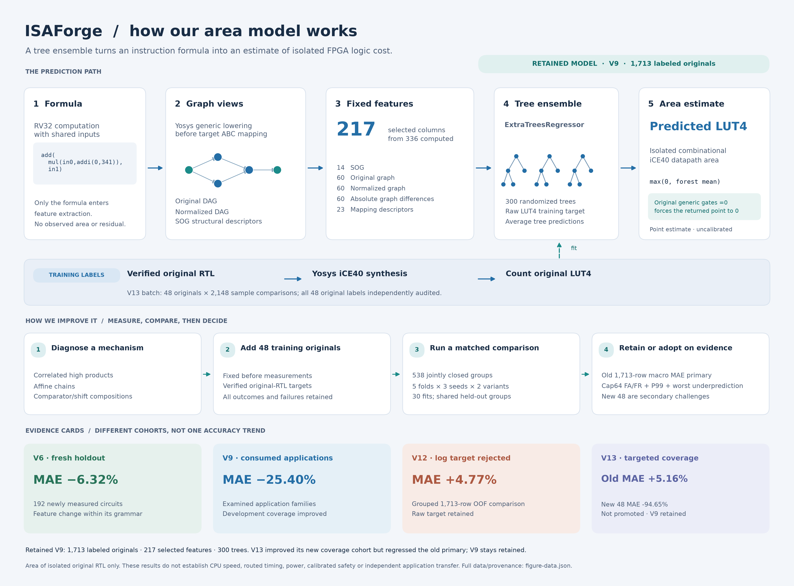

# ISAForge team progress — 2026-10-16

Evidence snapshot: **05:19 UTC, 2026-10-16**. V9 remains the current development model. Targeted training and routing have produced useful development findings, but no new model is promoted and reserved-program input collection is complete, with independent replay passed and model evaluation not yet started. The subsequent feature launch was rejected before any native job by an incomplete local-metadata allowlist. Its evidence is preserved; a narrow amendment is in review. No new features, predictions, area labels or fits have been produced.

## Model and improvement evidence

The retained V9 artifact predicts isolated original-RTL iCE40 LUT4 area using **217 fixed features, 300 ExtraTrees and 1,713 training circuits**. Its inputs describe pre-mapping original/normalized circuit graphs and a simple operator graph. This is an area regressor, not a processor-runtime, timing or energy predictor. [Model explanation](ml-model.md) · [V9 results](v9-coverage-results.md).

[Vector diagram: SVG](figures/ml-model/ml-model-overview.svg) · [PDF](figures/ml-model/ml-model-overview.pdf)

| Development experiment | Gain | Regression or limit | Decision |
|---|---|---|---|
| V13: 48 targeted circuits, common groups/folds, 30 paired fits | New-coverage pooled MAE **480.7060 → 25.7168 LUT4**; high-product MAE **1,396.2852 → 36.6129** | Original 1,713 nine-stratum macro MAE **5.5040 → 5.7882 (+5.16%)**, worse in all three seeds. Original cap64 false rejects rise **44/35/39 → 46/50/47**; false accepts stay **15/16/17**. P99 improves, but maximum underprediction worsens. | **Not promoted; V9 retained.** |
| V14: one structural route over the saved V13 held-out predictions | New-coverage pooled MAE **480.7060 → 27.4819**; every original prediction remains exactly equal to matched control | Gate matches **0/1,713 original** and **16/48 new** rows, so unchanged original error is mechanical preservation, not improved original accuracy. New-cohort maximum underprediction worsens **53.5078 → 173.8583 LUT4**. Gate was motivated by observed V13 behavior. | **Exploratory; no deployed specialist or promotion.** |

[V13 complete results and comparison figures](v13-coverage-results.md) · [V14 mechanism, per-seed metrics and independent replay](v14-specialist-results.md). These are consumed-development comparisons. V14's matched fold control is distinct from the full-data V9 artifact. Different experiment cohorts are not a single improvement curve, and routing's unchanged outputs outside its gate do not guarantee safety inside it.

## CPU hardware tradeoff is separate

The existing CRC32 processor experiment reduces RTL-simulated full-workload cycles **32,387,382 → 29,602,102 (8.60%)**, including the implemented integration. The custom configuration costs **1,633 → 1,704 LUT4**, **655 → 679 FF**, **295 → 297 carry cells**, with **20 BRAM unchanged**.

All three matched routing-seed pairs meet 12 MHz. At that common clock, cycle-based runtime falls 8.60%; at each configuration's own routed Fmax estimate, custom runtime falls **2.16%, 3.93% and 12.31%** across seeds. The LUT4 × runtime proxy is slightly worse in two seeds and better in one. These are conditional routing-model estimates, not physical-board runtimes, power or energy measurements. They do not follow from the ML error improvements. [Hardware ledger and research figure](hardware-tradeoffs.md) · [CPU figure PDF](figures/cpu-hardware-tradeoffs/crc32-hardware-tradeoffs.pdf).

## Reserved-program transfer: collection and independent replay complete

V11b's two capture commands failed at startup because the controlled PATH omitted Spike's `dtc` helper. Both retained raw gzip streams are empty; no workload trace, candidate pool or downstream ML/area stage resulted. The failure and unchanged four historical outcomes remain archived and independently audited as **preserved failure**, not successful transfer. [Failure status](../results/2026-10-16-v11b-transfer-recovery/STATUS.md).

V11c explicitly pins DTC and retains the same six programs, original ELF bytes, complete ROI, extraction policy and finite budgets. Its existing factorial ELF startup preflight passed with exact output **[154, 5]**, exit zero and clean process-group cleanup. The independent input audit passed **224 bindings**, preserving all four reused outcomes and the prior failure; the full suite passed **1,942 tests plus 179 subtests**. These checks validate implementation/preparation, not completion of the long traces. [Environment amendment](v11c-environment-amendment.md) · [Input audit](../results/2026-10-16-v11c-dtc-recovery/input-review/independent-input-audit.json) · [Full-suite log](../results/2026-10-16-v11c-dtc-recovery/input-review/full-suite.log).

The single approved attempt completed at **04:50:46 UTC** with no collector failures: AMMUNITION produced 129 formulas from 166,490,305 traced ROI instructions; PM produced 74 from 91,723,058. Both have zero unknown instructions and pass output/fusion checks. Together with the four reused outcomes, the six-program panel contains **521 program/formula memberships and 327 unique originals**. Recursion remains a valid empty outcome. Independent raw replay passed at 05:13:38 UTC, retaining explicit shared-helper and local-payload limitations; no feature, prediction, label or fit has been released. [Complete collection snapshot and raw-payload limitations](../results/2026-10-16-v11c-dtc-recovery/README.md).

The original all-program error endpoint remains undefined because recursion has a complete but empty eligible pool. Adopted **V11b-E1** instead reports all-six-program coverage and equal-five-family/equal-eligible-program MAE, conditional on all six outcomes being complete and every family nonempty. Factorial then supplies the recurrence-family error; recursion stays visible with unavailable error. The fixed comparison remains V9 versus V6, with no refitting. [Protocol](v11b-transfer-protocol.md) · [Prelabel endpoint adoption](../results/2026-10-16-v11b-transfer-recovery/endpoint-adoption.json).

Raw-stream replay and full-pool input staging are complete. The next evidence gates are separately reviewed feature/prediction freezing and complete-pool target measurement. Until those stages finish, there is no fresh program-transfer score or confirmed generalization gain.

## Frozen comparison inputs

The new `scripts/prepare_v11_model_comparison.py` prepares the complete audited input pool without extracting features, loading models, predicting or reading target labels. It preserves every program/formula membership, seals the pre-reservation 2,929-original reference and separately reports overlap with V6/V9 training. Direct matches and transitive accepted-identity components remain separate diagnostics; skeleton similarity does not establish identity. The complete-pool measurement budget is a proposal until separately released. Independent code review and all 36 synthetic tests pass. The adapter has now sealed all 327 originals and 521 memberships, with zero extraction, inference, target-label reads or fits. The feature/prediction runner and prospective reporting plan are committed before new target measurements. [Input preparation](../results/2026-10-16-v11-model-inputs/preparation.json) · [Reporting plan](v11-comparison-reporting-plan.md).

The first feature release stopped before its claim because the Git/provenance check omitted 36 compact recovery metadata files already bound by the archive. This is an implementation failure, not model performance evidence. The original runner and root are preserved; a new runner will admit only exact authenticated archive members. [Failure record](../results/2026-10-16-v11-frozen-predictions/README.md).
