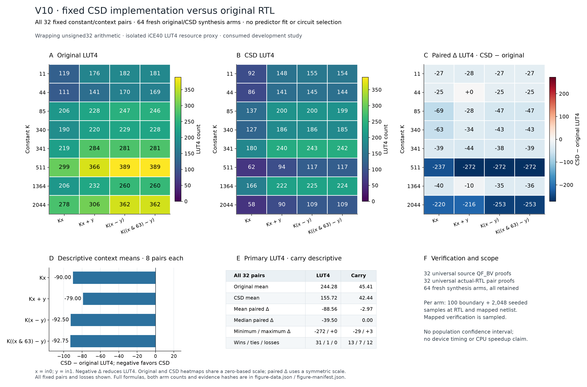
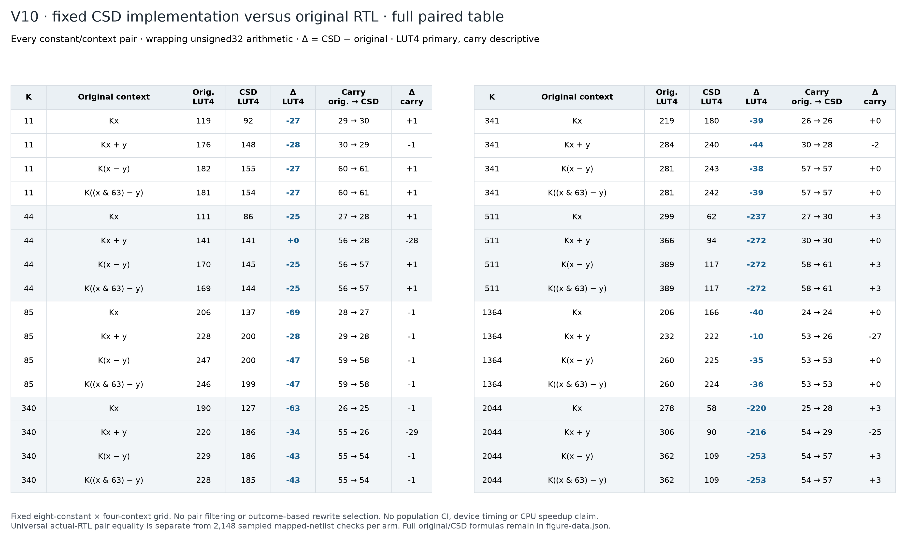

# V10: verified constant-multiply hardware comparison

**The completed V10d comparison saves LUT4 resources in 31 of 32 fixed cases, ties once, and loses none.** It compares one predetermined canonical signed-digit (CSD) implementation against fresh original RTL under identical default iCE40 synthesis settings. The average paired saving is 88.5625 LUT4. Carry usage increases in 12 cases, so LUT reduction alone does not establish dominance on every hardware resource.

This is an implementation experiment on consumed development cases, with no predictor fit. It does not establish a timing improvement, CPU speedup, power reduction, unseen-program generalization or superiority over published ASIC results.

## Complete paired results

| Resource | Original mean | CSD mean | Mean CSD − original | Median delta | Delta range | Lower / equal / higher |
| --- | ---: | ---: | ---: | ---: | ---: | ---: |
| LUT4, primary | 244.28125 | 155.71875 | −88.5625 | −39.5 | −272 to 0 | 31 / 1 / 0 |
| SB_CARRY, descriptive | 45.40625 | 42.4375 | −2.96875 | 0 | −29 to +3 | 13 / 7 / 12 |

All 32 fresh original LUT4 and carry counts match the earlier V9 controls. No prior measurement substitutes for a fresh original arm. For example, direct multiplication by 511 falls from 299 to 62 LUT4, while carry cells increase from 27 to 30. Multiplication by 44 followed by an addition ties at 141 LUT4 and reduces carry cells from 56 to 28. Both outcomes remain visible.



[Vector PDF](figures/v10d-csd-hardware/v10-csd-paired-hardware.pdf) · [Editable SVG](figures/v10d-csd-hardware/v10-csd-paired-hardware.svg) · [Full-precision data](figures/v10d-csd-hardware/figure-data.json) · [Figure source hashes](figures/v10d-csd-hardware/figure-manifest.json)



[Full table PDF](figures/v10d-csd-hardware/v10-csd-full-paired-table.pdf)

## Methodology and correctness

The [V10d protocol](v10d-csd-hardware-protocol.md) preserves the exact 32 inputs, source proofs, original/CSD RTL bytes and tool inventory from the [original protocol](v10-csd-hardware-protocol.md): eight constants in four arithmetic contexts, using wrapping unsigned 32-bit arithmetic. It changes the actual-RTL proof method after the first attempt timed out. Inputs and code were committed at `e65bf64692bb5647efc036299b80dd922ad57728`, then approved before new native jobs. There was one new attempt and no outcome-based filtering, retry or alternative implementation selection.

All 64 native Yosys word frontends completed. The reviewed modular-algebra checker proved universal equality for all 32 pairs of actual parsed RTL functions. Only then did the collector run all 64 fresh mappings, with the unchanged `synth_ice40 -top candidate` flow, carry enabled and no DSP option. Each arm passed 100 boundary and 2,048 seeded checks at both actual RTL and independently interpreted mapped netlist.

The portable audit verified 1,137 raw archive members, replayed 32 word proofs, checked 137,472 concrete word-JSON outputs, and checked 274,944 RTL/mapped outputs while recounting all 64 resource inventories. It reproduced the entire paired summary and proof-before-measurement chronology. Formal replay shares the reviewed universal checker; it is not a separately implemented universal proof or a second native RTL translation. Mapped verification remains sampled. The complete local suite passed 1,318 tests and 111 subtests.

## The previous failure remains part of the record

The V10c native SAT attempt proved 16 of 32 emitted-RTL pairs. Constants 11, 44, 85 and 340 passed in all four contexts; 341, 511, 1364 and 2044 reached the fixed 60-second limit without a reported counterexample. Its gate correctly blocked all 64 area jobs. Its [completion record](../results/2026-10-15-v10c-csd-hardware/measurements/completion.json), all outcomes and raw evidence remain unchanged and incomplete. A timeout was never treated as a proof. V10d explicitly records the subsequent proof-method amendment.

## Reproduce and interpret

From an installed checkout, audit the committed raw evidence without hardware tools:

```sh
python scripts/audit_v10d_hardware.py \
  --root results/2026-10-15-v10d-csd-hardware \
  --output generated/reproduction/v10d/independent-audit.json
```

To rerender all figures, use `scripts/plot_v10d_hardware.py` with the same `--root` and a fresh `--output` directory. It reruns the portable audit first. The [artifact guide](../results/2026-10-15-v10d-csd-hardware/README.md) links preparation, approval, measurements and the raw archive.

These fixed cases support a hardware development result, not a population confidence interval. Carry cells remain separate from LUT4, and the original model still predicts original-RTL area; rewritten labels must not silently replace its targets. A registered timing study must measure the delay implications before any speed claim. The [timing plan](v10-timing-direction.md) defines the common wrapper and matched routing seeds, but its 192 actual routes have not run. The [hardware tradeoff ledger](hardware-tradeoffs.md) separately retains the earlier integrated CPU measurements and unmeasured power/energy endpoints.
