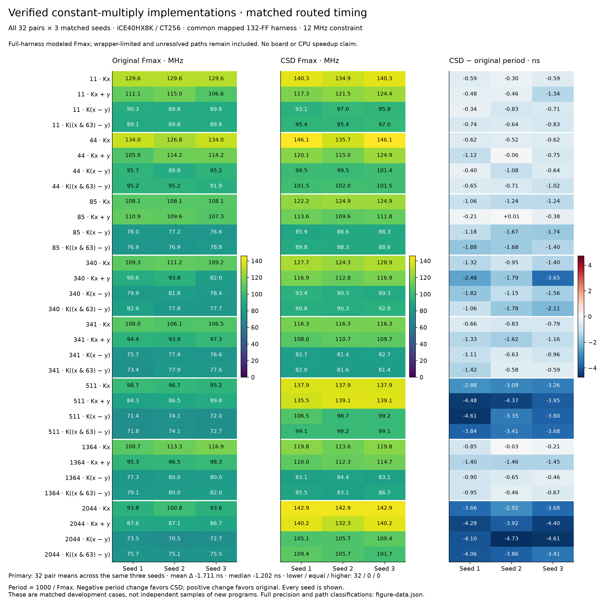
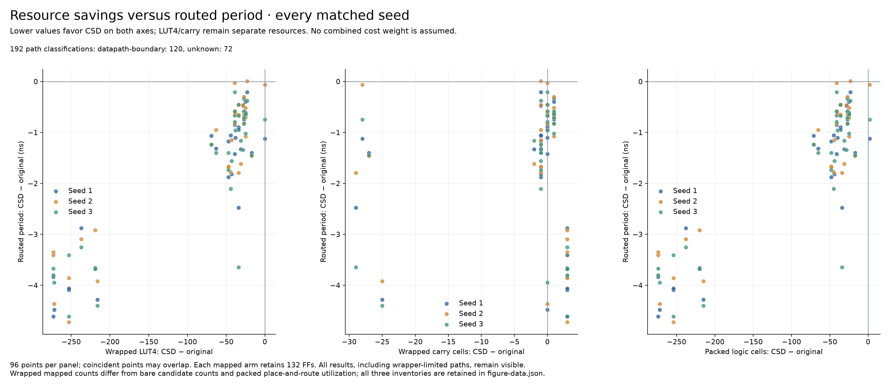

# Matched constant-multiply timing and resource tradeoffs

**All 32 fixed original/CSD circuit pairs have a lower mean routed period after the rewrite.** The average paired change is −1.710802 ns across the same three routing seeds per formula. All 192 routes succeeded and met the 12 MHz constraint. These measurements extend the [area study](v10-csd-hardware-results.md) with registered-harness timing; they do not change the original-area ML model or establish a CPU speedup.

## Complete outcome

| Endpoint | Original → CSD | Interpretation |
| --- | --- | --- |
| Mean full-harness period | 11.104885 → 9.394083 ns | −15.4059% ratio of cohort means; primary mean paired difference −1.710802 ns |
| Formula mean period, three seeds each | 32 lower / 0 equal / 0 higher | Primary denominator is 32 formulas |
| Individual paired seed period | 95 lower / 0 equal / 1 higher | All 96 pairs retained; these are not 96 independent programs |
| Wrapped LUT4 totals across 32 arms | 8,839 → 6,018 | 31 reductions / 1 tie; mean paired change −88.15625 |
| Wrapped carry totals across 32 arms | 1,453 → 1,358 | 13 reductions / 7 ties / 12 increases |
| Mapped flip-flops | 132 → 132 per arm | Identical registered boundary and serial interface |
| Packed logic-cell changes | 93 lower / 0 equal / 3 higher seed pairs | Mean change −88.875; range −274 to +2 |
| Routing failures / timing misses | 0 / 0 out of 192 | Every arm and seed is included |
| Critical-path attribution | 120 datapath-boundary / 72 unknown | Mandatory clock and pin checks pass in every run; attribution remains incomplete |

The one period regression is `85*x+y`, seed 2: 109.637115 → 109.553040 MHz, or +0.006999866 ns. Its three-seed mean still improves. The `44*x+y` LUT tie uses two more packed logic cells in each seed, while using fewer carry cells and achieving a lower period. Resource types therefore remain separate even when timing improves.



[Vector PDF](figures/v10d-timing/v10d-matched-timing.pdf) · [Editable SVG](figures/v10d-timing/v10d-matched-timing.svg) · [Full-precision data](figures/v10d-timing/figure-data.json)



[Tradeoff PDF](figures/v10d-timing/v10d-resource-timing-tradeoffs.pdf) · [Figure provenance](figures/v10d-timing/figure-manifest.json)

## Matched methodology

The [protocol](v10d-timing-protocol.md), collector, auditor, exact original/CSD RTL, common wrapper, tool inventory and two synthetic preflights were frozen at `3a0c44cc79ca845fdad799bdac66c3528174f333`. The release was approved before actual measurements. There was one attempt, no retries, no alternate rewrites, no seed filtering and no new predictor fit.

The cohort contains eight constants in four wrapping unsigned-32-bit arithmetic contexts, exactly matching the completed area experiment. Each arm is synthesized with the same default iCE40 recipe and placed in the same 132-FF serial test harness. All 64 mapped circuits pass 2,148 sequential transactions, with 99 checked clock edges per transaction, before any routing starts. The inherited area study provides 32 universal parsed-RTL equivalence proofs; mapped sequential verification is sampled rather than a universal mapped proof.

Routing uses nextpnr on iCE40HX8K / CT256, the same four fixed pins, a 12 MHz constraint, seeds 1/2/3 and one thread per route. Every packed design retains 132 enabled flip-flops, four I/O cells and one global-clock buffer, with no RAM or PLL. The audit verifies the actual package-pin placements and the top clock's path to every flip-flop. Period is `1000 / reported_Fmax_MHz`. First average each formula's three paired period differences; then weight all 32 formulas equally. No population confidence interval is inferred from these development cases.

Bare candidate, wrapped mapped and packed resources are different inventories. The bare study's LUT4 totals were 7,817 → 4,983; wrapping can change logic optimization, so its overhead is not always a fixed 32 LUTs. The figures preserve every inventory instead of subtracting a presumed wrapper cost.

## What this establishes and what remains unresolved

CSD improves LUT4 use and average registered-harness period on this fixed cohort, while increasing carry usage in 12 formulas. This supports carrying the rewrite into a separately measured integration experiment. It does not justify unconditional adoption under arbitrary carry, timing or workload constraints, and does not demonstrate a novel or globally optimal multiplication method.

The path classifier identifies a datapath boundary in 120 routes. In 72 routes, retained `launch_q` aliases are insufficient for its complete boundary certificate (48 lack `launch_q[0]`, 24 lack `launch_q[32]`). Those routes remain in every result. The mandatory 132-FF clock and pin checks still pass; the limitation prevents claiming that all reported critical paths are exclusively arithmetic. No wrapper delay is subtracted.

These are tool timing estimates for a common harness, not physical-board measurements, exact arithmetic-only delays, processor clock estimates or workload runtimes. Power and energy are unmeasured. The [hardware ledger](hardware-tradeoffs.md) retains the earlier CPU integration result separately. The V9 predictor still targets original-RTL LUT4: no rewritten target replaces its labels, and this hardware result does not repair its prediction or selection errors. Fresh application transfer, a separately defined implementation-aware predictor and CPU integration remain future experiments.

## Replay the raw evidence

```sh
make reproduce-v10d-timing
# or, to an unused output file:
python scripts/audit_v10d_timing.py \
  --root results/2026-10-15-v10d-timing \
  --output generated/reproduction/v10d-timing/independent-audit.json
```

Replay requires Python and the installed proof dependencies, but no Yosys, nextpnr, board or new model fit. It verifies 2,131 raw archive members, 64 mappings, 137,472 sequential transactions / 13,609,728 edge-lane comparisons and all 192 routes. Parent and separate-agent replays produce byte-identical reports. Raw command/resource/report checks are independent of the collector; the audit explicitly reuses the frozen sequential checker and path helper.

To render the figures, run `python scripts/plot_v10d_timing.py --root results/2026-10-15-v10d-timing --output <fresh-directory>`. It first replays the audit. The [artifact guide](../results/2026-10-15-v10d-timing/README.md) links the complete evidence and the historical failed SAT stage remains intact.
