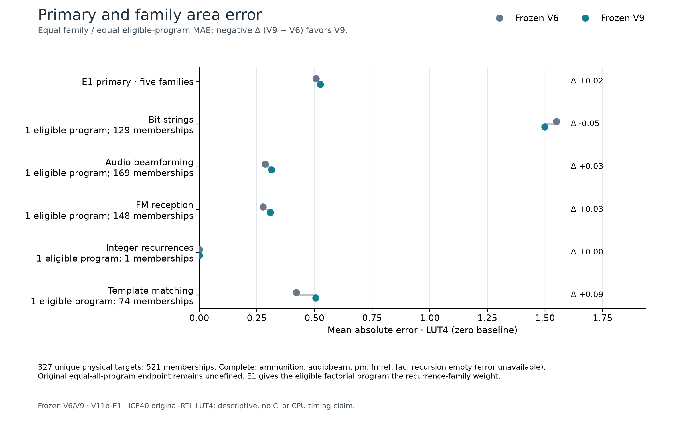
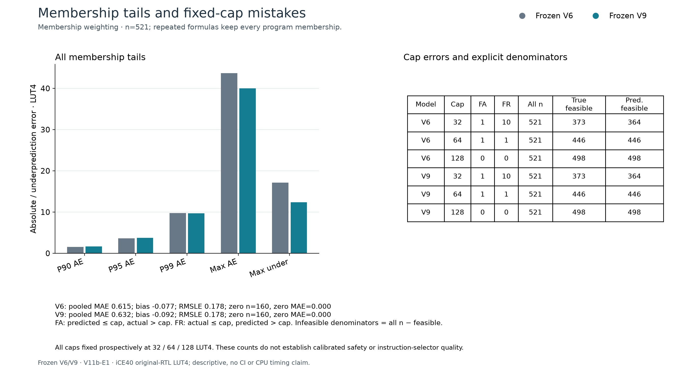
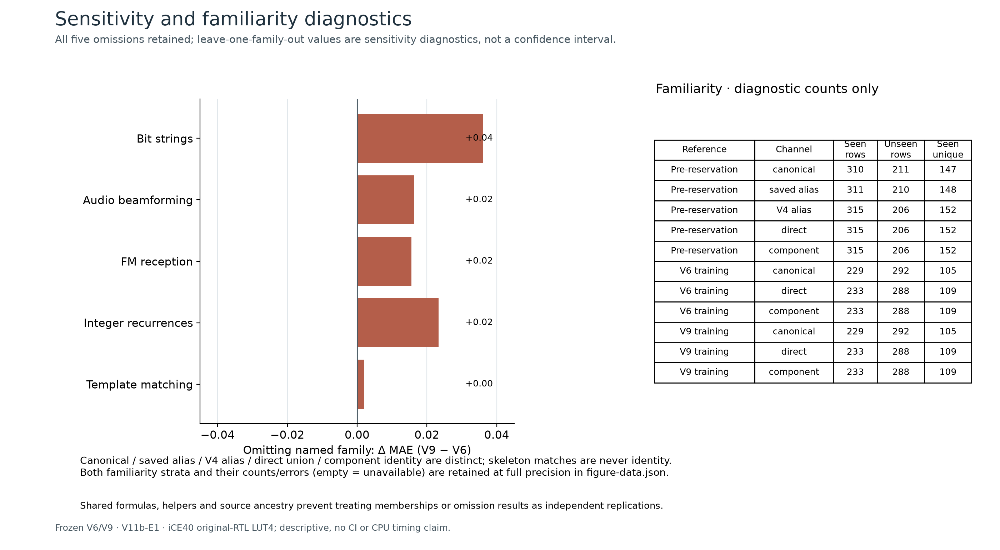

# V11e: completed 327-circuit frozen comparison

**V9 does not improve the primary transfer endpoint.** Equal-five-family MAE is **0.506605 LUT4 for V6 versus 0.525239 for V9**, a **3.68% increase**. All 327 original circuits were measured after freezing all 654 predictions. This result completes the previously unfinished transfer evaluation; it does not invalidate earlier, differently scoped development improvements.

## Matched results

| Family (program) | Memberships | V6 MAE | V9 MAE |
| --- | ---: | ---: | ---: |
| Bit strings (ammunition) | 129 | 1.549599 | 1.498643 |
| Audio beamforming (audiobeam) | 169 | 0.285306 | 0.313205 |
| FM reception (fmref) | 148 | 0.277354 | 0.308491 |
| Integer recurrences (fac) | 1 | 0 | 0 |
| Template matching (pm) | 74 | 0.420766 | 0.505856 |
| **Equal-family primary** | **521** | **0.506605** | **0.525239** |

The sixth program, recursion, has a complete empty candidate pool. Its error is unavailable, not zero. The original equal-all-program endpoint remains undefined. The previously adopted V11b-E1 endpoint averages eligible programs within each family, then gives each of the five families equal weight. The single zero-area fac circuit therefore carries 20% of the primary weight. Removing that family gives **0.633256 → 0.656549**, with the same relative change. Every leave-one-family-out difference favors V6; these are descriptive sensitivity checks, not significance tests.

## Hardware-budget mistakes and error tails

| Secondary metric | V6 | V9 |
| --- | ---: | ---: |
| Pooled membership MAE, 521 rows | 0.614779 | 0.632143 |
| Positive-target membership MAPE, 361 rows | 18.7421% | 18.1441% |
| Zero-target MAE, 160 memberships | 0 | 0 |
| Maximum absolute error, LUT4 | 43.6633 | 40.0267 |
| Maximum underprediction, LUT4 | 17.1167 | 12.4000 |
| Cap32 false accepts / false rejects | 1 / 10 | 1 / 10 |
| Cap64 false accepts / false rejects | 1 / 1 | 1 / 1 |
| Cap128 false accepts / false rejects | 0 / 0 | 0 / 0 |

A false accept predicts a feasible circuit whose measured LUT count exceeds the cap. A false reject excludes a measured-feasible circuit. All threshold counts above use the same 521 program/formula memberships; they are not counts of independent physical circuits. MAPE is the mean of absolute error divided by the positive measured LUT4 count, multiplied by 100. It excludes zero targets only from MAPE. Unique-circuit MAPE instead uses 228 positives and is **29.2700% → 28.2828%**; 99 unique zeros remain in MAE. These different denominators must not be mixed.

V9 improves the worst errors and percentage error but makes no fewer hardware-budget mistakes and loses on the primary MAE. We do not promote it as a generally better transfer model.

## Execution, validation and compute

The recovered feature archive contains 5,920 members and reproduces all 327 full336 feature records; packaging took 12.02 seconds. The original failed packaging receipt remains unchanged. Frozen V6/V9 inference took 7.00 seconds and produced 654 uncalibrated points; their freeze was committed before any new label release.

All 327 original RTL circuits passed **702,396 sampled/boundary output comparisons** and 327 Yosys iCE40 mappings, using at most two mapping workers. Label release to recorded measurement completion took **194.68 seconds**, within the one-hour stage cap. There were no replaced candidates or failed final mapping jobs. A previously declared simulator signed-overflow fallback was exercised once: the identical RTL was recompiled with `-fwrapv` and checked against 100 additional independent Yosys boundary cases. The initial mismatch and fallback evidence remain in the raw archive. These checks are sampled verification, not exhaustive equivalence proof.

An independent target audit reconstructed the RTL/check inputs, recounted all 327 archived netlists and admitted the complete payload. A separate arithmetic review, without importing the scorer, checked 722 values with maximum numerical difference 2.22e-16. Focused recovery tests passed 50 cases; inference/target/audit tests passed 158 cases before execution.

## Scope and next implementation

This is a frozen-model comparison on application-derived originals with fresh labels, not an untouched semantic holdout: input structure had been exposed and recorded overlap with earlier circuits remains. See the overlap/sensitivity panel and source protocol. We make no published-system superiority, CPU timing, energy or learned-selection claim. The target remains isolated iCE40 LUT4 count.

The negative global result motivates one bounded follow-up: retain V6 outside the two arithmetic structures covered by V9's added training, and evaluate a fixed V6/V9 router on 32 separately reserved synthetic circuits. Any router result on this now-consumed 327-circuit panel is retrospective development evidence. The new synthetic panel evaluates related covered-domain behavior, not new application-family transfer.

[Audited evidence and replay](../results/2026-10-19-v11e-frozen-comparison/README.md) · [E1 protocol](v11b-transfer-protocol.md) · [Execution bounds](v11e-execution-plan.md) · [Source-level overlap](../results/2026-10-16-v11-model-inputs/overlap.json)

All four figures are available as PNG, editable SVG and vector PDF in [the figure directory](figures/v11e-transfer/); their exact inputs and hashes are retained there.
