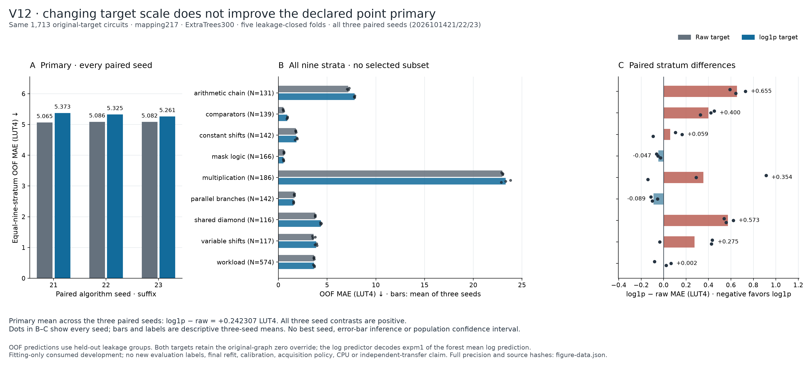
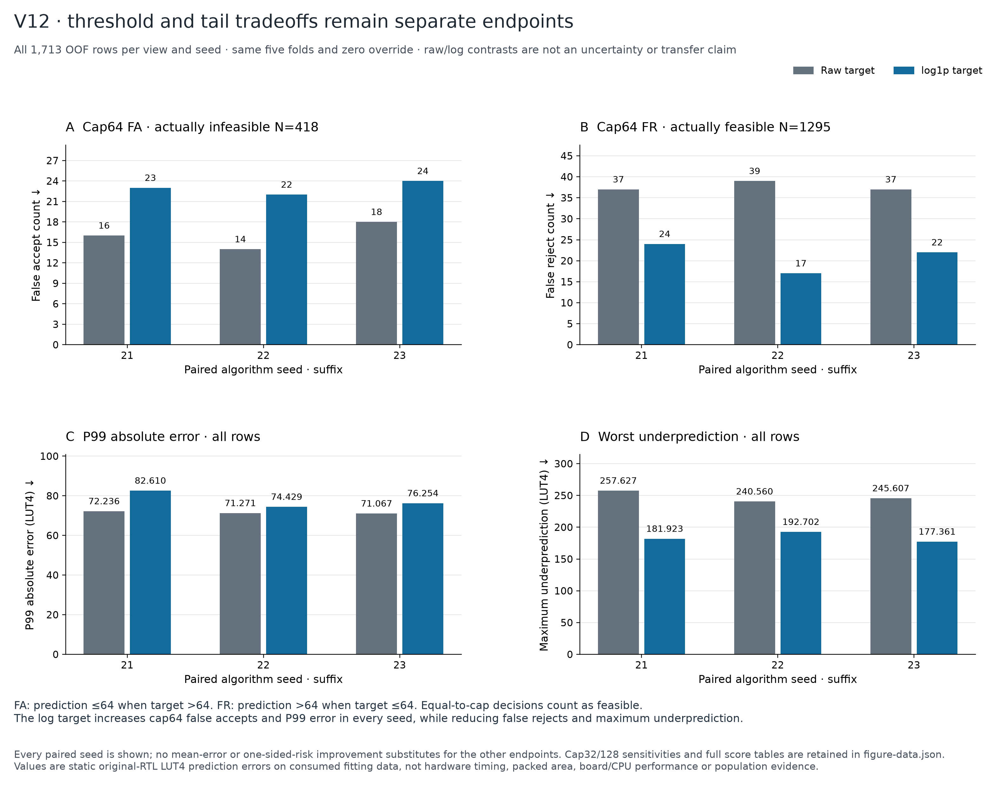

# V12 target-scale comparison

**Decision: retain raw-target fitting.** Fitting the same ExtraTrees model to log-transformed LUT4 targets worsens the declared nine-stratum macro MAE in all three seeds and increases over-budget false accepts. Lower MAPE does not support adopting this candidate.

All **30 fits** completed: two target views × five grouped folds × three paired seeds, with 1,713 circuits, the same 217 float32 mapping features, and 300 trees per model. No new circuit labels, feature extraction, solver queries or outside evaluation targets were used. These are consumed-development out-of-fold results, not independent transfer or CPU results.

## Matched results

The table averages each metric over the three algorithm seeds. It does not treat those seeds as independent programs or provide a population confidence interval.

| Metric | Raw target | log1p target |
| --- | ---: | ---: |
| **Nine-stratum macro MAE, LUT4 (primary)** | **5.077686** | 5.319993 |
| Pooled MAE, LUT4 | 5.151033 | 5.323253 |
| Positive MAPE, % (1,461 positive targets) | 24.062606 | 20.781248 |
| RMSLE (all 1,713 targets) | 0.245567 | 0.232172 |
| Zero-target MAE, LUT4 (252 targets) | 0.227937 | 0.136794 |
| P99 absolute error, LUT4 | 71.524667 | 77.764505 |
| Maximum underprediction, LUT4 | 247.931111 | 183.995598 |
| Signed bias, prediction minus target, LUT4 | 0.128565 | -1.584985 |

The primary paired log-minus-raw difference is **+0.242307 LUT4 (+4.77%)**. Its sample SD across algorithm seeds is 0.064682 LUT4. This is descriptive seed variation, not uncertainty over new applications.

| Seed | Raw macro MAE | Log macro MAE | Raw cap64 false accepts / rejects | Log cap64 false accepts / rejects |
| --- | ---: | ---: | ---: | ---: |
| 2026101421 | 5.064777 | 5.373339 | 16 / 37 | 23 / 24 |
| 2026101422 | 5.086156 | 5.325191 | 14 / 39 | 22 / 17 |
| 2026101423 | 5.082127 | 5.261449 | 18 / 37 | 24 / 22 |

At cap64, each seed evaluates **418 actually infeasible** and **1,295 actually feasible** circuits. False acceptance means predicting ≤64 LUT4 when measured area is >64; false rejection is the converse. The log candidate accepts more circuits: it reduces false rejections while adding false accepts. Maximum underprediction improves, but P99 absolute error worsens in all three seeds. These endpoints are kept separate.

## Every stratum

| Stratum | Circuits | Raw MAE, LUT4 | Log MAE, LUT4 |
| --- | ---: | ---: | ---: |
| arithmetic chain | 131 | 7.165225 | 7.819851 |
| comparators | 139 | 0.510320 | 0.910032 |
| constant shifts | 142 | 1.794703 | 1.853514 |
| mask logic | 166 | 0.571466 | 0.524348 |
| multiplication | 186 | 22.977867 | 23.331922 |
| parallel branches | 142 | 1.642437 | 1.553008 |
| shared diamond | 116 | 3.779952 | 4.352507 |
| variable shifts | 117 | 3.603481 | 3.878573 |
| workload | 574 | 3.653726 | 3.656183 |

Only mask logic and parallel branches improve in seed-mean MAE. Multiplication remains the largest-error stratum, followed by arithmetic chains. The transformation does not add the correlated-high-product training examples identified in the earlier [coverage diagnosis](v12-model-direction.md).



[Vector PDF](figures/v12-target-transform/v12-primary-and-strata.pdf) · [SVG](figures/v12-target-transform/v12-primary-and-strata.svg)



[Vector PDF](figures/v12-target-transform/v12-cap64-and-tails.pdf) · [Full-precision figure data and hashes](figures/v12-target-transform/figure-data.json)

## Why this comparison is more reliable

The [input protocol](v12-model-direction.md) was fixed before fitting. The 528 transitive groups preserve inherited components, accepted canonical/commutative aliases, exact float32 feature collisions and complete coverage contexts. Five validation folds contain 366, 373, 339, 317 and 318 rows; all nine strata remain represented in every training partition. Every row is forecast exactly once per target view and seed. Groups prevent the declared identity leakage; they do not establish independence between all possible semantic relatives.

Both views use squared-error ExtraTrees with identical parameters and splits. The log model returns `max(0, expm1(mean_tree_log_prediction))`; no fitted bias correction or best-seed choice is applied. Both share the original-generic-zero override. Original RTL labels remain unchanged.

The stronger grouping and added coverage rows differ from older development experiments. Their numerical scores cannot be used as a matched before/after improvement. V9 remains the current full-data development predictor; this experiment does not produce a new deployment model.

## Reproduction and artifacts

All six forecast files retain **10,278 out-of-fold predictions**, alongside every fit receipt, model hash, parameters, inputs, target scale, summary and completion record in the [result archive](../results/2026-10-15-v12-target-transform/README.md). The frozen preparation and independent input/release checks precede fitting.

Thirty fold model files total **179,716,740 bytes** and are retained locally under the result directory. They are intentionally excluded from Git; this checkout ships the complete saved-point evidence rather than all cross-validation forests. Model inference requires those retained joblib files and compatible dependencies. Saved-point score replay does not reconstruct the forests.

Reproduce scores and the two figures with `make reproduce-v12 PYTHON=.venv/bin/python` from an installed research environment; the output directory must be new. Score-only replay needs only Python's standard library:

```sh
python -I -S scripts/audit_v12_results.py \
  --root results/2026-10-15-v12-target-transform \
  --output generated/v12-score-replay.json
```

Actual inference from the retained local forests is a separate command, with no retraining fallback:

```sh
.venv/bin/python scripts/replay_v12_model_inference.py \
  --root results/2026-10-15-v12-target-transform \
  --output generated/v12-model-replay.json
```

## Next experiment

Retain raw-target fitting and address measured support gaps. The bounded direction is a separately frozen coverage batch for correlated high products, affine chains, and comparator/shift contexts, with matched controls. It must be evaluated on all declared cases and caps; a later unconsumed application cohort is still required to establish transfer. The current result supplies no ASIC, power, CPU-speedup, or learned-selection claim.

Independent validation passed in two separate ways: [saved-point/receipt replay](../results/2026-10-15-v12-target-transform/independent-results-audit.json) reconstructs every metric and threshold decision with the standard library; [actual model inference](../results/2026-10-15-v12-target-transform/independent-model-inference.json) reloads all 30 local forests and reproduces all 10,278 encoded, decoded, and final points exactly, with no fitting. The numerical score replay retains 218 floating-point rounding differences within its declared 1e-12/8-ULP tolerance; all counts and JSON types match exactly.
