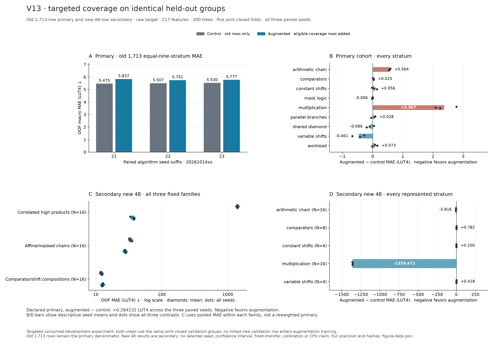
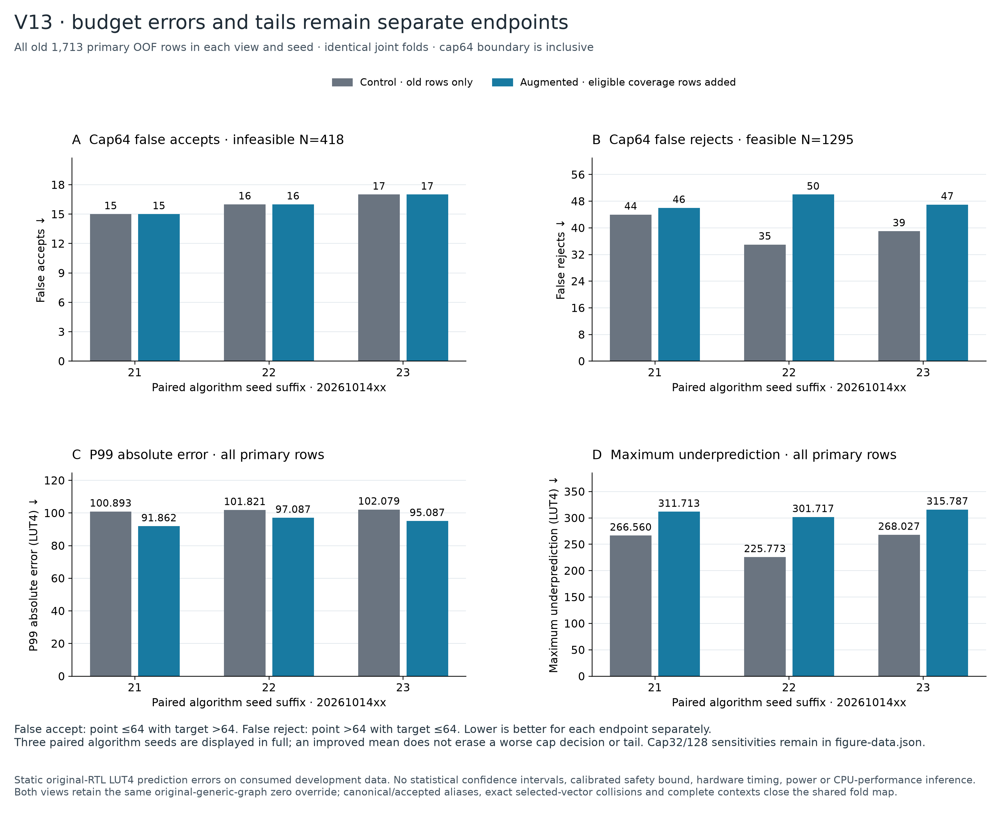

# V13: targeted coverage improves new cases but regresses the original cohort

Adding 48 circuits greatly improves prediction on the new coverage families, but the matched 30-fit experiment worsens the primary original-cohort macro MAE **5.5040 → 5.7882 LUT4 (+5.16%)**. All three paired seeds worsen. **The augmented model is not promoted; the current V9 development predictor is retained.**



[Vector PDF](figures/v13-coverage/v13-primary-and-coverage.pdf) · [Editable SVG](figures/v13-coverage/v13-primary-and-coverage.svg) · [Full-precision figure data](figures/v13-coverage/figure-data.json)

## Measured data and fair comparison

The fixed candidate grid contains 16 correlated high products, 16 masked affine chains and 16 comparator/shift compositions. All 48 original RTL implementations passed **103,104** sampled/boundary output comparisons and completed Yosys iCE40 synthesis. The independent audit reproduced expected outputs, original RTL identity and all 48 LUT4/carry counts from 540 authenticated archive members. Labels range from 0 to 745 LUT4.

The first V13 attempt failed before any labels or RTL comparisons because the controlled C++ environment could not find `cstdint`. Its failed archive remains intact. [V13b](v13b-coverage-recovery.md) is an explicit prelabel environment amendment: all six scientific input files were copied byte for byte, and an actual worker preflight verified explicit SDKROOT propagation. No candidates were replaced.

Feature extraction completed 112 pre-ABC graph/SOG processing runs for all 48 candidates. The same fixed 217 features and 300-tree ExtraTrees settings are used in both variants. The combined 1,761 rows form 538 groups, with shared assessment folds of 372, 382, 349, 329 and 329 rows. Group construction uses inputs, not labels; all training partitions retain the nine original strata.

Control training includes eligible original rows only. Augmented training adds eligible new rows. Both exclude all rows in the assessment group and predict identical held-out examples. Five folds × three paired seeds × two variants produces **30 fits and 10,566 held-out predictions**. The primary endpoint is equal-nine-stratum macro MAE on the original 1,713 examples; the new 48 examples remain secondary. There is no full-data refit or automatic deployment.

## Original-cohort results

Values below average the three algorithm seeds. They are development results on consumed data, not an independent program-transfer test. Seed variation is not a population confidence interval.

| Metric on original 1,713 | Control | Augmented | Interpretation |
| --- | ---: | ---: | --- |
| **Nine-stratum macro MAE, LUT4 (primary)** | **5.5040** | **5.7882** | **5.16% worse** |
| Pooled MAE, LUT4 | 5.6020 | 5.8974 | Worse |
| Positive-target MAPE, % | 23.4439 | 23.0568 | Slightly better; excludes 252 zero targets |
| P99 absolute error, LUT4 | 101.5978 | 94.6788 | Better |
| Maximum underprediction, LUT4 | 253.4533 | 309.7389 | Worse |

The paired primary differences are **+0.361933, +0.243712 and +0.247051 LUT4**, with mean +0.284232 and descriptive seed SD 0.067312. Original multiplication-stratum MAE increases 28.0132 → 30.3800; arithmetic-chain MAE increases 6.1392 → 6.7030. Variable shifts improve 3.5648 → 3.1034. Six of nine original strata worsen on the seed mean.

At a 64-LUT budget, false accepts remain **15/16/17** across the three seeds. False rejects increase **44/35/39 → 46/50/47**. Thus better P99 error does not establish better hardware-budget decisions. All caps, tails and per-seed values are preserved in the [full summary](../results/2026-10-15-v13b-coverage-recovery/fitting/fit-attempt-0000/summary.json).



[Vector PDF](figures/v13-coverage/v13-cap64-and-tails.pdf) · [Editable SVG](figures/v13-coverage/v13-cap64-and-tails.svg)

## New-coverage results

These are held-out predictions within the same consumed-development comparison. Each family has 16 rows. The pooled reduction is dominated by the high-product family and must not replace the original-cohort primary result.

| New coverage endpoint, mean MAE in LUT4 | Control | Augmented |
| --- | ---: | ---: |
| All 48, pooled | 480.7060 | 25.7168 |
| Correlated high products | 1,396.2852 | 36.6129 |
| Masked affine chains | 33.6606 | 27.8449 |
| Comparator/shift compositions | 12.1723 | 12.6926 |

The new-cohort maximum underprediction worsens 53.5078 → 173.8583 LUT4 even while its overall MAE falls. Its cap64 false accepts change 0/1/1 → 1/1/1; false rejects stay 4/4/4.

## What this changes about the research direction

The experiment supports targeted data collection for missing arithmetic behavior: high-product errors shrink sharply when related training support is present. It also shows that globally refitting the forest can hurt previously supported cases. A next hypothesis is an input-defined specialist or constrained correction that preserves the incumbent on unrelated structures. Such a method needs a separately frozen comparison and new transfer evidence; this result does not validate it.

The area model still does not predict processor runtime, Fmax or energy. The [hardware ledger](hardware-tradeoffs.md) reports those separate measurements and their limits. These FPGA results do not establish superiority over published ASIC studies.

## Reproduction and evidence

The [result directory](../results/2026-10-15-v13b-coverage-recovery/README.md) contains the original inputs, releases, measurement and feature archives, joint folds, all predictions and fit receipts. Independent saved-point replay verified all 139 input bindings, 30 receipts and 10,566 predictions; small floating-point arithmetic differences were recorded within the stated tolerance, with counts and decoding exact. Separate inference loaded all 30 saved forests and reproduced all predictions exactly.

The 30 forests occupy 155,017,667 bytes and remain local. Committed receipts retain their hashes and parameters; committed prediction records support score reproduction without model files. Saved-point replay is distinct from model inference and retraining.

```sh
python scripts/audit_v13_comparison.py --action results \
  --root results/2026-10-15-v13b-coverage-recovery \
  --output /tmp/isaforge-v13-results-audit.json
```

Choose a fresh output path: the auditor preserves existing reports rather than overwriting them.

`make reproduce-v13` replays scores and regenerates the comparison figures in a fresh output directory. `make model-diagram` regenerates the model overview. The input/group audit reuses project helpers and requires the installed Python project dependencies; it does not invoke native synthesis, fitting or saved-model inference.
