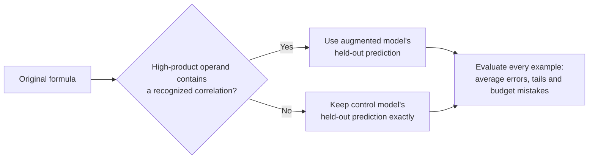

# V14: preserve the control outside correlated high products

A fixed structural route preserves every original-cohort prediction while retaining most of V13's new-coverage gain. This is **post-hoc development analysis of existing out-of-fold predictions**, not a fresh test or a deployed model. V9 remains the current development artifact.

Here, control means the V13 fold-matched, original-data-only predictor. It is distinct from the full-data V9 artifact; no deployed predictor was changed.

The single gate selects the augmentation-trained predictor when a formula contains a high-half multiply (`mulh`, `mulhu` or `mulhsu`) with an operand subtree matching either existing V7 correlation pattern: `(x OR K) - x` or `x - (x AND K)`. The repeated atom must contain an input. An input-containing expression can still simplify to a constant; the gate does not claim otherwise. All other formulas return the exact control prediction.

The gate does not use target values, model outputs, errors, cohort names, family names or formula whitelists. It has no fitted thresholds. Its source and recipe were committed at `06cb6db` before scoring this one variant. The mechanism was chosen after examining V13 failures, so the result remains exploratory despite that freeze.

## Measured outcome

The route matches **0 of 1,713 original examples** and **16 of 48 new examples**. All six original/augmented point sets use the same V13 folds; each routed prediction chooses between two models that both held out that example's group. No additional models, synthesis labels or solver queries were produced.

Values average all three paired seeds:

| Endpoint | Control | Global augmentation | Structural route |
| --- | ---: | ---: | ---: |
| Original 1,713: nine-stratum macro MAE, LUT4 | 5.5040 | 5.7882 | **5.5040** |
| Original 1,713: pooled MAE, LUT4 | 5.6020 | 5.8974 | **5.6020** |
| Original 1,713: maximum underprediction, LUT4 | 253.4533 | 309.7389 | **253.4533** |
| New 48: pooled MAE, LUT4 | 480.7060 | 25.7168 | **27.4819** |
| New 48: maximum underprediction, LUT4 | 53.5078 | 173.8583 | **173.8583** |

Every original prediction is unchanged, so original-cohort caps, tails and per-stratum metrics are unchanged too. This preservation follows from the fallback rule and zero gate matches in the original cohort; it is not evidence of improved original-cohort accuracy. The new-cohort average improves sharply, but its worst underprediction remains worse than control.

## Why it helps, and what remains unproven

The [V13 diagnosis](v13-regression-diagnosis.md) finds that global refitting changed 1,370 original predictions. Gross absolute-error losses exceeded gains even though slightly more rows improved than worsened. Routing isolates the new prediction behavior to a specific arithmetic structure, leaving other outputs untouched. That is a deterministic property outside the gate, not a statistical safety guarantee inside it.

The 16 routed training examples cover two root-`mulhsu` contexts. The broader gate also admits other high-product operations and nested operand structures, for which this experiment supplies no transfer evidence. New applications may match no examples, or may produce gated inputs the augmented predictor handles poorly. No independent-program, calibrated-budget, timing, energy or CPU gain is established.

Before promotion, freeze a deployable predictor pair and evaluate new programs and previously unmeasured gated structures. Report gate coverage, ungated identity, errors within the gate and hardware-budget decisions separately. Preserve empty-extraction programs as coverage outcomes rather than assigning them zero prediction error.

## Evidence

- [Fixed recipe](../results/2026-10-16-v14-specialist-development/routing-plan.json)
- [Complete per-seed metrics](../results/2026-10-16-v14-specialist-development/routing-results.json)
- [All 5,283 routed decisions and predictions](../results/2026-10-16-v14-specialist-development/routing-predictions.json)
- [Source review](../results/2026-10-16-v14-specialist-development/routing-source-review.json)
- [Independent routing replay](../results/2026-10-16-v14-specialist-development/independent-routing-audit.json)
- [Reusable independent replay and source receipt](../results/2026-10-16-v14-specialist-development/independent-routing-audit-replay.json)

The underlying 30 V13 forests and 10,566 source forecasts were independently replayed before this analysis. This routing stage evaluates their saved out-of-fold points; it does not fit or load a new deployment artifact.

Reproduce with `make PYTHON=.venv/bin/python reproduce-v14` in the installed project environment. Its fresh output directory retains the replay report. The [literature note](research-specialization-2026-10-16.md) explains how this hypothesis relates to prior transfer, expert-routing and model-compatibility research.
