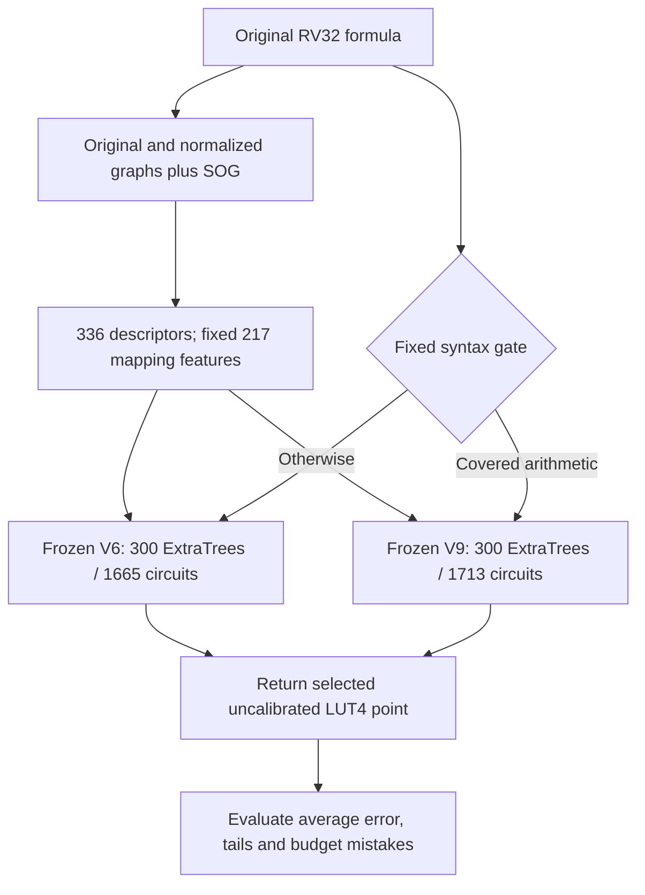
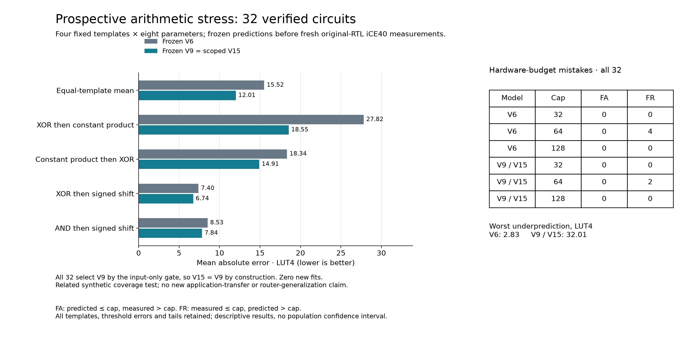

# V15: scoped reuse of arithmetic training coverage

The fixed router uses V9 for two syntactic arithmetic classes and V6 elsewhere. On **32 prospective synthetic stress circuits**, it reduces equal-template MAE from **15.5211 to 12.0093 LUT4 (22.63%)** and cap64 false rejections from **4 to 2**. However, worst underprediction increases from **2.8267 to32.0067 LUT4**. **V15 remains experimental; it is not promoted as a reliable hardware-budget predictor.**

All 32 stress circuits select V9 by construction. Thus the new test supports V9's performance within these related arithmetic compositions; it does not show that routing itself beats V9, or that the model generalizes to new application families. On the already-inspected327-circuit V11 panel, V15 selects V6 for all 327 cases and preserves every V6 point exactly. That is a retrospective mechanical preservation result, not an independent improvement over V6.

## Implemented model

The gate recognizes a low multiply with a positive syntactic constant1..2047, or the signed-shift difference `sub(srai(A,k),srai(B,31))`, where both A and B contain an input and k is0..31. It reads the original AST, without target labels or prediction thresholds. The selected model's complete point dictionary and zero override are preserved. Current cached inference computes both frozen models before selecting; this is a functional research implementation, not a latency optimization or a newly trained forest.

## Prospective measured result

| Fixed template (8 originals each) | V6 MAE | V9 = V15 MAE |
| --- | ---: | ---: |
| XOR then constant product | 27.8183 | 18.5462 |
| Constant product then XOR | 18.3421 | 14.9075 |
| XOR then signed shift | 7.3979 | 6.7408 |
| AND then signed shift | 8.5263 | 7.8425 |
| **Equal-template primary, 32 originals** | **15.5211** | **12.0093** |

All four template means improve. P99 absolute error falls **40.0677 →30.6685 LUT4**, while signed bias changes **+15.3445 →−2.5143**. The decrease in overprediction comes with a larger underprediction tail; lower average error alone is insufficient for budget-critical decisions.

| Hardware threshold | V6 false accepts / rejects | V9 = V15 false accepts / rejects | Measured feasible |
| --- | ---: | ---: | ---: |
|32 LUT4 |0 /0 |0 /0 |0 /32 |
|64 LUT4 |0 /4 |0 /2 |16 /32 |
|128 LUT4 |0 /0 |0 /0 |16 /32 |

The zero cap32 mistakes are uninformative about accepting feasible candidates because no measured candidate is feasible at that cap. Zero observed false accepts on this small panel are not a safety guarantee.

## Execution and limitations

The final 32 originals and code were committed at `9860124c8f405b2cbd9443646a340946f27f9175`. Their complete 96 V6/V9/V15 predictions were frozen before target mapping. All 32 passed **68,736 sampled/boundary RTL comparisons** without the simulator-overflow workaround and all 32 mapped successfully. The feature, inference, verification and target pipeline took **43.49 seconds**, with at most two workers, within the 900-second limit. **No training, tuning, calibration, retry or post-freeze replacement ran.**

The first proposed 32-input draft was rejected before scientific execution because four fourth-template originals already appeared in historical development inputs. [Input amendment V15-I1](../archive/2026-10-19-v15-preflight/README.md) preserves that draft and replaces the entire fourth template before the final freeze. All final 32 inputs passed the same canonical/saved-alias novelty check against seven reference sets. This is not proof of semantic independence. The 32 parameters are clustered within four deliberately related templates, so circuit-level independence and population confidence intervals are not claimed.

The independent reviewer recounted all 32 netlists, reconstructed all 68,736 expected vector outcomes, checked all 867 raw-file hashes and 66 cleaned worker receipts, and confirmed every target started after the point freeze. All 83 arithmetic checks agree within 1.78e-15. The final project suite passed 2,468 tests and 179 subtests.

[Protocol and compute limits](v15-scoped-protocol.md) · [Evidence, audit and inference replay](../results/2026-10-19-v15-scoped-stress/README.md) · [Retrospective327 preservation review](../results/2026-10-19-v15-retrospective/README.md) · [Completed frozen V11 comparison](v11e-transfer-results.md)

## Next useful improvement

Keep this result as evidence that targeted coverage helps some arithmetic classes while global updates can shift unrelated predictions. The next experiment should separate point accuracy from conservative feasibility decisions: calibrate an upper resource bound on a distinct group-held calibration set, then freeze both routing and bounds before a genuinely new mixed application panel. Compare that policy with V6, V9 and simple merit under the same synthesis budget. Report false accepts, best feasible instruction regret and inference/measurement cost together. The observed32.01-LUT underprediction must motivate the next study, not become a margin tuned on this test. No further training or hardware job is launched by this report.
