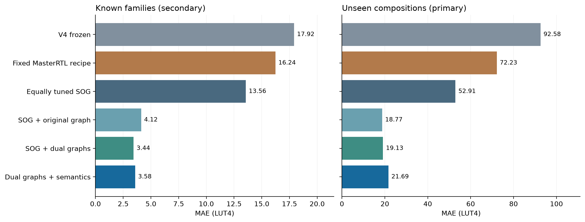

# V5: stronger graph features, matched estimators, and explicit transfer limits

V5 improves the fresh synthetic comparison substantially, but its full semantic
feature set does not outperform the simpler original-graph view. Upper-bound
calibration fails to retain nominal coverage on unseen compositions. Both are
research findings to retain, not reasons to replace the primary endpoint.

The [protocol](v5-protocol.md), [model freeze](../results/2026-10-14-v5/freeze.json)
and all six prediction lists were committed in `fc338e8` before target-label
release. The [complete scores](../results/2026-10-14-v5/evaluation.json) retain
every test row, stratum, feasibility threshold and comparison.

## Design and results

All 1,545 previously inspected formulas became development data. Another 512
development circuits passed verification and synthesis. Of the resulting
2,057 formulas, whole structural groups assign 1,665 to fitting and 392 to
calibration. Five grouped folds select among the same six configurations for
each nested feature view. All four views select 300-tree ExtraTrees with minimum
leaf size one. Calibration does not participate in fitting or selection.

The new test has two scopes, each containing 128 circuits and eight equally
weighted strata. All 256 original-RTL circuits pass sampled/boundary verification
and original iCE40 synthesis: 549,888 RTL/oracle comparisons, zero collection
failures. Full V5 adds 119 semantic features to original SOG and two generic
graph channels. All V5 views apply the same original-graph zero rule.

| Predictor | Known MAE | Known MAPE | Unseen MAE | Unseen MAPE | Unseen RMSLE |
| --- | ---: | ---: | ---: | ---: | ---: |
| Frozen V4 | 17.92 | 111.71% | 92.58 | 92.89% | 0.686 |
| Fixed MasterRTL recipe, matched fit | 16.24 | 102.90% | 72.23 | 40.15% | 0.428 |
| Equally tuned SOG | 13.56 | 102.91% | 52.91 | 30.97% | 0.371 |
| SOG + original graph | 4.12 | 17.52% | **18.77** | 12.70% | 0.164 |
| SOG + original/normalized graphs | **3.44** | 21.59% | 19.13 | **12.37%** | **0.157** |
| Full V5: dual graphs + semantics | 3.58 | 22.86% | 21.69 | 13.28% | 0.173 |

MAE units are LUT4. Known-family MAPE uses 125 positive targets; all three zero
targets remain in MAE/RMSLE. All 128 unseen targets are positive. The different
MAPEs reflect different target distributions, not a universal accuracy score.



The primary full-V5 minus equally tuned SOG difference is **−31.22 LUT4**,
a **59.01% MAE reduction**. The descriptive paired cluster interval is
**[−72.75, −2.11]**. Against frozen V4, MAE drops from 92.58 to 21.69; this
comparison also changes training data and evaluation design, so it does not
isolate the feature contribution. The same-row, same-budget V5 ablation does.

The full model's aggregate improvement comes entirely from multiplication:
that stratum improves from 348.23 to 97.42 LUT4 MAE. Across the other seven
strata combined, full V5 is slightly worse, 10.87 versus 10.72 LUT4. This is
evidence of improved multiplier-cost prediction on this cohort, not uniform
improvement across novel compositions. All eight strata remain in the primary
endpoint; the non-multiplier breakdown is a post-test diagnostic.

The original-graph view has lower observed unseen MAE than full V5 by 2.92 LUT4;
the descriptive interval for full V5 minus original graph is [1.04, 4.97].
It remains an ablation result rather than a replacement primary endpoint.
Future model selection must use a new untouched evaluation.

## What remains wrong

* **Multiplier generalization.** Multiplication accounts for 56.15% of full
  V5's unseen absolute error. Its stratum MAE is 97.42 LUT4. The largest miss
  is a shifted signed/unsigned high-product composition: measured 1,224,
  predicted 1,485.39. Partial-product structure, signed replication and output
  demand remain useful hypotheses for the next revision.
* **Extra semantic features are not a demonstrated gain.** They improve the
  fitting-only selection score slightly but worsen this held-out primary MAE.
  Simpler graph descriptors merit serious consideration. A larger model or
  more engineered features must earn their complexity on new data.
* **Bounds fail under structural shift.** The full model's 90% nominal bound
  covers 97.66% of known-family circuits and 96.81% of known whole components,
  but only 82.03% of unseen circuits and 63.16% of unseen whole components.
  Exchangeability is not established. These bounds must not be treated as
  reliable feasibility guarantees for new families.
* **Limited independent family replication.** The known scope has 94 clusters;
  the unseen scope has only 19. Five unseen strata each contain one cluster.
  Bootstrap resampling rejects draws missing any stratum: 116,355 attempts
  yield 10,000 valid unseen draws. Its conditional intervals cannot estimate
  between-family uncertainty in the singly represented strata.
* **Calibration imbalance.** The 145 calibration components contain only
  14 multiplication formulas and two mask/logic formulas. Overall calibration
  counts do not imply strong per-stratum calibration.

At a 64-LUT cap, full V5 makes four false accepts and two false rejects among
known-family circuits, and two of each among unseen circuits. All cap-specific
denominators remain in the score artifact; these point-prediction counts do not
establish a budgeted acquisition benefit.

## Reproduce and continue

```sh
make reproduce-v5 PYTHON=.venv/bin/python
```

This validates frozen provenance, recomputes all six scores and exports four
figures as PDF, SVG and PNG under `generated/reproduction/v5/report/`.
It does not fit a model or invoke hardware tools. Actual artifact inference
and native-tool requirements are in the [reproduction guide](v5-reproduction.md).
The schema's `training_dataset_sha256` identifies the complete 2,057-row ledger;
`split.json` identifies the 1,665 rows actually used for fitting.

Independent replay confirms all six saved artifacts reproduce all 256 frozen
predictions exactly from isolated populated caches with Yosys lookup disabled.
The raw audit recounts all 768 new development/test netlists and checks their
original RTL, scripts, logs and verification hashes. A separate statistical
implementation reconstructs every metric, comparison and calibration quantile.
See the [audit records](../results/2026-10-14-v5/audit/).

Actual full-V5 inference from an absent cache takes **34.33 seconds** for 256
formulas, excluding **0.138 seconds** of model loading. It performs 671 native
Yosys extractions. Three warm repeats have a **2.91-second median** with no
extraction calls; a separate warm CLI process takes 4.20 seconds including
startup and serialization. These costs are substantial relative to the recorded
84.17-second verification-plus-mapping run. Different work and concurrency
prevent interpreting their ratio as demonstrated measurement savings. Other
V5 views currently share the complete extraction pipeline, so their warm times
do not benchmark an optimized SOG-only implementation.

The [research direction](research-direction-v5.md) connects the changes to
MasterRTL, FPGA custom-instruction estimation and constrained optimization.
Published headline metrics use different devices, programs and operation sets;
these results do not establish published-system superiority. The next evidence
needed is untouched application-family transfer, followed by a prospectively
budgeted selection policy and integrated CPU validation.
