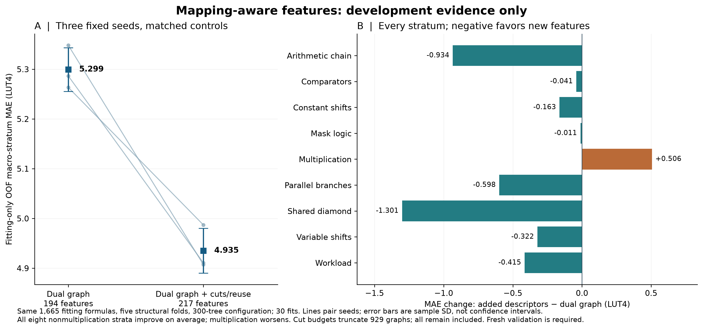

> Historical research direction. Its proposed priorities are superseded by the [current project contract](../README.md) and [handoff](HANDOFF.md). Preserve the evidence below; it does not authorize new LUT-model, RTL-agent, or GNN work.

> Evidence: [complete retained development study](../results/2026-10-14-development-router/README.md). This is development-only, not a new independent test.

# V6 development: conditional semantics and mapping-aware representation

The useful immediate change is a fixed input-only router: use dual graph on
nonmultiply formulas and full semantics on multiply formulas. On the existing
1,665 fitting rows, its mean nine-stratum macro OOF MAE is **5.200987 LUT4**,
compared with **5.246948** for full semantics and **5.305404** for dual graph.
This is a small development improvement; it does not repair severe residuals,
calibration, or application transfer. No test or external outcome was accessed,
no model was fitted, and no hardware tool was invoked in this study.

## Fixed experiment and all outcomes

`scripts/develop_v6_targeted.py` and nine passing contract tests implement two
predeclared variants. The parser routes formulas containing `mul`, `mulh`,
`mulhu`, or `mulhsu` anywhere in the AST to full semantics. All other formulas
use either dual graph or original graph, depending on the fixed variant. This
is a deterministic syntax classifier, not a fitted classifier or a family-name
lookup. A dead multiplication still triggers the gate; no postresult exception
was added. Both variants and all controls/seeds/strata remain in `summary.json`.

The study reuses the matched ExtraTrees OOF predictions from the same five
frozen component folds and five seeds, 2026101421–2026101425. It validates exact
fitting indices, component disjointness, inputs, labels, and prediction identity.
The seed study supplied 75 previous fits; this experiment performs zero new
fits. There are no changed thresholds, tuned blend weights, calibration reads,
or extra feature/target measurements. The plan and input/source hashes were
written before router scores were calculated.

| Fixed variant | Mean macro OOF MAE | Sample SD across seeds |
| --- | ---: | ---: |
| Original graph control | 5.420463 | 0.053502 |
| Dual graph control | 5.305404 | 0.039051 |
| Full semantics control | 5.246948 | 0.034276 |
| Original graph + semantics on multiply | 5.274306 | 0.020909 |
| Dual graph + semantics on multiply | 5.200987 | 0.039954 |

The dual-base router beats full semantics by 0.045961 LUT4 (0.876%) and dual
graph by 0.104417 (1.968%), in all five paired seeds. Its differences from full
semantics by seed are -0.046463, -0.012020, -0.024477, -0.051270, -0.095575.
The original-base router improves its base by 0.146156 in all five seeds, but
is 0.027358 worse than full semantics on average and loses to it in four seeds.
Reporting that lower-cost control prevents overstating the benefit of routing.

The gate selects full semantics for 187 rows: 154 multiplication-stratum rows
and 33 workload rows. The other 1,478 use the named base. Compared with dual
graph, the dual-base router improves multiplication MAE by 0.919370 and workload
MAE by 0.020383; all other strata remain exactly unchanged. Compared with full
semantics it reduces arithmetic, mask-logic, and variable-shift MAE by 0.132509,
0.186084, and 0.406900, but regresses constant shifts, parallel branches, and
shared diamonds by 0.059037, 0.100847, and 0.210799. It therefore does not establish
uniform improvement across nonmultiply structures.

Maximum underprediction across seeds remains **210.566667 LUT4**, identical to
full semantics and larger than the original-graph control's 196.386667. Five
stable seed results do not bound systematic error, and seed spread is not a
confidence interval. The router has no validated uncertainty bound.

## Why multiplication drives the gain

This is an inference from the existing development observations and the source
representation, not an external measurement. Multiplication contains repeated
partial-product and carry logic; demanded output bits, signedness, constant
patterns, and reusable operands strongly affect how much survives. V5 adds
explicit multiplier-demand/range/sign descriptors at
`isaforge/structural_features_v5.py:330` and `:396`; the global graph summaries
cannot expose every such dependency. Its semantic improvement is therefore
plausibly concentrated where those extra variables identify relevant regimes.

By contrast, adding 119 semantic columns to every ExtraTrees fit can change
splits and feature competition even on nonmultiply formulas. The router result
is consistent with this negative-transfer explanation, but does not prove its
cause: experts remain globally trained, and no conditional expert training or
permutation-importance causality experiment was performed. Further enlarging
the model search would not identify the missing circuit mechanisms.

MasterRTL motivates bit-level simple-operator representation as a bridge from
RTL to synthesized structure. Its evaluated task and technology are broader
PPA estimation, not this isolated iCE40 LUT4 endpoint; the paper is a useful
representation precedent, not evidence that its accuracy transfers here.
[MasterRTL, Fang et al., ICCAD 2023](https://arxiv.org/abs/2311.08441).

## Next representation experiment

Keep the original implementation graph and original-RTL targets. Equivalent
normalized syntax may expose function, but is not a replacement for the
implementation whose LUT count is predicted. The previously audited original
versus normalized discrepancy makes that distinction material.

A compact next ablation should add a small fixed block of **4-feasible-cut,
reuse, and area-flow descriptors**, first on nonmultiply development circuits.
The mapping literature defines cuts as frontiers intercepting every input path,
uses maximum fanout-free cones (MFFCs) for removable local area, and shows that
mapping depends on structural choices and area recovery. These mechanisms
are richer than V4/V5's support/fanout histograms and one greedy-cover scalar.
[Improvements to Technology Mapping for LUT-Based FPGAs, sections 2–5,
Mishchenko et al., FPGA 2006](https://people.eecs.berkeley.edu/~alanmi/publications/2006/fpga06_map.pdf).

Concretely, enumerate at most eight nondominated cuts per node with at most
four leaves, using a fixed ordering and explicit truncation counter. Derive
cut-size histograms, minimum cut depth, alternative-cut counts, fanout-weighted
area-flow summaries, and output-cone shared versus exclusive node fractions.
Compare equal raw gate/support statistics with different cut/reuse structure.
Keep LUT-cover proxies separate from carry-chain proxies; neither is a measured
SB_LUT4/SB_CARRY count. These are proposed descriptors, not an optimal mapper or
new algorithm. The eight-cut budget and depth/size/area-flow priorities follow
established priority-cut mapping practice. Their usefulness still needs a
controlled ablation against the current greedy descriptor.
[Combinational and Sequential Mapping with Priority Cuts, sections 3.3 and
4.1–4.4, Mishchenko et al., ICCAD 2007](https://people.eecs.berkeley.edu/~alanmi/publications/2007/iccad07_map.pdf).

For a later, larger representation study, local truth-table fingerprints of
small feasible cuts can distinguish functions with similar topology. Exhaustive
truth tables are feasible at four leaves, without assuming sampled functional
similarity proves equivalence. DeepGate2 provides a precedent for explicitly
learning functional information through pairwise truth-table differences; it
does not establish that a GNN or its original supervision improves LUT4 area.
[DeepGate2, Shi et al., ICCAD 2023](https://arxiv.org/abs/2305.16373).

## Data and acquisition before a V6 claim

Prioritize new **independent groups**, not additional constants or seeds for
existing templates. Development error concentration suggests collecting deeper
nonmultiply arithmetic, reconvergent/shared cones, dynamic shifts with masked
amounts, and combinations of these, alongside multiplier sign/width/demand and
operand-reuse regimes. Record whether a source is an application family,
synthetic grammar family, implementation rewrite, or constant variant. All
semantic or syntactic rewrites of one source must remain in the same split.

Before any later label acquisition, select a bounded cohort using only source,
input, generic graph and novelty information: stratified coverage of operator
mix/depth/support/reuse plus fixed per-source caps. Do not rank acquisition only
by model disagreement; the development examples already show confident,
seed-stable mistakes. Freeze the cohort, extraction budget, failures, source
versions and original implementations. Preserve mapping failures and report
measurement cost and candidate yield. No new hardware acquisition was performed
for this report.

OpenABC-D demonstrates retaining synthesis histories and intermediate AIGs,
which motivates stronger provenance and intermediate representations. Its AIG
node/delay labels are not interchangeable with original iCE40 LUT4 labels, and
its synthesis variants must not masquerade as independent application families.
[OpenABC-D, Chowdhury et al., 2021](https://arxiv.org/abs/2110.11292).

## Evaluation and calibration

Treat this router and its scores as development evidence. Reserve new
application families for a once-frozen V6 evaluation. Keep original graph, dual
graph, full semantics, and the fixed router as declared controls; compare on
identical inputs, original circuits, budgets and folds. Report equal-family
MAE, pooled/unique-formula secondary metrics, per-family/tail error, worst
underprediction and cap false acceptance. Quantify exact, normalized,
full-feature and skeleton overlap with every consumed cohort; if a novelty
subset lacks a family, report its family macro as unavailable.

Calibrate the **final composite predictor**, using untouched groups at the unit
of the intended claim. Existing experts' margins cannot simply be attached to
a new routed model. Application-family coverage needs complete exchangeable
family calibration groups and enough such groups for the requested quantile;
ordinary graph/template component calibration does not establish that claim.
A small number of observed families cannot validate a broad 90% statement.
Report observed finite-bound fraction, candidate coverage, whole-family
coverage, slack, width and feature-domain diagnostics separately.

The nonexchangeable conformal literature explicitly quantifies coverage loss
through distributional differences, with meaningful bounds requiring additional
control on those differences. It does not justify curing arbitrary structural
shift by choosing a larger margin after inspecting failures.
[Conformal Prediction Beyond Exchangeability, Barber et al., Annals of
Statistics 2023](https://arxiv.org/abs/2202.13415).

The deterministic gate costs O(AST nodes) and introduces no learned classifier.
A deployed router would hold two expert artifacts; it need execute only one per
formula. The existing frozen extractor still computes all 313 columns, so the
observed routing ratio establishes no runtime saving. View-aware extraction,
model memory, cold/warm timing and end-to-end acquisition costs need separate
measurement before a speed claim. No deployed V6 artifact, new bound, or V5
replacement was created.

## Reproduction and evidence

```sh
.venv/bin/python -m pytest -q tests/test_develop_v6_targeted.py
.venv/bin/python scripts/develop_v6_targeted.py \
  --output /absolute/path/outside/repository/new-run
```

This directory retains `plan.json`, exact script snapshot, ten complete routed
OOF prediction lists and `summary.json` with every control/variant/seed/stratum.
Nine tests cover all four multiply operators, dead products, deterministic exact
routing, invalid inputs, OOF index/identity/label alignment, macro weighting and
protected output placement. Frozen external/V5 sources and target outcomes were
not modified or inspected.

## Completed mapping-feature prototype

The [retained development experiment](../results/2026-10-14-development-mapping/README.md) now tests 23 cut/reuse/area-flow descriptors: mean macro MAE falls 6.87% from 5.299 to 4.935 LUT4 across three fixed seeds. All eight nonmultiplication strata improve, multiplication worsens, and worst-case underprediction is not uniformly better. All 929 graphs with truncated cut enumeration remain. These fitting-only results motivate fresh V6 validation; they do not replace either V5 test.


