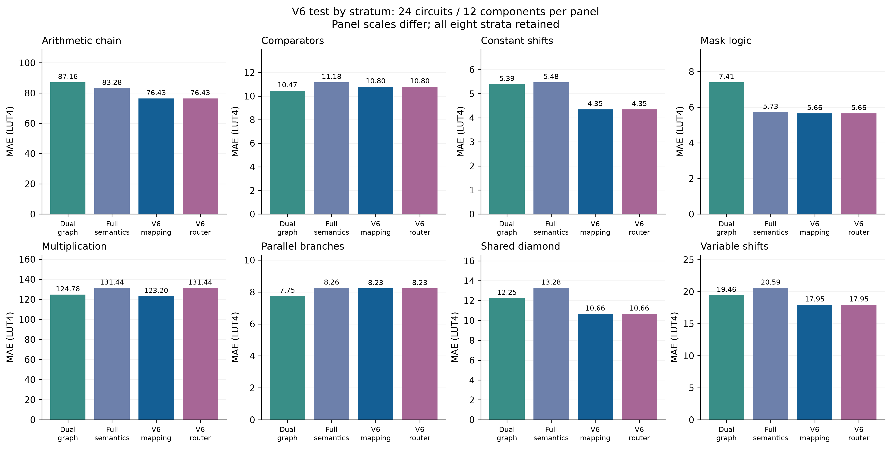
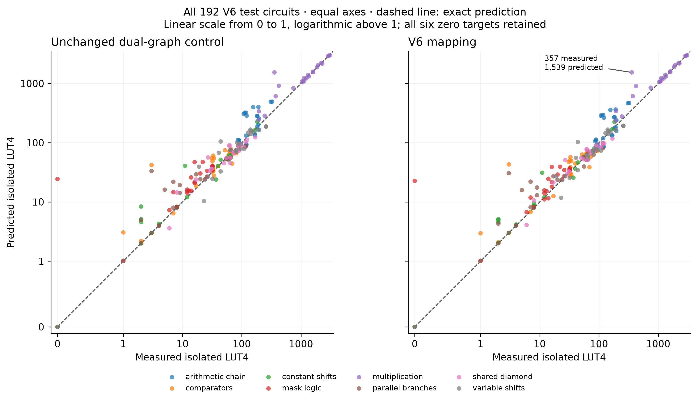
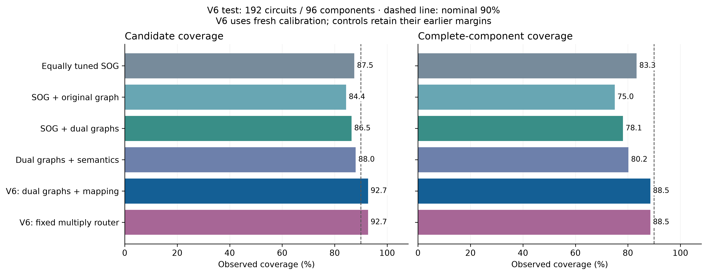

# V6: mapping features improve a frozen structural-family test

Adding 23 mapping descriptors reduces equal-stratum MAE from **34.332 to
32.161 LUT4**, a **6.32% reduction**, on 192 newly measured circuits. The
preregistered paired difference is **−2.171 LUT4**, with a descriptive 95%
component-bootstrap interval **[−3.473, −0.938]**. This supports the feature
change within the declared synthetic grammar. It does not establish better
application transfer, instruction selection, CPU performance or published
benchmark accuracy.

## What changed

The primary predictor adds bounded four-leaf feasible-cut, area-flow, sharing and
reconvergence descriptors to the existing 194-column dual-graph view. These
are generic-graph proxies motivated by established FPGA mapping methods;
they do not run target mapping or claim a new mapping algorithm. The final
estimator has 217 columns. It uses the **same 1,665 fitting circuits,
300-tree ExtraTrees parameters and random seed** as the unchanged dual-graph
control. No fresh calibration or test labels enter fitting.

A separate, predeclared router selects the frozen V5 semantic expert for
formulas containing multiplication and the new mapping model otherwise.
Its observed error is higher than the mapping model's. It remains a
secondary result and does not replace the primary comparison.

The [development ablation](v6-development-direction.md), [frozen protocol](v6-protocol.md)
and [reproduction guide](v6-reproduction.md) retain the rationale and commands.

## All frozen predictors

| Predictor | Equal-stratum MAE, LUT4 | RMSLE | Positive MAPE |
| --- | ---: | ---: | ---: |
| V6 mapping | **32.161** | **0.469** | **43.63%** |
| V6 fixed multiply router | 33.191 | 0.469 | 43.73% |
| SOG + original graph | 33.844 | 0.514 | 52.34% |
| SOG + dual graphs: primary control | 34.332 | 0.502 | 49.37% |
| Dual graphs + semantics | 34.903 | 0.501 | 50.42% |
| Equally tuned SOG | 46.339 | 0.614 | 75.63% |
| Fixed MasterRTL recipe | 61.469 | 0.688 | 85.67% |
| V4, unchanged | 101.580 | 0.966 | 181.87% |

All eight strata have 24 circuits, so pooled MAE equals equal-stratum MAE.
MAPE divides each absolute error by its own measured positive LUT4 target;
it uses **186 positive targets**. All **six zero targets** remain in MAE and
RMSLE. V6 mapping's zero-target MAE is 3.786 LUT4 and median positive APE is
15.21%. MAPE is not an accuracy percentage. The older models retain their
recorded training and selection histories; this is not an equally tuned
eight-model search.

The test contains **96 two-variant structural components**, 12 per stratum.
The bootstrap resamples complete paired components within every stratum
10,000 times. Every draw retains all eight strata. The interval conditions on
this grammar and these strata; components are not independent source programs.
Inputs exclude recorded identities, skeletons and feature vectors shared
with prior consumed corpora and calibration. Those checks do not prove
complete functional nonequivalence.

## Where it improves and where it fails

| Stratum | Dual-graph MAE | V6 mapping MAE | Difference, LUT4 |
| --- | ---: | ---: | ---: |
| Arithmetic chain | 87.160 | 76.429 | −10.731 |
| Comparators | 10.466 | 10.803 | +0.337 |
| Constant shifts | 5.393 | 4.350 | −1.042 |
| Mask logic | 7.406 | 5.656 | −1.750 |
| Multiplication | 124.775 | 123.200 | −1.575 |
| Parallel branches | 7.752 | 8.231 | +0.479 |
| Shared diamond | 12.248 | 10.663 | −1.586 |
| Variable shifts | 19.457 | 17.954 | −1.503 |

Six strata improve, with most of the aggregate gain in arithmetic chains.
The paired measured-versus-predicted plots retain all zero targets and the
large overpredictions on the same axes:

Multiplication remains the largest error source. One retained formula,
`add(add(mulhsu(sub(ori(in1,255),in1),slli(in0,16)),in1),in1)`, measures
**357 LUT4** but is predicted at **1,538.847**, an error of **1,181.847**.
The corresponding second constant variant is also a large failure. This
suggests missed operand correlations and simplifications; it is a post-test
diagnostic, not proof that a proposed rewrite improves prediction.

Mapping's signed bias is +19.540 LUT4; its 95th-percentile absolute error is
145.661 and its worst underprediction is 94.830. All 24 arithmetic-chain
cases have at least one estimator feature outside its training range.
Tree spread and feature-range flags are descriptive diagnostics, not
confidence estimates or an evaluated abstention policy.

Post-test diagnostics attribute 61.78% of the net MAE gain to arithmetic
chains. The two largest errors account for 26.95% of mapping's total absolute
error; the ten largest account for 50.45%. Only one test target exceeds the
fitting-label maximum of 3,050 LUT4, and that case contributes 1.08% of total
absolute error. The tree model's inability to extrapolate beyond its training
targets therefore cannot explain most of the observed error.

## Calibration and decision usefulness

The separate 192-circuit calibration cohort has 96 complete components.
The fixed one-sided 90% rule uses rank 88 of component-maximum residuals,
giving margins of **30.823 LUT4** for mapping and **28.950** for the router.
Fitted trees and point predictions remain unchanged.

Both V6 predictors cover **178/192 candidates (92.71%)** and **85/96 whole
components (88.54%)**. The latter is below nominal 90%; neither result is a
whole-application coverage guarantee. All bounds are finite. Mapping's
worst bound miss is 64.007 LUT4. Old controls retain their original V5
calibration, so differences in bound coverage cannot be attributed solely
to feature changes.

At a 64-LUT cap, the mapping point estimate falsely accepts 6 of 87
infeasible candidates and rejects 5 of 105 feasible candidates. Using its
upper bound removes those false acceptances in this test but rejects
**38 of 105 feasible candidates**. At 256 LUT, the bound still falsely
accepts 2 of 24 infeasible candidates. At 16 LUT, it rejects all 49 feasible
candidates. Better aggregate coverage therefore does not establish useful
budgeted instruction selection.

The unchanged dual-graph point model makes three false acceptances at 64 LUT,
versus mapping's six; it also makes fewer at 16 and 32 LUT. Four mapping
bound misses have no out-of-range selected feature, so a simple range check
would not identify every failure. Area MAE improvement alone is insufficient
to validate a feasibility gate.

## Measurement and reproducibility

All **384 original circuits** across calibration and test pass verification
and synthesis, with no failures or post-label replacements. Each has 100
boundary and 2,048 random input pairs: **824,832 comparisons** in total.
Independent audits recount every netlist and recompute every retained oracle
output. Calibration totals 53,246 LUT4 and 6,778 carry cells; test totals
41,902 LUT4 and 5,965 carry cells. These sums describe separate isolated
circuits, not a combined processor implementation.

Point models and predictions were committed at `60128277` before calibration
release. Calibrated artifacts and test bounds were committed at `abf321cc`
before test release. Two independent audit paths check raw evidence,
predictions, calibration, metrics and stage chronology. Actual cold/warm CLI
runs and replay with poisoned candidate outcome metadata preserve every frozen
prediction field. Corrupted model artifacts are rejected.
The first training attempt failed a serialization fingerprint check before
labels; its evidence is retained. A padding-independent fingerprint repair
produced exactly the same tree weights on retry. Total work includes both
fits; only the successful retry entered the frozen experiment.

Run `make reproduce-v6` to restore and hash-check both raw-evidence archives,
verify the Git freeze history, recompute the metrics and bootstrap, and render
PNG, editable SVG and vector PDF figures. See the [evidence index](../results/2026-10-14-v6/README.md)
and [inference guide](v6-reproduction.md). The optional
[descriptor-cache wrapper](v6-cached-inference.md) is a separate exact-output
runtime optimization; it does not alter the frozen accuracy experiment.

A fresh `git clone --no-local` of evidence commit `7c25a91d` restored both
archives into initially absent destinations and checked all 2,716 file
hashes. The relocated scorer reproduced every evaluation field except its
timestamp, without borrowing feature caches or raw files. The repository
test suite passes 618 tests and 40 subtests at this publication stage.

The separate cache preserves every feature and prediction field. On the
fixed 384-input corpus, three alternating pairs reduce median warm extraction
plus mapping prediction time from **19.824 to 8.681 seconds (2.28×)**. This
excludes native cold-cache acquisition and model loading. The first descriptor
cache build takes 19.570 seconds; the saving applies to later repeated use.

## Next experiments

1. Diagnose correlated operands and modular arithmetic cancellation, and
   validate any rewrite over RV32 bit-vector semantics before using it as a
   new feature channel. Current test labels are consumed development evidence
   for any such revision.
2. Test on untouched, independently sourced application families. The
   [previous application-transfer study](external-v5-results.md) still favors
   the fixed MasterRTL recipe, and V6 has no fresh application result.
3. Evaluate whether uncertainty helps select useful instruction sets at a
   fixed measurement budget, including false rejections, instruction overlap,
   integrated cycles and clock period.

The [latest literature review](research-update-2026-10-14.md) connects these
directions to graph-to-source distillation and microarchitecture-aware
selection, while keeping their reported targets separate from LUT4 error.
