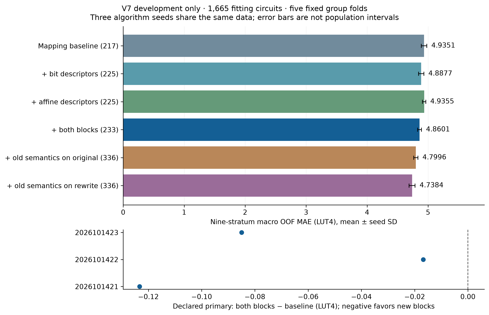
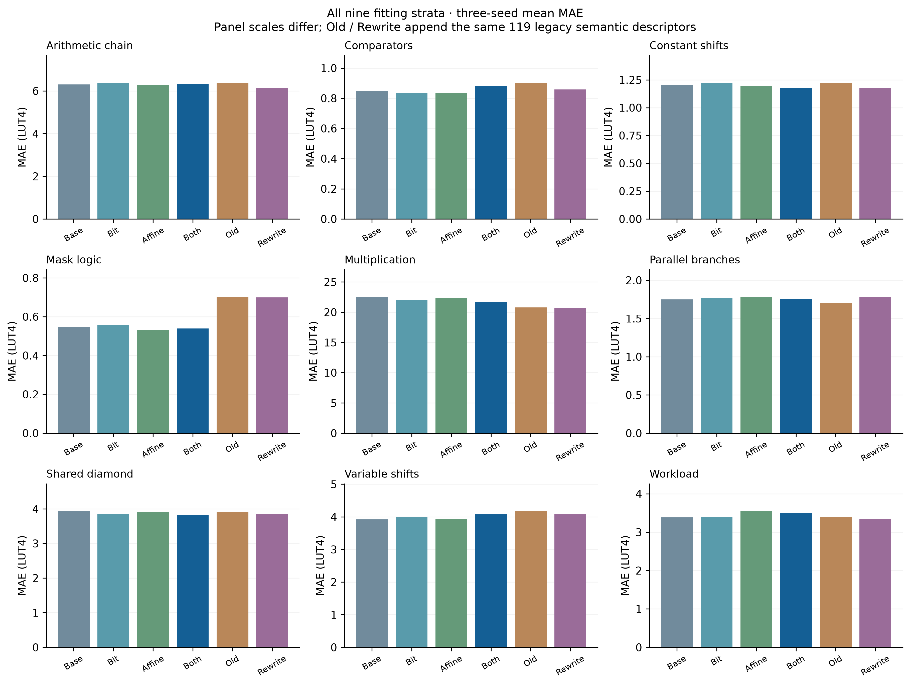

# V7 development: proved semantics help modestly, with tradeoffs

The fixed six-view study completed **90 fits** on the original **1,665 fitting circuits**, five inherited group folds and three paired algorithm seeds. Adding the two new descriptor blocks lowers nine-stratum macro out-of-fold MAE from **4.9351 to 4.8601 LUT4 (1.52%)**. The strongest observed view instead appends the existing 119 semantic descriptors after the new proved rewrite: **4.7384 LUT4 (3.99% below baseline)**.

These are consumed-data development results. No new hardware target was acquired, no independent test was performed, and no revised deployment model or calibration margin was released. V6's frozen independent results remain unchanged. This study does not establish superiority over a published system.

## Fixed comparison

All views use the same 300-tree ExtraTrees settings and seeds 2026101421–23. The original 217 mapping features and original-implementation LUT4 targets stay unchanged. The primary appends eight bit descriptors and eight affine descriptors. Two 336-column controls instead append the same 119 legacy descriptors, computed on original versus rewritten formulas. No feature selection or parameter search followed these scores.

| Feature view | Columns | Mean macro MAE, LUT4 | Algorithm-seed SD |
| :--- | ---: | ---: | ---: |
| Mapping baseline | 217 | 4.9351 | 0.0450 |
| + bit descriptors | 225 | 4.8877 | 0.0439 |
| + affine descriptors | 225 | 4.9355 | 0.0267 |
| + both blocks (declared primary) | 233 | 4.8601 | 0.0326 |
| + legacy semantics on original | 336 | 4.7996 | 0.0348 |
| + legacy semantics on rewrite | 336 | 4.7384 | 0.0489 |

SD measures sensitivity to three estimator seeds on identical data. It is not a population confidence interval. Each seed's baseline predictions exactly replay the earlier mapping-development run. All 18 prediction files retain all 1,665 rows, including 252 zero targets; MAPE uses the 1,413 positive targets.

The primary differences are **−0.1233, −0.0168 and −0.0850 LUT4**. Both blocks improve the primary metric in all three seeds. Affine descriptors alone are essentially neutral on average. Rewriting the legacy inputs improves over the original-legacy control by **0.0612 LUT4**, also in all three seeds; it improves seven of nine stratum means relative to that control. The observed best view remains a development-selected candidate.

## What improved, and what did not

The primary improves four of nine stratum means. Multiplication drops from **22.5274 to 21.6916 LUT4**. Across the other eight strata, mean MAE **increases by 0.0201 LUT4**; workload MAE rises from **3.3829 to 3.4912**. Thus multiplication supplies more than the total net gain, offsetting regressions elsewhere.

Three-seed mean positive MAPE increases **25.0663% → 25.1700%**, zero-target MAE increases **0.1247 → 0.1299 LUT4**, and mean per-seed 95th-percentile absolute error increases **19.7329 → 20.4133 LUT4**. At a 64-LUT cap, false accepts are baseline **15/16/12** versus primary **13/15/13**; false rejects are **34/39/33** versus **34/36/37**, in seed order. This does not establish uniformly better feasibility decisions.

## Correctness and independence audit

The implementation uses total 32-bit arithmetic, masks shift distances, and treats high-half products as opaque to affine rewrites. Every accepted rewrite has a retained bit-vector proof. Proof or complexity-budget failure falls back to the original representation for all modes without dropping a row. Semantic simplification never forces original hardware area to zero.

The independent audit passed 110 generic proof queries, 1,603,395 recursive oracle comparisons and 362,088 multiplier-property checks over the fitting inputs. Poisoned outcome metadata leaves features and normal forms unchanged. Affine and combined normalization each change **933 formulas**, with no fitting-input fallback. Neither proposed correlated-bit identity occurs in this corpus, so these scores cannot demonstrate learning those missing mechanisms.

One proved equivalent pair joins two inherited four-variant groups into an **eight-row connected component spanning two folds**; those eight formulas are not all equivalent. Exact baseline feature vectors also collide across folds (47 classes, 193 rows). The new primary reduces vector collisions to 13 classes/49 rows and introduces no new full-vector collisions because it retains the baseline prefix. These diagnostics were reviewed before fitting. The fixed folds remain for historical replay; their scores are descriptive, not independent-generalization evidence.

Independent reconstruction matches all **29,970 saved predictions' metrics** across the six views and three seeds, including every stratum, tail, zero error and cap decision. A separate **post-hoc sensitivity analysis** finds the linked eight validation rows contribute only −0.0000099 LUT4 to the primary difference; excluding them yields −0.07484 rather than −0.07502. Their influence in training remains, so this does not repair independence or create a new primary endpoint.

## Evidence and reproduction

The [pre-score protocol](v7-development-protocol.md), [proof audit](../results/2026-10-14-development-semantics-v7/audit/README.md), [implementation contract](../results/2026-10-14-development-semantics-v7/implementation/README.md) and [portable evidence replay](../results/2026-10-14-development-semantics-v7/evidence/REPRODUCE.md) retain the sources, matrices, proofs, parent assessment and complete predictions. The pre-score seal is `4d600556cb26eba443a897eb0691244c8fbbb99bbb5449b1fd08d430dc40e3ba`.

Figures are available as 300-dpi PNG, editable SVG and vector PDF. From restored evidence, run `python scripts/report_v7_development.py --prepared ../v7-restored-evidence/prepared --output generated/v7-report` in an environment with the reports extra.

## Next decision

Keep the frozen V6 model as the tested reference. The rewrite-plus-legacy view warrants an independently evaluated candidate, but the new 16-column block has not justified a broad improvement claim. Prioritize untouched application families, retain separate training augmentation for missing mechanisms, and freeze the final candidate and equal-data controls before new outcome measurements. Evaluate selection mistakes and timing alongside prediction error. Further changes belong to a new study; these results and failures stay visible.
