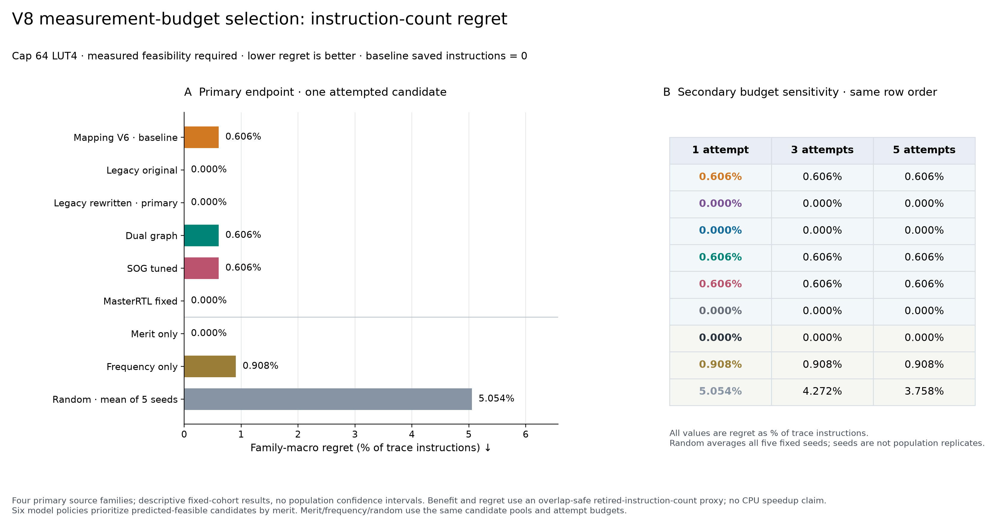
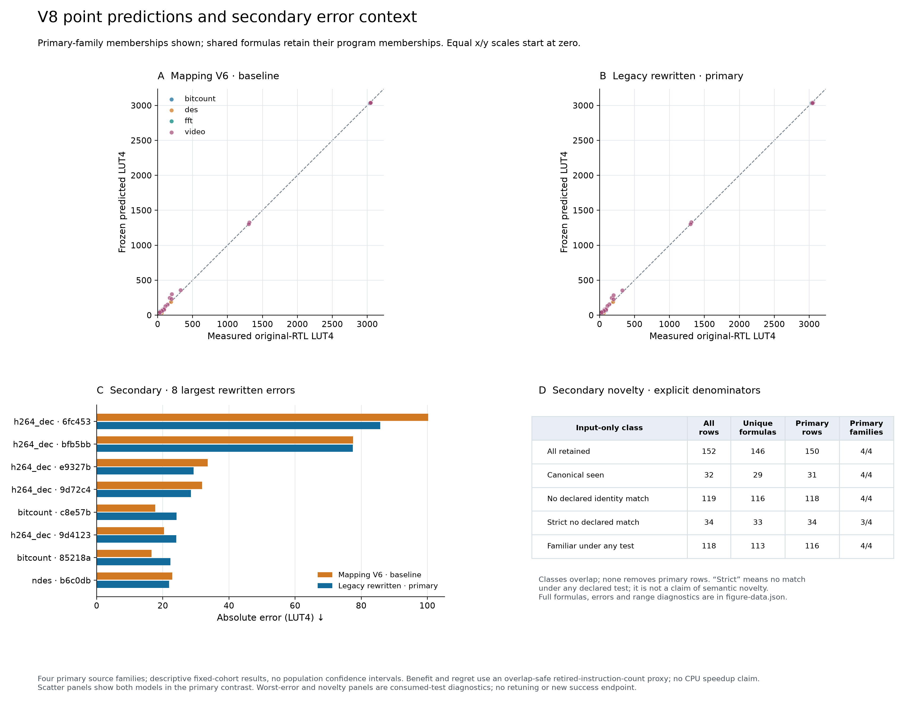

# V8: complete application-pool transfer

The development-selected semantic rewrite **does not improve the preregistered application prediction metric**: family-macro MAE is **3.4319 versus 3.4092 LUT4** for frozen V6 mapping, a difference of **+0.0227 LUT4 (+0.67%)**. It improves video and worsens the other three families. The simpler original-descriptor control has the lowest observed MAE, **3.3509**, but this secondary comparison does not replace the primary result.

## What was measured

The [frozen protocol](v8-application-pilot-protocol.md) retains every eligible candidate in each complete declared computation region: bitcount 47, FFT 6, NDES 47 and H264 50. These 150 primary program/formula rows span four families. Two related-source isqrt rows are secondary. Exact original-formula deduplication yields 146 physical circuits across all 152 rows; shared formulas retain every program membership.

Both new 300-tree predictors fit exactly the original 1,665 circuits, with the same fixed seed and parameters as the frozen mapping incumbent. They add 119 original or proved-rewrite semantic descriptors to its 217 mapping/graph features. The four reference artifacts are unchanged. All six point sets were committed at `2432e896906aafcb5863a441dda6e4664f57f43d` before target release. No new application label entered fitting or feature selection.

Every original circuit passed **2,148 boundary/random vectors**, totaling **313,608 RTL comparisons**, then fresh Yosys iCE 40 synthesis. All 146 completed; zero circuits failed or were replaced. Targets range from 0 to 3,052 LUT4. The independent audit recomputed every expected vector output, recounted every netlist and reproduced the errors and primary acquisition cases.


## Prediction results

| Frozen predictor | Equal-family MAE, LUT4 | Positive MAPE | P 95 absolute error, LUT4 | False accept / reject at 64 LUT4 |
| --- | ---: | ---: | ---: | ---: |
| V6 mapping, primary incumbent | 3.4092 | 8.71% | 18.677 | 0 / 3 |
| Legacy original336, secondary control | **3.3509** | **8.54%** | 19.702 | 0 / 2 |
| Legacy rewritten336, primary challenger | 3.4319 | 8.78% | 21.167 | 0 / 3 |
| Frozen dual graph | 3.6382 | 9.68% | 22.740 | 0 / 4 |
| Frozen tuned SOG | 5.3395 | 11.45% | 31.652 | 2 / 7 |
| Frozen MasterRTL recipe adaptation | 7.3124 | 15.53% | 42.185 | 4 / 6 |

MAE weights each primary family equally, then programs and unique formulas within it. MAPE, P 95 and feasibility counts above pool the 150 primary rows. MAPE uses 109 positive targets; all 41 zero targets remain in MAE and tail metrics. These are matched iCE 40 observations, not a replication of MasterRTL's published ASIC score.

| Family | V6 MAE | Rewritten MAE | Paired difference |
| --- | ---: | ---: | ---: |
| Bitcount | 2.5802 | 2.7386 | +0.1584 |
| FFT | 0.6861 | 0.7333 | +0.0472 |
| NDES | 1.2462 | 1.4081 | +0.1618 |
| Video / H264 | 9.1242 | 8.8475 | −0.2767 |

Removing one family changes the primary difference from−0.0237 to+0.1225 LUT4. Four curated families do not support a population confidence interval or a broad superiority claim. The development advantage of the rewritten view did not transfer to this primary endpoint.

## Does it improve instruction selection?

At the declared 64-LUT cap and one measured candidate per program, both new views and the fixed MasterRTL adaptation attain **zero normalized regret**. V6 mapping, dual graph and tuned SOG have **0.6055 percentage points** of mean regret relative to the full-pool oracle. Frequency gives 0.9083 and random ordering gives 5.0535, averaging the five fixed ordering seeds within each program.

**Merit alone also attains zero regret in every program.** Thus the new models improve this observed decision relative to V6, but do not demonstrate a benefit over the simple baseline. The same ordering outcome persists at budgets 3 and 5 for these model policies. Every query costs one measurement; final selection uses measured feasibility. The full-pool oracle required 146 unique physical measurements and is an evaluation reference, not a free policy input.

Regret uses overlap-safe retired-instruction savings divided by each full declared ROI instruction count. It is a single-instruction proxy, not CPU cycles, clock rate, energy or integrated processor speedup.



## Failure analysis and next direction

H264 constant multiplication dominates the large errors. For `mul(sub(in0,in1),addi(0,54))`, true area is 201 LUT4; V6 predicts 301.22 and rewritten predicts 286.77. Its two other largest errors bring the rewritten top-three share to 30.0% of primary absolute error. A rewrite improves this tail locally but worsens other families enough to lose overall.

Six constant-low-multiplication rows (4% of the primary pool) account for 43.3% of V6 pooled absolute error. A separate selection failure occurs near the cap: V6 predicts 64.7767 LUT4 for a true 56-LUT signed-shift candidate saving 1,536 instructions, and instead queries a 29-LUT candidate saving 1,024. Improving threshold behavior is a distinct objective from reducing average error.

Simple feature-range checks are insufficient: V6's worst 100.22-LUT error lies inside all selected training-feature ranges. Conversely, its six out-of-range application rows have mean error 7.237 LUT4. Such counts are diagnostics, not calibrated risk estimates.

The next development work should test arithmetic coverage and explicitly budgeted adaptation, while retaining this result. The [new literature note](research-update-2026-10-15.md) explains why very low published transfer errors can depend on receiving target labels. Any V8-guided revision consumes this cohort for development and needs a newly frozen application test for a new generalization claim.



## Limits and retained evidence

- Thirty original formulas match a consumed original/normalized/commutative identity; strict screening leaves 33 unique formulas /34 rows, with **zero FFT cases**. A complete four-family strict-novel score is unavailable. Familiar formulas remain in the primary pools.
- One first-extraction rewrite proof hit its 500 ms deadline. Its original-feature fallback is retained; no retry chose a preferred representation.
- MPEG2 passed its adapted self-check but exceeded the declared 300 s trace deadline before labels. Its failure is retained, with no shorter-window replacement. The 470 MiB partial remains local and hash-identified; admitted complete traces are archived.
- The computation regions include called helpers, but exclude initialization and final checks. They are declared workload instances, not all possible application inputs. Isqrt has related source lineage and remains secondary.
- One test-fixture omission was corrected through an explicit pre-fit amendment; original manifests, source bytes and failed logs remain in the archive. Full local validation later passed 928 tests and 47 subtests. Four guarded CLI runs reproduced all 152 point outputs exactly, including reordered inputs and poisoned unused metadata.

## Reproduce

Use the project branch with Git history available and the pinned research environment:

```sh
python3.13 -m venv .venv
source .venv/bin/activate
python -m pip install -e '.[dev,reports,proofs]' -r requirements-research.txt
make reproduce-v8
```

Output is immutable at `generated/reproduction/v8`; use `--output` for another run. `python scripts/reproduce_v8_applications.py --skip-figures --output generated/reproduction/v8-audit` authenticates committed inputs, predictions, artifacts and all raw archive members, recounts target resources, and reproduces every evaluation field except its timestamp. No native synthesis tools, new fits or target recollection are needed. Native cold inference has separate pinned tool requirements and timed proofs; saved-feature replay preserves the exact first-run proof outcome.

The [result archive](../results/2026-10-15-v8-application-transfer/) contains the input/point freezes, two models, six prediction sets, approvals, original measurement archive and complete evaluation, including all caps, budgets, seeds, novelty groups and failures.
