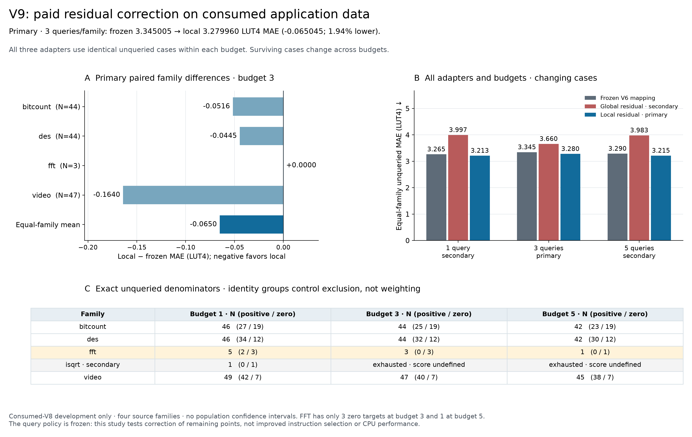

# V9: bounded correction on consumed V8 data

Three paid target reveals per primary family reduce local-adapter MAE from **3.345005 to 3.279960 LUT4**, a paired difference of **−0.065045 LUT4 (1.94%)** on identical unqueried cases. The fixed global-offset control worsens MAE to **3.659587**. This is a small **consumed-cohort development result**, not independent transfer confirmation. The largest constant-multiplication errors remain unchanged.

The [frozen protocol](v9-budgeted-adaptation-protocol.md) preserves the V6 mapping forest, all 300 trees, the original V8 feature extraction and original points. Similarity is the fraction of corresponding trees sharing a leaf. After revealing residuals `r = measured − frozen`, the local adapter adds `sum(K*r)/(1+sum(K))`; the global control adds `sum(r)/(1+count(r))`. Both keep nonnegative outputs and the original generic-graph zero override. No forest fitting, feature extraction, proof retries, new measurements or tuning occurred.

Queries follow the frozen cap64 predicted-feasible-merit schedule. Each distinct original query is charged to its family; visibility resets between families. Queried canonical/accepted-normalized identity groups are excluded from all unqueried memberships in that episode. Grouping controls exclusion, while MAE weights original formulas equally within program, programs equally within family and the four primary families equally.

| Primary family, budget 3 | Unqueried rows | Frozen MAE | Global MAE, secondary | Local MAE | Local − frozen |
| --- | ---: | ---: | ---: | ---: | ---: |
| Bitcount | 44 | 2.738068 | 2.742576 | 2.686451 | −0.051617 |
| DES | 44 | 1.246667 | 1.630455 | 1.202133 | −0.044534 |
| FFT | 3 | 0.000000 | 0.000000 | 0.000000 | 0.000000 |
| Video / H264 | 47 | 9.395284 | 10.265319 | 9.231254 | −0.164030 |
| Equal-family mean | 138 total | 3.345005 | 3.659587 | 3.279960 | −0.065045 |

Omitting one family leaves differences from −0.086727 to −0.032050 LUT4. These four fixed families do not support a population confidence interval. FFT's three surviving formulas are **all true-zero targets**, so its zero MAE is not evidence of accurate positive-area adaptation. Related-source isqrt remains secondary: it has one zero-area unqueried case after one query and is exhausted after its second query. Its budgets3/5 scores are undefined.

| Queries per primary family | Frozen MAE | Global MAE | Local MAE | Local − frozen | Primary unqueried rows |
| --- | ---: | ---: | ---: | ---: | ---: |
| 1, secondary | 3.265039 | 3.997082 | 3.213293 | −0.051747 | 146 |
| **3, primary** | **3.345005** | **3.659587** | **3.279960** | **−0.065045** | **138** |
| 5, secondary | 3.289723 | 3.983060 | 3.215275 | −0.074448 | 130 |

The surviving cases change with budget, so these are not a learning curve on one common test set. All adapters share precisely the same cases *within* each budget. FFT retains five cases at budget1, three zero cases at budget3, and only **one zero case at budget5**. The figure exposes positive/zero denominators for every family; full program bias, positive-only MAPE and its counts, zero-target error, and cap64 false accepts/rejects remain in the [evaluation](../results/2026-10-15-v9-adaptation-development/evaluation-attempt-0000/evaluation.json).

At the primary prefix, 12 queries are charged across the four primary families; the secondary isqrt episode uses two. The nested maximum-budget replay makes 22 family-episode reveals using 21 distinct existing physical targets, because one formula appears in both DES and isqrt episodes. Those are separate simulated budget charges, not 21 new measurements. The already measured 146-target V8 oracle is used only to score forecasts after they are saved.

## What the correction reaches

At budget3, local points change on 10/44 bitcount, 4/44 DES, 0/3 FFT and 5/47 video cases. Bitcount's first query supplies a +0.793333-LUT4 residual; its other two residuals are zero. DES supplies residuals 0, −0.093333 and −3.626667. Video supplies −14.633333, 0 and 0. The largest video correction, −5.262088 LUT4 on `sub(srai(in0,4),srai(in1,31))`, comes from proximity to those queried shift circuits. This is local information propagation, not a new arithmetic model.

All eight video formulas containing low multiplication have **zero proximity to the queried supports at every declared budget**. Their local points stay unchanged. For the largest miss, `mul(sub(in0,in1),addi(0,54))`, measured area is 201 LUT4 and both frozen and local predictions remain **301.22**, an error of **100.22 LUT4**. The next two largest constant-multiply errors, 77.54 and 33.61 LUT4, also remain. The global shift slightly reduces those overpredictions while worsening the aggregate, illustrating why exporting a target-domain offset everywhere can be harmful.

Acquisition never changes in this study. It cannot establish better instruction selection, CPU latency or speedup; V8's merit-only selection tie remains unchanged. No extra query policy, adapter variant or favorable subpool was selected after this evaluation. A later generalization claim needs a frozen method and newly reserved source families with the same explicit adaptation allowance.

## Audit and evidence

The [independent audit](../results/2026-10-15-v9-adaptation-development/independent-audit/evaluation-audit.json) imports neither V9 implementation nor evaluator. It independently reconstructs the same-tree kernel, fixed query schedules, all **415** unqueried formula forecasts and correction diagnostics, program metrics, family means, budget comparisons and leave-family-out differences. Every value matches exactly, with zero tolerance. It verifies every preparation/completion binding and unchanged input/source hashes. The audit retains each primary forecast's query proximity, residual and numerical contribution.

[Evidence and replay commands](../results/2026-10-15-v9-adaptation-development/README.md) include the input-only manifest written before its payload, parent release, charged logs, forecasts saved before scoring, completion, independent arithmetic report and audit source. The [saved plot helper](../scripts/plot_v9_adaptation.py) emits [PNG](figures/v9-adaptation/v9-budgeted-residual-correction.png), [SVG](figures/v9-adaptation/v9-budgeted-residual-correction.svg) and [PDF](figures/v9-adaptation/v9-budgeted-residual-correction.pdf), with [figure data and hashes](figures/v9-adaptation/figure-manifest.json). The [V8 result](v8-application-results.md) remains the untouched-transfer result for this cohort; V9 uses it as consumed development evidence.
