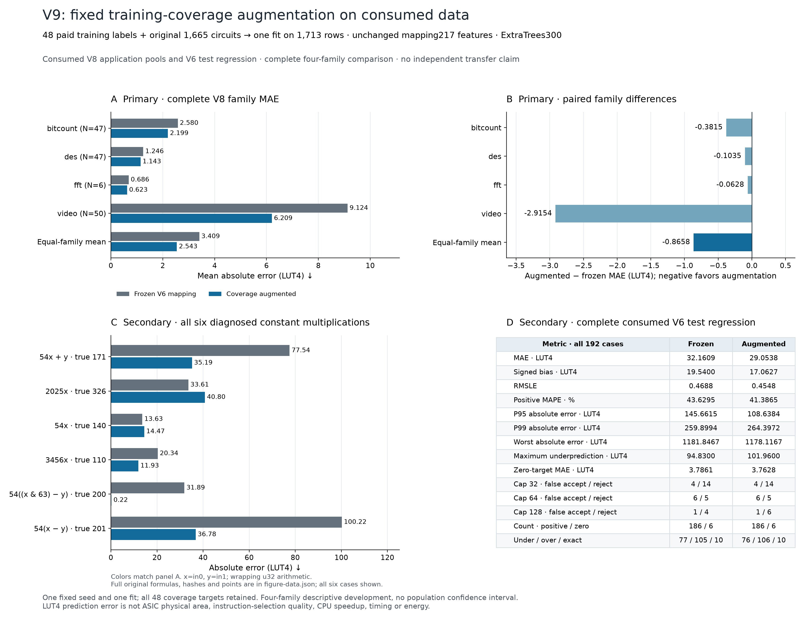

# V9: one fixed training-coverage augmentation

Adding 48 paid training circuits to the original 1,665 reduces consumed-V8 equal-family MAE from **3.409191 to 2.543396 LUT4**, a difference of **−0.865795 LUT4 (25.40%)**. All four primary families improve. The six previously diagnosed constant-multiply cases improve in aggregate, but two become less accurate. The consumed V6 regression set also improves in mean error while several tail and feasibility metrics worsen.

This is **development on already consumed data**, not an independent transfer result. V8 outcomes motivated the coverage batch. The [frozen direction](v9-training-coverage-direction.md) fixed its 48 circuits and one fit before new measurement; no result-driven model variant or replacement batch was selected afterward.

Panel C's short expressions use `x=in0`, `y=in1` and wrapping unsigned32-bit arithmetic; full original formulas and hashes remain in the figure data.

The comparison retains the same 217 mapping/graph features, 300-tree ExtraTrees recipe, seed and equal original-formula weights. The augmented model fits **1,713 rows once**. The 48 new originals comprise 32 positive-constant multiply/context circuits and 16 signed-shift/sign-subtraction circuits. Every new original completed 2,148 correctness vectors and original-RTL iCE40 synthesis: **48 targets, 103,104 vector comparisons, zero failed or replaced circuits**. The frozen V6 baseline remains unchanged.

Preparation checked the complete 2,881-formula prior-input union. The batch has no canonical-original or declared accepted-normal/commutative aliases under those recorded checks; this is not an exhaustive novelty proof. Shared structural skeletons are retained. The constants and shifts were amended before target collection to respect immediate encodings and avoid a previously consumed original; the initial proposal and reasons remain in the evidence.

## Complete application result

| Primary family | Formula rows | Frozen MAE | Augmented MAE | Paired difference, LUT4 |
| --- | ---: | ---: | ---: | ---: |
| Bitcount | 47 | 2.580177 | 2.198688 | −0.381489 |
| DES | 47 | 1.246241 | 1.142695 | −0.103546 |
| FFT | 6 | 0.686111 | 0.623333 | −0.062778 |
| Video / H264 | 50 | 9.124233 | 6.208867 | −2.915367 |
| Equal-family mean | 150 total | **3.409191** | **2.543396** | **−0.865795** |

MAE averages original formulas within program, programs within family, then the four primary families equally. All 150 primary rows remain; no queried cases are removed in this training-coverage experiment. The two related-source isqrt rows are secondary and remain exact for both predictors. Shared formulas preserve every program membership. The evaluation uses the same 146 unique physical application targets as V8.

Pooled primary positive-target MAPE changes from 8.7128% to 7.4489% on 109 positive targets. All 41 zero targets remain in MAE and keep zero error. Pooled worst absolute error improves from 100.22 to 40.7967 LUT4, but maximum underprediction **worsens from 22.88 to 40.7967**. Reduced average error does not provide a calibrated feasibility guarantee. Four curated families do not support a population confidence interval.

## Diagnosed arithmetic cases

The six fixed constant-low-multiply cases have MAE **46.2033 → 23.2317 LUT4**, a **49.72%** reduction. Every case is shown in the figure and table, including deterioration.

| Original formula | True LUT4 | Frozen prediction | Augmented prediction | Absolute error, frozen → augmented |
| --- | ---: | ---: | ---: | ---: |
| `add(mul(in0,addi(0,54)),in1)` | 171 | 248.5400 | 206.1933 | 77.5400 → 35.1933 |
| `mul(in0,addi(0,2025))` | 326 | 359.6100 | 285.2033 | **33.6100 → 40.7967** |
| `mul(in0,addi(0,54))` | 140 | 153.6267 | 154.4667 | **13.6267 → 14.4667** |
| `mul(in0,addi(lui(4096),-640))` | 110 | 130.3367 | 121.9267 | 20.3367 → 11.9267 |
| `mul(sub(andi(in0,63),in1),addi(0,54))` | 200 | 231.8867 | 200.2233 | 31.8867 → 0.2233 |
| `mul(sub(in0,in1),addi(0,54))` | 201 | 301.2200 | 237.7833 | 100.2200 → 36.7833 |

Unlike the earlier [local residual correction](v9-adaptation-results.md), coverage training changes the largest constant-multiply miss. The two experiments use different label budgets and evaluation sets, so their percentage improvements are not a matched method comparison.

For the diagnosed signed-shift case `sub(srai(add(in0,in1),5),srai(in1,31))`, true area is 56 LUT4. Its point changes **64.7767 → 57.2567**, fixing that false rejection at cap64. However, `sub(andi(add(in0,in1),63),in1)` has true area63 and changes **63.9067 → 64.44**, creating a new false rejection. Consequently the primary cap64 total remains **0 false accepts / 3 false rejects**. Cap32 remains 0/2; cap128 improves from 0/1 to 0/0. This is a threshold diagnostic, not a new instruction-selection or speedup result; V8's merit-only selection tie is unchanged.

## Complete consumed V6 regression

All 192 original V6 test circuits are retained. MAE changes **32.160946 → 29.053759 LUT4 (9.66% lower)**. This set is consumed historical development evidence, not a newly reserved test.

| Regression metric | Frozen | Augmented |
| --- | ---: | ---: |
| MAE, LUT4 | 32.1609 | 29.0538 |
| Signed bias, LUT4 | +19.5400 | +17.0627 |
| RMSLE | 0.468809 | 0.454775 |
| Positive-target MAPE, 186 cases | 43.6295% | 41.3865% |
| True-zero MAE, 6 cases, LUT4 | 3.7861 | 3.7628 |
| P95 absolute error, LUT4 | 145.6615 | 108.6384 |
| P99 absolute error, LUT4 | **259.8994** | **264.3972** |
| Worst absolute error, LUT4 | 1181.8467 | 1178.1167 |
| Maximum underprediction, LUT4 | **94.8300** | **101.9600** |
| Cap32 false accept / reject | 4 / 14 | 4 / 14 |
| Cap64 false accept / reject | 6 / 5 | 6 / 5 |
| Cap128 false accept / reject | **1 / 4** | **1 / 6** |

The regression tail remains large, and the worsened P99, maximum underprediction and cap128 false rejections must accompany the mean improvement. The new batch's zero training MAE is an **in-sample diagnostic**. Original1665 in-sample MAE stays 0.002402 LUT4 for both models; neither training score is generalization evidence.

The experiment supports training coverage as a development direction under this fixed budget. It does not isolate targeted coverage from the effect of adding 48 more training examples, and it does not establish superiority on unseen source families, lower ASIC area, processor timing, energy or CPU speedup. A subsequent method claim requires a separately frozen experiment on newly reserved sources.

## Evidence and figures

The [preparation](../results/2026-10-15-v9-coverage-development/preparation.json) binds the complete input ledger, fixed recipe, historical training/evaluation lineage and reviewed source/tests. The [measurement completion](../results/2026-10-15-v9-coverage-development/measurements/completion.json) and raw archive retain all48 original targets and proofs. A root-scoped immutable fit claim enforces one fit. The [point freeze](../results/2026-10-15-v9-coverage-development/fit-attempt-0000/point-freeze.json) records exact serialization agreement and points saved before historical evaluation-target reads; the [evaluation](../results/2026-10-15-v9-coverage-development/fit-attempt-0000/evaluation.json) includes every application program, full regression set, diagnosed cases and in-sample diagnostics.

The [saved plotting helper](../scripts/plot_v9_coverage.py) renders [PNG](figures/v9-coverage/v9-fixed-training-coverage.png), [SVG](figures/v9-coverage/v9-fixed-training-coverage.svg) and [PDF](figures/v9-coverage/v9-fixed-training-coverage.pdf). Its [data and hash manifest](figures/v9-coverage/figure-manifest.json) bind the completed evaluation, frozen points/model/schema, original targets, recipe and plotting source. Axes include zero; all four families, six diagnosed constant cases and full regression tradeoffs are shown.

The independent [metric replay](../results/2026-10-15-v9-coverage-development/fit-review/metric-replay.json) recomputes both models' complete 152 application rows, 192 regression circuits, 1,665 original training circuits and 48 coverage-training circuits with standard-library arithmetic; every numeric field matches exactly. The [CLI replay review](../results/2026-10-15-v9-coverage-development/fit-review/cli-replay-review.json) confirms all saved fields and types on the 48 native coverage cases, with all 768 cache files unchanged. An initial audit found three integer-zero versus floating-zero maximum-underprediction type comparisons; its original report and precise checker correction remain retained, without changing experiment outputs.

## Reproduce or run inference

Install the recorded research dependencies, then run `make reproduce-v9-coverage`. The wrapper checks frozen inputs, replays both fitted forests on saved features for all four cohorts, recomputes metrics and independent raw audits, and regenerates figures in a fresh `generated/reproduction/v9-coverage/` directory. It requires no training, feature extraction or hardware tools. Every prediction field and JSON type must match. Score comparison permits only the evaluation timestamp and narrowly scoped finite RMSLE roundoff of at most `1e-14` absolute; all other fields remain exact.

For new formula inference, use the augmented artifact with `python -m isaforge.area_model_v6`; the [artifact guide](../results/2026-10-15-v9-coverage-development/README.md#reproduce-and-infer) provides the complete command and native-cache requirements. Saved-feature replay and native formula inference have different prerequisites.

A [clean-clone review](../results/2026-10-15-v9-coverage-development/reproduction-review/clean-clone-review.json) reproduces all 4,114 prediction records, score arithmetic, raw audits and figures from commit `e8f5f607f11360e79551b6c788d861ea4591abab`, with native hardware tools absent from PATH. The clone stays clean; it shares only the pinned Python 3.14.7 numerical environment. The full local suite passes 1,083 tests and 47 subtests. Linux Python 3.13 is checked separately in CI.

[Linux Python 3.13 CI](https://github.com/jas0nriverah/agentic-riscv-codesign/actions/runs/38800589936) passes on the same commit: all 4,114 prediction records remain exact. Seven RMSLE fields differ by at most `9.37e-17`, within the declared narrow roundoff rule; no other score differences are accepted. The [retained CI review](../results/2026-10-15-v9-coverage-development/reproduction-review/linux-e8f5f60/ci-review.json) records the evidence.
