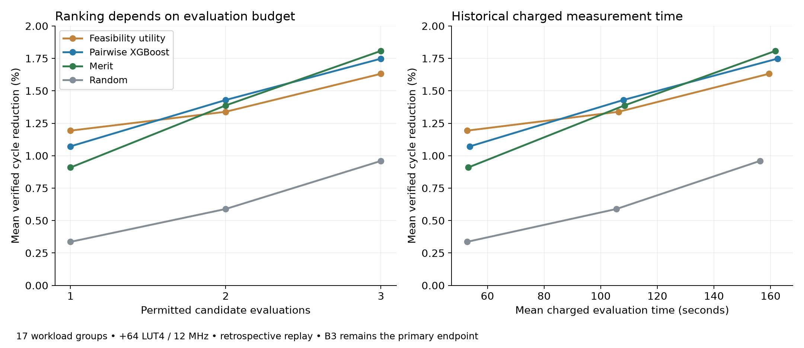

# Budget-dependent selection results

The same frozen experiment has different descriptive leaders at different budgets. Feasibility utility leads at B1, pairwise XGBoost at B2, and merit/latency at B3. Reporting only B3 hides the low-budget result; selecting B1 afterward as the new primary endpoint would also be misleading. B3 remains the prespecified primary endpoint. No new model is trained here.

| Policy | B1 reduction | B2 reduction | B3 reduction |
|---|---:|---:|---:|
| Feasibility utility | 1.1932% | 1.3388% | 1.6316% |
| Pairwise XGBoost | 1.0721% | 1.4295% | 1.7480% |
| Merit | 0.9091% | 1.3877% | 1.8079% |
| Latency | 0.9091% | 1.2019% | 1.8079% |
| Frequency | 1.0434% | 1.2025% | 1.4646% |
| Random | 0.3359% | 0.5892% | 0.9595% |

## Paired workload uncertainty versus merit

Intervals resample whole workload groups. Candidate rows and five dependent random seeds do not count as independent replications. These intervals describe consumed development evidence and are not confirmatory significance tests.

| Challenger | Budget | Difference (percentage points) | 95% interval | Wins / ties / losses |
|---|---:|---:|---:|---:|
| Feasibility utility | 1 | +0.2841 | [-0.0013, +0.8537] | 1 / 15 / 1 |
| Feasibility utility | 2 | -0.0490 | [-0.5574, +0.4105] | 1 / 15 / 1 |
| Feasibility utility | 3 | -0.1763 | [-0.4873, +0.0000] | 0 / 15 / 2 |
| Pairwise XGBoost | 1 | +0.1630 | [-0.0684, +0.5574] | 1 / 15 / 1 |
| Pairwise XGBoost | 2 | +0.0417 | [+0.0000, +0.1252] | 1 / 16 / 0 |
| Pairwise XGBoost | 3 | -0.0599 | [-0.1796, +0.0000] | 0 / 16 / 1 |

Measurement time comes from archived paid attempts, including failed attempts, not new time saved in this replay. Source-corpus collection cost (all160 attempts) is8,657.112seconds; fitting and inference costs are separate. Methods share the public information and attempt limits. No extra historical hardware observations are available for free to ML in a real deployment.

The next forward experiment should retain all three budgets and explicitly report actual pool size. With four candidates, B3 evaluates75% of the pool; with two candidates, B2 exhausts it. These are useful engineering tests but weak evidence for large-search-space efficiency.



```sh
.venv/bin/python scripts/report_budget_tradeoffs.py
```
