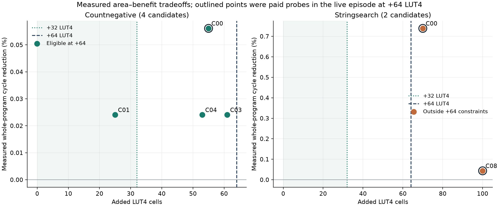
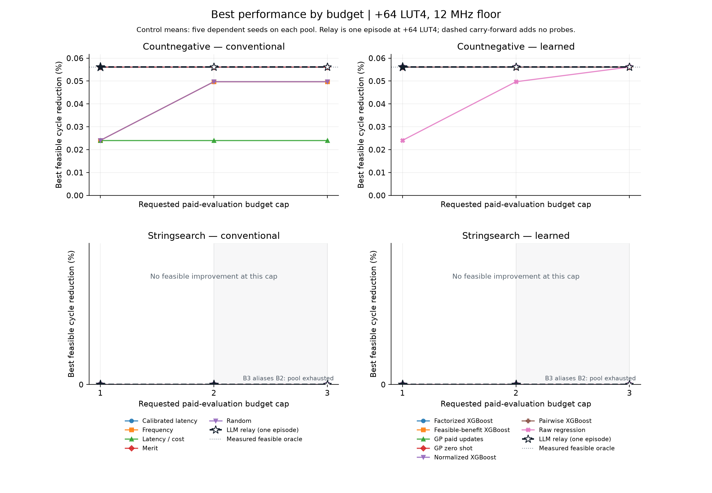
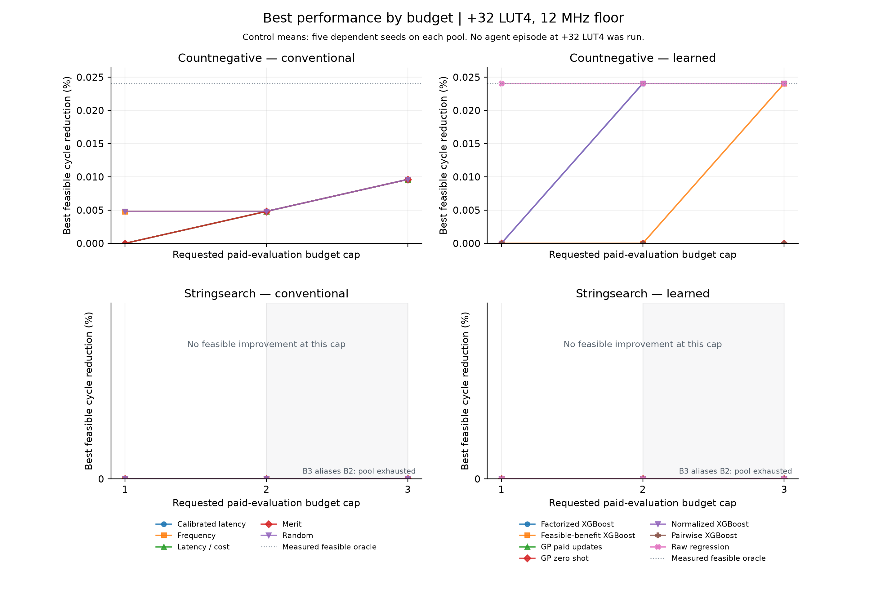

# Forward selection checkpoint

Two small measured pools under unchanged model recipes. No calibration promotion, model-recipe change or demonstrated general superiority. Both source-family-excluded forward studies fitted the same authenticated156-label history; later outcomes did not enter their fits.

| Workload | Pool | Training rows /156 | Agent paid probes | Physical pool cost (s) | Enclosing wrapper (s) |
|---|---:|---:|---:|---:|---:|
| Countnegative | 4 | 141 | 1 | 139.483 | 163.163 |
| Stringsearch | 2 | 133 | 2 | 72.848 | 84.137 |

Total physical paid-attempt cost for the two new pools: **212.331 seconds**.

Physical collection measured each pool member once. Replay prefix costs reuse those paid observations and are not additional physical experiments. Attempt-ledger, enclosing-wrapper and native-command durations overlap; do not sum them. Model-refit costs during paid-prefix replays do not demonstrate that new training improves decisions.







The agent ran once at +64 LUT4; no agent results are claimed at +32 or +128. Each control mean aggregates five dependent policy seeds, with every trajectory retained in CSV. For Stringsearch, requested B3 has effective budget2 and aliases B2 after both candidates are exhausted. Early-stop relay choices carry forward without spending unused budget. Pool exhaustion is not evidence of sample efficiency.

## Every measured candidate

| Workload | Candidate | Cycles | Speedup | Reduction % | ΔLUT4 | Total LUT4 | Min MHz | Correct | Paid seconds |
|---|---|---:|---:|---:|---:|---:|---:|---|---:|
| countnegative | candidate_00 | 12470 | 1.000561 | 0.056103 | 55 | 1708 | 67.449074 | True | 33.067581 |
| countnegative | candidate_01 | 12474 | 1.000241 | 0.024044 | 25 | 1678 | 68.488457 | True | 37.440678 |
| countnegative | candidate_03 | 12474 | 1.000241 | 0.024044 | 61 | 1714 | 67.723152 | True | 34.752863 |
| countnegative | candidate_04 | 12474 | 1.000241 | 0.024044 | 53 | 1706 | 68.686035 | True | 34.221559 |
| stringsearch | candidate_00 | 390286 | 1.007443 | 0.738827 | 70 | 1723 | 61.854397 | True | 39.954678 |
| stringsearch | candidate_08 | 393020 | 1.000435 | 0.043490 | 100 | 1753 | 72.155273 | True | 32.893763 |

At Countnegative +32/B2, factorized XGBoost mean reduction is 0.024044% versus merit 0.004809%. This sensitivity comparison does not override the primary +64 endpoint or establish general model superiority.

Formulas, identities, failures, censoring, device fit, wrapper cost and agent membership are in [measured-candidates.csv](measured-candidates.csv).

## Countnegative: +32 LUT4 same-budget comparison

| Policy | B1 reduction % | B2 reduction % | B3 reduction % | Scope |
|---|---:|---:|---:|---|
| Calibrated latency | 0.000000 | 0.004809 | 0.009618 | Mean of five dependent replays |
| Factorized XGBoost | 0.000000 | 0.024044 | 0.024044 | Mean of five dependent replays |
| Feasible-benefit XGBoost | 0.000000 | 0.000000 | 0.024044 | Mean of five dependent replays |
| Frequency | 0.004809 | 0.004809 | 0.009618 | Mean of five dependent replays |
| GP paid updates | 0.000000 | 0.000000 | 0.000000 | Mean of five dependent replays |
| GP zero shot | 0.000000 | 0.000000 | 0.000000 | Mean of five dependent replays |
| Latency / cost | 0.000000 | 0.004809 | 0.009618 | Mean of five dependent replays |
| Merit | 0.000000 | 0.004809 | 0.009618 | Mean of five dependent replays |
| Normalized XGBoost | 0.000000 | 0.024044 | 0.024044 | Mean of five dependent replays |
| Random | 0.004809 | 0.004809 | 0.009618 | Mean of five dependent replays |
| Pairwise XGBoost | 0.000000 | 0.000000 | 0.000000 | Mean of five dependent replays |
| Raw regression | 0.024044 | 0.024044 | 0.024044 | Mean of five dependent replays |

## Countnegative: +64 LUT4 same-budget comparison

| Policy | B1 reduction % | B2 reduction % | B3 reduction % | Scope |
|---|---:|---:|---:|---|
| LLM relay (one episode) | 0.056103 | 0.056103 | 0.056103 | One live relay at +64 LUT4 |
| Calibrated latency | 0.056103 | 0.056103 | 0.056103 | Mean of five dependent replays |
| Factorized XGBoost | 0.056103 | 0.056103 | 0.056103 | Mean of five dependent replays |
| Feasible-benefit XGBoost | 0.056103 | 0.056103 | 0.056103 | Mean of five dependent replays |
| Frequency | 0.024044 | 0.049691 | 0.049691 | Mean of five dependent replays |
| GP paid updates | 0.056103 | 0.056103 | 0.056103 | Mean of five dependent replays |
| GP zero shot | 0.056103 | 0.056103 | 0.056103 | Mean of five dependent replays |
| Latency / cost | 0.024044 | 0.024044 | 0.024044 | Mean of five dependent replays |
| Merit | 0.056103 | 0.056103 | 0.056103 | Mean of five dependent replays |
| Normalized XGBoost | 0.056103 | 0.056103 | 0.056103 | Mean of five dependent replays |
| Random | 0.024044 | 0.049691 | 0.049691 | Mean of five dependent replays |
| Pairwise XGBoost | 0.056103 | 0.056103 | 0.056103 | Mean of five dependent replays |
| Raw regression | 0.024044 | 0.049691 | 0.056103 | Mean of five dependent replays |

## Countnegative: +128 LUT4 same-budget comparison

| Policy | B1 reduction % | B2 reduction % | B3 reduction % | Scope |
|---|---:|---:|---:|---|
| Calibrated latency | 0.056103 | 0.056103 | 0.056103 | Mean of five dependent replays |
| Factorized XGBoost | 0.056103 | 0.056103 | 0.056103 | Mean of five dependent replays |
| Feasible-benefit XGBoost | 0.056103 | 0.056103 | 0.056103 | Mean of five dependent replays |
| Frequency | 0.024044 | 0.049691 | 0.049691 | Mean of five dependent replays |
| GP paid updates | 0.056103 | 0.056103 | 0.056103 | Mean of five dependent replays |
| GP zero shot | 0.056103 | 0.056103 | 0.056103 | Mean of five dependent replays |
| Latency / cost | 0.056103 | 0.056103 | 0.056103 | Mean of five dependent replays |
| Merit | 0.056103 | 0.056103 | 0.056103 | Mean of five dependent replays |
| Normalized XGBoost | 0.056103 | 0.056103 | 0.056103 | Mean of five dependent replays |
| Random | 0.024044 | 0.049691 | 0.049691 | Mean of five dependent replays |
| Pairwise XGBoost | 0.056103 | 0.056103 | 0.056103 | Mean of five dependent replays |
| Raw regression | 0.024044 | 0.049691 | 0.056103 | Mean of five dependent replays |

## Stringsearch: +32 LUT4 same-budget comparison

| Policy | B1 reduction % | B2 reduction % | B3 reduction % | Scope |
|---|---:|---:|---:|---|
| Calibrated latency | 0.000000 | 0.000000 | 0.000000 (alias B2) | Mean of five dependent replays |
| Factorized XGBoost | 0.000000 | 0.000000 | 0.000000 (alias B2) | Mean of five dependent replays |
| Feasible-benefit XGBoost | 0.000000 | 0.000000 | 0.000000 (alias B2) | Mean of five dependent replays |
| Frequency | 0.000000 | 0.000000 | 0.000000 (alias B2) | Mean of five dependent replays |
| GP paid updates | 0.000000 | 0.000000 | 0.000000 (alias B2) | Mean of five dependent replays |
| GP zero shot | 0.000000 | 0.000000 | 0.000000 (alias B2) | Mean of five dependent replays |
| Latency / cost | 0.000000 | 0.000000 | 0.000000 (alias B2) | Mean of five dependent replays |
| Merit | 0.000000 | 0.000000 | 0.000000 (alias B2) | Mean of five dependent replays |
| Normalized XGBoost | 0.000000 | 0.000000 | 0.000000 (alias B2) | Mean of five dependent replays |
| Random | 0.000000 | 0.000000 | 0.000000 (alias B2) | Mean of five dependent replays |
| Pairwise XGBoost | 0.000000 | 0.000000 | 0.000000 (alias B2) | Mean of five dependent replays |
| Raw regression | 0.000000 | 0.000000 | 0.000000 (alias B2) | Mean of five dependent replays |

## Stringsearch: +64 LUT4 same-budget comparison

| Policy | B1 reduction % | B2 reduction % | B3 reduction % | Scope |
|---|---:|---:|---:|---|
| LLM relay (one episode) | 0.000000 | 0.000000 | 0.000000 (alias B2) | One live relay at +64 LUT4 |
| Calibrated latency | 0.000000 | 0.000000 | 0.000000 (alias B2) | Mean of five dependent replays |
| Factorized XGBoost | 0.000000 | 0.000000 | 0.000000 (alias B2) | Mean of five dependent replays |
| Feasible-benefit XGBoost | 0.000000 | 0.000000 | 0.000000 (alias B2) | Mean of five dependent replays |
| Frequency | 0.000000 | 0.000000 | 0.000000 (alias B2) | Mean of five dependent replays |
| GP paid updates | 0.000000 | 0.000000 | 0.000000 (alias B2) | Mean of five dependent replays |
| GP zero shot | 0.000000 | 0.000000 | 0.000000 (alias B2) | Mean of five dependent replays |
| Latency / cost | 0.000000 | 0.000000 | 0.000000 (alias B2) | Mean of five dependent replays |
| Merit | 0.000000 | 0.000000 | 0.000000 (alias B2) | Mean of five dependent replays |
| Normalized XGBoost | 0.000000 | 0.000000 | 0.000000 (alias B2) | Mean of five dependent replays |
| Random | 0.000000 | 0.000000 | 0.000000 (alias B2) | Mean of five dependent replays |
| Pairwise XGBoost | 0.000000 | 0.000000 | 0.000000 (alias B2) | Mean of five dependent replays |
| Raw regression | 0.000000 | 0.000000 | 0.000000 (alias B2) | Mean of five dependent replays |

## Stringsearch: +128 LUT4 same-budget comparison

| Policy | B1 reduction % | B2 reduction % | B3 reduction % | Scope |
|---|---:|---:|---:|---|
| Calibrated latency | 0.738827 | 0.738827 | 0.738827 (alias B2) | Mean of five dependent replays |
| Factorized XGBoost | 0.738827 | 0.738827 | 0.738827 (alias B2) | Mean of five dependent replays |
| Feasible-benefit XGBoost | 0.738827 | 0.738827 | 0.738827 (alias B2) | Mean of five dependent replays |
| Frequency | 0.738827 | 0.738827 | 0.738827 (alias B2) | Mean of five dependent replays |
| GP paid updates | 0.738827 | 0.738827 | 0.738827 (alias B2) | Mean of five dependent replays |
| GP zero shot | 0.738827 | 0.738827 | 0.738827 (alias B2) | Mean of five dependent replays |
| Latency / cost | 0.738827 | 0.738827 | 0.738827 (alias B2) | Mean of five dependent replays |
| Merit | 0.738827 | 0.738827 | 0.738827 (alias B2) | Mean of five dependent replays |
| Normalized XGBoost | 0.738827 | 0.738827 | 0.738827 (alias B2) | Mean of five dependent replays |
| Random | 0.182558 | 0.738827 | 0.738827 (alias B2) | Mean of five dependent replays |
| Pairwise XGBoost | 0.738827 | 0.738827 | 0.738827 (alias B2) | Mean of five dependent replays |
| Raw regression | 0.738827 | 0.738827 | 0.738827 (alias B2) | Mean of five dependent replays |

## Audited episode explanations

- [Countnegative](episodes/countnegative/README.md): 1 paid probes, 2 unused attempts, 3 model decisions. Logged reasons are unverified notes; public advice is independently reconstructed.
- [Stringsearch](episodes/stringsearch/README.md): 2 paid probes, 0 unused attempts, 4 model decisions. Logged reasons are unverified notes; public advice is independently reconstructed.

## Analytic latency residual diagnostic

The authenticated r3 corpus has **162** verified successful outcomes. Actual simulated cycle savings (`baseline_cycles - candidate_cycles`) equal public prelabel `estimated_saved_cycles` exactly in **162** rows; nonzero residual rows: **0**, maximum absolute residual: **0 cycles**.

For these supported current fixed-latency patterns, learned benefit regression has no demonstrated cycle-savings residual to correct. These observations locate the practical selection bottleneck in hardware feasibility and search; they do not demonstrate that performance ML improves the analytic estimate. Target cycles come from verified processor simulations; latency features were public before candidate labels. This descriptive exactness does not extend automatically to arbitrary workloads, cores or instruction patterns.

Every row and source identity is retained in [analytic-latency-residuals.csv](analytic-latency-residuals.csv); canonical row digest and authenticated source bindings are in [analytic-latency-diagnostic.json](analytic-latency-diagnostic.json).

## Next blocker

These two low-cardinality pools do not establish that ML or the relay beats strong heuristics, nor that an expanded fit improves selection. A useful next test needs a separately frozen source/family holdout with enough alternatives to avoid near-exhaustive budgets, and matched controls under the same budget. Any proposed model or reviewer change needs a prospective release before new labels. Individual-instruction results also leave jointly measured instruction-set composition unresolved.

## Reproduction

```sh
.venv/bin/python scripts/report_forward_selection_checkpoint.py
```

Only sealed final study packages are decoded. No in-progress native artifacts, fits or hardware evaluations are consumed or launched. Full per-seed B1/B2/B3 trajectories at all three caps: [all-policy-trajectories.csv](all-policy-trajectories.csv).
