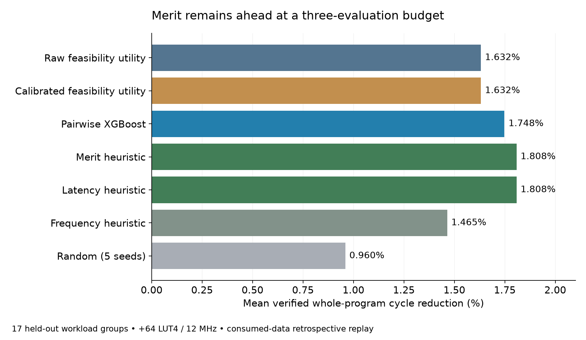

# Model and agent development checkpoint

The fixed nested calibration challenger was **not promoted**. It tied raw feasibility utility at budget three and worsened probability metrics. No new model outperformance claim is supported.

## Measured-data replay

156 successful candidate measurements and four charged failures across 17 workload groups. Each outer fold excludes its workload and all target canonical operator-tree families. Calibration uses only inner held-out predictions with the same exclusions. These are consumed development data, not a new prospective test.

| Policy | B3 mean cycle reduction | Mean charged seconds | Complete-pool regret |
|---|---:|---:|---:|
| Raw feasibility utility | 1.6316% | 159.46 | 0.2115 percentage points |
| Calibrated feasibility utility | 1.6316% | 159.46 | 0.2115 percentage points |
| Pairwise XGBoost | 1.7480% | 162.42 | 0.0795 percentage points |
| Merit heuristic | 1.8079% | 161.73 | 0.0116 percentage points |
| Latency heuristic | 1.8079% | 159.58 | 0.0116 percentage points |
| Frequency heuristic | 1.4646% | 159.77 | 0.4007 percentage points |
| Random (5 seeds) | 0.9595% | 156.24 | 0.7599 percentage points |

Regret covers 15 complete workload pools; two censored pools are excluded. Selection performance covers all 17. Random seeds are averaged within workload, not treated as independent evidence. Measurement times are historical charged evaluation times, not new hardware work. Total source-corpus collection cost is 8,657.112 seconds across all 160 attempts; fold fits use subsets of that corpus. The nested diagnostic took 24.743 seconds on this host.

Brier score worsened from 0.21685 to 0.22390; log loss worsened from 0.62418 to 0.64048 (lower is better). Probability metrics cover successful known outcomes only. All 17 folds fitted the logistic calibrator; no identity fallbacks occurred. Calibrated utility ties raw utility on all 17 B3 workloads and loses to merit on two, tying 15. The paired workload-bootstrap interval for its reduction difference versus merit is [-0.4873, 0.0000] percentage points. This does not establish an advantage.

The existing pairwise model remains a challenger, not the winning policy. The next useful experiment is a frozen forward comparison on countnegative; additional parameter sweeps on this development set would not establish generalization.

## Newly qualified workload

Countnegative v2 passed prepare, discovery, opportunity, baseline, public-feature export and freeze. Four legal candidates were retained without the old twelve-candidate minimum. The unchanged upstream self-check passed; baseline is 12,477 cycles / 2,510 instructions, 1,653 LUT4, 295 carry cells, 20 RAM blocks, 655 flip-flops. Three routed Fmax values are 77.160 / 68.493 / 70.388 MHz. Candidate measurements remain **zero**; this is pipeline qualification, not four new speedup labels. The source was previously screened, so it is not an untouched-source claim.

## Commands

```sh
.venv/bin/python scripts/evaluate_grouped_feasibility_calibration.py --output reports/<fresh-directory>
.venv/bin/python scripts/report_grouped_feasibility_calibration.py
.venv/bin/python scripts/qualify_countnegative_v2.py --output results/<fresh-directory> --native-root generated/<fresh-directory>
```

Calibration replay creates a fresh sealed directory. Qualification invokes the real toolchain; preserve original results and use fresh paths for reruns. No production scores or frozen live-agent controllers were modified.

## Agent diagnostics and validation

The new deterministic episode audit reconstructs the advice board from public predictions before each probe and checks temporal/hash links to paid outcomes. Nanocobs followed pairwise and utility advice on its one successful probe. Sudoku followed pairwise advice on the first two probes, departed on the third, and all three were area-infeasible. Missing historical utility advice stays explicitly unavailable. These audits improve observability; they do not establish an improved live policy.

Full repository validation: 4,592 tests and 181 subtests passed in 234.12 seconds; one intentional duplicate-ZIP warning. Ten new episode-audit tests passed separately. Countnegative qualification manifest authenticated all 82 artifacts. Frozen production controllers were unchanged.

[Nanocobs decision audit](../2026-10-28-nanocobs-decision-audit-r1/README.md) · [Sudoku decision audit](../2026-10-28-sudoku-decision-audit-r1/README.md)


