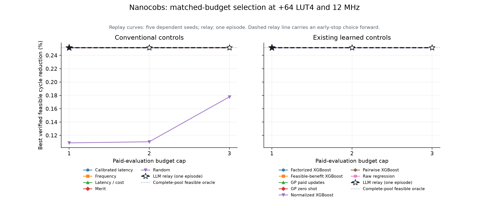
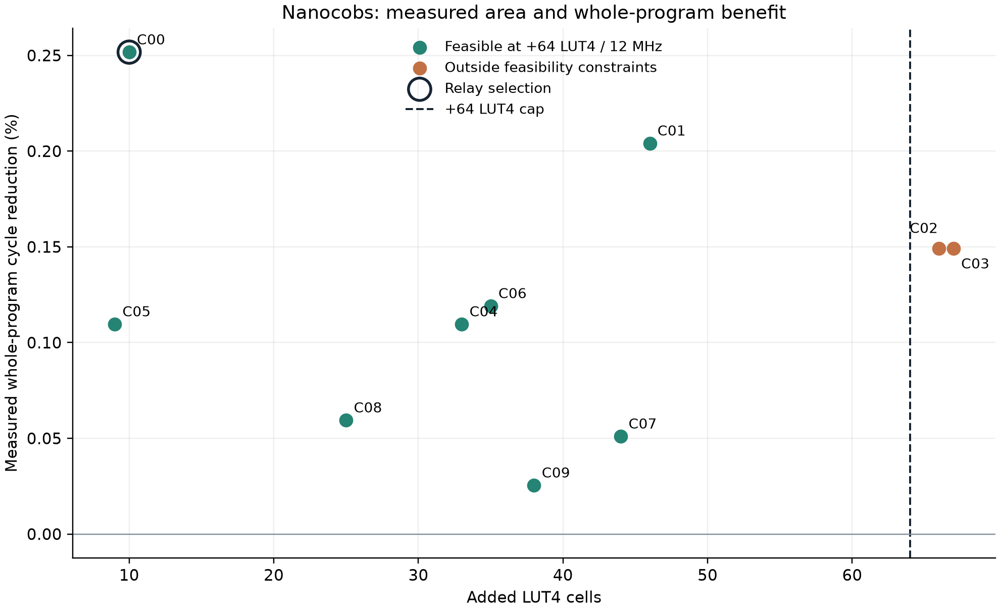

# Nanocobs selection: measured comparison

Prelabel commit `85fc99cf162372bfa76352af951ade1c1e2e4ab8`; 10 one-attempt candidate outcomes. Complete measured reference: **True**. The relay used **1** paid attempts in one episode.

The non-agent results are posthoc replays on the same measured pool, with only each policy’s paid prefix revealed. Five dependent policy seeds are not five independent workloads. Physical oracle collection and policy replay costs are separate. A dashed relay curve carries an early-stop result into larger budget caps; it adds no measurements.

The agent used 1 of 3 allowed paid evaluations; 2 remained unused. There were 3 logged model decisions. The provider_calls field (0) is bridge API telemetry, not a count of model decisions. Live measurement cost was 46.235 seconds; the enclosing evaluation-wrapper cost was 52.144 seconds. These overlap and must not be summed.





## Every candidate

| Candidate | Status | Cycles | Reduction % | Added LUT4 | Min MHz | Feasible +64 | Seconds |
|---|---|---:|---:|---:|---:|---|---:|
| candidate_00 | success | 96129788 | 0.252 | 10 | 61.660 | True | 46.235 |
| candidate_01 | success | 96175646 | 0.204 | 46 | 70.215 | True | 47.747 |
| candidate_02 | success | 96228578 | 0.149 | 66 | 68.227 | False | 52.686 |
| candidate_03 | success | 96228578 | 0.149 | 67 | 68.385 | False | 52.412 |
| candidate_04 | success | 96266672 | 0.110 | 33 | 65.176 | True | 51.645 |
| candidate_05 | success | 96266672 | 0.110 | 9 | 68.498 | True | 43.306 |
| candidate_06 | success | 96257532 | 0.119 | 35 | 67.020 | True | 47.197 |
| candidate_07 | success | 96323156 | 0.051 | 44 | 69.828 | True | 49.481 |
| candidate_08 | success | 96315037 | 0.059 | 25 | 65.449 | True | 47.919 |
| candidate_09 | success | 96347801 | 0.025 | 38 | 66.146 | True | 49.542 |

Full formulas, identities, self-check/device status and relay membership are in [candidates.csv](candidates.csv).

## Same-budget comparison at +64 LUT4

| Policy | B1 reduction % | B2 reduction % | B3 reduction % | Scope |
|---|---:|---:|---:|---|
| Calibrated latency | 0.252 | 0.252 | 0.252 | Five dependent replay seeds (mean) |
| LLM relay (one episode) | 0.252 | 0.252 | 0.252 | One live relay episode |
| Factorized XGBoost | 0.252 | 0.252 | 0.252 | Five dependent replay seeds (mean) |
| Feasible-benefit XGBoost | 0.252 | 0.252 | 0.252 | Five dependent replay seeds (mean) |
| Frequency | 0.252 | 0.252 | 0.252 | Five dependent replay seeds (mean) |
| GP paid updates | 0.252 | 0.252 | 0.252 | Five dependent replay seeds (mean) |
| GP zero shot | 0.252 | 0.252 | 0.252 | Five dependent replay seeds (mean) |
| Latency / cost | 0.252 | 0.252 | 0.252 | Five dependent replay seeds (mean) |
| Merit | 0.252 | 0.252 | 0.252 | Five dependent replay seeds (mean) |
| Normalized XGBoost | 0.252 | 0.252 | 0.252 | Five dependent replay seeds (mean) |
| Random | 0.109 | 0.110 | 0.178 | Five dependent replay seeds (mean) |
| Pairwise XGBoost | 0.252 | 0.252 | 0.252 | Five dependent replay seeds (mean) |
| Raw regression | 0.252 | 0.252 | 0.252 | Five dependent replay seeds (mean) |

No general superiority or multi-instruction improvement follows from one fixed workload. The timed region includes the scalar reference and checker; their shared source limits correctness coverage, supplemented by the independent fixed-input host oracle. Unknown outcomes remain censored; a complete-pool oracle is reported only when available.

The original frozen verifier omitted the SQLite action-context count; the [separate verification amendment](../../results/2026-10-28-nanocobs-selection-verification-r1/README.md) preserves the failure and successful full replay with the corrected verifier.

## Reproduction

```sh
.venv/bin/python scripts/verify_nanocobs_selection.py
.venv/bin/python reports/2026-10-28-nanocobs-selection/build_report.py
```

Input sealed manifest SHA256: `ece98ea9b5ec4f7931053e9f608de69b77918f27c68f8c0ff991fdad39dec46b`. This builder verifies result hashes and performs no model fitting, native jobs or LLM calls.
