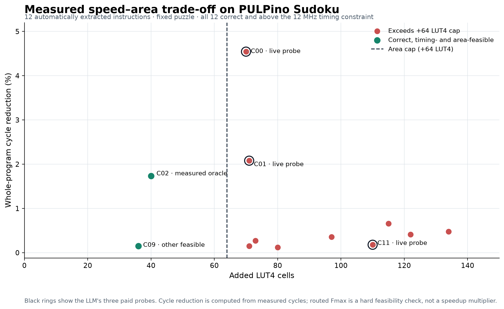
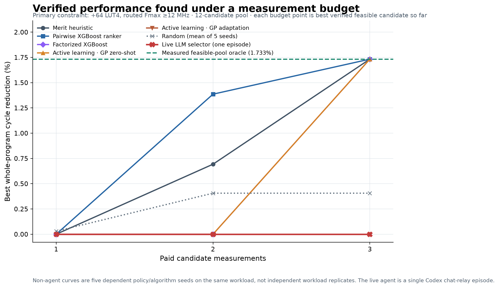

# PULPino Sudoku: measured model and agent selection result

## Finding

The second successful held-out workload now completes the full path from pinned
RISC-V source through automatic candidate extraction, lowering, correctness
checks, measured PicoRV32 cycles, routed hardware cost, ML/agent selection, and
matched-budget policy replay.

Under the preregistered **+64 LUT4 / 12 MHz / three-measurement** constraint, the
best verified single instruction is `slli(add(in0,in1),2)`. On the fixed Sudoku
input it reduces execution from **1,024,889 to 1,007,129 cycles** (17,760 fewer;
**1.017634× speedup / 1.732871% cycle reduction**), adds **40 LUT4**, and routes
at **66.984 MHz minimum Fmax** across the measured seeds. Correctness passes.
This is a measured feasible-pool oracle result for one fixed input, not a
generalization claim.

The live LLM agent did **not** find it: it measured candidates `candidate_00`,
`candidate_01`, and `candidate_11`, which all exceeded the area cap, then kept
the baseline. It left the full **1.732871 percentage-point cycle-reduction
regret** at the three-measurement budget. Pairwise XGBoost, merit, frequency,
the factorized feasibility XGBoost policy, and zero-shot GP active learning all
reached the oracle at three measurements in their five dependent replay seeds.
The pairwise XGBoost ranker had the best descriptive two-measurement mean
cycle reduction (1.3863% versus 0.6931% for merit), then tied merit and the
oracle at three. This is a negative result for the live agent, and a one-pool
pilot; it does **not** establish an ML win or broad agent failure.





## Frozen workload and measurements

- Pinned upstream PULPino Sudoku source; one fixed 9×9 puzzle, solved twice per
  timed run, with all 81 returned cells checked against the upstream answer.
- RV32I/Zicsr, ILP32, PicoRV32/PCPI. Baseline: **1,024,889 cycles / 198,711
  instructions**. Baseline hardware: **1,653 LUT4 / 295 carry / 655 FF / 20
  BRAM**; minimum baseline routed Fmax **68.493 MHz** against a 12 MHz clock
  constraint.
- Program/stack partition: 2,304 / 5,760 bytes within the existing 8 KiB RAM.
  Runtime stack high-water was 3,968 bytes, with 1,792 bytes headroom and zero
  guard violations.
- Twelve automatically discovered, lowerable, executable candidates across
  nine operator-tree families. They are the existing extractor's top-12
  shortlist, not an exhaustive legal instruction set. All 12 evaluations
  completed; all correctness checks passed; there were no failed or censored
  candidates. Every candidate passed the 12 MHz timing constraint. Only two
  met the additional +64 LUT4 limit.
- Exact cycle speedups equal the public calibrated analytic cycle estimates on
  all 12 outcomes. The new learned result is therefore primarily about ranking
  hardware-feasible candidates; do not describe this as a learned magnitude
  predictor win.

## Complete measured candidate pool

`C00`–`C11` are native candidate names, not ranks. The timing column reports the
minimum Fmax across the three routed results. `Feasible` means correctness,
device fit, area ≤64 LUT4 and routed Fmax ≥12 MHz.

| Candidate | Instruction formula | Cycles | Speedup | Cycle reduction | Added LUT4 | Min Fmax | Feasible |
|---|---|---:|---:|---:|---:|---:|:---:|
| C00 | `add(in0,slli(in1,2))` | 978,319 | 1.047602× | 4.544% | 70 | 61.854 MHz | No |
| C01 | `add(slli(in0,3),in0)` | 1,003,577 | 1.021236× | 2.079% | 71 | 63.638 MHz | No |
| C02 | `slli(add(in0,in1),2)` | 1,007,129 | 1.017634× | 1.733% | 40 | 66.984 MHz | **Yes** |
| C03 | `slli(add(add(slli(in0,3),in0),in1),2)` | 1,018,169 | 1.006600× | 0.655% | 115 | 62.418 MHz | No |
| C04 | `sub(slli(sub(slli(in0,3),in0),2),in0)` | 1,019,993 | 1.004800× | 0.478% | 134 | 62.688 MHz | No |
| C05 | `add(add(slli(in0,3),in0),in1)` | 1,020,689 | 1.004115× | 0.410% | 122 | 64.131 MHz | No |
| C06 | `slli(sub(slli(in0,3),in0),2)` | 1,021,217 | 1.003596× | 0.358% | 97 | 71.490 MHz | No |
| C07 | `sub(slli(sub(in0,in1),2),in1)` | 1,022,135 | 1.002694× | 0.269% | 73 | 68.204 MHz | No |
| C08 | `add(slli(in0,1),in0)` | 1,023,665 | 1.001196× | 0.119% | 80 | 64.234 MHz | No |
| C09 | `slli(sub(in0,in1),2)` | 1,023,359 | 1.001495× | 0.149% | 36 | 67.806 MHz | **Yes** |
| C10 | `sub(slli(in0,2),in1)` | 1,023,359 | 1.001495× | 0.149% | 71 | 68.004 MHz | No |
| C11 | `sub(slli(in0,3),in0)` | 1,023,053 | 1.001795× | 0.179% | 110 | 70.842 MHz | No |

Cycle reduction is `1 − candidate_cycles / baseline_cycles`; speedup is
`baseline_cycles / candidate_cycles`. Routed Fmax is used as a constraint
check. It is not a silicon frequency measurement and was not multiplied into
the fixed-clock cycle-speedup result.

## Matched-budget results

Mean best-so-far cycle reduction across five **dependent policy seeds on this
same pool**; the live agent ran once. Search time is the corresponding
counterfactual paid-measurement prefix. The entire corpus was nevertheless
measured once to establish the oracle.

| Selector | B1 | B2 | B3 | B3 paid evaluation time |
|---|---:|---:|---:|---:|
| Live Codex LLM agent (one episode) | 0.000% | 0.000% | 0.000% | 120.5 s |
| Pairwise XGBoost ranking | 0.000% | 1.386% | 1.733% | 115.9 s |
| Merit heuristic | 0.000% | 0.693% | 1.733% | 115.9 s |
| Frequency | 0.000% | 0.693% | 1.733% | 115.9 s |
| Factorized feasibility XGBoost | 0.000% | 0.000% | 1.733% | 115.9 s |
| Zero-shot GP active learning | 0.000% | 0.000% | 1.733% | 115.9 s |
| Adaptive GP active learning | 0.000% | 0.000% | 0.000% | 120.8 s |
| Random (mean of five seeds) | 0.030% | 0.406% | 0.406% | 124.4 s |

At B3, 10 of 12 non-agent policies reach the measured oracle across all five
replay seeds. Replays use a complete outcome table but release only each
policy's own outcomes one at a time; they create **zero new native jobs**.
The physical dataset/oracle collection cost **491.264 seconds** of candidate
attempt time and **569.836 seconds** of enclosing candidate operations across
all 12 evaluations. Do not present these full-pool collection costs as the
three-query policy cost.

## What the ML model and LLM do

- The frozen fit used **106 historical rows across 14 workload groups** after
  excluding Sudoku's source and all nine exact candidate tree families. It
  read zero Sudoku labels. The earlier historical corpus has 122 successful
  labels plus four preserved failed attempts.
- `XGBRanker(rank:pairwise)` predicts a relative ordering based on historical
  measured whole-program speedup orderings. Its score is not a speedup value.
- A 20-member XGBoost ensemble emits uncalibrated hardware-feasibility signals.
  The factorized score multiplies that signal by analytic cycle reduction; it
  is an ordering proxy, not a calibrated expected value or confidence
  interval. The ensemble disagreement is not calibrated uncertainty.
- The Codex LLM is a decision policy over structured `list_candidates`,
  `predict`, `measure`, and `finalize` calls. It was not fine-tuned and does not
  predict speedup. Its six structured tool calls were two predictions, three
  charged native measurements, and finalization; the host enforced the
  one-to-three measurement budget, candidate identity, correctness, area,
  timing and incumbent rules.
- The episode recorded **120.523 s** of candidate measurement time,
  **139.951 s** of enclosing operations, **409.142 s** decision elapsed through
  the interactive relay, and **549.453 s** live-session time. These scopes
  overlap and must not be added. Relay wait is included in decision elapsed;
  model-only latency is unavailable.
- Hybrid history retrieval used TF-IDF lexical and truncated-SVD semantic
  similarity with reciprocal-rank fusion, top three records and a 40 KB cap.
  The retrieval was bound to 106 historical rows. The knowledge graph was
  built but not queried in this episode. The relay used the current Codex model;
  exact model ID, token usage and model-only latency are unavailable. Dynamic
  provider routing was not evaluated. `provider_calls=0` means no separate
  provider API calls; it does not mean the LLM made no decisions.
- Sealed JSON traces are authoritative; SQLite is a read-only observability
  projection. The evidence verifier rechecked archive hashes and replayed
  **540 saved policy endpoints** with no mismatch; SQLite integrity passed.
  The LLM's short decision notes remain unverified explanations, not causal
  evidence for its choices.

## Concrete agent improvement for the next fresh workload

The LLM's third measured probe had a factorized score of 0.000947. The board
already ranked `C02` third and exposed its 0.008604 score—a 9.08× higher
factorized score than the agent's override. The raw feasibility scores were
0.529 versus 0.496 and both were uncalibrated. The agent chose the slightly
higher raw score, but the selected candidate added 110 LUT4 while C02 added 40.
This supports improving objective clarity, not fitting a new model to Sudoku.

The next selector implementation now exposes an explicit, unattempted
factorized-utility recommendation, its pairwise rank, per-candidate utility
rank and score ratio. The prompt asks the LLM to use that recommendation by
default and to justify overrides with the public score ratio and evidence.
The host still permits overrides and logs them. This software change is covered
by unit tests; its selection benefit remains **unverified** until a fresh
workload is preregistered and compared against the unchanged agent and
non-agent controls at the same budgets.

## Reproduction and evidence

From repository root, with `.venv` installed from `.[dev,reports]`:

```sh
.venv/bin/python scripts/execute_pulpino_sudoku_selector.py release
.venv/bin/python scripts/execute_pulpino_sudoku_selector.py agent  # interactive PTY required
.venv/bin/python scripts/execute_pulpino_sudoku_selector.py collect
.venv/bin/python scripts/execute_pulpino_sudoku_selector.py evaluate
.venv/bin/python scripts/execute_pulpino_sudoku_selector.py verify
.venv/bin/python scripts/plot_pulpino_sudoku_selection.py
```

The archived run is under
[`results/2026-10-28-pulpino-sudoku-selection-r4`](../../results/2026-10-28-pulpino-sudoku-selection-r4/README.md).
The frozen prelabel contract, failures from earlier launch revisions, native
archive, per-candidate outcomes, policy replays, agent ledger and observability
projection remain available there. This fixed puzzle and one agent episode do
not establish arbitrary-input correctness, whole-workload generalization,
combined-instruction performance, superiority over heuristics, or performance
on silicon.
