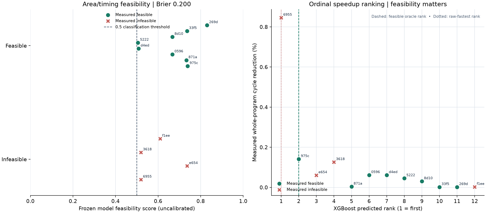

# Frozen tiny-regex-c model diagnostic

This is a post-label audit of the zero-label r5 predictions against the complete r2 target pool. No model was refit and no target outcome entered training.

## What the model predicted

- XGBoost pairwise ranker: 106 historical rows across 14 groups; target workload and 11 exact expression families were excluded. It predicts ordering, not speedup magnitude.
- The analytic latency feature supplied the cycle-benefit estimate; it matches all 12 observed cycle deltas here. This is a deterministic feature check on one pool, not learned magnitude prediction.
- Feasibility output was explicitly uncalibrated. Seed-0 Brier is 0.200 versus 0.222 for a prevalence-only baseline; ROC AUC is 0.641. At the illustrative 0.5 cutoff, it predicts 12/12 feasible and has 4 false positives. Do not tune a threshold to these twelve labels.

## Held-out result

- Pairwise rank versus measured speedup: Spearman 0.849, Kendall tau 0.708 on twelve candidates from one related-domain workload.
- The raw-fastest design ranked 1st but exceeded the +64 LUT4 cap. The feasible oracle ranked 2nd and was found after two measurements.
- Feasible oracle: 1.001414× speedup, 0.1412% cycle reduction.
- These target metrics are descriptive; candidate rows from one source are correlated and do not estimate independent-workload generalization.

## Next model work

The evidence points to better feasibility calibration and new measured outcomes across workloads, not another speedup-regression family. Keep XGBoost frozen until fresh eligible labels support a preregistered grouped evaluation. Host verification remains authoritative for area and timing.

The agent reached the oracle at two measurements and tied merit, calibrated latency, pairwise XGBoost, and factorized XGBoost. This diagnostic does not establish model or agent superiority.

Reproduce into a fresh directory or verify exact outputs with scripts/report_tiny_regex_model_diagnostics.py.
