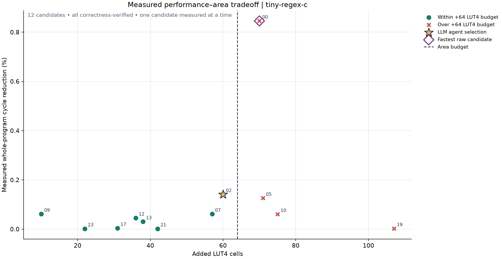
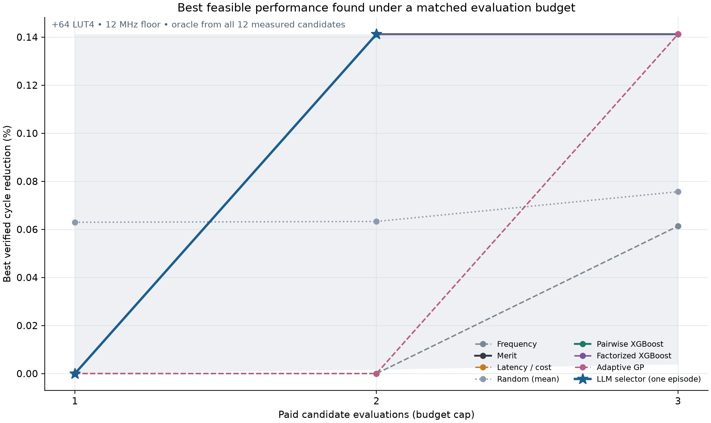

# tiny-regex-c selector pilot: readable results

This is one source/family-disjoint but related-domain transfer pilot. It does not establish that the ML or LLM selector beats strong heuristics or generalizes to unrelated programs.

## Measured endpoint

- Baseline: **361,839 cycles**, 66,206 instructions, 1,653 LUT4, 295 carry cells, 20 RAM blocks, 655 flip-flops, 68.49 MHz minimum routed Fmax.
- Agent selection: `sltiu(addi(andi(in0,-33),-65),26)`; **361,328 cycles** (511 fewer), **1.001414×** (0.1414% speedup), +60 LUT4, 68.88 MHz minimum routed Fmax, correctness verified.
- Agent used **2 of 3** allowed measurements and selected the exact measured oracle winner. Cycle-reduction regret: **0.000000**.
- First agent test: `695596a316ac87a4d10dd00bf303adc3bf8743860ba81d278dc07fadf4044b6c` measured 70 additional LUT4 and violated the +64 LUT4 constraint. The second measurement fit at +60 LUT4.
- Complete pool: 12 one-shot candidate measurements, 0 failures, 8 candidates within the +64 LUT4 / 12 MHz constraints, oracle speedup **1.001414×**.
- Full-pool data collection cost: 433.6 seconds of candidate evaluation time (493.9 seconds including wrapper checks). This is the cost to establish the oracle, not the 2-measurement agent search budget.

## Matched-budget comparison

Merit, calibrated latency, pairwise XGBoost ranking, factorized XGBoost, raw regression, and normalized XGBoost also reached the measured feasible oracle by budget 2 in the frozen offline replays. The LLM selector therefore **matched** these controls on this pool; it did not beat the strongest heuristics. Frequency had not found a feasible improvement by budget 2 and reached 0.0614% mean cycle reduction by budget 3. The adaptive and zero-shot GP controls reached the oracle at budget 3. Random selection remained below the oracle on average. Five control seeds are dependent policy runs on this one candidate pool, not five independent workloads; the LLM result is one episode.

The counterfactual policy curves release already measured candidate outcomes one at a time and account for each policy's own measurement prefix. Physically collecting the common oracle required all twelve evaluations. See the sealed study package for native jobs, evaluation times, full outcomes, model artifacts, decision requests, rationale links, and SQLite observability.





## AI engineering evidence and limits

The model used 106 prior measured rows across 14 workload groups after excluding all 11 exact candidate-tree families in the target pool. Six SLRE rows remain, so this is related-domain text/regex transfer. The ranking model is XGBRanker (`rank:pairwise`); the feasibility model is a 20-member XGBoost ensemble whose output and disagreement are uncalibrated.

The LLM received the frozen ML predictions, public frequency/merit/latency signals, top-three TF-IDF plus truncated-SVD semantic retrieval fused by reciprocal-rank fusion, and five structured tool decisions. The typed knowledge graph was built and hashed but was not queried in hybrid mode. SQLite observability is a read-only projection; the sealed JSON ledger is authoritative. This was a cooperative current-Codex chat relay, with no API model identifier, token counts, or isolated provider latency. The decision notes are concise public-evidence summaries linked to pre-measure contexts and host-verified outcomes; they are not validated chain-of-thought explanations.

A first launch was separately preserved as a zero-call, zero-measurement stdin startup failure; it is not counted as a model decision or selection trial. The r5 preregistered interactive run is the one reported above.

## Reproduce

```sh
../work/audit-venv/bin/python scripts/report_tiny_regex_selection.py
../work/audit-venv/bin/python scripts/execute_tiny_regex_selector.py verify
```

Source study manifest SHA-256: `61418b0f56626bd831223a9249159744d364996e3cfadf4a28510a041c368e37`.
Generated tables: `measured-candidates.csv` and `budget-selection-summary.csv`.
