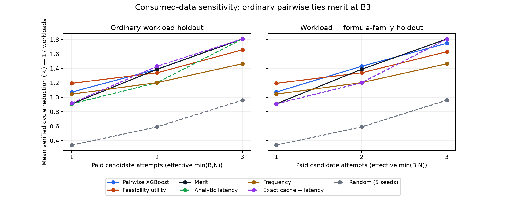

# Workload transfer sensitivity — derived summary

Ordinary workload-held-out pairwise XGBoost **ties merit at B3: 1.8079% mean cycle reduction**. Under strict workload-and-family exclusion it reaches 1.7480%, below merit’s 1.8079%. The historical strict-family B3 comparison remains primary. No model is promoted; these are already consumed development data, with no new native measurement or estimator fit in this report.



Every mean selection result averages 17 workload groups equally. Regret averages only 15 groups with complete oracles. Four unknown failures remain charged, and two censored workloads retain lower-bound references. Random uses five dependent seeds; other policies use fixed model seed zero. All target choices, including cache hits, pay actual verification and measurement costs.

## Selection and complete-oracle regret

Each cell is **cycle reduction % / regret percentage points**. Budgets are requested B1/B2/B3 with effective min(B,N).

### Ordinary workload holdout

| Policy | B1 | B2 | B3 | B3 native seconds |
|---|---:|---:|---:|---:|
| Pairwise XGBoost | 1.0721 / 0.8456 | 1.3877 / 0.4878 | 1.8079 / 0.0116 | 162.26 |
| Feasibility utility | 1.1932 / 0.7083 | 1.3388 / 0.5433 | 1.6572 / 0.1823 | 158.38 |
| Merit | 0.9091 / 1.0303 | 1.3877 / 0.4878 | 1.8079 / 0.0116 | 161.73 |
| Analytic latency | 0.9091 / 1.0303 | 1.2019 / 0.6984 | 1.8079 / 0.0116 | 159.58 |
| Frequency | 1.0434 / 0.8780 | 1.2025 / 0.6977 | 1.4646 / 0.4007 | 159.77 |
| Exact cache + latency | 0.9174 / 1.0209 | 1.4295 / 0.4405 | 1.8079 / 0.0116 | 159.72 |
| Random (5 seeds) | 0.3359 / 1.4093 | 0.5892 / 1.1250 | 0.9595 / 0.7599 | 156.24 |

### Workload + formula-family holdout

| Policy | B1 | B2 | B3 | B3 native seconds |
|---|---:|---:|---:|---:|
| Pairwise XGBoost | 1.0721 / 0.8456 | 1.4295 / 0.4405 | 1.7480 / 0.0795 | 162.42 |
| Feasibility utility | 1.1932 / 0.7083 | 1.3388 / 0.5433 | 1.6316 / 0.2115 | 159.46 |
| Merit | 0.9091 / 1.0303 | 1.3877 / 0.4878 | 1.8079 / 0.0116 | 161.73 |
| Analytic latency | 0.9091 / 1.0303 | 1.2019 / 0.6984 | 1.8079 / 0.0116 | 159.58 |
| Frequency | 1.0434 / 0.8780 | 1.2025 / 0.6977 | 1.4646 / 0.4007 | 159.77 |
| Exact cache + latency | 0.9091 / 1.0303 | 1.2019 / 0.6984 | 1.8079 / 0.0116 | 159.58 |
| Random (5 seeds) | 0.3359 / 1.4093 | 0.5892 / 1.1250 | 0.9595 / 0.7599 | 156.24 |

## Exact cache coverage

Compatibility is fixed before fitting: actual hardware, compiler, linker/memory/clock and hardware code-generation/device/routing source hashes must match. Historical max area/minimum Fmax/all-device-fit summaries are observations, not bounds. ML receives the same success cohort; its existing features use mixed contexts while the cache conservatively accepts only compatible records.

| Split | Known contexts | Exact matches | Compatible hits | Hit workloads | Infeasible hits | Rejected exact record pairs |
|---|---:|---:|---:|---:|---:|---:|
| Ordinary workload holdout | 160/160 | 28/160 | 8/160 | 6/17 | 6 | 34 |
| Workload + formula-family holdout | 160/160 | 0/160 | 0/160 | 0/17 | 0 | 0 |

All 160 target contexts have sufficient provenance for a comparison; this does not mean all historical records are compatible. Ordinary holdout exposes 28 target attempts with an exact formula in training, but only eight have compatible historical records (5.0%). Strict exclusion has zero exact matches and zero hits, as asserted before fitting. The strict cache therefore equals analytic latency. No compatibility rule was broadened after scoring.

| Compatible example (target workload) | Exact formula | Historical area / Fmax | Fit | Training record IDs |
|---|---|---:|---|---|
| beebs-expint | `add(in0,slli(in1,3))` | 71 LUT4 / 65.210 MHz | historically infeasible | `36184aef240a04662516085b7f804f3e0e4c606f170d68bebb6171e8cc0980a4` |
| beebs-ndes | `or(in0,slli(in1,1))` | 72 LUT4 / 73.411 MHz | historically infeasible | `a5a18b2ff8e4a94504e3e2d643c6baf6eaf2fb81f37cbcd37007ac061c7c18ea` |
| tacle-bitcount | `add(slli(in0,2),in1)` | 70 LUT4 / 68.856 MHz | historically infeasible | `695596a316ac87a4d10dd00bf303adc3bf8743860ba81d278dc07fadf4044b6c` |
| tacle-g723-enc | `sltu(0,add(in0,in1))` | 61 LUT4 / 67.723 MHz | historically feasible | `0e59451b8b862810d79835cc5d1b3afdeee2ee810c2b1594fdb6478e45e6a82b` |
| tacle-lift | `sltu(0,add(in0,in1))` | 61 LUT4 / 67.723 MHz | historically feasible | `b088b578b417daf31967582b1b777bd360d68a1b4721b909fb94281a1012e910` |
| tacle-lift | `or(in0,slli(in1,1))` | 72 LUT4 / 73.411 MHz | historically infeasible | `43d88b838f465609f64f3f7537b6b16d1bc69fbac68db2a5024d96297826674e` |
| tiny-regex-fixed-suite | `add(in0,slli(in1,3))` | 71 LUT4 / 65.210 MHz | historically infeasible | `4d5d3a61f435e56dadabad0538eb201044f562a898efa02e83fbe2738f847d74` |
| tiny-regex-fixed-suite | `add(slli(in0,2),in1)` | 70 LUT4 / 68.856 MHz | historically infeasible | `cdd44385c73d3944c7b97d5d3babaca977f4e0a1610cb598fe708c48178e092d` |

## Training cohorts

The strict split changes cohort size and composition. A split difference cannot identify a causal memorization effect. IDs, families, public predictions and complete orders remain in the sealed raw folds.

| Held-out workload | Ordinary rows / groups | Strict rows / groups | Additional family exclusions | Ordinary cache hits |
|---|---:|---:|---:|---:|
| beebs-aha-compress | 144 / 16 | 143 / 16 | 1 | 0/12 |
| beebs-expint | 150 / 16 | 128 / 16 | 22 | 1/6 |
| beebs-jfdctint | 150 / 16 | 138 / 16 | 12 | 0/6 |
| beebs-ndes | 144 / 16 | 121 / 16 | 23 | 1/12 |
| beebs-nettle-md5 | 144 / 16 | 110 / 16 | 34 | 0/12 |
| embench-aha-mont64 | 150 / 16 | 126 / 16 | 24 | 0/6 |
| embench-crc32 | 150 / 16 | 130 / 16 | 20 | 0/6 |
| embench-edn | 151 / 16 | 119 / 16 | 32 | 0/6 |
| embench-nettle-sha256 | 144 / 16 | 123 / 16 | 21 | 0/12 |
| embench-slre | 150 / 16 | 134 / 16 | 16 | 0/6 |
| embench-ud | 152 / 16 | 122 / 16 | 30 | 0/6 |
| nanocobs | 146 / 16 | 132 / 16 | 14 | 0/10 |
| pulpino-sudoku | 144 / 16 | 126 / 16 | 18 | 0/12 |
| tacle-bitcount | 144 / 16 | 111 / 16 | 33 | 1/12 |
| tacle-g723-enc | 145 / 16 | 124 / 16 | 21 | 1/12 |
| tacle-lift | 144 / 16 | 133 / 16 | 11 | 2/12 |
| tiny-regex-fixed-suite | 144 / 16 | 122 / 16 | 22 | 2/12 |

## Paired uncertainty versus merit

Difference and percentile 95% interval are percentage points of verified cycle reduction, bootstrapping whole workloads. Positive favors the listed policy; this is not a superiority test on untouched workloads.

| Split | Policy | Budget | Difference (pp) | 95% interval (pp) | Wins / ties / losses |
|---|---|---:|---:|---:|---:|
| Ordinary workload holdout | Pairwise XGBoost | 1 | 0.1630 | [-0.0684, 0.5574] | 1 / 15 / 1 |
| Ordinary workload holdout | Pairwise XGBoost | 2 | 0.0000 | [0.0000, 0.0000] | 0 / 17 / 0 |
| Ordinary workload holdout | Pairwise XGBoost | 3 | 0.0000 | [0.0000, 0.0000] | 0 / 17 / 0 |
| Ordinary workload holdout | Feasibility utility | 1 | 0.2841 | [-0.0013, 0.8537] | 1 / 15 / 1 |
| Ordinary workload holdout | Feasibility utility | 2 | -0.0490 | [-0.5574, 0.4105] | 1 / 15 / 1 |
| Ordinary workload holdout | Feasibility utility | 3 | -0.1507 | [-0.4359, 0.0000] | 0 / 15 / 2 |
| Ordinary workload holdout | Analytic latency | 1 | 0.0000 | [0.0000, 0.0000] | 0 / 17 / 0 |
| Ordinary workload holdout | Analytic latency | 2 | -0.1858 | [-0.5574, 0.0000] | 0 / 16 / 1 |
| Ordinary workload holdout | Analytic latency | 3 | 0.0000 | [0.0000, 0.0000] | 0 / 17 / 0 |
| Ordinary workload holdout | Frequency | 1 | 0.1344 | [-0.0061, 0.4105] | 1 / 14 / 2 |
| Ordinary workload holdout | Frequency | 2 | -0.1852 | [-0.7097, 0.2737] | 1 / 12 / 4 |
| Ordinary workload holdout | Frequency | 3 | -0.3433 | [-0.8229, -0.0018] | 1 / 12 / 4 |
| Ordinary workload holdout | Exact cache + latency | 1 | 0.0083 | [0.0000, 0.0249] | 1 / 16 / 0 |
| Ordinary workload holdout | Exact cache + latency | 2 | 0.0417 | [0.0000, 0.1252] | 1 / 16 / 0 |
| Ordinary workload holdout | Exact cache + latency | 3 | 0.0000 | [0.0000, 0.0000] | 0 / 17 / 0 |
| Ordinary workload holdout | Random (5 seeds) | 1 | -0.5732 | [-1.6355, 0.2167] | 9 / 1 / 7 |
| Ordinary workload holdout | Random (5 seeds) | 2 | -0.7985 | [-1.8115, -0.0277] | 6 / 1 / 10 |
| Ordinary workload holdout | Random (5 seeds) | 3 | -0.8484 | [-1.4162, -0.3625] | 1 / 1 / 15 |
| Workload + formula-family holdout | Pairwise XGBoost | 1 | 0.1630 | [-0.0684, 0.5574] | 1 / 15 / 1 |
| Workload + formula-family holdout | Pairwise XGBoost | 2 | 0.0417 | [0.0000, 0.1252] | 1 / 16 / 0 |
| Workload + formula-family holdout | Pairwise XGBoost | 3 | -0.0599 | [-0.1796, 0.0000] | 0 / 16 / 1 |
| Workload + formula-family holdout | Feasibility utility | 1 | 0.2841 | [-0.0013, 0.8537] | 1 / 15 / 1 |
| Workload + formula-family holdout | Feasibility utility | 2 | -0.0490 | [-0.5574, 0.4105] | 1 / 15 / 1 |
| Workload + formula-family holdout | Feasibility utility | 3 | -0.1763 | [-0.4873, 0.0000] | 0 / 15 / 2 |
| Workload + formula-family holdout | Analytic latency | 1 | 0.0000 | [0.0000, 0.0000] | 0 / 17 / 0 |
| Workload + formula-family holdout | Analytic latency | 2 | -0.1858 | [-0.5574, 0.0000] | 0 / 16 / 1 |
| Workload + formula-family holdout | Analytic latency | 3 | 0.0000 | [0.0000, 0.0000] | 0 / 17 / 0 |
| Workload + formula-family holdout | Frequency | 1 | 0.1344 | [-0.0061, 0.4105] | 1 / 14 / 2 |
| Workload + formula-family holdout | Frequency | 2 | -0.1852 | [-0.7097, 0.2737] | 1 / 12 / 4 |
| Workload + formula-family holdout | Frequency | 3 | -0.3433 | [-0.8229, -0.0018] | 1 / 12 / 4 |
| Workload + formula-family holdout | Exact cache + latency | 1 | 0.0000 | [0.0000, 0.0000] | 0 / 17 / 0 |
| Workload + formula-family holdout | Exact cache + latency | 2 | -0.1858 | [-0.5574, 0.0000] | 0 / 16 / 1 |
| Workload + formula-family holdout | Exact cache + latency | 3 | 0.0000 | [0.0000, 0.0000] | 0 / 17 / 0 |
| Workload + formula-family holdout | Random (5 seeds) | 1 | -0.5732 | [-1.6355, 0.2167] | 9 / 1 / 7 |
| Workload + formula-family holdout | Random (5 seeds) | 2 | -0.7985 | [-1.8115, -0.0277] | 6 / 1 / 10 |
| Workload + formula-family holdout | Random (5 seeds) | 3 | -0.8484 | [-1.4162, -0.3625] | 1 / 1 / 15 |

## Historical agreement and next improvement

All 18 overlapping strict-split selection macro values (six existing policies × three budgets) reproduce the previous nested-calibration diagnostic’s uncalibrated controls to numerical tolerance below 1e-14. This report changes no historical result. The new cache is an additional comparator.

The evidence directs the next model improvement toward feasibility and useful ordering under strict transfer: pairwise still trails merit at strict B3, feasibility utility trails both, and eight compatible cache hits are too sparse to explain the full policy difference. Preserve operand order and constants in future structural evidence, inspect existing feasibility misses and cohort support, then freeze one bounded change against an untouched workload with matched controls. These are research directions, not demonstrated improvements. Do not tune repeatedly on this consumed sensitivity or infer that the ordinary/strict gap proves memorization.

## Reproduction

Raw sealed source: `reports/2026-10-28-workload-transfer-sensitivity-r1`. Historical comparison: `reports/2026-10-28-grouped-feasibility-calibration-r1`. This generator authenticates both manifests, reads existing predictions/results and creates tables/plots only.

```sh
.venv/bin/python scripts/report_workload_transfer.py --source reports/2026-10-28-workload-transfer-sensitivity-r1 --historical reports/2026-10-28-grouped-feasibility-calibration-r1 --output reports/2026-10-28-workload-transfer-summary-r2
```
