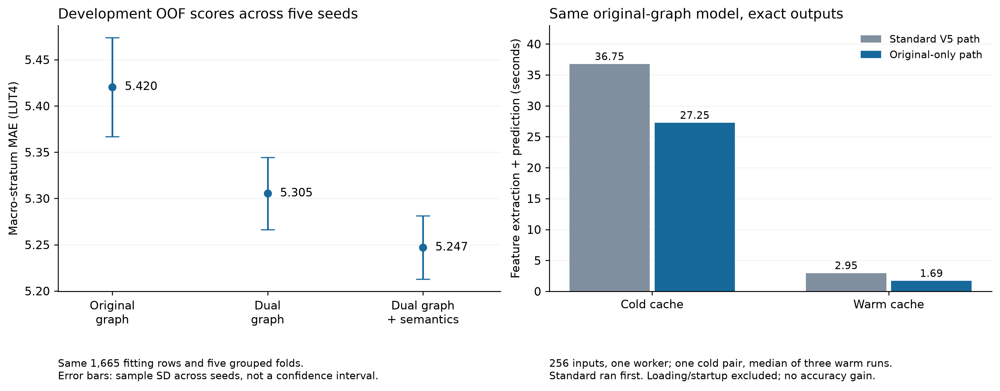

# Post-V5 development and exact inference optimization

This archive contains development diagnostics, not a new independent model
evaluation. The study was designed after V5 outcomes were inspected. The V5
model, sources, calibration and reported predictions remain unchanged.



Regenerate PDF/SVG/PNG with `python scripts/report_development_diagnostics.py --output generated/development-report`.

## Repeated-seed fitting-only study

Three views × five seeds × five frozen fitting folds produce 75 fits, all using
300-tree ExtraTrees with minimum leaf size one. The same 1,665 V5 fitting rows
are used; calibration and test rows enter no fit or score.

| View | Mean macro-stratum OOF MAE | Sample SD across five seeds |
| --- | ---: | ---: |
| Original graph | 5.42046 | 0.05350 |
| Dual graph | 5.30540 | 0.03905 |
| Dual graph + semantics | 5.24695 | 0.03428 |

The direction is consistent across the five seeds. The semantic increment is
only 0.05846 LUT4 and comes from multiplication; the other eight development
strata collectively regress. The worst roughly 1% of fitting rows contribute
25–27% of absolute error. Seed stability does not fix systematic structural
errors or provide calibrated uncertainty.

See [findings](findings.txt), [all metrics](summary.json), retained OOF
predictions, parameters and source snapshots. Reproduce with
`scripts/develop_v6.py --root results/2026-10-14-v5 --output <new-directory-outside-repository>`.

## Exact original-only inference

The separately versioned `isaforge.fast_graph_inference` wrapper uses the strict
V5 loader and skips channels unused by the frozen original-graph model. All 256
point predictions, upper bounds, tree deviations and domain flags remain exactly
equal, including cold and three warm repeats. This changes runtime, not accuracy.

One-worker runs from separate absent caches on the same machine:

| Implementation | Cold features + prediction | Median three warm repeats |
| --- | ---: | ---: |
| Standard V5 original-graph path | 36.75 s | 2.95 s |
| Original-only wrapper | 27.25 s | 1.69 s |

The observed cold reduction is 25.86%. Only one sequential cold pair was measured;
standard ran first. OS caches and scheduling are uncontrolled. Model loading is
separate, and no acquisition or processor speedup is established. See the
[timing record](fast-graph-runtime.json) and [method](fast-graph-runtime.txt).

```sh
.venv/bin/python -m isaforge.fast_graph_inference \
  --model results/2026-10-14-v5/models/original_graph.joblib \
  --candidates results/2026-10-14-v5/corpus/test/candidates.json \
  --cache-root generated/original-only-cache \
  --output generated/original-only-predictions.json
```

The external transfer experiment continues to use the original frozen runtime.
The wrapper does not replace its comparator or alter any frozen prediction.
