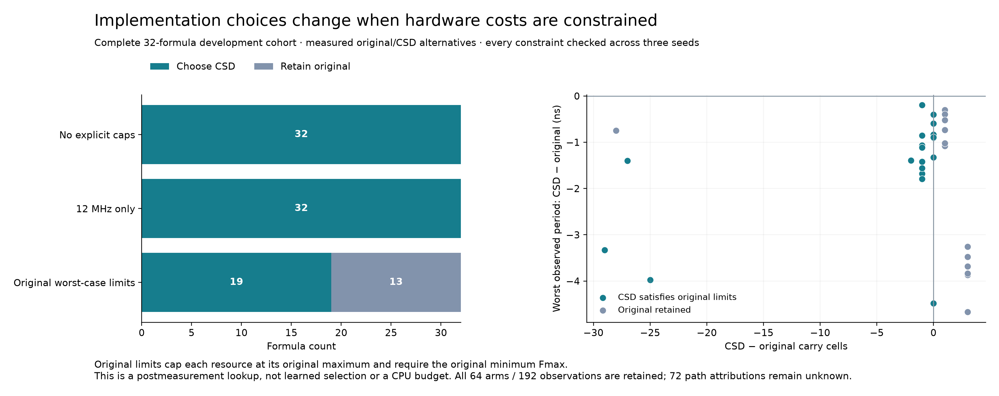

# Measured implementation choices under hardware budgets

The implemented selector checks each explicit resource/clock constraint across all three seeds, retains both implementation alternatives and their Pareto fronts, and chooses the feasible arm with the smallest worst observed period. It returns no choice when neither arm is feasible. This is a postmeasurement development lookup, not learned selection or CPU performance.

| Policy | Choose CSD | Retain original | No feasible choice |
| --- | ---: | ---: | ---: |
| No explicit caps | 32 | 0 | 0 |
| Minimum 12 MHz only | 32 | 0 | 0 |
| Original per-formula worst-case limits | 19 | 13 | 0 |

The last policy caps every resource at that original implementation's maximum measured count and requires its minimum measured Fmax. Twelve CSD arms violate the carry cap and one violates the packed logic-cell cap. These 13 remain explicit tradeoffs, even though worst observed period improves for all 32 rewrites. Nineteen formulas have a single Pareto-optimal measured arm; 13 retain both arms on the frontier. Limits are per harness, not a sum over the cohort or a CPU area budget.

[PDF](v10d-constrained-selection.pdf) · [SVG](v10d-constrained-selection.svg) · [Complete alternatives, budgets, violations and decisions](policy-results.json) · [Source/evidence hashes](manifest.json) · [Independent review](independent-review.json)

The [policy definition](../../docs/v10d-selection-policy.md) states the exact inclusive thresholds, worst-seed aggregation and tie-breaking order. All 64 alternatives and 192 route observations are retained for every policy. The 72 unknown path classifications remain unknown. No new native measurements, fits or target relabeling were performed.

Reproduce with `make reproduce-v10d-selection` (fresh output required). The general CLI accepts explicit JSON budgets; use `python scripts/select_v10d_implementations.py --help`. It authenticates the complete raw timing evidence before choosing. The full suite passes 1,539 tests and 111 subtests ([log](full-suite.log)); 64 tests specifically cover missing seeds, invalid caps, exact boundaries, ties, worst-seed behavior and infeasible outcomes. Independent review reconstructs policy arithmetic separately from the selector.

This result changes implementation choices under explicit budgets. It does not demonstrate an ML advantage, fewer physical measurements, independent generalization, power savings or a CPU benefit. [Research context](../../docs/research-update-hardware-selection-2026-10-15.md).
