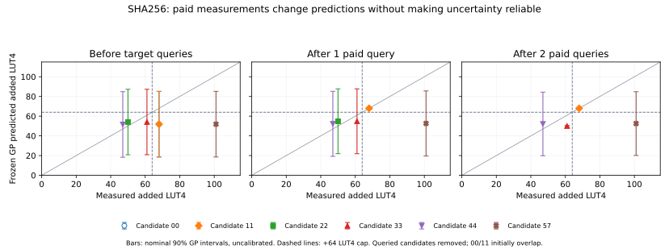

# Model and research-readiness analysis — October 21, 2026

**Decision:** keep the measured whole-program selection objective. Build a minimal bounded LLM selector as the next integration milestone, alongside one focused structural-feature development experiment. Current evidence does not establish a learned/agent win, calibrated confidence or a completed final instruction-set optimizer.

The [archived analysis and proposed agent contract](analysis.md) covers original-proposal status, model/selection errors, uncertainty, dataset limitations, cost accounting, primary methods and acceptance criteria. This archive adds **zero model fits, LLM calls, native measurements or training labels**. All six workloads are consumed development data.

## Reproduce

```sh
# From the repository root; Python 3.12 and requirements-speedup.txt.
python scripts/analyze_model_readiness.py --output generated/reproduction/model-readiness
# Use a fresh output directory; the command refuses to overwrite evidence.
python results/2026-10-21-model-readiness-analysis/plot_area_confidence.py \
  --output generated/reproduction/model-readiness-plot
```

The first command authenticates 13 frozen JSON inputs and writes sealed metrics/source/input hashes. It performs arithmetic reweighting of seed-zero initial scores and reads recorded paid updates. It never counterfactually refits a GP or simulates an unrecorded adaptive path. Observed-area ranking is a privileged diagnostic computed only for the complete SHA256 hardware pool; EDN/UD missing hardware outcomes remain unknown. The plot command redraws only these archived metrics; it fits no model.

## Main findings

- All 33 successful cycle deltas equal calibrated latency. Thirteen of 31 structural columns are constant, and only 11 of 24 supported expression-operation types occur. All successful designs fit the device and clear 12 MHz; area-cap exclusions are the main tested hardware constraint.
- Removing duration, duration variance or timing does not change the initial frozen ordering on EDN/UD/SHA at any of the three caps. SHA's wrong first query is explained by area feasibility: GP probabilities favor the actual +68-LUT candidate over the actual +50-LUT optimum.
- Paid measurements help ordering but do not establish calibrated confidence. After two SHA queries, candidate33's 50.014 ±0.328-LUT prediction misses its actual61LUT by33.5 predicted standard deviations. Both remain feasible at64; this error alone does not change that endpoint's feasibility.
- SHA's XGBoost 00→11→22 order is correct for unconstrained speedup. Hardware-aware decision value and regressor accuracy must be tested separately. The cost heuristic wins SHA in one query but misses EDN's primary optimum through three; keep both it and calibrated latency in comparisons.
- Historical measurement-record times and SHA's validation-inclusive ledger times differ. Workload runtime/context is omitted from the duration model. Harmonize target definitions and measure full outer search time before claiming end-to-end efficiency.
- A bounded LLM agent is a missing proposal component. Its four tools should be list/predict/measure/finalize with host-enforced budgets, label isolation and measured acceptance. Compare five trajectories with frozen numeric models, matched inputs/controls and inference cost. Consumed replay is an engineering pilot; fresh preregistered evidence is required for research claims.



Error bars show nominal 90% GP model intervals, not calibrated confidence. The target outputs on the horizontal axis are privileged analysis data, never agent inputs before their paid query. Candidates queried in earlier states are removed.

## Files and validation

- `metrics.json`: sealed corpus/target diagnostics; complete source/input hashes and zero-fit/job counters.
- `scope-metrics.json`: independent corpus coverage/count check. `scope-metrics-source.txt` captures its original scratch script for provenance; the runnable reproduction entrypoint is the main analysis CLI above.
- `primary-methods.md`: exact source/version/sections and bounded adaptation limits, including ReAct and LLAMBO.
- `plot_area_confidence.py`, `area-confidence.svg/png`: reproducible illustration of recorded model states.
- `historical-document-check.json`: preserved prior document hashes and unchanged reviewed-method text.
- `targeted-tests.txt`: **9 passed**, including no-fit/no-native checks, unknown outcomes, frozen-ranking agreement, input tampering and exclusion of analysis writes from selector inputs.
- `full-tests.txt`: **2,872 passed, 179 subtests passed, one recurring failure** in unchanged `test_blocked_pipe_or_compressor_drain_has_finite_cleanup[pipe]`. Its residual owned-process-group assertion is retained; the listed process was absent when checked after the suite. No fix to frozen legacy capture code is claimed.
- `reproduce.txt`: existing six-model score replay passes with all six metrics matching. This does not count as a new fit or native measurement in this analysis.

Active methodology/research-status documents were synchronized. Prior versions were saved with historical banners and exact original bytes. All old datasets, predictions, source-bound runtime modules, failures and prospective results remain unchanged. This archive is privileged analysis material and must stay outside any selection agent's tool/filesystem access.
