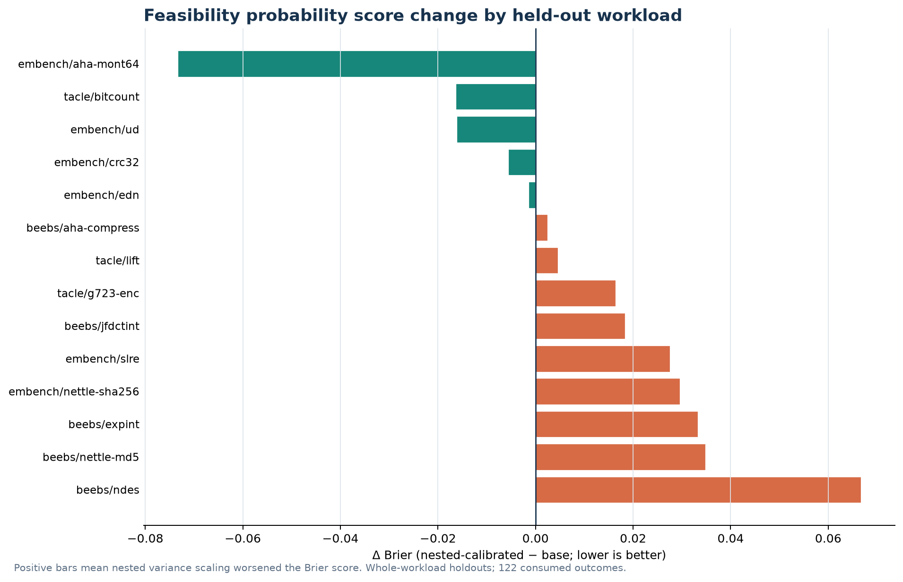
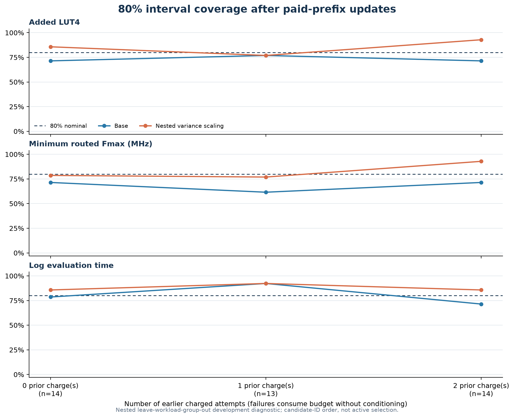

# Nested joint-posterior uncertainty scaling

**Retrospective development diagnostic; no policy or model promoted.** The variance multiplier is estimated only from nested, source-family-excluded workload-group folds. The held-out outer workload contributes no labels to either the base fit or calibration factor.

Input: 122 verified outcomes and 4 charged failures across 14 workload groups. The nested analysis used 196 total fits (182 inner calibration fits). No native jobs or new measurements.

## Feasibility score

| Metric | Base fixed-joint | Nested variance-calibrated |
|---|---:|---:|
| Candidate-weighted Brier score, n=41 | 0.2508 | 0.2593 |
| Equal-workload macro Brier | 0.2237 | 0.2323 |

Paired whole-workload bootstrap (20,000 resamples): macro Brier difference calibrated−base `+0.0086` with descriptive 95% interval `-0.0088` to `+0.0244`; candidate-weighted difference `+0.0129` with interval `-0.0040` to `+0.0288`. These intervals describe resampling of this selected engineering corpus, not a workload population.

## Interval calibration by charged-attempt prefix

Entries are 50% / 80% / 95% interval coverage. Prefix 0, 1, or 2 means prior charged attempts, including failures. Each outer workload uses factors estimated from the other groups only. Only the first three attempts per group enter the budget-three diagnostic.

| Prior charged attempts | Output | Base coverage | Calibrated coverage |
|---:|---|---|---|
| 0 | area_delta_lut4 | 0.429 / 0.714 / 0.929 | 0.500 / 0.857 / 0.929 |
| 0 | routed_fmax_min_mhz | 0.500 / 0.714 / 0.929 | 0.500 / 0.786 / 0.929 |
| 0 | log_measurement_seconds | 0.571 / 0.786 / 0.857 | 0.786 / 0.857 / 0.857 |
| 1 | area_delta_lut4 | 0.692 / 0.769 / 0.923 | 0.692 / 0.769 / 0.923 |
| 1 | routed_fmax_min_mhz | 0.308 / 0.615 / 0.846 | 0.615 / 0.769 / 0.923 |
| 1 | log_measurement_seconds | 0.462 / 0.923 / 0.923 | 0.615 / 0.923 / 0.923 |
| 2 | area_delta_lut4 | 0.500 / 0.714 / 0.857 | 0.714 / 0.929 / 0.929 |
| 2 | routed_fmax_min_mhz | 0.571 / 0.714 / 0.929 | 0.929 / 0.929 / 0.929 |
| 2 | log_measurement_seconds | 0.500 / 0.714 / 0.857 | 0.714 / 0.857 / 0.929 |

## Learned variance factors

Factors multiply predictive variance, not standard deviation. One source/workload group contributes once to each estimate.

| Prior charged attempts | Output | Median q | Min q | Max q |
|---:|---|---:|---:|---:|
| 0 | area_delta_lut4 | 1.143 | 0.866 | 1.377 |
| 0 | routed_fmax_min_mhz | 1.192 | 0.982 | 1.637 |
| 0 | log_measurement_seconds | 2.432 | 0.651 | 3.047 |
| 1 | area_delta_lut4 | 1.112 | 0.774 | 1.439 |
| 1 | routed_fmax_min_mhz | 1.407 | 1.085 | 1.697 |
| 1 | log_measurement_seconds | 1.378 | 1.316 | 1.987 |
| 2 | area_delta_lut4 | 3.171 | 0.909 | 14.090 |
| 2 | routed_fmax_min_mhz | 98.678 | 0.849 | 586.325 |
| 2 | log_measurement_seconds | 1.752 | 0.938 | 20.813 |

## Limits

- All outcomes are from the consumed 122-success/four-failure engineering corpus; this is not confirmatory.
- Nested leave-one-workload-group-out and operation-family exclusion prevent the outer target labels and families from entering either base fitting or calibration.
- Candidate-ID order is a fixed retrospective sequence, not a live or simulated active-selection policy.
- The variance multiplier rescales predictive variances only; it does not correct conditional-mean bias, estimate cross-output covariance, or calibrate correctness/infrastructure failure risk.
- Brier and interval summaries use observed successful numeric outcomes only; all failed attempts remain charged and are not imputed.
- The engineering workload groups are few and selected; these estimates do not establish exchangeability, population calibration, or future selection gain.
- No model, policy, source outcome, or native measurement was changed; a prospective source-family holdout with matched myopic controls is still required before promotion.

## Figures

