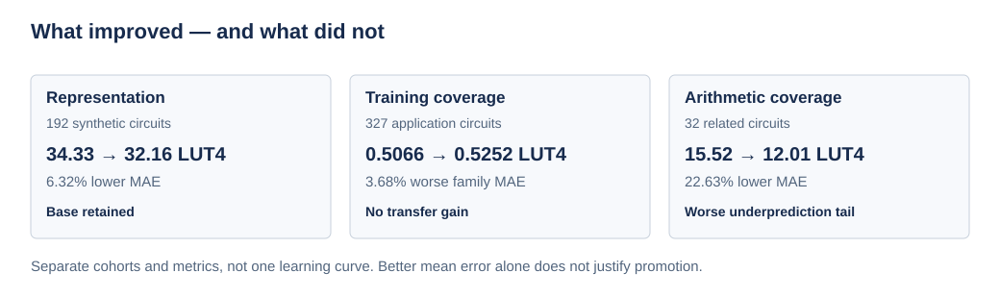

# Results

**Default model: base.** Newer experimental models have not passed all accuracy and hardware-budget gates.

## Matched benchmark outcomes



Representation compares dual-graph with base; the coverage studies compare base with coverage. These are separate distributions and endpoints. The 327-case scoped policy is retrospective and selects base everywhere. [Metric definitions and denominators](../docs/benchmarks.md).

| 192-circuit predictor | MAE, LUT4 ↓ | Positive-target MAPE ↓ |
| --- | ---: | ---: |
| Base | 32.1609 | 43.63% |
| Dual-graph | 34.3322 | 49.37% |
| Tuned operator graph | 46.3390 | 75.63% |
| MasterRTL FPGA recipe adaptation | 61.4686 | 85.67% |

These are our measured implementations, not published MasterRTL ASIC scores.

## Latest budget-safety work

| Experiment | Accuracy / coverage | Budget outcome | Status |
| --- | --- | --- | --- |
| Direct feasibility | Fresh general32 MAE 15.41 → 13.44 | Three targeted false accepts; one sharing false reject | Not promoted |
| Control/sharing coverage | 32 training additions; 62/62 required acceptances | Seven consumed false accepts, four newly introduced | Not promoted |
| Latest fresh validation | 16/55 area labels complete | Complete-population metrics unavailable | Incomplete; no accuracy claim |

[Latest report](control-sharing-coverage/README.md) · [Status figure](../docs/assets/research-status.svg). Negative results and missing outcomes remain part of the record.

## Reproduce

```sh
./start.sh
# Or, in the prepared environment:
.venv/bin/python scripts/reproduce.py --check
```

This checks hashes and recomputes the three curated benchmark summaries, with no training or synthesis. [Machine-readable summary](summary.json) · [Provenance](provenance.json).

| Benchmark evidence | Files |
| --- | --- |
| Research baselines | [Observations](research-baselines/observations.json) |
| Application transfer | [Observations](application-transfer/observations.json) · [Audit](application-transfer/audit.json) |
| Arithmetic stress | [Observations](arithmetic-stress/observations.json) · [Audit](arithmetic-stress/audit.json) |

## Experiment records

Individual records retain protocols, complete predictions, failures, replay commands and raw-evidence references. They are archival research detail, not alternative production defaults.

| Question | Records |
| --- | --- |
| Do more or selected features help? | [Feature comparison](feature-comparison/README.md) · [Stability](selection-stability/README.md) · [Fresh validation](selection-validation/README.md) |
| Does training coverage transfer? | [Targeted coverage](targeted-coverage/README.md) · [Budget-preserving coverage](budget-preserving-coverage/README.md) · [Guarded revision](guarded-revision/README.md) |
| Can signed arithmetic be improved? | [Signed refinement](signed-refinement/README.md) · [Budget release](budget-release/README.md) |
| Can boundary decisions be repaired? | [Repair](boundary-repair/README.md) · [Challenge](boundary-challenge/README.md) · [Refinement](boundary-refinement/README.md) |
| Do coverage and abstention help? | [Coverage](boundary-coverage/README.md) · [Abstention](boundary-abstention/README.md) · [Corroboration](boundary-corroboration/README.md) |
| Can feasibility be learned directly? | [Feasibility](boundary-feasibility/README.md) · [Control/sharing coverage](control-sharing-coverage/README.md) |

[Earlier research archive](https://github.com/jas0nriverah/agentic-riscv-codesign/tree/b64716a2b94b332fdbced677869620bb949c073d) · [Pre-cleanup documentation snapshot](https://github.com/jas0nriverah/agentic-riscv-codesign/tree/f8fa7b02ba56507f64893debece8d38db8aff642). Historical audit paths and document hashes resolve at their recorded commits.
