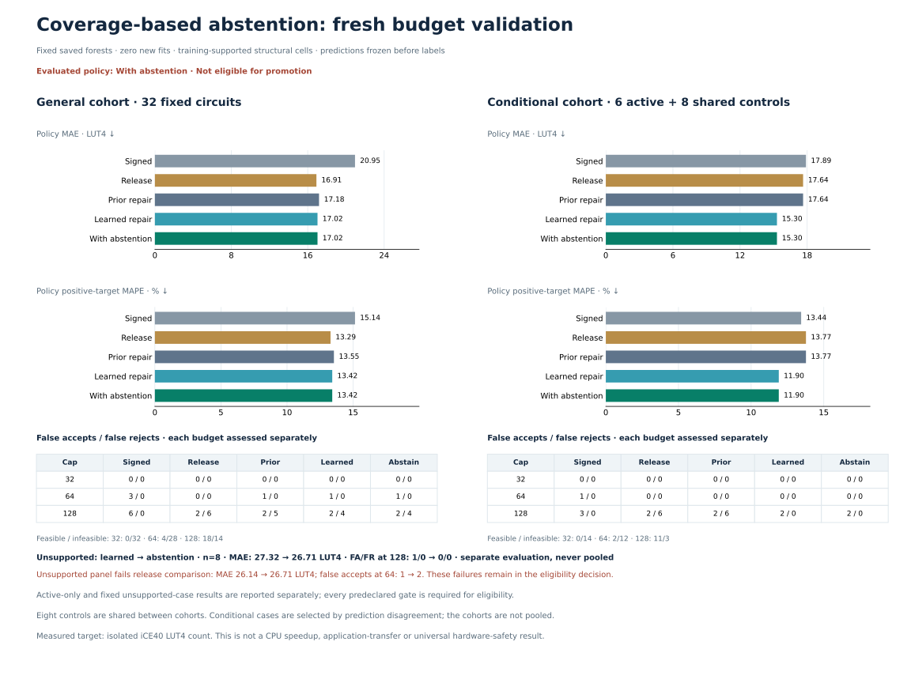

# Same-chain coverage abstention

**The guard correctly blocks one unsafe learned acceptance and six supported actions repair rejections, but the complete general and unsupported panels fail. The model is not promoted; the goal remains active.** The guard leaves inherited median errors and other false rejections untouched. Passing selected cases cannot replace the failed full populations.



## Frozen zero-fit rule

The fixed 1,857-row / 217-feature forest and all earlier predictors remain unchanged. From training **formulas only**, each learning-eligible root-XOR/add/direct-signed-shift chain receives a joint cell: conservative data unknown span **<=16 versus >16 (wide)**, and presence of a shared nonleaf subtree between that same data operand and post-add operand. Width and sharing must come from the **same chain**. Wide includes spans 17–31, not necessarily 32 unknown bits.

Training support contains narrow/unshared 8, narrow/shared 4 and wide/unshared 20 eligible chains; wide/shared has none. Four additional older chains are outside learning scope. A new learned override is permitted only if **every eligible chain** has a supported cell; any unsupported chain falls back to `previous_structural`. This is an input-coverage heuristic, not calibrated risk. Labels, IDs and error lookup never determine inference.

The mixed-chain test prevents a narrow/unshared chain and wide/shared chain from masquerading as supported narrow/shared through aggregate min/max features. All **15 retained panels,938 metric rows /922 circuit records**, pass development gates against release, previous structural and learned 217. All 30 required repairs and the safe 122 correction remain; the prior 159 false acceptance is rejected. These are consumed results.

## Prospective populations

The input-only fixed 128 pool contains general 32, mandatory unsupported 8, and challenge 88. All fixed 40 cases are labeled without filtering. Prospective 217/233 freshness checks pass against **3,235 historical records /2,542 distinct keys**, including all earlier labeled and unlabeled pools.

Six supported learned actions across three templates are selected, all at 128; every available action is measured. One fixed unsupported case activates the blocked-override requirement. Both prospective coverage gates pass. There are **46 unique labels**:32 general +8 unsupported +6 active. Conditional 14 uses the active 6 plus the **same eight general controls**. Populations are separately gated, without pooling or independence claims; the other 82 pool rows remain unlabeled with all features/predictions retained.

## Fixed general 32: fails

| Metric | Signed | Release | Previous structural | Learned 217 = guard |
| --- | ---: | ---: | ---: | ---: |
| MAE, LUT4 | 20.9491 | 16.9101 | 17.1818 | **17.0242** |
| Positive-target MAPE | 15.1423% | 13.2903% | 13.5457% | **13.4196%** |
| Maximum underprediction | 84.0000 | 49.5200 | 49.5200 | 49.5200 |

| Cap | Feasible / infeasible | Signed FA / FR | Release FA / FR | Guard FA / FR |
| --- | ---: | ---: | ---: | ---: |
| 32 | 0 /32 | 0 /0 | 0 /0 | 0 /0 |
| 64 | 4 /28 | 3 /0 | 0 /0 | **1 /0** |
| 128 | 18 /14 | 6 /0 | 2 /6 | **2 /4** |

General accuracy remains better than signed but is worse than release. One extra FA64 and four FR128 violate separate frozen gates. The FA64 case costs **107**, with release 73.05 but previous structural/learned/guard 64. Its raw 217 mean is 84.7633: the learned regressor disagrees with the inherited median acceptance, yet the layered policy cannot raise that old point.

The remaining FR128 cases cost 125/119/114/125, with guarded points 136.25/144.5033/146.73/137.8933. Three lie inside learning scope; one lies outside. Supported-cell membership does not guarantee sufficient learned coverage or correct area estimates.

## Mandatory unsupported 8: also fails

| Metric | Release | Previous structural | Learned 217 | Guard |
| --- | ---: | ---: | ---: | ---: |
| MAE, LUT4 | 26.1354 | 26.7054 | 27.3217 | **26.7054** |
| Positive-target MAPE | 19.6189% | 20.1234% | 20.5109% | **20.1234%** |
| FA64 / FA128 | 1 /0 | 2 /0 | 2 /1 | **2 /0** |

All eight are infeasible at 32/64; at 128 the feasible/infeasible split is 2/6. All models have FR0 at every cap. The guard correctly blocks the new learned acceptance for actual **159**: learned 128 →guard 132.93, removing one FA128 without adding a rejection.

But another **113-LUT** case retains an inherited prediction 64 versus release 68.56. Its raw 217 mean is 97.655, again rejecting 64 while the older median accepts. Thus unsupported accuracy and FA64 gates still fail. Falling back to an older predictor does not certify its decisions.

## Supported evidence passes, without establishing success

Active 6 all cost 125. Their MAE improves **8.4539 →3.0000**, MAPE **6.7631% →2.4000%**, and FR128 **6 →0** versus previous structural, with zero false acceptances or underprediction. They cover plain-input, OR-data and XOR-data direct-post-add templates. The signed incumbent already accepts all six and has lower MAE (1.7994 LUT4); the incremental accuracy claim is against release and the structural predictor.

Conditional 14 MAE improves **17.6362 →15.2988**, MAPE **13.7741% →11.9042%**. Its feasible/infeasible counts are 0/14 at 32,2/12 at 64 and 11/3 at 128. Guard FA/FR are 0/0,0/0 and 2/0; active-only and conditional-full gates pass. These six successful actions and one safely blocked override cannot offset the complete general/unsupported failures.

## Actionable limitation and reproducibility

[Supplemental diagnostics](supplemental-diagnostics.json) trace exact formulas, predictions and decision provenance. A guard only around **new** learned overrides cannot address errors inherited from an earlier median layer. The [unexecuted next hypothesis](next-experiment-hypothesis.json) proposes auditing the entire lowering pipeline, testing legacy corroboration/release fallback, and sound known-bit carry propagation with bounded new training for narrow sign placement. It is not implemented, selected or claimed to pass; no cap-margin tweak is proposed.

The single rule, all cohorts/selection and every gate were frozen before features or labels. All 128 feature jobs and 46 original RTL labels complete without retries, replacements or failures; **98,808 sampled/boundary comparisons** pass. Native extraction, verification and synthesis takes **86.19 seconds**, peak two workers, with **zero fits**. The independent final audit passes integrity while preserving scientific ineligibility and all prior artifacts.

MAPE averages percentage error only over positive targets; zeros remain in MAE, cap and tail metrics. All fresh targets here are positive. Validation: **516 tests and 40 subtests pass**. Finite identity/normalization/composition screens cover 10,410 historical formulas/aliases, without proving exhaustive semantic novelty. This remains targeted, uncalibrated isolated-iCE40 evidence, without universal hardware safety, timing, power or CPU guarantees.

[Protocol](protocol.json) · [Formula-only support](support-cells.json) · [Selection](../boundary-abstention-validation/selection.json) · [Development metrics](development-metrics.json) · [Separate fresh metrics](fresh-metrics.json) · [Independent audit](audit.json).

```sh
.venv/bin/python scripts/abstain_boundary_coverage.py predict-cached \
  --candidates results/boundary-abstention-validation/candidates.json \
  --features results/boundary-abstention-validation/features.json \
  --prediction-output generated/boundary-abstention-predictions.json

.venv/bin/python scripts/abstain_boundary_coverage.py replay
.venv/bin/python scripts/audit_boundary_abstention.py
```
