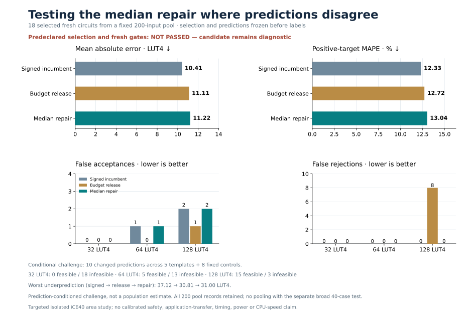

# Prospective boundary activation challenge

**The unchanged median rule is not eligible. It corrects eight false rejections but introduces two false acceptances versus budget release, and slightly worsens accuracy and maximum underprediction. The active branch was exercised; the negative result is retained without changing the rule, inputs, selection or gates.**



## Prospective design

The previous broad40 cohort did not exercise the repair branch. This separate challenge freezes a **200-input pool** before features: 192 targeted compound signed circuits from 24 original AST templates and eight fixed outside-route controls. Target parameters use masks1/3 and four immediate pairs. The same previously frozen `boundary_median` rule and existing 1,825-row forest are used with **zero fits**.

All 200 features and ordered model predictions are retained. Active cases are exact repair-versus-release prediction differences. Historical217-feature matches are excluded prospectively from active eligibility; round-robin selection across sorted templates keeps at most one case per exact217-feature cluster, up to 16 actives, followed by all eight controls. Controls cannot be replaced; a historical or selected feature collision involving one blocks eligibility. Labels remain unavailable until the complete selection and point freeze plus independent prelabel audit.

The pool has **10 raw active cases**, all feature-novel and unique, so **all 10** are selected alongside the eight controls. They span five templates, one64-LUT clamp and nine128-LUT clamps, passing the frozen requirement for at least four actives across two templates including cap128. No historical217 matches or within-pool feature duplicates occur. The other 182 inputs remain unlabeled with their complete features and predictions saved; all 200 count as consumed for future novelty checks.

This is a **conditional challenge selected by frozen prediction disagreement**, not representative unconditioned fresh performance. The selected full 18 and active 10 are checked separately so controls cannot hide an active regression. No pooled metric combines this challenge with the separate broad40 panel.

## Selected challenge results

| Metric, same 18 selected circuits | Signed incumbent | Budget release | Median repair |
| --- | ---: | ---: | ---: |
| MAE, LUT4 | 10.4124 | 11.1085 | 11.2150 |
| Positive-target MAPE | 12.3340% | 12.7221% | 13.0363% |
| Maximum underprediction, LUT4 | 37.1167 | 30.8067 | 31.0000 |

| Cap | Actual feasible / infeasible | Signed FA / FR | Release FA / FR | Repair FA / FR |
| --- | ---: | ---: | ---: | ---: |
| 32 | 0 / 18 | 0 / 0 | 0 / 0 | 0 / 0 |
| 64 | 5 / 13 | 1 / 0 | 0 / 0 | **1 / 0** |
| 128 | 15 / 3 | 2 / 0 | 1 / 8 | **2 / 0** |

Relative to release, repair corrects **eight false-rejection events at128** but adds **one false acceptance at64 and one at128**. The frozen gate evaluates these directions separately; eight corrections cannot offset two newly introduced mistakes.

On the **active 10 alone**, MAE worsens **7.1083 → 7.3000**, MAPE **5.4692% → 6.0348%**, and maximum underprediction **30.8067 → 31.0000**. At64, all 10 are infeasible: FA **0 → 1**. At128, nine are feasible and one infeasible: FA/FR **0/8 → 1/0**. Both full and active-only accuracy, false-acceptance and tail gates fail, while false rejections remain no worse than signed. The candidate is not promoted and the goal remains incomplete.

## Two new mistakes and next diagnostic

| New false acceptance | Actual | Release | Median repair |
| --- | ---: | ---: | ---: |
| Low16 data, root `xor(sra(...),add(...))`, cap64 | 80 | 73.2800 | 64.0000 |
| XOR after inner addition, root `add(sra(...),xor(...))`, cap128 | 159 | 128.1933 | 128.0000 |

The first forest median is63 and the second is128; both trigger the unchanged rule incorrectly. The eight corrected false rejections have actual 124/125 and share a root `xor(add(sra(...),...),...)` composition, with three different data templates. All ten cases, formulas and exact predictions appear in [descriptive diagnostics](failure-diagnostics.json).

These structures suggest a **hypothesis** for a future mechanistic refinement, not an eligible posthoc subset. A later separately preregistered experiment would need fresh broader circuits and activated cases, preserve all retained accuracy/FA/FR/tail gates, and test whether that distinction transfers. No new route, fit or trial is implemented here, and current native jobs must not be rerun.

## Complementary evidence remains separate

The unchanged rule still repairs the original consumed125-LUT case **129.3167 → 128** without losing any release gain across all **ten consumed panels, 823 circuits**, including all named repairs. These are development checks for this challenge.

The earlier broad40 panel independently retained release's strict gains over signed: MAE **21.1966 → 12.2020**, MAPE **19.7536% → 14.5131%**, and nine corrected false-acceptance events without new false rejections. Repair equaled release on all40, and that trial's **activity gate remains failed**. Its unchanged receipt is not relabeled as passing. The conditional challenge fills the activation gap and reveals new mistakes; the complementary evidence does not establish success.

## Compute and reproducibility

The fixed pool, rule, exact selection, freshness screening and all gates were frozen before native extraction. Finite identity/normalization/composition checks found no known overlap against **9,442 historical formulas/aliases**. Exact217-feature screening compares all **1,825 training +823 consumed rows**, or 2,054 unique keys. These finite checks do not prove exhaustive semantic novelty.

All 200 native feature jobs and all 18 selected original RTL labels complete, with **38,664 sampled/boundary RV32 comparisons**, no failures, retries, replacements, pool extensions or postlabel changes. Shared native extraction, verification and synthesis takes **245.63 seconds**, below 300 seconds, with at most two workers; zero fits. The independent final audit passes and preserves the failed eligibility decision, verifying all point/median/selection/metric, proof, mapped-netlist and raw-archive evidence; 630 prior artifacts remain unchanged. A separate [diagnostic audit](failure-diagnostics-audit.json) verifies all ten descriptive case records. Every pool input, feature, prediction and selected label remains available. The heuristic is uncalibrated and makes no universal safety, timing, power, full-CPU or representative application guarantee.

[Protocol](protocol.json) · [Selection and coverage](../boundary-challenge-validation/selection.json) · [All 200 points](pool-predictions.json) · [Feature freshness](pool-feature-freshness.json) · [Development metrics](development-metrics.json) · [Conditional metrics](fresh-metrics.json) · [Independent audit](audit.json) · [Measurement plan](../boundary-challenge-validation/plan.json).

Validation: **472 tests and 40 subtests passed**. Cached inference reproduces all selected frozen predictions.

Cached inference (use a new output path) and read-only reproduction, with no fitting or native measurements:

```sh
.venv/bin/python scripts/challenge_boundary_coverage.py predict-cached \
  --candidates results/boundary-challenge-validation/candidates.json \
  --features results/boundary-challenge-validation/features.json \
  --prediction-output generated/boundary-challenge-predictions.json
.venv/bin/python scripts/challenge_boundary_coverage.py replay
.venv/bin/python scripts/audit_boundary_challenge.py
```
