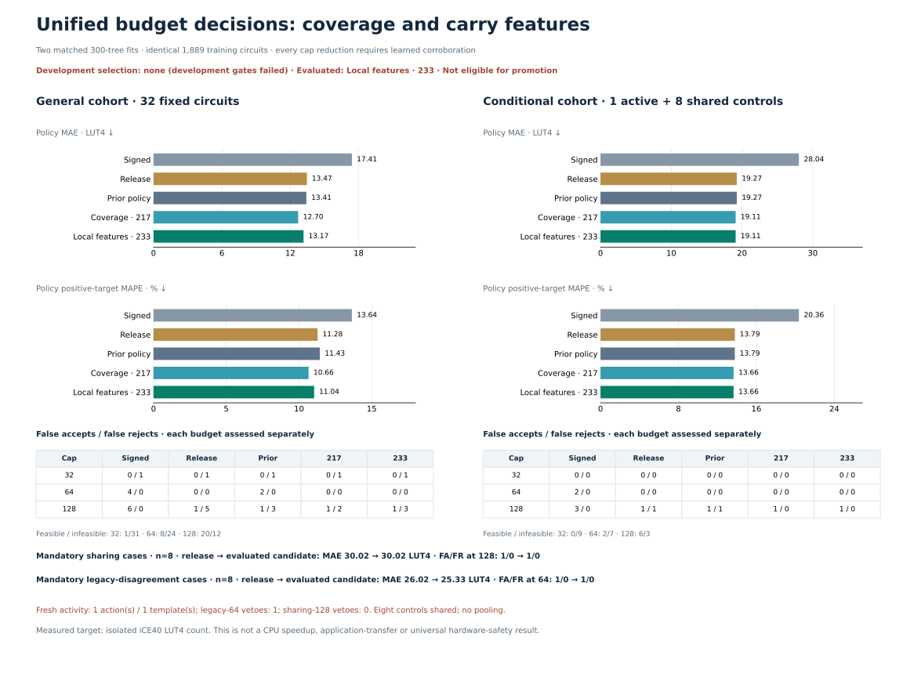

# Whole-pipeline corroboration: negative result

Neither frozen candidate is eligible. Both reject all six protected unsafe cases and repair three of the four remaining FR 128 targets, but lose established repairs. Fresh general 32 still has excess FR 128, and prospective activation coverage fails. No candidate is promoted; the goal remains active.



The protocol and both cohorts were frozen before features or labels. Two fixed ExtraTrees regressors share the exact same ordered **1,889 training rows**: frozen 1,857 plus 32 novel circuits. No consumed evaluation labels were fitted. The primary adds 16 localized columns to 217; coverage-only is the fixed fallback. Neither passed development, so the preregistered augmented diagnostic was evaluated without a selection change.

Every decision starts at `budget_release_compound_only`. An original root-XOR/add/direct-compound-SRA chain may lower that prediction only to a physical cap 32/64/128 accepted by both signed incumbent and the **new forest mean**. The smallest qualifying cap wins; otherwise release is retained. Legacy median proposals have no bypass. Bounds are signed≤candidate≤release.

The new pure helper propagates conservative RV32 ADD/ADDI known bits using possible carries, including nested arithmetic. It preserves old helpers and diagnostics. [Compiler-analysis motivation](method-rationale.json) cites LLVM KnownBits; soundness does not imply area accuracy. The 233-vs 217 ablation tests the complete 16-column localized representation, not carry propagation alone. Overall results also change training coverage and policy.

Support is computed from training formulas only, per eligible chain's own width/sharing cell. Counts are narrow/shared 8, narrow/unshared 24, wide/shared 4, wide/unshared 32 across 68 scoped training formulas. All four cells occur, so the cell guard is **inactive within the declared root-chain scope**. Exact input-profile matches for all four remaining FR targets did not guarantee cost transfer.

## Consumed development evidence

All 18 panels (992 metric rows,968 circuit records,24 shared-control duplicate rows),17 named groups,43 required acceptances and 6 rejections are retained. Every panel/subgroup requires MAE/MAPE/tail no worse than release, structural, learned 217 and abstention; FA≤release and FR≤signed separately at every cap.

| Policy | Established 39 retained | Remaining 4 repaired | Protected 6 rejected | Development |
|---|---:|---:|---:|---|
| Augmented 233 |34|3|6|Fail|
| Coverage 217 |31|3|6|Fail|

Both repair remaining targets actual 125/119/114 to 128. The outer-input actual 125 remains 137.8933 (raw 233-feature mean 129.3667; raw 217-feature mean 129.0900). Both restore known actual 107/113 from legacy 64 to release 73.05/68.56, rejecting 64, and preserve all protected 159 cases.

The augmented policy loses five established FR 128 repairs: consumed-eighth-general index 4; consumed-tenth-general index 6; consumed-tenth-conditional indices 1,2,4 (all actual 125). Raw means are 128.0433,128.2067,128.6800,130.4033,128.8000. Coverage-only loses eight; exact identities/formulas/points are in [failure diagnostics](failure-diagnostics.json). No cap margin, exception or further fit was added.

## Fresh evidence

The fixed 128 pool contains general 32, sharing 8, legacy 8 and challenge 80. All 128 features/ten-model points are retained, including 79 unlabelled rows. Both 217/233 representations are novel against 3,409 historical feature rows. Selection always labels fixed 48, then at most 16 new acceptances versus old abstention using deterministic template round-robin.

Only **one** novel action from **one** template was available (cap 128); minimum 4/two templates fails. One required legacy 64 veto was present, but sharing 128 veto count was zero. These failures were frozen before labels; no pool extension or quota filling occurred. All 49 labels were completed.

FA and FR vectors below follow caps 32/64/128. These are circuit-budget events, not distinct circuits.

| General 32 policy | MAE | Positive MAPE% | FA | FR |
|---|---:|---:|---|---|
| Signed |17.4110|13.6369|0/4/6|1/0/0|
| Release |13.4650|11.2794|0/0/1|1/0/5|
| Old abstention |13.4147|11.4309|0/2/1|1/0/3|
| Augmented 233 |13.1673|11.0412|0/0/1|1/0/3|
| Coverage 217 |12.6967|10.6586|0/0/1|1/0/2|

Both new policies improve general accuracy/FA versus signed, but fail FR 128 preservation. Augmented rejects actual 125/123/125 at 152.2567/143.0600/136.9100; coverage repairs 123 but retains the two 125 rejections. General maximum underprediction is 47.4633 for both versus 74 signed, matching release. Raw general regressors (not the budget policies) have MAE/MAPE 10.5985/13.8934 for 233 and 10.2850/13.4013 for 217.

| Separate population | N | Augmented MAE/MAPE% | Coverage MAE/MAPE% | FA | FR | Hard performance gates |
|---|---:|---:|---:|---|---|---|
| Sharing |8|30.0229/23.1552|30.0229/23.1552|0/1/1|0/0/0|Pass|
| Legacy |8|25.3346/30.1806|25.3346/30.1806|0/1/0|1/0/0|Pass|
| Conditional full |9|19.1052/13.6599|19.1052/13.6599|0/0/1|0/0/0|Pass|
| Active only |1|3.0000/2.4000|3.0000/2.4000|0/0/0|0/0/0|Pass|

Conditional full shares the same eight general controls. The panels are reported separately; there is no pooled metric or independence claim. Active 125 changes 129.45→128 and fixes FR 128; signed was 126.0867, so this is not an accuracy gain versus signed. The legacy veto raises old 64 to release 72.9233 on actual 108, preventing one FA 64. Sharing/legacy errors retained from release remain errors.

| Population | Feasible/infeasible at 32 | At 64 | At 128 |
|---|---|---|---|
| General 32 |1/31|8/24|20/12|
| Sharing 8 |0/8|0/8|3/5|
| Legacy 8 |1/7|2/6|7/1|
| Conditional 9 |0/9|2/7|6/3|
| Active 1 |0/1|0/1|1/0|

## Integrity, limits and replay

Positive MAPE is 100 × mean(|actual − prediction| / actual) over positive targets. Zero targets remain in MAE, cap and tail metrics. All 49 fresh targets are positive. Validation: **539 tests plus 40 subtests pass**, and the actual cached CLI reproduces all 49 × 10 saved model predictions.

Native total 132.8261 seconds/300, peak 2 workers,243 jobs, zero failures/retries/replacements. The two one-thread fits completed in the 8.72-second model stage. Original RTL checks cover 173,988 RV32 vectors. Both training matrices and 1,133,400 tree-leaf assignments were independently checked against exactly the frozen targets. Old scientific artifacts remain unchanged.

[Protocol](protocol.json), [development metrics](development-metrics.json), [fresh metrics](fresh-metrics.json), [independent audit](audit.json), [input coverage matrix](measurement-input-profile-audit.json), [unexecuted next hypothesis](next-experiment-hypothesis.json). This is bounded synthetic iCE40 LUT4 evidence, with conditional selection, not calibrated risk or application/CPU transfer.

```sh
.venv/bin/python scripts/learn_boundary_corroboration.py replay
.venv/bin/python scripts/audit_boundary_corroboration.py final
.venv/bin/python scripts/learn_boundary_corroboration.py predict-cached --candidates results/boundary-corroboration-validation/candidates.json --features results/boundary-corroboration-validation/features.json --prediction-output /tmp/corroboration-predictions.json
```
