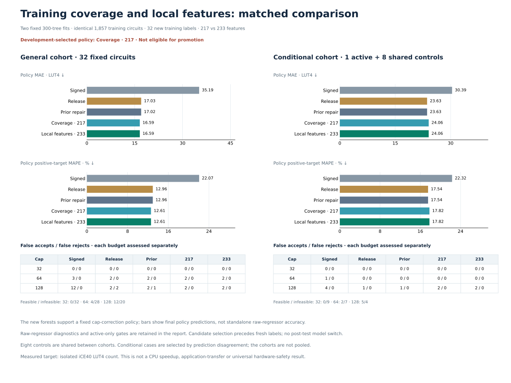

# Matched coverage and representation learning

**Added training coverage repairs all 30 required development cases, but the fresh learned action creates a false acceptance. The experiment is ineligible and the goal remains active.** Fresh general 32 passes every gate; conditional 9 and active 1 fail safety/accuracy gates, and activity 1 case/1 template also fails the preregistered 4/2 requirement. Neither failure is relaxed or hidden by pooling.



## Frozen learning experiment

Two matched 300-tree forests fit the **same 1,857 rows**:1,825 original frozen training records plus 32 novel measurements. Training supplies 16 Boolean-sharing and 16 narrow signed compounds, with masks 1/3/7/31 and substantial high-cost contrasts (targets 51–257 LUT4;19 above 128). No consumed evaluation labels enter either fit.

The first forest uses 217 existing features plus 16 localized original-AST features: same-chain input overlaps, nonleaf subtree reuse, conservative data widths, low 5 shift-control unknown bits and Boolean input joins. The second uses 217 features only. Fixed seed/settings and one thread are identical. The feature helper is under `scripts/`; all older sources and weights remain unchanged.

The single operational rule is **learned budget-decision support**. On a root-XOR/add/signed-shift chain with Boolean outer operand or narrow data, consider fixed caps 32/64/128. If signed accepts, previous structural rejects, and the new raw forest mean accepts, return the smallest supported cap; otherwise retain previous structural exactly. There is no tuned margin or additional median. Raw regressors remain separately reported; their means are not global point replacements or calibrated upper bounds.

All columns, cohorts, both fit order and augmented-first development selection were frozen before new labels. The 233-column candidate leaves two of four confident errors unrepaired. The 217-column candidate passes every gate across **13 consumed panels:897 panel rows,889 circuit records with 8 shared controls**, preserving all named subgroup/tail/FA gains and correcting all 30 required rejections. The fixed hierarchy therefore selects 217 before fresh labels. This run demonstrates a coverage benefit; it does **not** establish a benefit from the additional 16 features.

| Consumed target, actual LUT4 | Old structural point | New 217 raw mean | New 233 raw mean |
| --- | ---: | ---: | ---: |
| 128 | 144.4500 | 127.8767 | 129.6767 |
| 125 | 136.5067 | 127.8533 | 128.8733 |
| 125 | 135.1500 | 127.5633 | 127.3533 |
| 115 | 137.6233 | 123.9333 | 124.6767 |

The 217 policy returns 128 for all four. Its first two means are only **0.1233 and 0.1467 LUT4 below the cap**. These narrow margins are reproducible, not evidence of robust or calibrated acceptance. The prelabel [input-coverage audit](input-coverage-audit.json) documents why training relationships were adjusted before freeze; matching input coordinates was never claimed as unseen cost transfer.

## Fixed fresh general 32: passes

The fresh 128-input pool contains a fixed general 32 and separate challenge 96. All 32 general cases are labeled without filtering. All 128 feature/point records remain saved. Exact 217/233 screening finds no training, historical, cross-cohort or within-pool feature collisions.

| Same 32 general circuits | Signed | Release | Previous structural | Selected 217 policy |
| --- | ---: | ---: | ---: | ---: |
| MAE, LUT4 | 35.1892 | 17.0251 | 17.0191 | **16.5908** |
| Positive-target MAPE | 22.0700% | 12.9626% | 12.9579% | **12.6069%** |
| Maximum underprediction, LUT4 | 84.0000 | 47.1867 | 47.1867 | **47.1867** |

| Cap | Feasible / infeasible | Signed FA / FR | Release FA / FR | Previous FA / FR | Selected FA / FR |
| --- | ---: | ---: | ---: | ---: | ---: |
| 32 | 0 / 32 | 0 / 0 | 0 / 0 | 0 / 0 | 0 / 0 |
| 64 | 4 / 28 | 3 / 0 | 2 / 0 | 2 / 0 | 2 / 0 |
| 128 | 12 / 20 | 12 / 0 | 2 / 2 | 2 / 1 | **2 / 0** |

The new policy correctly accepts a 122-LUT circuit previously predicted 141.7033, returning 128. It preserves 11 corrected false-acceptance circuit–budget events versus signed and introduces no new general-panel mistakes. All general accuracy, separate FA/FR and tail gates pass.

## Conditional challenge: fails

The 96 challenge inputs contain 44 predicted cap 128 crossing opportunities, but the selected forest supports only **one new learned acceptance**, from one template. The frozen quota is not filled or expanded. That case plus the **same eight general controls** forms conditional 9; active-only 1 is evaluated separately. There are 33 unique labels, not 41; shared controls do not form independent evidence. The other 95 pool cases remain unlabeled with all features and predictions retained.

The sole active formula is:

```text
xor(add(sra(addi(xori(xor(in0,in1),3),17),andi(in1,1)),xor(in0,in1)),and(in0,in1))
```

Its actual cost is **159 LUT4**. Release/previous predict **131.94**, correctly rejecting cap 128. Both new raw forests underestimate it: **126.8933 (217)** and **127.2967 (233)**. Both policies return **128**, creating a false acceptance. Agreement between the two forests does not establish safety.

| Population | Previous MAE → selected | Previous MAPE → selected | FA128 → selected |
| --- | ---: | ---: | ---: |
| Conditional 9, including shared controls | 23.6256 →24.0633 | 17.5439% →17.8192% | 1 →**2** |
| Active 1 | 27.0600 →31.0000 | 17.0189% →19.4969% | 0 →**1** |

Active underprediction worsens 27.06 →31; conditional maximum remains 47.1867 because a control has a larger error. The active-only gate prevents that control from hiding the regression. Conditional feasible/infeasible denominators are 0/9 at 32,2/7 at 64 and 5/4 at 128; selected FA/FR are 0/0,0/0 and 2/0. The active 159 case is infeasible at every cap. Conditional accuracy/FA/tail, active safety and minimum 4 actions/2 templates gates fail; no promotion is claimed.

Raw-regressor diagnostics are retained, separately from policies. On general 32, raw 217 MAE/MAPE is 14.7742/8.5258%, and raw 233 is 14.5563/8.2734%; their tail underpredictions 53.8233/56.1867 exceed the operational policy's 47.1867. Better raw averages do not override failed budget gates or justify a postfresh model swap.

## What the failure suggests

The unsafe fullword case repeats a nonleaf XOR expression in shift data and the post-add operand. Among **32 learning-scoped training rows**, coverage cells are narrow/unshared 8, narrow/shared 4, fullword/unshared 20 and **fullword/shared 0**. Four additional old rows match the broader structural chain but lie outside learning scope; the other 1,821 training rows lack that chain. These counts do not describe all 1,857 as interchangeable low-risk cases.

The safe 122-LUT general correction also lacks an exact 16-vector training match. Blanket novelty abstention would lose that repair. The [unexecuted next hypothesis](next-validation-hypothesis.json) instead proposes testing mechanism-level joint-cell coverage/abstention using the **fixed model**, with fresh broad and activated validation, unchanged hard gates and no tuned margins. It is a postlabel hypothesis, not an implemented policy or a newly eligible passing subset. Exact cases and narrow development margins are in [diagnostics](failure-diagnostics.json).

## Integrity and bounded compute

Finite novelty screens cover 10,090 historical formulas/aliases, including all prior unlabeled pools; they do not prove exhaustive semantic novelty. Historical feature screening includes 3,042 records/2,382 distinct keys. MAPE means mean absolute percentage error over positive targets only; zero targets remain in MAE, cap and tail metrics. These fresh populations have no zero targets; counts are explicit in every metric record.

Both preregistered fits take **4.20 +4.21 seconds**, within the 24.40-second fit/development stage. All 160 feature jobs,32 training labels and 33 fresh labels complete without failures, retries, replacements or extra fits. Original RTL passes **139,620 sampled/boundary comparisons**. Shared native time is **122.26 seconds**, peak two workers, below 300 seconds.

The independent final audit passes integrity while retaining scientific ineligibility. It reconstructs both ordered training matrices/targets and **1,114,200 tree-leaf assignments/means**, verifies saved inference and chronology, and preserves 721 previous scientific artifacts. Validation: **503 tests and 40 subtests pass**. This remains targeted, uncalibrated isolated-iCE40 LUT4 evidence, without universal hardware safety, timing, power or full-CPU guarantees.

[Protocol](protocol.json) · [Goal clarification at freeze](goal-update-at-freeze.json) · [Training manifest](training-manifest.json) · [Development metrics](development-metrics.json) · [Selection](../boundary-coverage-validation/selection.json) · [All 128 points](pool-predictions.json) · [Separate fresh metrics](fresh-metrics.json) · [Independent audit](audit.json).

```sh
.venv/bin/python scripts/learn_boundary_coverage.py predict-cached \
  --candidates results/boundary-coverage-validation/candidates.json \
  --features results/boundary-coverage-validation/features.json \
  --prediction-output generated/boundary-coverage-predictions.json

.venv/bin/python scripts/learn_boundary_coverage.py replay
.venv/bin/python scripts/audit_boundary_coverage.py
```
