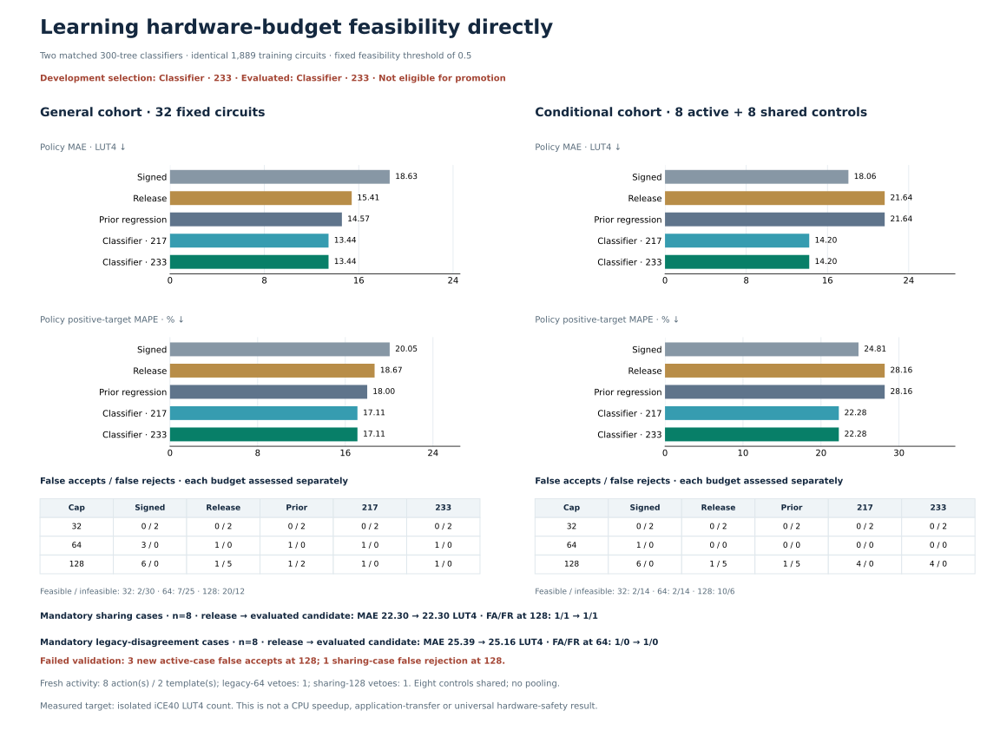

# Direct feasibility classifiers: development pass, fresh failure

The fixed hierarchy selects `feasibility_augmented` on consumed development evidence, but **fresh eligibility is false and the candidate is not promoted**. General 32 passes every gate and removes its five excess FR 128 events. Mandatory sharing 8 fails with one FR 128; active 8 repairs five FR 128 events but introduces three FA 128 events. Those mistakes cannot offset one another. The goal remains unmet.

## Frozen comparison

Two native multioutput ExtraTrees classifiers use exactly the same ordered 1,889 training rows and nested targets area≤32/64/128. Coverage-only uses 217 columns; augmented uses the same 217 plus the frozen 16 localized carry-aware descriptors. Both use 300 trees, seed 2026101401, one thread, shared multioutput partitions, no class/sample weights and fixed probability≥0.5 with ties accepted. No consumed evaluation labels were fitted; no new training labels were acquired.

Inference starts at budget release. Within the original root-XOR/add/direct-compound-SRA scope, choose the smallest physical cap supported by signed acceptance and the new classifier probability; otherwise retain release. Bounds are signed≤candidate≤release. The formula-only support table contains all four width/sharing cells, so its coarse guard is inactive inside that scope. All probabilities, classes and raw regression comparators are retained; probabilities are uncalibrated and never sorted or adjusted.

All 22 retained panels (1,049 metric rows, 1,017 circuit records, 32 shared-control duplicate rows), 25 named groups, 50 required acceptances and 23 protected rejections were frozen before execution. Accuracy/tail comparators are release, structural, learned 217, abstention and both prior regression policies. Every panel separately requires FA≤release and FR≤signed at all three caps, with zero newly introduced cap mistakes.

| Consumed development | Panels/groups | Required acceptances | Required rejections | Gate |
|---|---:|---:|---:|---|
| Augmented 233 |22/25 pass|50/50|23/23|Pass, selected|
| Coverage 217 |Some fail|50/50|22/23|Fail|

Coverage-only accepts an actual 157 repeated-AND circuit at 128 (P 128=.523333); augmented retains 138.37 (P 128=.263333). This is evidence for the complete localized representation within this classifier comparison, not proof that carry analysis alone caused the difference.

## Fresh populations and outcomes



The fixed 128 pool contains general 32, sharing 8, legacy 8 and challenge 80. An input-only revision removed 36 modular-normalized skeleton overlaps; the rejected draft and its audit remain retained. The final original/modular novelty screen passes against 10,986 historical formulas/aliases. All 128 features/probabilities remain available, including 72 unlabelled rows; both 217/233 representations are unique and novel against 3,618 historical feature rows.

Before labels, all activity gates passed: eight new cap 128 acceptances across two templates, one legacy 64 veto and one sharing 128 veto. The exact 56 labels were fixed 48 plus those eight actions. Conditional full shares the same eight general controls; populations are separate, with no pooled metric or independence claim.

Positive MAPE is 100×mean(abs(actual−prediction)/actual) on positive targets; zero targets stay in MAE/cap/tail. All 56 fresh targets are positive. FA/FR vectors below follow caps 32/64/128 and count circuit-budget events, not distinct circuits. Both classifier budget policies are identical on all 56 selected cases.

| General 32 policy | MAE | Positive MAPE% | FA | FR |
|---|---:|---:|---|---|
| Signed |18.62625|20.04902|0/3/6|2/0/0|
| Release |15.40646|18.67058|0/1/1|2/0/5|
| Prior 233 regression policy |14.57365|17.99737|0/1/1|2/0/2|
| Either classifier policy |13.44115|17.10654|0/1/1|2/0/0|

General 32 passes all six comparator gates, strict signed accuracy/FA gains and separate cap gates. Maximum underprediction is 49.62333 versus 87 signed, matching release. This passing population cannot replace the failed mandatory/conditional populations.

| Population | N | Classifier MAE/MAPE% | FA | FR | Hard gate |
|---|---:|---:|---|---|---|
| Sharing |8|22.30458/18.39194|0/1/1|0/0/1|Fail|
| Legacy |8|25.15542/24.65872|0/1/0|0/0/0|Pass|
| Conditional full |16|14.20500/22.28313|0/0/4|2/0/0|Fail|
| Active only |8|2.00000/1.58611|0/0/3|0/0/0|Fail|

The legacy veto correctly rejects 64 on actual 108 (old 64→release 69.98). The sharing veto is wrong: actual 125 changes old learned 128→release 130.57667. Its P 128=.366667; the prior regression raw mean 123.36667 supports acceptance. The active 8 outcomes are five corrected FR 128 and three introduced FA 128, rather than eight correct repairs.

| Unsafe active index | Actual | Release / classifier | Classifier P 128 | Prior 233 raw area mean |
|---|---:|---|---:|---:|
|51|129|138.65667 /128|.873333|129.03333|
|53|130|139.76667 /128|.713333|131.17333|
|55|129|144.82000 /128|.633333|132.92667|

All three use `xor(add(sra(addi(xori(in1,c),d),andi(and(xori(in0,15),in1),3)),in0),in1)` with different fixed immediates. Their actual values sit just above 128 despite high feasibility probabilities. A higher arbitrary confidence threshold is not validated. The shared-AND rejection has repeated AND data/post-add/outer operands. Exact formulas, class probabilities, raw means and every action/veto outcome are in [failure diagnostics](failure-diagnostics.json). No source, threshold, selection or fit changed after labels.

| Population | Feasible/infeasible at 32 | At 64 | At 128 |
|---|---|---|---|
| General 32 |2/30|7/25|20/12|
| Sharing 8 |0/8|0/8|5/3|
| Legacy 8 |0/8|2/6|7/1|
| Conditional 16 |2/14|2/14|10/6|
| Active 8 |0/8|0/8|5/3|

## Integrity and limits

Native total is 189.3875377 summed worker-process seconds/300, including startup through reap; stage wall totals 97.208752 seconds. Peak two workers,185 jobs, zero failures/retries/replacements. Two one-thread fits completed in a 5.56-second model stage. All 56 mapped circuits and 120,288 original RTL comparisons are retained in 2,796 verified archive members. Both 1,889-row matrices, shared-tree class probabilities, class mappings, nesting and chronological freezes are independently audited. Parent full suite:558 tests+40 subtests pass; cached CLI reproduces all 56×12 predictions and auxiliary fields.

Existing release false acceptances and signed false rejections that cannot be repaired within the policy bounds remain visible in [policy limitations](policy-limitations.json). This is finite synthetic iCE40 LUT4 evidence, not calibrated safety, application transfer or CPU speedup. The unchanged [preregistration](preregistration.md), [protocol](protocol.json), [development metrics](development-metrics.json), [fresh metrics](fresh-metrics.json), [audit](audit.json) and [unexecuted next hypothesis](next-experiment-hypothesis.json) provide the evidence trail.

```sh
.venv/bin/python scripts/learn_boundary_feasibility.py replay
.venv/bin/python scripts/audit_boundary_feasibility.py final
.venv/bin/python scripts/learn_boundary_feasibility.py predict-cached --candidates results/boundary-feasibility-validation/candidates.json --features results/boundary-feasibility-validation/features.json --prediction-output /tmp/feasibility-predictions.json
```
