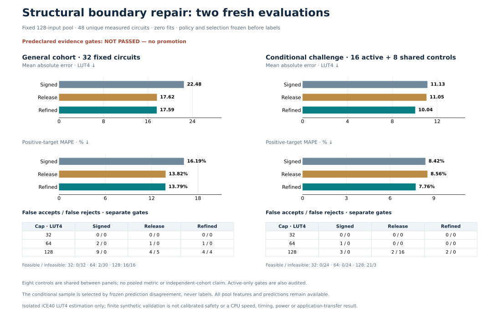

# Structural boundary refinement

**The structural refinement passes all retained checks and corrects every selected active false rejection, but fails the broader fresh panel: four release false rejections remain versus the signed incumbent. It is not promoted and the goal remains incomplete.** Accuracy and false-acceptance gains cannot offset the failed false-rejection gate. No rule, selection, input or gate changes after labels.



## One frozen hypothesis

The previous unrestricted median rule created two false acceptances. This experiment freezes one development-informed dataflow gate: the **original root is `xor`; either operand is `add`; either operand of that same `add` is a direct compound, input-controlled `sra`**. That same shift's data subtree must contain both `addi` and `xori`. Both commutative operand positions are tested. No constants, IDs, labels or normalized formulas determine routing.

Within this gate, use the unchanged 300-tree median adjudication: if signed accepts a fixed cap32/64/128, release rejects it, and the even-tree median accepts it, clamp to the smallest qualifying cap. Otherwise retain release. Outside the gate, retain release exactly. The median averages the two central tree predictions; it is not a strict-majority vote or calibrated uncertainty.

All **11 consumed panels, 841 circuits**, pass no-loss release MAE/MAPE/FA/tail gates and signed FR gates, with every named subgroup preserved. The original 125-LUT rejection and all eight later false rejections remain corrected; both previously introduced false acceptances remain correctly rejected. The consumed conditional18 MAE improves **11.1085 → 10.6887**, MAPE **12.7221% → 12.3851%**. This is development evidence, not a new independent positive result.

## Prospective populations and selection

The fixed **128-input pool** contains a general32 panel and a disjoint96-input challenge pool. General32 includes24 varied in-gate circuits and eight excluded-root controls, including analogues of both earlier false-acceptance structures. All 32 are labeled without filtering.

All 128 features and ordered five-model predictions are retained. Challenge activity is exact refined-versus-release disagreement. Prospective exact217-feature screening checks1,825 fitted rows,841 evaluated rows and all200 previous pool rows, including182 previously unlabeled cases and18 labeled overlaps: **2,866 rows,2,254 unique keys**. General collisions block eligibility; challenge historical/general-key matches are excluded prospectively, with one active per remaining feature cluster. No replacements or pool extensions.

There are **18 eligible, unique challenge activations**. Fixed template round-robin selects16 across six templates, all at cap128. The other two activations remain unlabeled under the frozen quota. General32 plus active16 gives **48 unique labels**. Conditional-full24 consists of active16 plus the **same eight general controls**. These shared controls are explicit; general, conditional-full and active-only metrics are separate and are neither pooled nor claimed independent. All 128 pool rows, including80 unlabeled cases, remain consumed for future novelty.

## Fixed general32: fails false-rejection preservation

| Same 32 general circuits | Signed incumbent | Budget release | Structural refinement |
| --- | ---: | ---: | ---: |
| MAE, LUT4 | 22.4784 | 17.6229 | 17.5907 |
| Positive-target MAPE | 16.1860% | 13.8164% | 13.7907% |
| Maximum underprediction, LUT4 | 87.0000 | 57.8667 | 57.8667 |

| Cap | Actual feasible / infeasible | Signed FA / FR | Release FA / FR | Refined FA / FR |
| --- | ---: | ---: | ---: | ---: |
| 32 | 0 / 32 | 0 / 0 | 0 / 0 | 0 / 0 |
| 64 | 2 / 30 | 2 / 0 | 1 / 0 | 1 / 0 |
| 128 | 16 / 16 | 9 / 0 | 4 / 5 | **4 / 4** |

The refinement corrects one general release rejection without adding any false acceptances. Relative to signed it retains six corrected circuit–budget false-acceptance events, but introduces four false rejections at128. Every general accuracy, FA and tail gate passes; **FR128<=signed fails**, which is sufficient to reject the entire experiment.

The four remaining cases all lie **inside** the structural gate. Their medians exceed128, so adjudication never activates:

| Original composition, parameter | Actual | Release = refined | Forest median |
| --- | ---: | ---: | ---: |
| Signed offset / OR root, mask3 | 128 | 144.4500 | 155 |
| AND data / XOR root, mask1 | 125 | 136.5067 | 155 |
| OR data / addition shift-control, mask1 | 125 | 135.1500 | 141 |
| Signed8 data / AND root, mask31 | 115 | 137.6233 | 145 |

The actual128 case also demonstrates why acceptance is inclusive at the cap. A fifth case, actual125/release129.03/median128, is correctly repaired to128. Exact formulas and points are in [failure diagnostics](failure-diagnostics.json). These failures reflect overconfident release overprediction, rather than exclusion by the new structural scope; further narrowing the gate would not repair these unchanged predictions.

## Conditional evidence: passes, without establishing overall success

| Population | Release MAE → refined | Release MAPE → refined | FR128 → refined |
| --- | ---: | ---: | ---: |
| Active16 | 4.6977 → 3.1875 | 3.7652% → 2.5548% | 16 → 0 |
| Conditional-full24, including shared8 controls | 11.0490 → 10.0422 | 8.5649% → 7.7580% | 16 → 0 |

All16 selected activations have actual124/125 LUT4. They introduce **zero false acceptances**, preserve maximum underprediction and pass every active-only gate. Active16 cap32/64 feasible/infeasible counts are0/16; cap128 is16/0, with FA/FR0/0 at every cap after refinement.

Conditional-full24 has feasible/infeasible counts0/24 at32,0/24 at64 and21/3 at128. Refined FA/FR are0/0,0/0 and2/0, respectively; false acceptances equal release, and false rejections equal signed. This panel also passes all gates. Neither conditional result can replace the complete general32 failure. The refined and broader median predictors happen to agree on all 48 fresh labels, so the new gate's incremental protection against the two old false acceptances is supported here by consumed evidence.

## Bounded evidence and reproduction

The single policy, pool, feature screening, finite selection and all gates are frozen before features and labels. Existing forest weights are unchanged: **zero fits**. Finite identity/normalization/composition checks find no known overlap against **9,834 historical formulas/aliases**; exact217 screening finds no historical or within-pool collisions. These screens do not prove exhaustive semantic novelty.

All 128 native feature jobs and all 48 selected original RTL measurements complete, with **103,104 sampled/boundary RV32 comparisons**, no failures, retries, replacements or postlabel changes. Total native extraction, verification and synthesis takes **88.78 seconds**, with at most two workers, below 300 seconds. The independent final audit passes, authenticating all source/point/selection/metric, proof, raw-archive and mapped-netlist evidence and the failed eligibility decision; 675 prior scientific artifacts remain unchanged. This remains a targeted, uncalibrated isolated-iCE40 LUT4 heuristic, without universal safety, timing, power, full-CPU or representative application guarantees.

The general failure must remain part of any future method's retained evidence. The [unexecuted training hypothesis](next-experiment-hypothesis.json) shifts attention to coverage and representation: at most32 newly measured Boolean-sharing/narrow-signed compounds, one planned fit (maximum two), a small preregistered topology/width feature set, and disjoint fresh general plus activated validation under the same300-second/two-worker bound. Exact features must be frozen before new labels; consumed evaluation labels remain excluded from fitting. Additional threshold adjustment is not proposed. No fit or native job for that hypothesis is implemented here.

[Protocol](protocol.json) · [Selection](../boundary-refinement-validation/selection.json) · [All 128 points](pool-predictions.json) · [Feature freshness](pool-feature-freshness.json) · [Development metrics](development-metrics.json) · [Separate fresh metrics](fresh-metrics.json) · [Independent audit](audit.json) · [Measurement plan](../boundary-refinement-validation/plan.json).

Validation: **483 tests and 40 subtests pass**. Cached inference, read-only model replay and the independent final audit also pass; integrity does not imply scientific eligibility.

Read-only reproduction:

```sh
.venv/bin/python scripts/refine_boundary_coverage.py predict-cached \
  --candidates results/boundary-refinement-validation/candidates.json \
  --features results/boundary-refinement-validation/features.json \
  --prediction-output generated/boundary-structural-predictions.json

.venv/bin/python scripts/refine_boundary_coverage.py replay
.venv/bin/python scripts/audit_boundary_refinement.py
```
