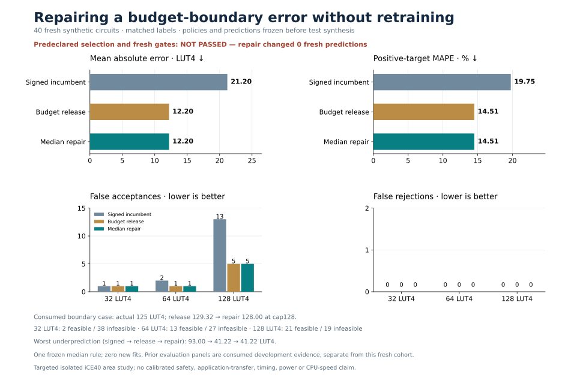

# Zero-fit boundary repair

**The median rule repairs the consumed 125-LUT false rejection while preserving every retained gain. It changes no predictions on the fresh cohort, so the preregistered activity gate fails and repair transfer remains unproven. The candidate is not promoted.** No rule, gate or input changed after labels.



## Repair mechanism and consumed evidence

The existing 1,825-row forest has 300 trees. On the original signed compound AST route, start with the frozen budget-release point. For each cap32/64/128, test whether `signed <= cap < release` and the **median of all 300 tree predictions is <=cap**. Return the smallest qualifying cap; otherwise retain release exactly. Outside the compound route, retain release exactly. Decisions use inclusive `point<=cap`.

The even-tree median averages the two central predictions. It is not equivalent to strict majority voting, and correlated trees do not provide calibrated uncertainty. The heuristic has no new numerical threshold or fit, but its design uses consumed development evidence.

For the known failure, the signed point is **126.5067**, release **129.3167**, median **128**, and actual **125 LUT4**. The rule returns **128**, correcting the false rejection. Across all **nine consumed panels, 783 circuits**, this is the only modified prediction. Every retained MAE, positive-target MAPE, FA, maximum-underprediction and prior named-subgroup gain is preserved; FR is no worse than the signed incumbent at each cap. The consumed fifth-fresh40 MAE improves **11.3996 → 11.3667**, MAPE **8.1164% → 8.0901%**, and FR128 **1 → 0**, while FA128 remains **3**. These are development results.

Inference uses the original AST, cached features, fixed caps and saved forest outputs. The named case's index and label are used only for evaluation, never for prediction routing.

## Separately frozen fresh40

The fresh inputs contain 16 full-width compound shifts, 16 compound variants with 8/16-bit data widths, and eight outside-route controls. Masks1/3/7/31 challenge smaller and wider variable shifts. This input-only design assumes some variants may approach cap boundaries; no input was filtered or replaced using features, predictions or labels.

| Same 40 fresh circuits | Signed incumbent | Budget release | Boundary repair |
| --- | ---: | ---: | ---: |
| MAE, LUT4 | 21.1966 | 12.2020 | 12.2020 |
| Positive-target MAPE | 19.7536% | 14.5131% | 14.5131% |
| Maximum underprediction, LUT4 | 93.0000 | 41.2200 | 41.2200 |
| Modified predictions versus release | — | — | **0** |

| Cap | Actual feasible / infeasible | Signed FA / FR | Release = repair FA / FR |
| --- | ---: | ---: | ---: |
| 32 | 2 / 38 | 1 / 0 | 1 / 0 |
| 64 | 13 / 27 | 2 / 0 | 1 / 0 |
| 128 | 21 / 19 | 13 / 0 | 5 / 0 |

Relative to signed, release and repair correct nine circuit–budget false-acceptance events: one at64 and eight at128, with no new false accepts or rejects. These gains belong to the unchanged release predictions; this fresh cohort provides **no observed incremental repair effect**.

The fresh compound32 likewise has identical release/repair MAE **12.1907** and MAPE **13.6086%**. Every fresh accuracy, separate FA/FR and tail criterion passes. The requirement for **at least one fresh modified prediction** was frozen before features and labels, and is the sole failed gate. Consequently `scoped_experimental_eligibility=false`; the goal remains incomplete. This cohort must remain intact if a later, separately preregistered challenge examines the missing branch.

## Evidence and bounded compute

Protocol, single candidate, immutable goal snapshot, all gates and fresh40 were frozen before measurements. Existing 1,825-row weights are unchanged; **zero fits** and zero new training circuits. Finite identity, normalization, composition and feature-collision screens found no known overlap against **9,366 historical formulas/aliases**, without proving exhaustive semantic novelty.

Independent preflight and prelabel receipts verify chronology, source/weight bindings and cached inference, including the inactive fresh rule before labels. All40 original RTL circuits passed **85,920 sampled/boundary comparisons** and Yosys iCE40 measurement. All planned rows remain; no failures, retries, replacements or postlabel changes. Native features, verification and synthesis took **50.00 seconds**, at most two workers, under the 300-second limit. The independent final audit passes: 3,292 points, 246,900 tree outputs, all metric gates, cached inference, 40 mapped-netlist recounts and the raw archive replay exactly; 592 prior artifacts remain unchanged.

This is a targeted synthetic isolated-LUT4 experiment. It provides no universal safety, calibrated risk, full-CPU, timing, power or representative application guarantee.

[Protocol](protocol.json) · [Goal at freeze](goal-at-freeze.json) · [Development results](development-metrics.json) · [Fresh results](fresh-metrics.json) · [Independent audit](audit.json) · [Measurement plan](../boundary-repair-validation/plan.json).

Read-only reproduction:

```sh
.venv/bin/python scripts/repair_boundary_coverage.py replay
.venv/bin/python scripts/audit_boundary_repair.py
```

Validation: **461 tests and 40 subtests passed**.
