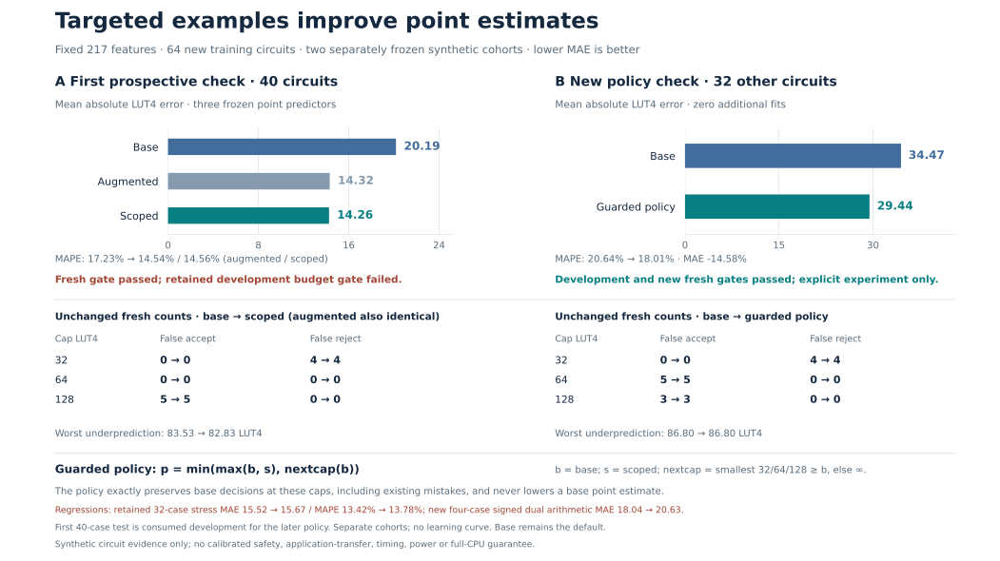

# Coverage improvement with unchanged budget decisions

**The candidate passes the predeclared development and fresh-test criteria.** On 32 new synthetic circuits, MAE improves **14.58%**, with every baseline decision at 32/64/128 LUT4 preserved. This is an explicitly selectable experimental predictor; the original default and historical evidence remain unchanged.



| Fresh 32-circuit result | Base | Budget-preserving coverage |
| --- | ---: | ---: |
| MAE, LUT4 ↓ | 34.4686 | **29.4424** |
| Positive-target MAPE ↓ | 20.64% | **18.01%** |
| Worst underprediction, LUT4 ↓ | 86.80 | 86.80 |
| False accepts / rejects at 32 LUTs | 0 / 4 | 0 / 4 |
| False accepts / rejects at 64 LUTs | 5 / 0 | 5 / 0 |
| False accepts / rejects at 128 LUTs | 3 / 0 | 3 / 0 |

All 32 targets are positive. Eight equally sized compositions give equal-template and circuit-pooled MAE the same value. The new 32 labels were collected only after inputs, policy, model artifacts and predictions were frozen. These are synthetic compositions, not independent application-family or processor-level results.

## What changed

The [first coverage experiment](../targeted-coverage/README.md) adds 64 verified variable-shift and mixed-arithmetic circuits to the original 1,665 training examples, keeping 217 features and 300 ExtraTrees. It improves a separate fresh 40-case test but fails two retained-panel budget checks. Those failed candidates and all results remain frozen.

This follow-up reuses those weights with **zero additional fits**. Let `b` be the baseline prediction and `s` the predeclared scoped coverage prediction. Let `U(b)` be the smallest cap in `{32,64,128}` that is at least `b`, or infinity if `b>128`:

```text
prediction = min(max(b, s), U(b))
```

The correction can only raise the baseline estimate within its existing budget interval. Therefore:

- `prediction <= cap` exactly when `b <= cap`, for each of the three declared caps. False-accept and false-reject counts are unchanged for any measured targets.
- `prediction >= b`, so underprediction cannot worsen for any circuit.
- MAE and MAPE can still worsen if the correction overshoots the actual area. Their improvement must be measured.

This **preserves budget mistakes; it does not correct them**. The guarantee concerns the three exact caps only, not arbitrary budgets, calibrated feasibility, carry resources, physical area, timing, power or an integrated CPU. The policy also discards potentially useful downward corrections.

## Validation and remaining regressions

The independently screened new 32 inputs contain eight compositions absent from the earlier input inventory, with 20 targeted cases and 12 controls. Known formula identities and constant-erased AST structure were checked; finite normalizers cannot establish complete semantic novelty.

All 32 original RTL implementations passed **68,736 sampled/boundary comparisons** and actual Yosys iCE40 synthesis. The independent audit recounted 32 mapped netlists, verified 960 archived members, reproduced 128 saved comparator predictions exactly, and replayed 631 retrospective policy predictions.

Both predeclared gates pass. This does not mean every subgroup improves:

- The retained 32-case arithmetic-stress panel regresses: MAE **15.5211 →15.6698**, MAPE **13.4176% →13.7829%**.
- The new four-case `signed_dual_arithmetic` subgroup regresses: MAE **18.0358 →20.6313 LUT4**.

All budget decisions remain unchanged even in these groups. The complete [fresh metrics](fresh-metrics.json), [development metrics](development-metrics.json) and [independent audit](audit.json) retain the regressions. No subset or threshold was adjusted after new labels.

## Run actual cached inference

From the repository's pinned environment, use a fresh output path:

```sh
.venv/bin/python scripts/budget_preserving_coverage.py predict \
  --candidates results/budget-preserving-validation/candidates.json \
  --features results/budget-preserving-validation/features.json \
  --prediction-output generated/budget-preserving-predictions.json
```

This loads the frozen base and augmented forests and returns predictions, routes, cap decisions and policy limits. It needs no training or installed synthesis tools when using cached features. The saved CLI smoke check matches the frozen 32 predictions.

Reproduce the independent checks without new fits or native jobs:

```sh
.venv/bin/python scripts/replay_coverage_audits.py
```

The whole coverage round measured 136 circuits with **292,128 RTL comparisons**, used **one fit taking 4.59 seconds**, and spent **161.45 seconds** on native extraction, verification and synthesis, with at most two workers. The second 32-case stage used 40.53 seconds of its 120-second cap. The original 20-minute native limit was not approached.

[Policy protocol](protocol.json) · [Fresh prediction freeze](fresh-point-freeze.json) · [New cohort and raw archive](../budget-preserving-validation/plan.json) · [Independent audit](audit.json).

Validation: all 430 repository tests and 40 subtests passed. Read-only audit replay matches both frozen receipts without modifying their timestamps or hashes.
