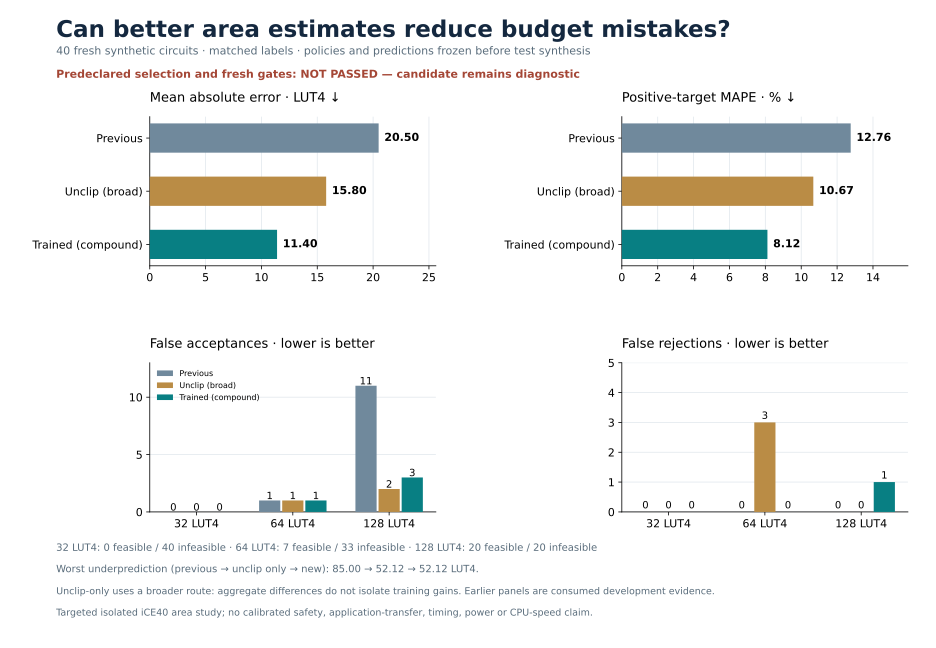

# Bounded budget-release experiment

**The development-selected policy reduces false acceptances and repairs the signed compound subgroup, but fails fresh validation because it introduces one false rejection. It is retained as a negative result and is not promoted.** No policy, gate, threshold or cohort changed after labels.



## Fresh validation

The jointly frozen fresh cohort contains 16 compound signed shifts, 16 signed addition/Boolean circuits and eight controls. These are targeted synthetic isolated circuits, with no claim of representative application or CPU performance.

| Metric, same 40 circuits | Base | Signed incumbent | Selected compound release |
| --- | ---: | ---: | ---: |
| MAE, LUT4 | 40.9715 | 20.4959 | 11.3996 |
| Positive-target MAPE | 26.2600% | 12.7582% | 8.1164% |
| Maximum underprediction, LUT4 | 90.3633 | 85.0000 | 52.1183 |

| Cap | Actual feasible / infeasible | Incumbent FA / FR | Selected FA / FR | Corrected FA / new FR |
| --- | ---: | ---: | ---: | ---: |
| 32 | 0 / 40 | 0 / 0 | 0 / 0 | 0 / 0 |
| 64 | 7 / 33 | 1 / 0 | 1 / 0 | 0 / 0 |
| 128 | 20 / 20 | 11 / 0 | 3 / 1 | 8 / 1 |

The eight corrected acceptances are circuit–budget events at cap128. No new false acceptances or corrected false rejections occur. The single new rejection has actual **125 LUT4**: the incumbent predicts **126.5067**, and the selected policy predicts **129.3167**, crossing the inclusive 128-LUT4 threshold. It belongs to `heldout_compound_signed_xordata_addxor`, mask1. The preregistered gate requires no additional false rejections at any cap, so the accuracy improvements cannot offset this failure.

The fresh 16-case compound subgroup improves MAE **31.2829 → 8.5421** and MAPE **16.7188% → 5.1143%**. Its exact four-case `heldout_compound_signed_add_xor` subgroup improves MAE **31.7383 → 3.3875** and MAPE **16.1773% → 1.9994%**. These gains coexist with the failed full-cohort gate.

## Frozen policy and development selection

One fixed 300-tree, 217-feature forest is fitted on **1,825 training rows**, adding 32 new measured rows to the previous 1,793. It uses the existing settings and seed. Consumed evaluation rows are never fitted.

Two policies, their order and all gates were frozen before new labels. The primary releases the cap clip on the previous compound-or-addBoolean original-AST route. The fallback releases only the compound route: an input-controlled `sra` whose data subtree contains both `addi` and `xori`. On that route, `p=max(signed_incumbent,new_raw)`; elsewhere it preserves the signed incumbent exactly. Predictions can only rise. This prevents new false acceptances mechanically, while false rejections require separate empirical checks.

The primary fails development gates, including new false rejections. The compound-only fallback passes every accuracy, separate cap-FA/cap-FR and maximum-underprediction gate across all **eight consumed panels, 743 circuits**, preserving prior named repairs. It was selected and all 40 fresh predictions were frozen before fresh labels. The fresh gate then rejects it. The broader primary also fails fresh gates and cannot replace it.

| Consumed four-case compound regression | MAE | Positive-target MAPE |
| --- | ---: | ---: |
| Previous guarded 1,761-row policy | 26.0050 | 15.6803% |
| Signed 1,793-row incumbent | 26.4408 | 15.7757% |
| Cached 1,793-row uncapping diagnostic | 16.5033 | 10.5177% |
| New compound release | 13.3417 | 8.8227% |

This repairs the previously reported subgroup regression against the actual earlier comparator. On the consumed fourth-fresh40 panel, FA128 falls **9 → 5**, with no new false rejections; the fresh failure is additional evidence.

A zero-fit uncapping ablation was frozen as a diagnostic and was never eligible for selection. On the fresh compound16, it has MAE **19.3604**, MAPE **10.5627%**, and FA128/FR128 **0/0**; the new forest improves accuracy further but adds the one rejection. The overall ablation uses the broader primary route, whereas the selected fallback uses only compound; their full-cohort difference cannot be attributed solely to additional training. No new alternative is selected after seeing this result. A future, separately preregistered experiment could study boundary-aware decision calibration or adjudication; it is not implemented or evaluated on this fresh cohort.

## Compute and evidence

Both cohorts and the protocol were frozen before measurements. Finite identity, normalization, composition and feature-collision checks found no known overlap against **9,238 historical formulas/aliases**; these checks do not prove exhaustive semantic novelty. Independent preflight, pretrain and prelabel receipts verify the sequence. All 72 original RTL circuits passed **154,656 sampled/boundary comparisons** and Yosys iCE40 measurement; every planned row remains, with no failures, retries or replacements.

One fit took **3.78 seconds**. All native extraction, verification and synthesis consumed **86.62 seconds**, with at most two workers, below the 300-second limit. The model is a composite of five saved forests and explicit AST rules, with uncalibrated point estimates. Timing, power, full-CPU behavior and application transfer remain outside scope. The independent final audit passes, verifying all 4,698 predictions, 72 mapped-netlist recounts, both raw archives and the failed eligibility decision. Existing frozen scientific artifacts are preserved.

[Protocol](protocol.json) · [Development results](development-metrics.json) · [Fresh results](fresh-metrics.json) · [Independent audit](audit.json) · [Training evidence](../budget-release-data/plan.json) · [Fresh evidence](../budget-release-validation/plan.json).

Validation: **451 tests and 40 subtests passed**. The comparison figure was visually checked.

Cached diagnostic inference (use a new output path), followed by read-only replay without new fitting or native measurements:

```sh
.venv/bin/python scripts/release_budget_coverage.py predict-cached \
  --candidates results/budget-release-validation/candidates.json \
  --features results/budget-release-validation/features.json \
  --prediction-output generated/budget-release-predictions.json
.venv/bin/python scripts/release_budget_coverage.py replay
.venv/bin/python scripts/audit_budget_release.py
```
