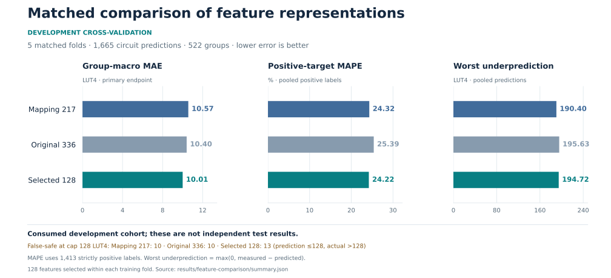

# Which features improve area prediction?

**Selecting 128 features improves development MAE, but does not yet justify replacing the base model.** The fixed 217-input view is not a capacity limit. Simply adding every available descriptor is less effective here than selecting a subset within the training data.



## Matched results

All three views use the same 1,665 measured circuits, five validation folds, 300-tree ExtraTrees settings and seed. The primary endpoint is equal-weight mean absolute error across 522 merged circuit groups. These are consumed development data, not a new independent test.

| Feature view | Group-macro MAE ↓ | Pooled MAE ↓ | Positive MAPE ↓ | Worst underprediction ↓ | False-safe decisions at 128 LUTs ↓ |
| --- | ---: | ---: | ---: | ---: | ---: |
| Fixed 217 | 10.5678 | 5.0520 | 24.32% | **190.40** | **10** |
| All 336 | 10.4034 | 4.9440 | 25.39% | 195.63 | **10** |
| Training-selected 128 | **10.0054** | **4.8215** | **24.22%** | 194.72 | 13 |

MAE and underprediction are in LUT4 units. MAPE uses 1,413 positive targets; all 252 zero targets remain in MAE. Zero-target MAE is 0.2148 / 0.2234 / 0.2185 respectively. A false-safe decision predicts a circuit fits the stated budget when its measured area exceeds it. These are point decisions, not calibrated safety guarantees.

The selected view reduces primary MAE **5.32%**, pooled MAE **4.56%**, and wins primary MAE in four of five folds. All 336 features reduce primary MAE **1.56%**, while worsening MAPE. Selection also increases cap32 false rejections from 90 to 98 and cap64 false rejections from 39 to 40. Every endpoint, fold and workload stratum is retained in [summary.json](summary.json).

## Method

- **217:** the deployed representation: 14 simple-operator-graph, 180 original/normalized/difference graph and 23 mapping descriptors.
- **336:** the same 217 followed by 119 original-formula semantic descriptors. This is the extractor's existing full set in a fixed reordered schema, not 119 newly synthesized features or rewritten-area targets.
- **Selected 128:** rank the training fold's full-336 forest impurity importances, take the first 128 with deterministic tie breaking, restore schema order, and fit the same estimator. Validation labels never enter selection. The 128 count was fixed before scoring.

All fits retain the original generic-graph zero override. Grouping joins prior circuit components, accepted semantic-normalization identities and identical 217-feature vectors. The same conservative groups are used for all models. Every fold contains 333 validation rows; no audited group or exact feature vector crosses a fold boundary. This is stricter than the historical split, so old cross-validation scores are not directly comparable. Sufficient identities cannot prove that every possible semantic duplicate was detected.

The [protocol](protocol.json), inputs, folds and runner were hash-frozen before scoring. Execution completed **15 fits in 43.27 seconds**, with one worker and one native thread, under a 600-second cap. There was no new synthesis, parameter search or final model fit. [Timings](timings.json) · [Predictions](predictions.json) · [Fold selections](selected-columns.json) · [Independent audit](audit.json).

## What we learned and the next decision

Keep the 217-feature model as the deployed default; advance fold-local selection as a candidate for further validation. Fewer inputs can help, but this result does not establish that 128 is optimal. Only 88 columns are selected in every fold, with 181 distinct columns across folds; there is no single new 128-column model in this experiment.

Graph and mapping descriptors dominate training impurity importance. Each selected fold still retains 27–33 semantic descriptors. Correlated features can share or suppress importance, so these rankings do not establish causal usefulness or justify removing whole blocks. [Importance diagnostics](importance-summary.json).

The next bounded experiment should test selection stability across a small fixed seed set, then freeze one candidate before acquiring independent application circuits. It should keep the same primary MAE definition and report budget mistakes and underprediction explicitly. The current tail regressions motivate testing a separately calibrated upper-bound decision policy; it must use calibration data separate from training and final evaluation. Neither that calibration nor an independent test has been run here. Repeated tuning on these folds cannot establish fresh generalization.

## Reproduce

```sh
python scripts/replay_feature_comparison.py
```

This standard-library command verifies hashes and replays metrics and selection records with zero fits. To repeat training in a fresh directory, see [reproduction instructions](../../docs/reproduce.md#feature-comparison). Exact input arrays, feature names, row identities and grouping records are included; original acquisition provenance is pinned to the archived research commit. Existing model artifacts are unchanged.

Validation: independent replay checked 2,227 numeric fields (maximum floating-point difference 2.84×10⁻¹⁴); all 409 repository tests and 40 subtests passed. No estimator was refitted during the independent metric audit.
