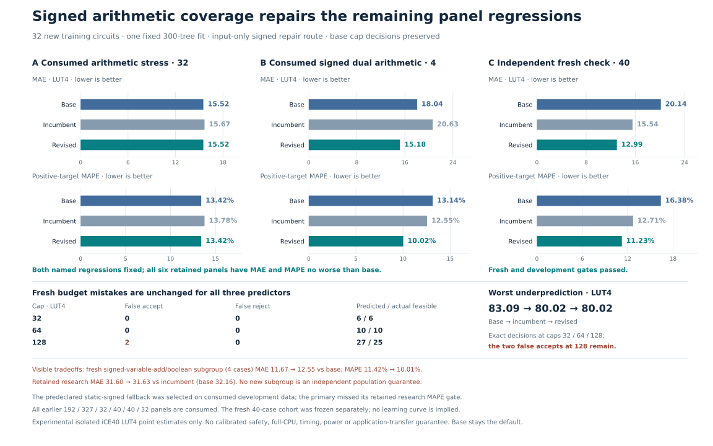

# Signed-arithmetic regression repair

**The revised predictor fixes both named development regressions and improves accuracy on a separately frozen 40-circuit test.** All baseline accept/reject decisions at 32, 64 and 128 LUT4 remain unchanged, including existing mistakes.



## Fresh results

| Metric | Original base | Previous guarded model | Revised guarded model |
| --- | ---: | ---: | ---: |
| MAE, LUT4 ↓ | 20.1394 | 15.5437 | **12.9945** |
| Positive-target MAPE ↓ | 16.38% | 12.71% | **11.23%** |
| Worst underprediction, LUT4 ↓ | 83.09 | 80.02 | 80.02 |
| False accepts / rejects, cap32 | 0 / 0 | 0 / 0 | 0 / 0 |
| False accepts / rejects, cap64 | 0 / 0 | 0 / 0 | 0 / 0 |
| False accepts / rejects, cap128 | 2 / 0 | 2 / 0 | 2 / 0 |

The revision lowers MAE **16.40% versus the incumbent**, or **35.48% versus the original base**. All 40 targets are positive. Ten equally sized compositions give pooled and equal-template MAE the same value. This is fresh synthetic evidence, not representative application or full-processor validation.

## What was repaired

The previous upward-only correction sometimes raised estimates that already exceeded measured area. The repair adds **32 new measured signed-arithmetic circuits** to the previous 1,729 fitting rows, retaining the same 217 features, 300 trees and fixed seed.

Within the existing active route, the new 1,761-row forest is used only when the original formula contains a signed shift (`sra` or `srai`), subtraction and XOR. The previous forest handles other cases. A predeclared fallback uses the original base on mixed-arithmetic formulas with a constant arithmetic-right shift and no variable shift. This prevents unjustified upward correction in that structural class.

The fallback was selected by a fixed development-only hierarchy **before fresh labels**. The primary candidate narrowly failed the older research panel's MAPE criterion. Both candidates and their scores remain recorded; there was no choice based on the fresh test.

The final point still uses the frozen rule `min(max(base, scoped), nextcap(base))`. It stays in the baseline's budget interval and never falls below the baseline, so decisions at the three specified caps and pointwise underprediction cannot worsen. This does not fix budget classification mistakes, cover arbitrary caps, or provide calibrated feasibility.

| Consumed development set | Base MAE | Previous MAE | Revised MAE |
| --- | ---: | ---: | ---: |
| Arithmetic stress, 32 cases | 15.5211 | 15.6698 | **15.5211** |
| Signed dual arithmetic, 4 cases | 18.0358 | 20.6313 | **15.1817** |

Both named groups also improve MAPE versus the incumbent. All six retained development panels satisfy the declared MAE/MAPE criteria against the original base. These are consumed data, not independent confirmation.

## Remaining tradeoffs

- On the older research panel, revised MAE is **31.6287 versus incumbent 31.6017**: a small regression, while still below base 32.1609.
- On the fresh four-case `heldout_signed_variable_add_boolean` subgroup, revised MAE **12.5521** equals the incumbent but exceeds base **11.6733**. That subgroup's MAPE improves versus base.

Complete panel, template and policy comparisons remain in the [independent audit](audit.json), [development metrics](development-metrics.json) and [fresh metrics](fresh-metrics.json). Aggregate success does not imply every circuit improves.

## Freeze, evidence and compute

Both cohorts—32 training and 40 validation circuits—were fixed before new labels. The joint screen checked 8,994 prior formulas/aliases and constant-erased composition structures; no known overlap or exact 217-feature collision was found. These finite checks cannot establish exhaustive semantic novelty.

All 72 circuits passed actual Yosys iCE40 measurement and **154,656 sampled/boundary RTL comparisons**. The independent audit recounted mapped netlists, replayed all model predictions and verified frozen chronology. Raw ZIPs and hash manifests are retained in [training evidence](../guarded-revision-data/plan.json) and [validation evidence](../guarded-revision-validation/plan.json).

One fit took **4.76 seconds**. Native extraction, verification and synthesis took **88.89 seconds**, with at most two workers, below the 300-second budget. No failed case, retry or post-label replacement was removed.

## Run and replay

Use the pinned environment and a fresh output path:

```sh
.venv/bin/python scripts/revise_guarded_coverage.py predict-cached \
  --candidates results/guarded-revision-validation/candidates.json \
  --features results/guarded-revision-validation/features.json \
  --prediction-output generated/signed-repair-predictions.json

.venv/bin/python scripts/audit_guarded_revision.py
```

The inference command loads frozen forests and returns the selected prediction, comparator points, routes and invariant checks. The audit is read-only by default. Neither command fits models or launches native measurement. This is an explicit experimental option; original model files and the default CLI remain preserved.

Validation: all 437 repository tests and 40 subtests pass. Cached inference reproduces the frozen 40 points; the new read-only audit and previous coverage audits pass without altering frozen receipts.
