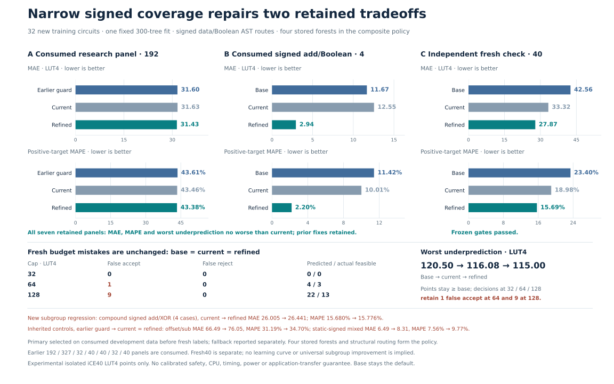

# Signed-shift coverage refinement

**Both targeted development tradeoffs are repaired, and the selected refinement improves the separately frozen fresh test.** Decisions at 32, 64 and 128 LUT4 remain identical to the baseline, including existing mistakes.



## Fresh results

| Metric, 40 new synthetic circuits | Base | Previous model | Refined model |
| --- | ---: | ---: | ---: |
| MAE, LUT4 ↓ | 42.5628 | 33.3181 | **27.8697** |
| Positive-target MAPE ↓ | 23.40% | 18.98% | **15.69%** |
| Worst underprediction, LUT4 ↓ | 120.50 | 116.08 | **115.00** |
| False accepts / rejects, cap32 | 0 / 0 | 0 / 0 | 0 / 0 |
| False accepts / rejects, cap64 | 1 / 0 | 1 / 0 | 1 / 0 |
| False accepts / rejects, cap128 | 9 / 0 | 9 / 0 | 9 / 0 |

MAE improves **16.35% versus the previous model** on these same circuits. All 40 targets are positive, and ten equally sized compositions make pooled and equal-template MAE identical. These results do not form a learning curve with earlier cohorts, and do not establish representative application or full-CPU performance.

## Targeted repair

The previous model underestimated two complex signed shifts, while another structural class overshot some signed-add/Boolean targets. We added **32 measured training circuits**, producing a **1,793-row forest** with the unchanged 217 features, 300 trees and fixed seed.

The new forest handles only original formulas matching either of these predeclared structures:

- An `sra` with an input-bearing shift operand and both `addi` and `xori` in its data operand subtree.
- An input-controlled `sra`, plus addition, XOR and AND/OR, with no subtraction or multiplication anywhere in the original formula.

Other cases retain the previous predictor exactly. Only six rows across the seven consumed panels fall within this refinement scope. The same final cap guard remains: `min(max(base, scoped), nextcap(base))`. It preserves baseline cap decisions and cannot worsen underprediction relative to base. Maximum underprediction versus the **previous model** is also checked empirically on every retained panel and the fresh cohort.

Two policies and a deterministic development-only selection order were frozen before new labels. The primary policy passed and was selected before fresh labels. The fallback remains reported; no decision was changed after examining the fresh test. This is a composite of four saved forests and explicit AST rules, not a single end-to-end learned router.

| Consumed target | Previous MAE | Refined MAE |
| --- | ---: | ---: |
| Research panel, 192 circuits | 31.6287 | **31.4271** |
| Signed-add/Boolean subgroup, 4 circuits | 12.5521 | **2.9383** |

The research score also beats the earlier guard's 31.6017. The four-case MAPE falls 10.0055% → 2.1953%. All seven retained panels pass the stricter incremental MAE, MAPE and tail criteria; previous arithmetic-stress and signed-dual repairs are preserved. These are consumed development results, not additional independent tests.

## Remaining tradeoffs

The fresh four-case `heldout_compound_signed_add_xor` subgroup worsens slightly versus the previous model: MAE **26.0050 → 26.4408**, MAPE **15.6803% → 15.7757%**. Both remain better than base.

Two unchanged controls favor an **earlier** 1,729-row policy, not the immediately previous model:

| Fresh control, 4 cases each | Earlier-policy MAE | Previous = refined MAE |
| --- | ---: | ---: |
| Signed variable offset/subtraction | 66.4871 | 76.0450 |
| Static signed mixture | 6.4908 | 8.3083 |

Their MAPE also favors that earlier policy: 31.19% versus 34.70%, and 7.56% versus 9.77%. These are inherited tradeoffs; the refinement leaves those predictions unchanged. All comparisons and template metrics remain in the [independent audit](audit.json). The cap guard preserves mistakes rather than correcting them; arbitrary budgets, calibration, carry usage, timing and power remain outside this guarantee.

## Evidence and bounded compute

The 32 training and 40 test inputs were jointly frozen before new measurements. Finite canonical/normalization, composition and feature-collision screens checked the retained inventory of 9,126 formulas/aliases. They found no known overlap, but do not prove exhaustive semantic novelty.

All 72 original RTL circuits passed **154,656 sampled/boundary comparisons** and actual Yosys iCE40 measurement. The audit replayed model predictions, recounted mapped netlists and verified chronology and the two raw ZIP manifests. [Training evidence](../signed-refinement-data/plan.json) · [Fresh evidence](../signed-refinement-validation/plan.json).

One fit took **5.36 seconds**. Native extraction, verification and synthesis took **84.49 seconds**, with at most two workers, below the 300-second limit. No failures, retries or post-label replacements were removed. Existing scientific artifacts remain unchanged.

Validation: **444 tests and 40 subtests passed**. Both the new and previous independent audits pass in read-only replay.

## Run and replay

Use the pinned environment and a fresh output path:

```sh
.venv/bin/python scripts/refine_signed_coverage.py predict-cached \
  --candidates results/signed-refinement-validation/candidates.json \
  --features results/signed-refinement-validation/features.json \
  --prediction-output generated/signed-refinement-predictions.json

.venv/bin/python scripts/refine_signed_coverage.py replay
.venv/bin/python scripts/audit_signed_refinement.py
```

These commands run cached inference and read-only replay without fitting or native measurement. The candidate is an explicit experimental option; the original default remains unchanged. [Protocol](protocol.json) · [Development metrics](development-metrics.json) · [Fresh metrics](fresh-metrics.json) · [Audit](audit.json).
